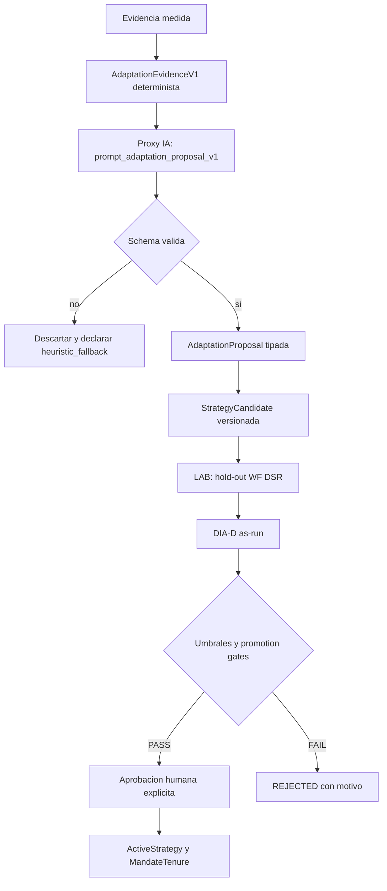
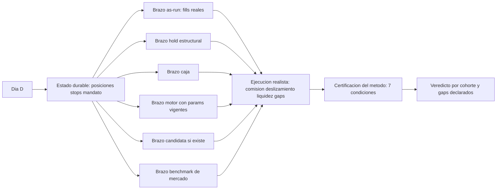

# ADR-049 — Adaptación gobernada por IA y DÍA-D retrospectivo as-run

**Estado:** **Accepted — propuesta de producto, implementación en curso.** Introduce dos piezas
nuevas y ninguna de ellas autoriza operaciones por sí misma: (1) un **bucle de adaptación
gobernado** en el que la IA solo propone mutaciones tipadas sobre la estrategia vigente y los
gates deterministas deciden; (2) un **método DÍA-D retrospectivo as-run** que rejuega la
operativa que realmente llevábamos desde un día D pasado, con brazos contrafactuales y sin
look-ahead. **`Δ motor = 0`** · **`Δ decisión = 0`** sin aprobación humana · **sin migración** ·
**sin flags encendidos por defecto**.
**Fecha:** 2026-11-13
**Contexto:** [operativa secuencial extremo a extremo](../engineering/operativa-secuencial-extremo-a-extremo-2026-11-13.md) §3–§6 ·
[evidencia DÍA-D de la política](../engineering/dia-d-evidencia-politica-2026-11-05.md) ·
[línea base y evidencia monetaria](../engineering/linea-base-y-evidencia-2026-11-08.md).
**Depende de:** [ADR-020](./020-operating-mandate-tenure.md) (mandato y tenures) ·
[ADR-031](./031-operational-model-tesis-plan-permiso.md) (tesis ≠ plan ≠ permiso) ·
[ADR-032](./032-operational-core-tradeplan-positionstate-execution.md) (`TradePlan` y `PositionState`) ·
[ADR-046](./046-protocolo-longitudinal-paper.md) (protocolo longitudinal paper).
**Afecta a:** [`auto_orchestrator`](../../packages/py/application/src/bolsa_application/auto_orchestrator.py),
[`strategy_lifecycle`](../../packages/py/domain/src/bolsa_domain/entities/strategy_lifecycle.py),
[`bolsa_ai`](../../packages/py/ai/README.md),
[`auto_ops_job`](../../packages/py/domain/src/bolsa_domain/entities/auto_ops_job.py),
[`dia_d_artifacts`](../../packages/py/application/src/bolsa_application/dia_d_artifacts.py).

---

## 1. El problema, medido (no supuesto)

### 1.1 La línea base es negativa

La evidencia ya medida, no una opinión, dice:

| Medición | Valor | Fuente |
| --- | --- | --- |
| Brazo AUTO V2 DÍA-D 2021–2026 | **−169,7 % neto** | [línea base 2026-11-08](../engineering/linea-base-y-evidencia-2026-11-08.md) |
| Expectativa por ciclo | **−0,2037 R** | [evidencia DÍA-D 2026-11-05](../engineering/dia-d-evidencia-politica-2026-11-05.md) |
| Hit rate | **41,7 %** | ídem |
| Brazos que pasan `BASELINE_THRESHOLDS` | **ninguno** | [línea base 2026-11-08](../engineering/linea-base-y-evidencia-2026-11-08.md) |
| Decisión de producto vigente | `AUTO_STAYS_OFF` | ídem |

El cuello de botella declarado es **la señal, no el coste**. Cualquier propuesta que prometa
«máxima rentabilidad» o «100 % ganadora» contradice esta medición y queda fuera de este ADR.

### 1.2 La pregunta que la evidencia no respondía

Los métodos DÍA-D existentes (`v2_89`–`v2_97`) rejuegan **el motor** desde D: responden «qué
habría decidido la estrategia». No responden la pregunta de producto:

> «Si en D hubiéramos seguido exactamente **la operativa que llevábamos** —posiciones, stops,
> mandato vigente—, ¿qué habría pasado hasta hoy, y qué aportó o costó cada decisión?»

Esa es una pregunta **as-run**, de atribución y no de búsqueda. No existía como método propio.

---

## 2. Decisión 1 — Bucle de Adaptación Gobernado (APL)

### 2.1 Formulación del objetivo

El objetivo **no** es «ganar siempre». Es:

> Maximizar el R esperado **neto de costes** sujeto a DD ≤ 15 %, ventanas positivas ≥ 60 %,
> exceso vs compra y mantener ≥ 0 y coste round-trip declarado ≥ 22 bps, con umbrales
> fijados **antes** de medir y sin que la IA pueda autorizar nada.

`BASELINE_THRESHOLDS` no se toca. Si el bucle no mejora, declara `no_improvement`. Esa salida es
un resultado legítimo, no un fallo.

### 2.2 La IA propone; los gates deciden

**Invariantes, sin excepción:**

1. La IA **solo** emite `AdaptationProposal`. No escribe `ActiveStrategy`, `MandateTenure`,
   umbrales, pesos, `TradePlan` ni código.
2. Cada mutación pertenece a un **enum cerrado** y declara la evidencia que la sostiene.
3. El payload se valida contra esquema; una clave fuera del contrato invalida **todo** el payload.
4. Sin proveedor LLM disponible, el sistema produce el **mismo veredicto** con heurística y lo
   declara (`engine: "heuristic"`).
5. La promoción exige **dos veredictos independientes** —LAB en verde y DÍA-D as-run en verde
   **con el método certificado**— y, además, **aprobación humana explícita**. Incluso con todo en
   PASS no hay activación automática: la razón es la línea base negativa de §1.1, no hay evidencia
   suficiente para automatizar la adopción de una señal que aún no ha demostrado edge.

### 2.3 Enum cerrado de mutaciones

| Mutación | Qué cambia | Cota |
| --- | --- | --- |
| `tighten_stop_atr` / `loosen_stop_atr` | multiplicador ATR del stop | cota declarada en la propuesta |
| `raise_payoff_target` / `lower_payoff_target` | target en múltiplos de R | cota declarada |
| `add_regime_filter` / `remove_regime_filter` | filtro por régimen | solo regímenes del clasificador vigente |
| `disable_family` / `enable_family` | familia del catálogo | solo familias existentes |
| `adjust_entry_confirmation` | confirmación de entrada | valores del enum de preset |
| `adjust_position_sizing_cap` | tope de tamaño | nunca por encima del techo del perfil |

### 2.4 Guardas anti-sobreajuste

| Guarda | Regla |
| --- | --- |
| Pre-registro | umbrales y cohortes hasheados antes de medir (`preregistrationHash`) |
| Pruebas múltiples | corrección obligatoria (`AUTO_ORCHESTRATOR_LAB_CORRECT_MULTIPLE_TESTING`) |
| Muestra mínima | por familia y global (`DEFAULT_MIN_SAMPLES`, `DEFAULT_MIN_TOTAL_SAMPLES`) |
| Coste | round-trip explícito; sin coste no hay veredicto |
| Look-ahead | prohibido en toda medición; test adversarial obligatorio |
| Gates | `NOT_EVALUATED` nunca cuenta como PASS |
| Reproducibilidad | mismo input ⇒ mismo hash de artefacto |

---

## 3. Decisión 2 — DÍA-D retrospectivo as-run

### 3.1 Definición

El método parte del **estado durable real** en D y evalúa hacia hoy. No reconstruye el motor:
lo toma tal como estaba y lo deja correr con las reglas vigentes.

### 3.2 Brazos mínimos

| Brazo | Qué mide | Estado inicial |
| --- | --- | --- |
| `as_run` | lo que la operativa realmente hizo | posiciones y órdenes reales en D |
| `hold_structural` | mantener hasta stop o target | mismas posiciones |
| `cash` | no hacer nada | caja |
| `engine_params` | el motor con los parámetros vigentes | mismos valores que `as_run` |
| `candidate` | la candidata en evaluación, si existe | misma caja |
| `market_bh` | comprar y mantener equiponderado el estado inicial | mismas posiciones |

`market_bh` es el **benchmark de mercado**: se publica en retorno porcentual, no en R (no tiene
stop, así que no tiene denominador de riesgo). No compite en la comparación de R y nunca se
convierte en `0 R`.

El brazo `candidate` es lo que conecta los dos puntos de este ADR: un candidato del bucle de
adaptación se valida con el mismo aparato as-run. Una candidata sin fecha point-in-time
(`candidate_as_of <= D`) **no se mide**: se declara `candidate_not_point_in_time`.

### 3.3 Reglas del método, y las ocho condiciones de validez

0. **Integridad del artefacto.** El `hash` declarado se recalcula sobre el artefacto completo:
   cualquier edición de brazos, decisiones, versiones o certificación lo invalida. Lo que un
   productor coherente podría reescribir (artefacto + hashes) solo lo distingue una firma o un
   sello externo al propio artefacto.
1. **Congelación temporal (point-in-time).** El artefacto declara el día D, la fuente del estado y
   la huella de las patas. No hay reconstrucción a ojo.
2. **Estado inicial real.** Patas del ledger durable con instrumento, dirección, cantidad, entrada,
   stop y targets; coherencia verificable por hash. El universo de D va **declarado**: si se deriva
   de las patas y las barras cargadas, la condición es `NOT_EVALUATED`.
3. **Reproducción secuencial.** Cada brazo medido conserva sus decisiones (`date`, `instrument`,
   `action`, `price`, `reason`), ordenadas y nunca anteriores a D.
4. **Datos de mercado reales posteriores.** Fuente y `barsHash` declarados, con un manifest de una
   huella sha256 por vela que la certificación recomputa: el futuro solo se usa para valorar, nunca
   para decidir, y cambiar una vela rompe la certificación.
5. **Ejecución realista.** Comisión, deslizamiento, spread, cota de participación sobre el volumen
   y política de gaps declarados. Un gap adverso se ejecuta al `open` real, no al stop teórico.
   Sin liquidez suficiente el cierre se difiere o se declara `liquidity_insufficient`; jamás se
   asume liquidez infinita ni se rellena el hueco. La base de coste de los fills reales
   (`quoted`/`effective`) se declara: el mismo ciclo paga el mismo coste medido como `as_run` o
   como contrafactual.
6. **Benchmarks.** `as_run`, `cash` y `market_bh` medidos, con universo, capital, periodo y coste
   del benchmark declarados: sin comparabilidad no hay comparación.
7. **Auditoría.** Motor, esquema, bump, versiones de estrategia y mandato, `paramsHash`
   recomputable desde los parámetros declarados, huellas y límites declarados, más el `hash`
   estable del artefacto.

`NOT_EVALUATED` **nunca** cuenta como PASS. Un dato ausente es `NOT_EVALUATED`; uno presente e
incoherente es `FAIL`. Los artefactos v1 se siguen leyendo y salen `not_certified` con su motivo:
no se reescriben.

### 3.4 Cohortes y veredicto

Por ventana (días hábiles) o por evento (días con apertura o cierre real). Agregado con media,
mediana, hit rate y bootstrap CI. Veredicto por cohorte: `as_run_beats_arms`,
`arms_beat_as_run`, `insufficient_sample`. Un brazo no medido jamás participa ni se imputa con
cero.

### 3.5 Certificación: valida el método, no la rentabilidad

`dia_d_certification.certify_artifact` emite `certified`, `not_certified` (con la lista de fallos)
o `insufficient_sample` para la cohorte. La certificación **no mira el signo del resultado**: un
DÍA-D certificado puede ser negativo y sigue siendo útil, porque lo que certifica es que la
reconstrucción histórica es válida.

### 3.6 Veredictos independientes y regla innegociable

LAB (experimento) y DÍA-D as-run (reproducción histórica) emiten **veredictos separados, cada uno
con su hash**. Se comparan; no se mezclan. El veredicto global solo pasa a
`requires_human_approval` si LAB está en verde **y** as-run está en verde **y** el método as-run
está `certified`. La activación as-run exige además el gate `as_run_certification`: sin
certificación, el lado as-run queda rechazado aunque la candidata supere a `as_run`.

---

## 4. Consecuencias

### 4.1 Positivas

- La pregunta de producto del §1.2 pasa a tener respuesta reproducible.
- El bucle de adaptación gana un juez externo que no depende del propio LAB que propuso la
  mutación: el as-run mide la operativa real, no el backtest del candidato.
- La IA entra en el proceso con un rol acotado y auditable, sin tocar la autoridad de decisión.
- La ejecución realista (gaps, deslizamiento, liquidez) evita que el replay regale un R que el
  mercado no habría dado.
- La certificación separa «el número es bueno» de «el método es válido».

### 4.2 Costes y límites declarados

- Es un método **descriptivo**, no causal. La atribución explica la muestra, no el futuro.
- La muestra histórica sigue siendo la que es: 192 ciclos en 2021–2026. Con `insufficient_sample`
  el veredicto lo dice; no se rellena.
- El modelo de ejecución es una **aproximación declarada**: el deslizamiento y la cota de
  participación son parámetros, no mediciones de libro de órdenes. Están en el artefacto para que
  se puedan discutir.
- El estado inicial depende del ledger durable: si una pata no está, no se inventa.
- El bucle de adaptación **no** demuestra edge por sí solo: solo propone y mide.
- `AUTO` sigue OFF. Este ADR no enciende workers.

### 4.3 Regla innegociable

**Ni una propuesta favorable de la IA ni un DÍA-D positivo autorizan `AUTO` ni dinero real.** La
activación exige los dos veredictos en verde, la certificación del método as-run y una aprobación
humana explícita. `activationAllowed` es `false` en todas las rutas; el sistema, como mucho,
devuelve `requires_human_approval`.

### 4.4 Lo que este ADR **no** hace

- No promete rentabilidad ni «100 % ganadora».
- No permite que la IA escriba estrategia activa, mandato, umbrales, pesos ni código.
- No cambia defaults de `BASELINE_THRESHOLDS` ni de los flags `AUTO_*`.
- No reescribe artefactos históricos: conservan su hueco declarado y salen `not_certified`.

---

## 5. Referencias

- [ADR-020](./020-operating-mandate-tenure.md) · [ADR-031](./031-operational-model-tesis-plan-permiso.md) ·
  [ADR-032](./032-operational-core-tradeplan-positionstate-execution.md) ·
  [ADR-046](./046-protocolo-longitudinal-paper.md)
- [Operativa secuencial extremo a extremo](../engineering/operativa-secuencial-extremo-a-extremo-2026-11-13.md)
- [DÍA-D as-run](../engineering/dia-d-as-run-2026-11-13.md)
- [`packages/py/ai/README.md`](../../packages/py/ai/README.md) — gobierno de la IA (RFC-007)
