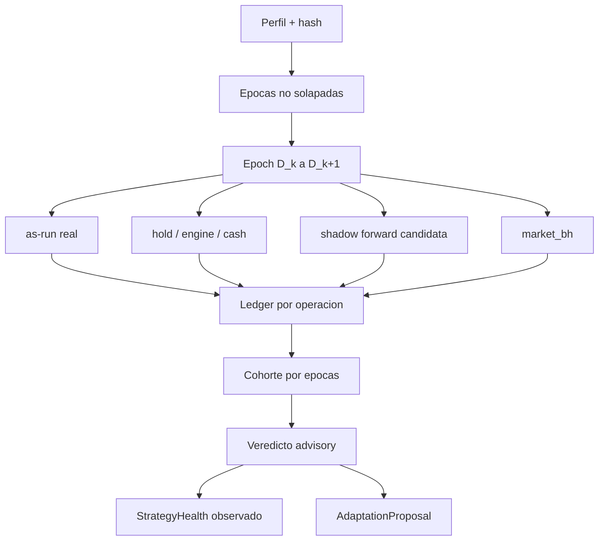

# ADR-050 — Verificación periódica de estrategia y ledger contrafactual

**Estado:** **Accepted — implementado.** Añade un sistema de verificación **advisory** que
responde «¿seguimos con la estrategia correcta?» con **épocas no solapadas**, un **ledger por
operación** que separa resultado de calidad de decisión y un **shadow forward** de la candidata
point-in-time. **`Δ motor = 0`** · **`Δ decisión = 0`** · **`activationAllowed = false`** en todas
las rutas · **sin flags encendidos por defecto**.
**Fecha:** 2026-11-14
**Contexto:** [DÍA-D as-run](../engineering/dia-d-as-run-2026-11-13.md) ·
[cohorte as-run](../engineering/cohorte-dia-d-as-run-2026-11-13.md) ·
[método de verificación](../engineering/verificacion-periodica-estrategia-2026-11-14.md).
**Depende de:** [ADR-049](./049-adaptacion-gobernada-por-ia.md) (adaptación gobernada y as-run) ·
[ADR-020](./020-operating-mandate-tenure.md) (mandato y tenures) ·
[ADR-046](./046-protocolo-longitudinal-paper.md) (protocolo longitudinal).
**Afecta a:** [`dia_d_as_run`](../../packages/py/application/src/bolsa_application/dia_d_as_run.py) ·
[`strategy_verification`](../../packages/py/application/src/bolsa_application/strategy_verification.py) ·
[`strategy_verification_cadence`](../../packages/py/application/src/bolsa_application/strategy_verification_cadence.py) ·
[`strategy_verification_profile`](../../packages/py/application/src/bolsa_application/strategy_verification_profile.py) ·
[`strategy_verification_candidate`](../../packages/py/application/src/bolsa_application/strategy_verification_candidate.py) ·
[`strategy_verification_scheduler`](../../apps/api-python/src/bolsa_api/background/strategy_verification_scheduler.py) ·
[`auto_strategy_verification`](../../apps/api-python/src/bolsa_api/api/v1/routes/auto_strategy_verification.py).

---

## 1. El problema, medido

### 1.1 Dos defectos del método anterior

El DÍA-D as-run (ADR-049) mide bien **una** ventana `D → hoy`. Usarlo como verificación periódica
tenía dos defectos que no se ven en el artefacto individual:

1. **Pseudorreplicación.** Cada corrida se hacía con una combinación ad-hoc de banderas y ninguna
   declaraba independencia. Doce replays diarios con `D = ayer` no son doce muestras: son **una**
   operación mirada doce veces. `certify_cohort` verifica el método de cada artefacto, no la
   independencia **entre** artefactos, así que una cohorte solapada podía «certificar» la misma
   operación doce veces.
2. **Confusión de ejes.** El artefacto publicaba `realizedR` y `outcome`, pero no distinguía
   «el trade salió mal» de «la decisión fue mala». Un ciclo perdedor ejecutado según la regla es
   una **buena** decisión; etiquetarlo como fallo enseña a juzgar por resultado y corrompe
   cualquier bucle de mejora.

Además, el as-run programado encolaba sin `universeInstruments` (⇒ `universeSource=derived` ⇒
certificación `NOT_EVALUATED`) y sin `--verify-bars`, y el brazo `candidate` nunca se medía porque
el CLI no construía sus patas.

### 1.2 Lo que este ADR añade

| Pieza | Qué resuelve |
| --- | --- |
| **Perfil pre-registrado** (`StrategyVerificationProfileV1`) | fija y hashea los parámetros ANTES de medir |
| **Épocas no solapadas** | una ventana `(D_k, D_{k+1}]` = una muestra; el solape se detecta, no se supone |
| **Ventana móvil separada** | historial visual, marcada `overlapping=true`; **nunca** certifica |
| **Ledger por operación** | `outcome` y `decisionQuality` son ejes distintos; `unrealizedR` separado |
| **Candidata point-in-time** | `candidateAsOf <= D`; si no, hueco declarado, nunca medida |
| **Índice durable sellado** | `strategy_verification_runs` con `measurement_hash` reproducible |
| **Scheduler de épocas** | encola las épocas completas; no reescribe runs |

---

## 2. Decisión 1 — El veredicto solo usa épocas no solapadas

- `epochs(profile, today)` devuelve `D_k` y la ventana `(D_k, D_{k+1}]`; la última queda `open` y
  **no** cuenta como muestra.
- `overlaps(a, b)` y `assert_non_overlapping(epochs)`: una cohorte con **cualquier** solape ⇒
  `insufficient_independent_sample`, **jamás** PASS.
- La ventana móvil (`build_rolling_window`) se marca `overlapping=True` y solo alimenta el
  historial visual.

**Implicación temporal declarada.** Con `everyDays=30`, la primera cohorte certificable de 12
muestras llega a ~12 meses. Con `everyDays=7` llega a ~3 meses, pero muchas épocas tendrán 0
ciclos. El perfil declara ambas cosas y el veredicto dice `insufficient_sample` hasta cumplirlas.

---

## 3. Decisión 2 — Resultado y calidad de la decisión son ejes distintos

El ledger por ciclo publica:

| Campo | Dominio | Qué significa |
| --- | --- | --- |
| `outcome` | `win` / `loss` / `breakeven` / `open` / `unmeasured` | qué **pasó** |
| `decisionQuality` | `consistent` / `inconsistent` / `unmeasured` | si la acción fue **coherente** con el plan y las reglas |

Un ciclo perdedor ejecutado según la regla es `loss` + `consistent`. Un acierto por saltarse el
stop es `win` + `inconsistent`. La UI y el veredicto no los colapsan.

**Posiciones abiertas.** No se descartan como `no_exit` ni se suman al realizado: van en
`unrealizedR` y `openPositions`, marcadas a mercado, con su propio `measured`/`reason`. El R
realizado nunca las incluye.

**Contraste honesto por ciclo.** `hold_structural` y `engine_params` comparten ciclo con `as_run`
(misma entrada, salidas alternativas). La candidata **no** es una columna del mismo ciclo: es un
ledger paralelo del shadow forward. `cash` y `market_bh` se comparan a nivel de época.

---

## 4. Decisión 3 — La candidata se mide point-in-time o se declara el hueco

- `CandidateVerificationProvider.snapshot(account_id, day)` devuelve la candidata vigente **con
  `candidateAsOf <= D`**.
- Si `candidateAsOf > D` ⇒ `candidate_not_point_in_time`. Sin `strategyVersion` ⇒
  `candidate_version_unavailable`. Fuera del universo declarado o sin barras ⇒ hueco declarado.
- El forward reutiliza el motor de shadow/paper con el **mismo modelo de coste** del perfil.
- Un hueco declarado **nunca** suma como 0 ni como muestra.

---

## 5. Decisión 4 — Gates, veredictos y prohibición de activación

Gates: `method_certified`, `independent_sample`, `as_run_vs_best_arm`, `candidate_vs_as_run`,
`observed_health`, `version_integrity`, `freshness`.

| Gate | Regla |
| --- | --- |
| `method_certified` | `certify_cohort` sobre la cohorte |
| `independent_sample` | épocas no solapadas + mínimos del perfil (12) |
| `as_run_vs_best_arm` | R medio mayor, IC bootstrap determinista favorable y ≥ 60 % de épocas no peores |
| `candidate_vs_as_run` | solo si la candidata está medida en **todas** las épocas |
| `observed_health` | `evaluate_active_health` en `continue`; `NOT_EVALUATED` si no se aporta |
| `version_integrity` | misma versión de estrategia/mandato en toda la ventana |
| `freshness` | evidencia dentro del TTL declarado |

Veredictos: `continue`, `watch`, `relab`, `promote_requires_human`,
`insufficient_sample`, `inconclusive_version_change`.

**Invariantes:**

1. `NOT_EVALUATED` **nunca** cuenta como PASS.
2. `activationAllowed` es **`false`** en el perfil, en el veredicto y en todas las rutas HTTP.
3. El veredicto puede pedir re-LAB o proponer una mutación (`AdaptationProposal`), **nunca**
   escribir `ActiveStrategy` ni `MandateTenure`.
4. Un cambio de versión de estrategia dentro de la ventana ⇒ `inconclusive_version_change`, no
   comparación entre versiones distintas.

---

## 6. Decisión 5 — Identidad de medición y sellado durable

- `measurement_hash` se calcula **solo** sobre el contenido medido: ni `meta.generatedAt` ni el
  `hash` del artefacto (que sí incluye el timestamp). Mismo perfil + mismas entradas ⇒ mismo
  `measurement_hash`; dos rejuegos idénticos no pueden parecer mediciones distintas.
- Migración `068` crea `strategy_verification_runs` con clave natural única
  `(account_id, profile_id, kind, day, to_day)`.
- Un run sellado **no se reescribe**: la misma clave con otra medición levanta
  `SealedVerificationRunConflictError`. Una revisión de barras es una **identidad nueva**, no un
  `UPDATE` silencioso.
- El JSON del artefacto sigue siendo la fuente de verdad de la medición; la tabla es el índice
  consultable.

---

## 7. Decisión 6 — Planificación y corrección del as-run programado

- `strategy_verification_scheduler.py` encola las épocas completas con doble gate
  (`STRATEGY_VERIFICATION_ENABLED`, como los demás).
- Settings: `STRATEGY_VERIFICATION_ENABLED=0`, `STRATEGY_VERIFICATION_EVERY_DAYS=30`,
  `STRATEGY_VERIFICATION_ROLLING_ENABLED=1`, `STRATEGY_VERIFICATION_ROLLING_LOOKBACK_DAYS=1`,
  `STRATEGY_VERIFICATION_INTERVAL_SECONDS=3600`.
- El as-run programado **declara el universo** desde el snapshot de D y pasa `--verify-bars`. Sin
  universo declarado el artefacto no se presenta como certificable.

---

## 8. Consecuencias

### 8.1 Positivas

- La verificación deja de ser una serie de corridas ad-hoc: hay un contrato pre-registrado y
  hasheado, comparable entre ejecuciones.
- La pseudorreplicación se detecta por construcción, no por buena voluntad.
- El ledger permite atribuir R por decisión y distinguir mala suerte de mala ejecución.
- La candidata se mide sin look-ahead o se declara el hueco.
- La identidad de medición es reproducible entre rejuegos.

### 8.2 Costes y límites declarados

- Es **descriptivo**, no causal: explica la muestra, no el futuro.
- Con `everyDays=30` la primera cohorte certificable tarda ~12 meses. Es el precio de la
  independencia y se declara en la UI.
- El coste de cómputo es N épocas × candidatas × brazos; el perfil acota candidatas y ventanas.
- Una corrección de barras cambia la medición: se declara una identidad nueva y no se reescribe el
  run anterior.
- La verificación **no** demuestra edge: solo dice si seguimos midiendo lo que creemos medir.

### 8.3 Regla innegociable

**Ni un veredicto `continue` ni una candidata prometedora autorizan operar.** `activationAllowed`
es `false` en todas las rutas; la promoción, si acaso, devuelve `promote_requires_human` y exige
aprobación humana explícita según ADR-049.

---

## 9. Referencias

- [ADR-049](./049-adaptacion-gobernada-por-ia.md) · [ADR-020](./020-operating-mandate-tenure.md) ·
  [ADR-046](./046-protocolo-longitudinal-paper.md)
- [DÍA-D as-run](../engineering/dia-d-as-run-2026-11-13.md)
- [Verificación periódica: método, límites y niveles de evidencia](../engineering/verificacion-periodica-estrategia-2026-11-14.md)
- [Verificación de ADR-050: remedición, atribución de fallos y checklist de sello](../engineering/verificacion-adr-050-2026-11-14.md)
