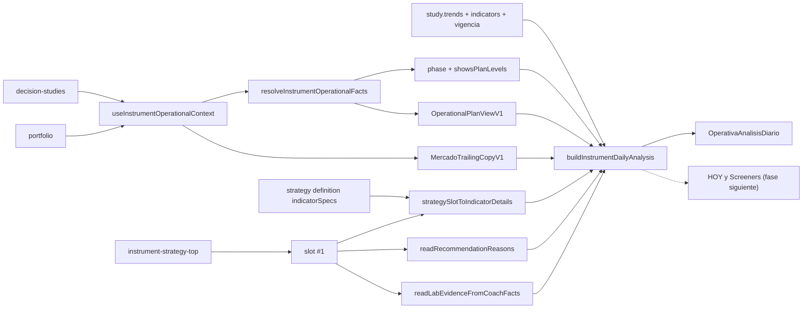

# Análisis diario del valor en DECISIÓN (MERCADO · OPERATIVA)

> **Fecha:** 2026-11-10 · **Estado:** implementado (banda) · **Premisa:** [PROJECT_PREMISES §6.4](../PROJECT_PREMISES.md)
>
> Objetivo: que al seleccionar un valor en el gráfico, el panel DECISIÓN responda de un vistazo
> en qué régimen está, con qué indicadores optimizados del LAB se sigue, y cuál es el momento de
> entrada (o de salida si está en cartera). Sin motores nuevos y sin fabricar datos.

## 1. Principio: una sola proyección

La banda **no calcula** tendencia, régimen ni indicadores. Proyecta artefactos que ya existen:

- `DecisionJournalStudyViewV1.trends` / `.indicators` — parte diario (Python:
  `bolsa_analytics.knowledge.technical_facts` → `bolsa_application.decision_journal_studies`).
- `OperationalPlanViewV1` — plan/niveles desde estudio o posición
  (`packages/shared/src/cognitive/operational-plan-view.ts`).
- `MercadoTrailingCopyV1` — trailing sugerido vs stop vigente
  (`packages/shared/src/cognitive/mercado-cockpit-phase.ts`).
- `InstrumentStrategyTopSlotV1` + `definition.indicatorSpecs` — estrategia #1 e indicadores
  optimizados (`packages/shared/src/strategy-top1-chart-indicators.ts`).
- `coachFacts.recommendations[].reasons` y evidencia de estabilidad — razón y OOS/WF.



## 2. Modelo: `InstrumentDailyAnalysisV1`

`packages/shared/src/cognitive/instrument-daily-analysis.ts`

| Campo | Contenido |
| --- | --- |
| `measured` | Existe parte diario con tendencia utilizable. |
| `studyMeta` | `studiedAt`, `ageMs`, `vigencia` (`current`/`expiring_soon`/`expired`) e indicadores base del estudio. |
| `trends` | Copia literal de `study.trends` + `tone` (solo presentación) + `basis` (ADX + DI / SMA). |
| `tracking` | Estrategia #1, indicadores con parámetros (`SMA 20/50`, `MACD 12/26/9`), razón del coach, evidencia Lab y estabilidad. |
| `entry` | `null` si hay posición. Con niveles solo cuando `showsPlanLevels && plan.hasPlan`; si no, `missing` declara el motivo (`mercadoCockpitNoLevelsCopy`). Distancia `(mark − entrada) / entrada`. |
| `exit` | `null` si no hay posición. Stop vigente, hints de T1/T2 (`targetProgressHint`), trailing y primera invalidación. |
| `gaps` | Huecos declarados, sin duplicados. |

El builder es determinista y sin efectos: mismas entradas ⇒ misma salida.

### 2.1 Tono (solo presentación)

`strong_bullish|bullish|bullish_stack → bullish` · `weak → range` · `bearish|strong_bearish|bearish_stack → bearish`
· `mixed → mixed` · resto → `unknown`. El `value` canónico nunca se reescribe.

### 2.2 Indicadores con parámetros

`strategySlotToIndicatorDetails` amplía la resolución de specs existente
(`definition.indicatorSpecs` → `presetIndicatorSpecs(strategyType)` → `[]`), agrupa por
`definitionId` y concatena los parámetros numéricos en el orden del catálogo. Una definición
desconocida conserva su id como etiqueta; sin specs devuelve `[]`.

## 3. UI

`apps/web/src/features/trading/operativa-analisis-diario.tsx` — componente puro sin hooks de datos.
Se renderiza **encima** de `OperativaCockpitCard` en
`apps/web/src/features/trading/trading-operativa-panel.tsx`, que aporta el contexto operativo, la
definición de la estrategia #1 (`["strategy", id]`), las razones del coach y la acción de recálculo.

| `data-testid` | Qué valida |
| --- | --- |
| `operativa-analisis-diario` | `data-instrument-id`, `data-estudio`, `data-measured`, `data-phase`. |
| `operativa-analisis-tendencia` | Chips por `data-trend` / `data-tone` o «Sin análisis diario todavía». |
| `operativa-analisis-seguimiento` | Estrategia #1, evidencia y razón. |
| `operativa-analisis-indicadores` | Indicadores con parámetros. |
| `operativa-analisis-entrada` | Estado, entrada, stop, T1, T2, distancia, R:R, `missing`. |
| `operativa-analisis-salida` | Stop vigente, T1/T2, R no realizado, trailing, invalidación. |
| `operativa-analisis-gaps` | Huecos declarados. |
| `operativa-analisis-actualizar` | Recálculo del parte diario (Alta/Actualizar Estudio). |

Fuera de Estudio la banda muestra solo una línea declarativa; el banner
`operativa-fuera-estudio` del panel sigue siendo la vía para añadirlo.

## 4. Honestidad (qué no hace)

- No recalcula tendencia ni régimen en TypeScript.
- No deduce indicadores del catálogo del gráfico.
- No promueve el trailing a stop vigente ni autoriza entradas: `Ranking ≠ BUY`, `Confirm = firma`.
- No muestra niveles en `vigilar` / `bloqueada` / `caducada`.
- No toca `HOY` ni Screeners en esta fase: el modelo se exporta para que ambas superficies lo
  consuman sin duplicar copy.

## 5. Verificación

```bash
pnpm --filter @bolsa/shared test
pnpm --filter @bolsa/web exec vitest run src/features/trading/operativa-analisis-diario.test.tsx src/features/trading/operativa-cockpit-card.test.tsx
pnpm --filter @bolsa/shared typecheck
pnpm --filter @bolsa/web typecheck
pnpm --filter @bolsa/web lint
```

Tests nuevos: `packages/shared/src/cognitive/instrument-daily-analysis.test.ts`,
`packages/shared/src/strategy-top1-chart-indicators.test.ts`,
`apps/web/src/features/trading/operativa-analisis-diario.test.tsx`.
