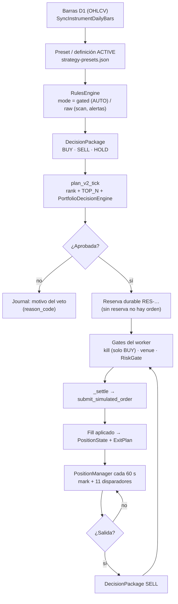

# Auditoría de detección de compras y ventas en entorno diario

**Fecha:** 2026-10-26 · **Base:** `HEAD = 8ce53c3c` (`docs(evidence): corrige la composición de §8 (W-2)…`)
· **Naturaleza:** auditoría **read-only**. No modifica código, estado operativo, `PROJECT_STATE.md`,
pin PAPER, CI ni la nota del dictamen PAPER. **No** crea commit, tag, PR ni push.

**Objeto:** cómo se detecta hoy una **compra** y una **venta** en la cadena diaria AUTO/PAPER —
desde la barra D1 hasta la orden simulada, la posición y la salida— y qué parte de esa cadena
puede afirmarse con evidencia y qué parte es un hueco declarado.

---

## Premisas fijas (no se reabren)

| Premisa | Estado |
|---|---|
| AUTO | **OFF** (premisa del propietario; el default de código también es OFF) |
| Operativa | **PAPER virtual**, sin dinero real |
| Ventana | **INCONCLUSIVE** |
| Rentabilidad | **no demostrada** |
| Commits del bloque | `be1c1295`, `8ce53c3c` y el del sello `2.11.162-beta` |
| Árbol de trabajo | limpio: el `M` del dictamen de aceptación (§6) entra en el commit del sello |
| Este documento | nuevo; entra en el commit del sello `2.11.162-beta` |

Verificación de las premisas de repositorio (§8.0): `git log -1` era `8ce53c3c` al escribir la
auditoría; `git status --porcelain` filtrado a `docs/engineering` devolvía **solo** `M
…dictamen-aceptacion-cierre-siete-todos-2026-10-26.md`. El sello `2.11.162-beta` publica ese `M`
junto con este documento y su verificación.
No se ha consultado PostgreSQL en ningún momento de esta auditoría.

### Vocabulario de veredictos

| Veredicto | Significado exacto en este documento |
|---|---|
| **CERTIFICADO** | El comportamiento está implementado en `HEAD`, citado con `fichero:línea` y fijado por al menos una prueba hermética ejecutada. **No** significa que haya ganado dinero ni que la ventana esté cerrada. |
| **PARCIAL** | Implementado, pero con un límite, una asimetría entre capas o un camino sin prueba que lo fije. |
| **HUECO DECLARADO** | El código o la documentación declaran que el dato/estado no puede afirmarse (fail-closed), pero no existe mecanismo que lo cierre ni medición que lo cuantifique. |
| **NO CERTIFICADO** | No hay evidencia suficiente. Se marca **NO MEDIDO** y no se extrapola. |

### Qué NO es este documento

- No certifica rentabilidad, expectancy ni ventaja estadística: la ventana está **INCONCLUSIVE**
  con 0 episodios y 0 ciclos (§8).
- No mide el estado de los procesos vivos (no se inspeccionan PIDs ni el scheduler en ejecución):
  AUTO OFF es **premisa del propietario + default de código**, no una medición de proceso.
- No propone parches aplicados al escribirla: los criterios de cierre del §9 son **falsables**. Tres
  de ellos se implementaron después (2026-10-26, tarde) en el commit del sello `2.11.162-beta` —
  `B-2`, `B-4` y `O-5`—; §10 y la matriz de trazabilidad registran el cambio de estado.

---

## 0. Resumen ejecutivo

La cadena diaria existe y está separada en **tres capas que no son la misma cosa**:

1. **Detectar** (señal): `RulesEngine` evalúa las reglas del preset sobre barras D1 y emite
   `entry_long` / `exit` (`packages/py/analytics/src/bolsa_analytics/signals/rules_engine.py:606-692`).
2. **Decidir** (cartera): `plan_v2_tick` rankea, `PortfolioDecisionEngine` aplica la escalera de
   vetos y la aprobación **solo existe si hay reserva durable**
   (`packages/py/application/src/bolsa_application/auto_v2_entry.py:1079-1330`,
   `portfolio_decision_engine.py:418-700`).
3. **Ejecutar** (orden/fill): el worker emite la propuesta, pasa kill/venue/RiskGate, liquida en el
   simulador y actualiza la posición (`apps/api-python/src/bolsa_api/background/auto_simulation_worker.py:7239-7400`,
   `:2180-2308`).

El hallazgo central es que **detectar no es decidir ni ejecutar**, y que la capa de detección tiene
dos modos incompatibles entre sí: `raw` (scans y alertas: emite la señal aunque no haya posición) y
`gated` (decisor ACTIVE: exige una entrada previa dentro de la misma ventana). Además, la ventana de
la señal es de **120 barras** por defecto, lo que **inhabilita por construcción** los presets que
exigen SMA200.

| Etapa | Dónde vive | Veredicto |
|---|---|---|
| Ingesta D1 | `SyncInstrumentDailyBars` + `OhlcvRepository` | **PARCIAL** (ruta existe; no medida en esta auditoría) |
| Detección BUY declarativa | `rules_engine` + `strategy-presets.json` | **PARCIAL** (4/21 presets no pueden disparar con 120 barras) |
| Selección de la estrategia ACTIVE | `load_active_strategy_decider` + flags de entorno | **HUECO DECLARADO** (dos flags; sin señal ⇒ HOLD silencioso) |
| Ranking y decisión de cartera | `plan_v2_tick` + `decide_portfolio` | **CERTIFICADO** (19 entradas de docstring / 19 rechazos literales, fail-closed, con pruebas) |
| Reserva durable como aprobación | `_reservation_for` + `ledger.reserve` | **CERTIFICADO** (sin reserva ⇒ veto `reservation_failed`) |
| Orden simulada y fill | `_settle` + `submit_simulated_order` | **PARCIAL** (P-2 cerrado; excepción de persistencia solo deja log) |
| Detección SELL de la estrategia | `evaluate_exit_last_bar_gated` | **NO CERTIFICADO** en AUTO: **no está cableada** al worker |
| Gestión de salida | `PositionManager` + `ExitPlan` | **PARCIAL** (11 disparadores; TIME_STOP y THESIS con asimetrías) |
| Cadencia diaria/orquestación | `scheduler_worker` + `queue_poll_worker` + `auto_sim_loop` | **NO CERTIFICADO** en producción (no medido) |
| Observabilidad y honestidad | journal, DÍA-D, UI, vigía | **PARCIAL** |
| Ventana / rentabilidad | ledger + day-watch | **NO CERTIFICADO** (`INCONCLUSIVE`, 0/32 ciclos) |

---

## 1. Alcance, método y reproducibilidad

**Alcance:** cadena diaria AUTO/PAPER completa (señal → gates → orden → posición → salida) y su
superficie de lectura (journal, DÍA-D, UI, vigía). Fuera de alcance: corrección de hallazgos,
paridad con backtest más allá de explicar divergencias, y publicación de los commits pendientes.

**Método:**

- Lectura directa de los módulos citados en `HEAD` (no se delega la conclusión: cada afirmación de
  código se comprobó en el fichero y línea que se cita).
- `rg` para verificar llamadas y ausencias de llamadas (p. ej. que el worker AUTO **no** invoca
  `check_exit_permission`).
- Tres mediciones puntuales de solo lectura con `uv run python -c` (sin escribir estado):
  disponibilidad de SMA200 por tamaño de ventana, supresión de `exit` en modo `gated`, y
  comparación `raw` vs `gated`. Se detallan en §3.3 y §3.5. El **recuento del catálogo** (21 presets,
  765 líneas) se verificó sobre `strategy-presets.json` y contra `preset_strategy_keys()`.
- **Suites herméticas ejecutadas** (319 pruebas, todas en verde):

```
uv run --no-sync python -m pytest \
  packages/py/analytics/tests/test_signal_evaluate.py \
  packages/py/analytics/tests/test_signal_strategy.py \
  packages/py/analytics/tests/test_rules_engine.py \
  packages/py/analytics/tests/test_exit_plan.py \
  packages/py/analytics/tests/test_exit_permission.py \
  packages/py/application/tests/test_active_strategy_signal_evaluator.py \
  packages/py/application/tests/test_position_manager.py -q
# 83 passed

uv run --no-sync python -m pytest \
  apps/api-python/tests/test_auto_sim_active_strategy_seam.py \
  apps/api-python/tests/test_window_day_watch.py -q
# 58 passed

uv run --no-sync python -m pytest \
  apps/api-python/tests/test_auto_v2_lifecycle_clock_thesis.py \
  apps/api-python/tests/test_auto_v44_exit_governance.py \
  apps/api-python/tests/test_auto_v2_real_price_source.py \
  apps/api-python/tests/test_auto_v2_real_price_fail_closed.py -q
# 45 passed

uv run --no-sync python -m pytest \
  apps/api-python/tests/test_auto_v2_closed_bars_and_bar_idempotency.py \
  apps/api-python/tests/test_auto_v2_bar_short_circuit.py -q
# 12 passed

uv run --no-sync python -m pytest \
  packages/py/application/tests/test_portfolio_decision_engine.py \
  packages/py/application/tests/test_portfolio_reservation.py \
  packages/py/analytics/tests/test_portfolio_reservation_ledger.py \
  packages/py/application/tests/test_decision_contract_barricade.py \
  packages/py/analytics/tests/test_position_decision.py \
  packages/py/analytics/tests/test_position_policy_decision.py -q
# 121 passed
```

- **Suites NO ejecutadas y por qué:** todas las que requieren PostgreSQL real o mutan estado
  (`*_pg.py`, `test_auto_daily_chain_full_real_e2e_pg.py`, `test_auto_scheduler_real_pg_zero_human_intervention.py`,
  `test_auto_v46_crash_recovery.py`, `test_auto_v46_concurrent.py`). No se ha levantado base de datos
  ni se ha ejecutado el runner de la ventana (`run-day`, certificador, `window:forward`).
  **Nota de alcance:** estas suites se ejecutaron **después**, en una base desechable, por la
  verificación independiente del mismo día (38 pruebas, 0 saltadas, 0 fallidas; más **7** de PG-4
  re-ejecutadas tras aislar el vigía, con los artefactos del repo intactos). Este documento conserva
  lo que **esta** auditoría midió; no se reescribe como si las hubiera corrido.
- **Lectura read-only del estado:** `operability_runs/window-runs/ledger.jsonl` (12 filas) y
  `operability_runs/window-runs/day-watch.json`. Este último es un **artefacto vivo**: la lectura
  de referencia de esta iteración es `sha256 0D14165A…DA95`, 659 bytes, `17:05:56` (950 líneas en
  `day-watch.jsonl`, `9AF8A3E2…5706`); la marca `16:13:37` de una lectura anterior ya no existe.

Toda afirmación no comprobada se marca **NO MEDIDO**. Ninguna se presenta como certificada por
inferencia.

---

## 2. Mapa end-to-end



**Tabla de anclaje (fichero:línea):**

| Paso | Evidencia |
|---|---|
| Reglas y cruces | `packages/py/analytics/src/bolsa_analytics/signals/rules_engine.py:264-348` |
| Ventana y modo | `rules_engine.py:606-692`; `packages/py/analytics/src/bolsa_analytics/signals/strategy.py:113-171` |
| Decisor ACTIVE | `packages/py/application/src/bolsa_application/active_strategy_signal_evaluator.py:115-199` |
| Ranking y TOP_N | `packages/py/application/src/bolsa_application/auto_v2_entry.py:191`, `:1290-1330` |
| Escalera de vetos | `packages/py/application/src/bolsa_application/portfolio_decision_engine.py:418-700` |
| Reserva como aprobación | `auto_v2_entry.py:1535-1572` |
| Gates del worker | `apps/api-python/src/bolsa_api/background/auto_simulation_worker.py:7345-7398` |
| Settlement | `auto_simulation_worker.py:2180-2308` |
| Gestión de posición | `auto_simulation_worker.py:6460-6618`; `packages/py/application/src/bolsa_application/position_manager.py:233-360` |
| Plan de salida | `packages/py/analytics/src/bolsa_analytics/cognitive/exit_plan.py:44-229` |

---

## 3. Detección de compra

### 3.1 Motor de reglas y presets

Los presets son declarativos y viven en un catálogo compartido: **21** estrategias con
`indicatorSpecs`, `entries` y `exits` (`packages/shared/src/strategy-presets.json:1-765`). El motor
resuelve los indicadores de forma **causal** (sin look-ahead) y evalúa la regla en el índice de la
barra (`rules_engine.py:70-201`, `:264-348`). Un cruce exige que **las dos series** tengan valor en
`index-1` y en `index`:

```text
rules_engine.py:252-261
    prev_left = left[index - 1]
    ...
    if None in (prev_left, prev_right, curr_left, curr_right):
        return False
```

Consecuencia directa: si un indicador no tiene valor porque la ventana es demasiado corta, la regla
**no dispara y no lo dice**. No hay excepción, no hay fila de skip: el resultado es indistinguible de
"el mercado no dio señal".

### 3.2 Ventana de decisión: 120 barras

La ventana que alimenta al decisor ACTIVE es configurable, con **default 120**:

```text
auto_simulation_worker.py:8591-8600
def _signal_snapshot_limit() -> int:
    raw = (os.getenv("AUTO_ENGINE_SIM_SIGNAL_BARS") or "").strip()
    if not raw:
        return 120
```

y se usa tanto para barras cerradas como para el snapshot sin cota
(`auto_simulation_worker.py:8699-8703`). El cargador por defecto también declara `limit=120`
(`active_strategy_signal_evaluator.py:61-67`).

### 3.3 Hallazgo B-1 · SMA200 es inalcanzable con la ventana por defecto

Cuatro de los veintiún presets exigen SMA200:

| Preset | Requisito | Línea |
|---|---|---|
| `golden_cross` | SMA50 cruza SMA200 | `strategy-presets.json:104-138` |
| `death_cross` | SMA50 cruza SMA200 | `strategy-presets.json:139-172` |
| `price_above_sma200` | precio > SMA200 | `strategy-presets.json:424-453` |
| `ma_stack_bullish` | SMA50/SMA200 + precio > SMA200 | `strategy-presets.json:454-501` |

`compute_sma` devuelve `None` hasta que hay `period` barras
(`packages/py/analytics/src/bolsa_analytics/indicators/compute.py:99-108`).
**Medición de solo lectura** sobre `HEAD`:

| Ventana | `None` en SMA200 | Primer valor real |
|---|---|---|
| 120 barras | **120 de 120** | ninguno |
| 200 barras | 199 de 200 | índice 199 |
| 250 barras | 199 de 250 | índice 199 |

Y un cruce necesita **dos** valores consecutivos, es decir **≥ 201 barras**. Con `SIGNAL_BARS=120`:

- `golden_cross` / `death_cross` no pueden disparar **nunca**;
- `price_above_sma200` y `ma_stack_bullish` no pueden cumplirse **nunca** (la comparación con
  `None` es falsa, no un error);
- el resultado es `HOLD` perpetuo, sin rastro de por qué.

**Veredicto: PARCIAL.** El motor es correcto; la ventana por defecto hace inoperables 4/21 presets y
el silencio no se distingue de "sin señal". Es un fallo de **configuración por defecto**, no del
evaluador. El denominador correcto es **21** (el catálogo tiene 21 entradas con `entries.rules` y
`exits.rules`, y `preset_strategy_keys()` devuelve las mismas 21).

### 3.4 Hallazgo B-2 · Barras sintéticas close-only en el decisor

El decisor ACTIVE no pasa OHLCV: construye `StrategyBarInput` con **solo** `timestamp` y `close`
(`packages/py/application/src/bolsa_application/active_strategy_signal_evaluator.py:185-189`). Dentro
del motor, `evaluate_rules_signals` fabrica barras con `open=high=low=close` y `volume=0` cuando no
recibe `indicator_context` (`packages/py/analytics/src/bolsa_analytics/signals/rules_engine.py:626-629`;
idéntico en la salida, `:708-710`). El scan sí lo recibe y lo reenvía
(`packages/py/application/src/bolsa_application/scans.py:288-321`; `:400-407`). La alerta no (§3.6).

**Medición de solo lectura** por el camino real del decisor (sin `indicator_context`), con series
monótonas de 120 cierres:

| Preset | Serie alcista | Serie bajista | Lectura |
|---|---|---|---|
| `vwap_reclaim` | `[]` | `[]` | **Nunca dispara**: `cum_vol` no sale de 0 ⇒ VWAP siempre `None` (`indicators/compute.py:566-580`). |
| `stoch_oversold` | `exit` | `entry_long` | Se calcula, pero sobre el **rango de cierres**: con `high=low=close`, `%K` es el percentil del último cierre en la ventana (`compute.py:232-247`); el rango intrabar desaparece y una tendencia lo satura en 0/100. El guard `50.0` solo aplica a ventanas planas. |
| `cci_oversold` | `exit` | `entry_long` | Igual: el típico es el cierre y la desviación media se mide sobre cierres (`compute.py:214-229`); el guard `0.0` solo aplica si los cierres son idénticos. |
| `supertrend_follow` | `entry_long` | `exit` | El ATR usa `TR = abs(Δcierre)` porque `high−low = 0`, y las bandas se centran en el cierre (`compute.py:520-563`): es un SuperTrend del cierre, no del rango. |

En series monótonas la dirección coincide (por eso un smoke test no lo revela); la divergencia
aparece cuando la barra tiene rango o volumen —justo lo que el decisor borra—. La **magnitud está
medida** por la matriz de contrato de esta iteración (verificación independiente del 2026-10-26,
§3.4 y §5.4): sobre cuatro escenarios deterministas con OHLCV real, **5 de 16 pares
preset/escenario cambian de acción** respecto del camino close-only —4 de `vwap_reclaim` y 1 de
`supertrend_follow`— y **3 de 16** pares muestran `raw ≠ gated` sobre la misma feature.

> **Errata de magnitud (2026-10-26, tarde).** Una lectura anterior de esta misma verificación
> publicó «13 de 16 divergencias» a nivel de eventos. Reproducida con el banco de contrato, la cifra
> no se sostiene: la divergencia **de acción** es 5/16 y la de **eventos** `raw`/`gated` es 3/16. La
> cifra 13/16 se retira; el detalle por preset queda en la verificación §3.4.

**Estado en el commit del sello `2.11.162-beta`.** El fix de procedencia está aplicado:
`signal_feature_context.py` construye el `indicator_context` desde OHLCV y lo usan el decisor
(`active_strategy_signal_evaluator.py`) y las alertas (`signal_alerts.py`). El contrato queda fijado
por `packages/py/application/tests/test_scan_decider_contract.py` (16/16 pares) y por
`test_signal_alerts_feature_context.py`. Esto **no** valida la operación: AUTO sigue OFF, la ventana
sigue `INCONCLUSIVE` y la rentabilidad sigue sin demostrarse.

**Veredicto: PARCIAL.** El camino es fail-closed (no inventa señal sin dato: VWAP desaparece), pero
la feature que evalúa el decisor **no es la misma** que la del scan, y el journal no lo distingue
(O-6).

### 3.5 Hallazgo B-3 · `raw` frente a `gated`: la misma señal, dos respuestas

`evaluate_rules_signals` tiene dos modos
(`packages/py/analytics/src/bolsa_analytics/signals/rules_engine.py:606-692`):

- `mode="raw"`: emite `entry_long` y `exit` **sin estado de cartera**. Lo usan los scans
  (`scans.py:400-407`) y las alertas (`signal_alerts.py:271-280`).
- `mode="gated"`: solo emite `entry_long` si `not has_long`, y `exit` solo si `has_long`. Lo usa el
  decisor ACTIVE (`active_strategy_signal_evaluator.py:191-195`).

El estado `has_long` **se recalcula desde cero en cada llamada** recorriendo la ventana. No es la
posición real de la cartera: es un replay de la ventana. Dos consecuencias:

1. **Una salida puede suprimirse si no hubo entrada en la ventana.** Medido con 120 barras
   monótonamente crecientes y el preset `rsi_mean_reversion`:

   ```text
   raw   -> ['exit']
   gated -> []
   ```

   La posición puede llevar abierta semanas; si el RSI entra en sobrecompra y no hubo un RSI<30 en
   las últimas 120 barras, la regla de salida **no se emite**.
2. **Una entrada de nivel se repite cada barra.** `price_above_sma200` es un nivel, no un cruce: en
   cada barra de la ventana cumple. El dedupe por barra evita la repetición intra-barra, pero la
   señal se re-emite en cada barra nueva.

**Veredicto: PARCIAL.** `raw` y `gated` responden a preguntas distintas (¿hay señal? / ¿hay una
transición long-only en esta ventana?) y el producto las presenta como si fueran la misma.

### 3.6 Hallazgo B-4 · Las alertas evalúan con barras sintéticas

El scan construye `indicator_context` con OHLCV real (`packages/py/application/src/bolsa_application/scans.py:288-321`)
y se lo pasa a `evaluate_strategy_last_bar` (`scans.py:400-407`). La alerta **no** pasa contexto:

```text
packages/py/application/src/bolsa_application/signal_alerts.py:267-286
    strategy_bars = [StrategyBarInput(timestamp=bar.timestamp, close=bar.close) for bar in bars]
    ...
    events = evaluate_strategy_last_bar(
        per_instrument_definition,
        strategy_bars,
        instrument_id=subscription.instrument_id,
        mode="raw",
    )
```

Sin `indicator_context`, el motor cae en las barras sintéticas de §3.4. Por tanto, para un preset
con volumen o rango, **la alerta puede no coincidir con el scan** sobre las mismas barras: el scan
ve el indicador real y la alerta ve una constante. La divergencia ya está cuantificada en la
verificación independiente del 2026-10-26 §3.4: el caso extremo es `vwap_reclaim`, donde el camino
sin contexto devuelve `[]` en los 4 escenarios (sin volumen, `cum_vol=0` ⇒ VWAP `None`).

**Veredicto: PARCIAL.** Divergencia medida; no hay prueba que la fije.

### 3.7 Hallazgo B-5 · La ACTIVE necesita dos flags y falla en silencio

La entrada de la estrategia promovida al hot path exige **dos** variables:

| Flag | Efecto si falta | Evidencia |
|---|---|---|
| `AUTO_ENGINE_SIM_ACTIVE_STRATEGY` | No se carga la ACTIVE; se usa el spine determinista | `auto_simulation_worker.py:8565-8571`, `:8656-8663` |
| `AUTO_ENGINE_SIM_ACTIVE_STRATEGY_SIGNAL` | Se usa `active_strategy_decider(..., fallback=None)` | `auto_simulation_worker.py:8583-8588`, `:8656-8663` |

Con el segundo flag OFF, el decisor llama a `fallback(symbol)` con `fallback=None`; la excepción se
captura y se devuelve `HOLD` (`auto_orchestrator.py:774-787`). Es decir: **no** "opera con el lote
sobre el spine", como podría sugerir el nombre; **no opera nada** y no lo declara.

**Veredicto: HUECO DECLARADO.** El código lo dice en el docstring ("fail-closed a NO TRADE") y la
prueba `test_auto_sim_active_strategy_seam.py` lo fija, pero el operador solo ve HOLD.

### 3.8 Hallazgo B-6 · El scan exige 50 barras, no el warmup del preset

`MIN_SCAN_BARS = 50` (`packages/py/domain/src/bolsa_domain/platform_kernel.py:10`) y el scan salta
el instrumento si tiene menos (`scans.py:245-250`). Un preset que exige SMA200 puede pasar el filtro
de 50 barras y producir **cero señales** sin declararlo. No hay validación `warmup ≥ period`.

**Cuantificación:** con `bar_limit = 50` quedan bloqueados **5** presets — los 4 de warmup ≥ 200
más `sma_crossover`, que necesita **51** barras para que el cruce SMA50 tenga los dos valores
consecutivos. `pullback_in_uptrend` (warmup 50) cabe justo.

**Veredicto: PARCIAL.** El scan no promete warmup; el silencio se lee como "sin señal".

---

## 4. Gates y fail-closed (capa "decidir")

### 4.1 Escalera de vetos

`decide_portfolio` aplica, en orden, las familias de veto documentadas en la cabecera
(`portfolio_decision_engine.py:10-58`) y ejecutadas en `:505-698`. **Recuento verificado:** el
docstring tiene **19 entradas numeradas** (1–18 más `3.b`), el cuerpo emite **19** llamadas
`_reject` con motivo literal y hay **5 familias dinámicas** (`sector_*`, `*_measurement_*`,
`governor_*`) que construyen el `reason_code` por tabla. La tabla siguiente las agrupa por **paso de
ejecución** (19 pasos con sub-pasos `b`/`c`), que es el orden que realmente se recorre, no el de la
enumeración del docstring:

| Paso | Veto (`reason_code`) | Línea |
|---|---|---|
| 1 | `stale_data` | `:505-507` |
| 2 | `position_exists` | `:509-511` |
| 3 | `regime_invalid` (direccional) | `:513-515` |
| 3.b | `governor_halted` / `governor_exit_only` | `:517-525` |
| 4 | `liquidity_unknown` / `liquidity_insufficient` | `:527-531` |
| 5 | `edge_below_threshold` | `:533-535` |
| 6 | `risk_budget_exceeded` | `:537-539` |
| 7 | `sector_unknown` / `sector_conflicting` / `sector_stale` | `:541-544` |
| 8 | `correlation_unknown` / `correlation_conflict` | `:546-554` |
| 9 | `sector_exposure_unverifiable` | `:556-559` |
| 10 | `risk_measurement_partial` / `risk_measurement_unknown` | `:561-572` |
| 10.b | `exposure_measurement_partial` / `exposure_measurement_unknown` | `:572-576` |
| 10.c | `open_orders_unmeasurable` | `:578-583` |
| 11 | `stale_data` (sin precio de entrada) | `:585-588` |
| 12 | `atr_unknown` | `:590-599` |
| 13 | `risk_budget_exceeded` (equity ≤ 0 o allocator no aprueba) | `:601-642` |
| 14 | `concentration_exceeded` | `:644-653` |
| 15 | `risk_reward_below_threshold` | `:655-663` |
| 16 | `plan_invalid` | `:689-698` |

El régimen es **direccional y fail-closed**: `UNKNOWN` y `RISK_OFF` bloquean cualquier entrada, y un
LONG no se abre en `BEAR_TREND` (`packages/py/analytics/src/bolsa_analytics/cognitive/market_regime_gate.py:131-146`).
`regime_is_exit_only` es exactamente la negación de "permite entrada nueva" (`:149-151`).

**Veredicto: CERTIFICADO** (implementación y pruebas herméticas de la escalera y del gate
direccional). El rótulo «18 familias / 16 pasos» queda sustituido por «19 entradas de docstring / 19
rechazos literales / 5 familias dinámicas».

### 4.2 Reserva durable = aprobación

No hay aprobación sin compromiso trazable. La propuesta se convierte en reserva en el mismo acto; si
la reserva no se puede construir, la decisión se **degrada a veto** con `reservation_failed`
(`auto_v2_entry.py:1535-1572`). El worker vuelve a comprobarlo antes de emitir: si la reserva no es
durable, no hay orden (`auto_simulation_worker.py:7319-7331`).

**Veredicto: CERTIFICADO.**

### 4.3 Kill switch

`_kill_active` devuelve `True` si el lector lanza: **no saber ⇒ bloquear** (`auto_simulation_worker.py:1983-1987`).
El latch durable se restaura en cada turno (`:2518-2581`) y un store ilegible **engancha** el latch
local con `KILL_STATE_UNREADABLE` (`:2539-2547`). El veto del worker es **solo para BUY**; un SELL
sigue permitido porque reducir riesgo no empeora la exposición (`:7346-7352`).

**Veredicto: CERTIFICADO.** (El hallazgo P-1 del dictamen PAPER está cerrado en `HEAD`; ver §7.1.)

### 4.4 Régimen desconocido ⇒ liquidación total

`_v2_regime()` devuelve `None` si no hay fuente o si falla
(`auto_simulation_worker.py:2367-2386`). Ese `None` se normaliza a `UNKNOWN`
(`auto_v2_entry.py:1760`), y `UNKNOWN` es exit-only (`market_regime_gate.py:149-151`). En la
gestión de posición, exit-only ⇒ `REGIME_EXIT` ⇒ venta **total** (`position_manager.py:299-302`,
`:345-352`).

Es fail-closed y está declarado. El riesgo operativo es el signo contrario al habitual: **una caída
de la fuente de régimen no paraliza las ventas, liquida toda la cartera**. Está probado que la
venta se ejecuta; no está medido cuántas veces un fallo transitorio de la fuente produce esa
liquidación.

**Veredicto: PARCIAL** (dirección fail-closed correcta; consecuencia no cuantificada).

### 4.5 AUTO ON/OFF es un gate de proceso, no de cuenta

`sim_worker_enabled()` lee `AUTO_SIMULATION_WORKER_ENABLED` del entorno; ausente/vacío ⇒ **OFF**
(`auto_simulation_worker.py:426-431`, único uso en `:8748` y `:9150`). No hay flag por cuenta ni
endpoint que lo cambie en caliente. `.env.example` no lo habilita (solo comenta
`AUTO_ENGINE_SIM_REAL_PRICE`).

**Veredicto: PARCIAL.** Correcto para un proceso único; no aísla cuentas dentro del mismo proceso.

---

## 5. Detección de venta y salida

### 5.1 Hay dos motores de venta, y en AUTO solo uno está cableado

| Motor | Qué vende | Dónde se usa |
|---|---|---|
| Señal de la estrategia (`evaluate_exit_last_bar_gated`) | `exit` de las reglas del preset | **Solo** `position_exit_evaluator.py:209` (ruta de política/PAPER_D) |
| `PositionManager` (`ExitPlan` + `PositionDecision`) | stop, objetivos, trailing, tiempo, tesis, gobernador | Worker AUTO, `auto_simulation_worker.py:6460-6618` |

Verificado por búsqueda exhaustiva: `evaluate_exit_last_bar_gated` **no** aparece en
`auto_simulation_worker.py` ni en `packages/py/application/src/bolsa_application/auto_v2_entry.py`.
Es decir: **la regla de salida de la estrategia promovida no participa en el AUTO V2**. La venta la
decide la geometría (`PositionState`), no el preset.

**Veredicto: NO CERTIFICADO** para "detección de venta por señal en AUTO". No es un bug de
ejecución: es un alcance distinto del que sugiere la UI.

### 5.2 Precedencia de los 11 disparadores

`EXIT_REASON_PRECEDENCE` es única y ordena por autoridad de deshacer riesgo
(`exit_plan.py:44-57`):

```text
KILL_SWITCH > REGIME_EXIT > RISK_EXIT > MANUAL > STRUCTURAL_STOP >
THESIS_INVALIDATION > PORTFOLIO_RISK > TARGET_1 > TARGET_2 > TRAIL > TIME_STOP
```

Los nueve primeros son `_HARD_TRIGGER` ⇒ `TRIGGERED` (`exit_plan.py:59-70`, `:232-246`). `TRAIL`
queda `ARMED` si hay stop; `TIME_STOP` queda **`HINT`** (no está en `_HARD_TRIGGER`, no está en
`ARMED`).

El stop se contrasta con el **rango** de la barra, no solo con el open: `bar_low`/`bar_high` entran
en la misma decisión y un breach intradía dispara (`exit_plan.py:184-207`). El precio de ejecución
declarado es `min(open, stop)` en long y `max(open, stop)` en short (`exit_plan.py:282-320`), y el
worker lo usa en el settlement (`auto_simulation_worker.py:7252-7288`, `:2221-2225`). **P-2 está
cerrado en `HEAD`.**

**Veredicto: PARCIAL** (precedencia y P-2 certificados; las asimetrías siguientes no).

### 5.3 Hallazgo S-1 · TIME_STOP no es accionable en PAPER_D pero sí vende en AUTO

El plan de salida con `expires_at` vencido produce `primary_reason = "TIME_STOP"` y estado `HINT`
(`exit_plan.py:221-227`, `:232-246`). El gate F5 solo resuelve acción si el estado es `TRIGGERED` o
`ARMED`:

```text
exit_permission.py:64-74  (_resolve_action)
    if exit_plan.status == "TRIGGERED" and exit_plan.suggested_action == "full_exit":
        return "full_exit"
    ...
    return "none"

exit_permission.py:185-186
    if action == "none":
        return _deny(["not_actionable"], exit_plan, at)
```

⇒ `check_exit_permission` deniega con `not_actionable` y `allowed=False`
(fijado por `test_exit_permission.py:90-99`).

Pero el worker AUTO **no llama** a `check_exit_permission` (búsqueda exhaustiva: 0 apariciones en el
worker). Convierte el resultado del `PositionManager` directamente en propuesta
(`auto_v2_entry.py:1779-1803`), y `suggestion_from_exit_policy` convierte `TIME_STOP` en
`full_exit` por el fallback (`exit_policy.py:165`). Resultado: **la misma condición es "no
accionable" para PAPER_D y vende la posición completa en AUTO**.

**Veredicto: PARCIAL / inconsistencia entre capas.** La prueba
`test_v2_time_exit_sells_and_journals_time_exit`
(`apps/api-python/tests/test_auto_v2_lifecycle_clock_thesis.py:170`) certifica el lado AUTO; nadie
certifica la equivalencia con F5.

### 5.4 Hallazgo S-2 · `THESIS_INVALIDATION` fuera del conjunto protector

`_PROTECTIVE_EXIT_REASONS` incluye `STRUCTURAL_STOP`, `TRAIL`, `PORTFOLIO_RISK`, `RISK_EXIT`,
`REGIME_EXIT` y `KILL_SWITCH` — **no** `THESIS_INVALIDATION` ni `TIME_STOP`
(`position_decision.py:71-91`). Con reconciliación `CRITICAL`, cualquier motivo fuera de ese
conjunto degrada a `REVIEW` (`:193-201`).

`THESIS_INVALIDATION` solo se convierte en `EXIT` **después** de esa rama (`:209-210`), así que bajo
`CRITICAL` no vende; y como tampoco está en `_is_protective` de F5 (`exit_permission.py:91-96` sí la
incluye, pero F5 no se consulta en AUTO), el resultado es un `REVIEW` que no emite orden.

**Veredicto: PARCIAL.** El código lo declara ("el veto de reconciliación está declarado, no
silenciado"), pero la asimetría entre `position_decision` y `exit_permission` es real.

### 5.5 Hallazgo S-3 · `EXIT_PENDING` sin orden emitida

`_v2_journal_exit_request` avanza el FSM a `EXIT_PENDING` **antes** de que la propuesta pase los
gates, y lo hace para `TIME_STOP`, `THESIS_INVALIDATION` y los tres motivos del gobernador
(`auto_simulation_worker.py:6619-6707`). Si el `PositionManager` devolvió `hold` (el caso `REVIEW`
de S-2, o un `hold` defensivo), `position_manager_package` devuelve `None`
(`auto_v2_entry.py:1790-1793`), el worker cae en `_veto("hold_no_op")`
(`auto_simulation_worker.py:7334-7337`) y la posición queda marcada como salida pedida **sin venta**.

**Veredicto: PARCIAL.** Camino estrecho (requiere `CRITICAL` de reconciliación conocido, que solo se
reporta para `DIVERGENT`: `auto_simulation_worker.py:5871-5886`), pero no imposible y sin prueba que
lo cubra.

### 5.6 Hallazgo S-4 · `THESIS_EXIT` es estructuralmente inalcanzable como motivo decisorio

`invalidation_price` se congela al nacer como el nivel declarado por el plan **o, si no hay, el
stop inicial** (`position_state.py:419-429`, `:684-687`). No hay ningún productor de un
`invalidationPrice` distinto del stop en el camino de entrada (el propio DÍA-D lo declara:
`packages/py/application/src/bolsa_application/dia_d_multi_sampling.py:387`).

Como el stop tiene **mayor precedencia** que la tesis (`exit_plan.py:44-57`), cualquier precio que
invalide la tesis también toca el stop ⇒ el motivo decisorio será `STRUCTURAL_STOP`, no
`THESIS_INVALIDATION`. La prueba `test_v2_stop_out_is_not_declared_as_thesis_exit`
(`test_auto_v2_lifecycle_clock_thesis.py:251`) certifica exactamente esa precedencia.

**Veredicto: PARCIAL.** La rama existe y está probada, pero en la práctica solo se alcanzaría con un
plan que declare un nivel de invalidación **por encima** del stop, y hoy nadie lo produce.

### 5.7 Hallazgo S-5 · Adopción de posiciones: protegida, pero no siempre gestionable

Al arrancar, `readopt_positions` rehidrata el plan durable; sin plan, reconstruye geometría y la
declara degradada (`RECONCILIATION_REQUIRED`/`PROTECTION_MISSING`), no la disfraza
(`auto_simulation_worker.py:5900-5920`). Si el símbolo no tiene `PositionState` ni se puede adoptar,
`_v2_position_package` devuelve `None` y la posición **no tiene gestión de salida V2**
(`:6480-6499`).

Esto cubre el caso "posición manual sin base de coste": no se adopta y no se vende por el motor. El
resultado es fail-safe (no se inventa una venta), pero es un **punto ciego declarado**: la UI puede
mostrar una posición abierta que AUTO no gestiona.

**Veredicto: PARCIAL / hueco declarado.**

### 5.8 Hallazgo S-6 · El worker no consulta el permiso de salida F5

`check_exit_permission` se invoca en `evaluate_exit_plan.py:56-104`,
`execute_position_policy_auto.py:236` y las pruebas, **no** en el worker AUTO. Los gates efectivos de
una venta en AUTO son: kill (no la bloquea), venue AUTO-only y `held > 0`; después se clampa a la
posición (`auto_simulation_worker.py:7345-7398`).

Consecuencia: condiciones que F5 bloquearía (`data_stale`, `market_closed`, `portfolio_drift`,
`paper_auto_env_blocked`) **no bloquean una salida AUTO**. Es deliberado para las salidas
protectoras ("reducir riesgo no espera"), pero también aplica a `TARGET_1`/`TARGET_2`/`TIME_STOP`,
que no son protectoras en F5. El modo stale sí veta **aperturas** (`:2823-2824`).

**Veredicto: PARCIAL.** No es un bypass accidental; es una decisión de arquitectura que no está
declarada como tal en la UI ni en el journal.

### 5.9 Venta sin posición

El worker veta `sell_without_position` antes de emitir y clampa `SELL > held`
(`auto_simulation_worker.py:7387-7398`). En el scan/alerta, en cambio, `mode="raw"` puede mostrar
una señal `exit` sobre un símbolo sin posición: es información de la estrategia, no una orden.

**Veredicto: CERTIFICADO** en el worker; **PARCIAL** en la lectura (la UI no distingue "señal" de
"orden").

---

## 6. Runtime diario y cadencia

### 6.1 Quién ejecuta qué

| Proceso | Cadencia | Qué hace | Evidencia |
|---|---|---|---|
| `scheduler_worker` | continuo | 20 starters de crons (alertas, custodia, ESTUDIO EOD, AUTO ops, vigía…) | `apps/api-python/src/bolsa_api/workers/scheduler_worker.py:68-104` |
| `queue_poll_worker` | 5 s (`scan_worker.py:16`) | drena la cola de scans/optimización (proceso **dedicado**, no en el scheduler) | `queue_poll_worker.py:32-39`; `scripts/run-dev.mjs:384-405` |
| `OPPORTUNITY_DAILY_SCAN` | 24 h, **duerme antes del primer trabajo** | encola el scan diario de oportunidades | `opportunity_daily_scan_worker.py:140-152` |
| `ESTUDIO_EOD_OPINION` | 1 h | encola **un** job diario si no existe | `estudio_eod_opinion_worker.py:51-90`; `config.py:217-222` |
| `AUTO SIM` | 60 s | `runtime.run_tick()` → decisión + settlement | `auto_simulation_worker.py:8722-8767` (bucle `auto_sim_loop`); `:9268-9281` es el helper `_sim_interval_seconds` |
| `window_day_watch` | 20:00 local | vigía read-only del ledger | `config.py:102-117`; `scheduler_worker.py:100-102` |

**Hallazgo T-1 · El scan no está en el scheduler.** `start_scan_worker` no aparece en
`_event_loop_starters()`; se arranca desde `queue_poll_worker` (`:36-39`) o desde `run-dev.mjs`
(`:403`). Si el despliegue no levanta ese proceso, los jobs de scan se encolan y **no se ejecutan**.

**Hallazgo T-2 · El scan diario duerme 24 h antes de su primer intento.**
`opportunity_daily_scan_worker_loop` hace `await asyncio.sleep(interval)` antes de
`_run_opportunity_daily_once` (`:150-152`); con el default de 86 400 s, un proceso recién arrancado
no ejecuta el primer scan hasta el día siguiente. Además el flag está **OFF por defecto**
(`config.py:244-250`).

**Hallazgo T-3 · El bucle AUTO es de 60 s sobre una señal D1.** El worker reevalúa cada minuto la
misma ventana cerrada (`B-1`), con dedupe durable por barra (`auto_simulation_worker.py:4770-4830`).
No hay lookahead: la decisión usa `last_closed_bar_day` (`closed_bars.py:98-118`) y la ejecución usa
`open(B)` (`auto_simulation_worker.py:4709-4717`;
`apps/api-python/src/bolsa_api/background/auto_price_provider.py:190-207`). La cadencia real
de **decisión** es diaria; la de **ejecución** es de 60 s dentro de la barra.
**Veredicto del bloque: NO CERTIFICADO** para la cadencia en producción: no se ha medido qué
procesos estaban vivos, ni la latencia del primer scan, ni la cobertura real de la cola. Lo que sí
está certificado es el diseño (T-3) y la separación de procesos.

---

## 7. Observabilidad y honestidad

### 7.1 Lo que ya está cerrado en `HEAD` (no reabrir)

El dictamen PAPER describe el estado **anterior** a los cierres; en `HEAD` estos hallazgos están
corregidos y con prueba:

| ID | Qué se cerró | Evidencia |
|---|---|---|
| **P-1** | Store de kill ilegible **no** deja el latch desenganchado; se engancha `KILL_STATE_UNREADABLE` | `auto_simulation_worker.py:2539-2547`, `:2601-2620` |
| **R-1** | Fallo de lectura de proyección **no** autoriza abrir; se declara `UNKNOWN` y no se consume la readopción | `:1551-1568`, `:1577-1583` |
| **R-2** | Con varias filas vivas no se adopta el total de la cuenta; se conserva la fila propia y se declara `UNKNOWN` | `:1590-1598`, `:7395-7401` |
| **P-2** | Stop/objetivo se contrastan con `low(B)`/`high(B)` y el fill se declara al nivel | `exit_plan.py:184-207`, `:282-320`; `auto_simulation_worker.py:7252-7288` |
| **W-1** | Un día `MEDIDO` con gate `INCONCLUSIVE` **no** cuenta como día ganado y alerta | `window_day_watch_worker.py:159-186`, `:252-269` |
| **R-4** | Composición durable sin `AUTO_ENGINE_SIM_ENGINE_ID` **no** arranca AUTO (y no tumba el scheduler) | `auto_simulation_worker.py:9090-9114`; `scheduler_worker.py:108-128` |

Las pruebas herméticas ejecutadas (§1) cubren P-2 y W-1 directamente; R-1/P-1/R-2/R-4 se apoyan en
las suites PG que **no** se ejecutaron en esta auditoría.

### 7.2 Hallazgo O-1 · `_settle` traga la excepción

```text
auto_simulation_worker.py:2261-2267
    except Exception:
        logger.exception("auto_sim settle failed symbol=%s side=%s", symbol, side)
        return _Settlement(requested_qty=qty, structural=structural)
```

No se fabrica posición (correcto), pero el fallo de persistencia **solo** queda en el log: el
informe del día no gana un contador de "settlement fallido" y el journal no lo distingue de "no hubo
fill". El reintento es correcto; la observabilidad, no.

**Veredicto: PARCIAL.**

### 7.3 Hallazgo O-2 · Modo estructural indistinguible del dinero

Sin `finance_applier`, `_settle` declara `structural=True` y considera **aplicado** todo fill
confirmado por el schedule (`:2201-2204`, `:2286-2288`). Es correcto para tests, pero el mismo
código corre en un despliegue mal compuesto: la posición existiría sin que se hubiera movido caja.
El modo no se publica en el journal de la operación.

**Veredicto: PARCIAL.**

### 7.4 Hallazgo O-3 · Lectores que devuelven vacío y UI que rellena con 0

| Superficie | Comportamiento | Evidencia |
|---|---|---|
| DÍA-D · muestra OOS | `closedCount ?? 0`, `openCount ?? 0` | `apps/web/src/features/auto-monitor/dia-d-auto-panel.tsx:249-250`, `:298-300` |
| Alertas · último precio | `lastSignalPrice ?? 0` | `apps/web/src/features/alerts/signal-alerts-section.tsx:494` |
| Monitor operativo · venue | default `"paper"` en la firma | `apps/api-python/src/bolsa_api/api/v1/routes/auto_operational_monitor.py:194` |

En DÍA-D el titular sí es honesto (si `closed === 0`, muestra "Evidencia insuficiente"), pero el
texto de la muestra puede decir "0 cerrados" cuando el dato es **ausente**. En alertas, un precio
no medido se pinta como `0`.

**Silencio del scan: qué distingue la UI.** El panel de resultados sí lista los instrumentos
omitidos con su motivo, en un bloque **colapsado** (`result.skipped.length` + `item.reason`,
`apps/web/src/features/screeners/scan-results-panel.tsx:219`, `:346-358`). El titular, en cambio,
dice «Sin señales en la última barra de la lista» (`:325-328`) sin separar tres causas distintas:

1. el instrumento se evaluó y no había señal;
2. el instrumento se saltó por **falta de barras** (`MIN_SCAN_BARS = 50`, mensaje
   «sincroniza el instrumento»);
3. el preset **no puede disparar** con la ventana disponible (warmup > barras), que hoy no produce
   ningún motivo: cae en el caso 1.

Es decir: la UI distingue «omitido» de «sin señal», pero **no** distingue «no evaluable» de «sin
señal» para el caso 3, que es exactamente el que produce B-1/B-6. Entradas P0-1 (motivo
`warmup_insufficient`), P1-10 y **P1-12b** (declarar «no evaluable» en el titular del scan, sin
tocar la UI en esta iteración).

**Veredicto: PARCIAL.**

### 7.5 Hallazgo O-4 · `INCONCLUSIVE` estático en la UI

Dos componentes afirman el veredicto de la ventana **sin consultarlo**:

- `estudio-daily-ops-panel.tsx:1132-1139`: "Validación global de la ventana PAPER: **INCONCLUSIVE**
  hasta cumplir la ventana".
- `estudio-chain-evidence.tsx:712-716`: "Veredicto global de la ventana PAPER: **INCONCLUSIVE**".

La redacción es una política ("esta vista no emite CONFIRMED"), no una medición. Es honesta en el
sentido de no sobreafirmar, pero **no puede cambiar** cuando la ventana cambie: el día que el gate
diga otra cosa, la UI seguirá diciendo `INCONCLUSIVE`.

**Veredicto: PARCIAL.** Es el reverso del problema de los ceros: un pesimismo hardcodeado también es
un dato no medido.

### 7.6 Hallazgo O-5 · Vigía de ventana: corregido, pero el efecto no está observado

`window_day_watch_worker.py` ya implementa W-1: un día `MEDIDO` cuyo gate no acredita ciclos pasa a
`INCONCLUSIVE` con severidad `alert` y `reason` `gate_inconclusive`/`gate_missing`
(`apps/api-python/src/bolsa_api/background/window_day_watch_worker.py:159-186`, `:252-269`).
Sin embargo, el `day-watch.json` leído **no** contiene ningún veredicto `INCONCLUSIVE`: su día
corriente es `NOT_DUE` y los avisos son `20261020:MISSED` y `20261023:MISSED`. Es decir: la
corrección está en el código y en la suite, pero **no hay evidencia de que haya disparado** sobre los
tres días `MEDIDO` del ledger.

**Veredicto: PARCIAL** (código certificado; efecto operativo no observado).

**Evidencia añadida (2026-10-26, tarde).** El mapeo ya no descansa solo en pruebas sintéticas:
`test_day_watch_alerts_on_measured_inconclusive_day` copia **literal** la fila `20261019` del ledger
(`MEDIDO`, `gate.verdict=INCONCLUSIVE`, `cycles=0`) a un `tmp_path` y exige `alert` con
`gate_inconclusive`, escribiendo el latido fuera del repo. El banco de pruebas ya no reescribe
`day-watch.*` (override `WINDOW_DAY_WATCH_DIR` + vigía desactivado por defecto + guarda de sesión).
Sigue sin observarse el disparo sobre la **ventana real**: E1, no E3.

### 7.7 Hallazgo O-6 · El journal distingue motivos, pero no capas

El journal registra el `reason_code` del veto (`plan_v2_tick` → `DecisionJournal`) y el motivo de
salida (`primary_reason`/`secondary_reasons`), pero **no** registra si la señal se evaluó con barras
reales o sintéticas, ni si la ventana tenía 120 o 250 barras. Un `HOLD` por SMA200 ausente y un
`HOLD` por mercado lateral son la misma fila.

**Veredicto: HUECO DECLARADO.** El journal es rico en decisión y pobre en **procedencia de la
feature**.

**Matiz (2026-10-26, tarde).** La procedencia ya está **centralizada en código**
(`signal_feature_context.py`: de OHLCV real a `indicator_context`, con fallback declarado a cierre y
volumen 0), y decisor y alertas consumen la misma función. Lo que sigue faltando es **publicarla**:
el journal no escribe `featureSource` ni `signalWindowBars`, así que un `HOLD` por SMA200 ausente
sigue siendo indistinguible de un `HOLD` por mercado lateral. El contrato de datos está escrito; la
propagación al journal es la entrada P1-8.

---

## 8. Estado operativo medido

### 8.0 Repositorio (medido el 2026-10-26, antes del sello `2.11.162-beta`)

| Comprobación | Valor |
|---|---|
| `HEAD` | `8ce53c3c` |
| Commits pendientes de publicar | `be1c1295`, `8ce53c3c` |
| `git status --porcelain` | **3 entradas**: `M` el dictamen de aceptación (§6), `??` este documento de auditoría y `??` su verificación independiente |
| `operability_runs/` | **no trackeado**: `git status` no puede detectar reescrituras de `day-watch.*`; se auditan por hash y `mtime` (§8.2) |
| Este documento | nuevo; entra en el commit del sello `2.11.162-beta` |

### 8.1 Ledger de la ventana (read-only)

Fuente: `operability_runs/window-runs/ledger.jsonl` (25/10/2026 18:30). **9 días con material, 12
filas** (un mismo día puede aportar dos filas: `HARD_ERROR` y `MEDIDO`).

| Día | Estado | Gate |
|---|---|---|
| 2026-10-14 | `NO_MEDIDO_REGIMEN` | — (`regime_invalid`, veto) |
| 2026-10-15 | `NO_MEDIDO_REGIMEN` | — |
| 2026-10-16 | `NO_MEDIDO_REGIMEN` | — |
| 2026-10-17 | `NO_MEDIDO_REGIMEN` + `NON_MARKET_DAY` | — |
| 2026-10-18 | `NON_MARKET_DAY` | — |
| 2026-10-19 | `HARD_ERROR` + `MEDIDO` | `days=2, episodes=0, cycles=0, INCONCLUSIVE` |
| 2026-10-21 | `HARD_ERROR` + `MEDIDO` | `days=4, episodes=0, cycles=0, INCONCLUSIVE` |
| 2026-10-22 | `MEDIDO` | `days=5, episodes=0, cycles=0, INCONCLUSIVE` |
| 2026-10-25 | `NON_MARKET_DAY` | — |

**Totales:** 12 filas · 3 `MEDIDO` · 2 `HARD_ERROR` · 3 `NON_MARKET_DAY` · 4 `NO_MEDIDO_REGIMEN`.
Los tres `MEDIDO` tienen gate **`INCONCLUSIVE`** con **0 episodios** y **0 ciclos** (mínimos:
`minEpisodes=2`, `minCycles=32`).

### 8.2 Vigía

`day-watch.json` es un **artefacto vivo**. A las **16:47:06** del 2026-10-26 tenía
`sha256 = DB11882AD496B5037106A867B10ECE7241870D5338678FC91982C6888A9499B0`, 659 bytes, veredicto
`NOT_DUE` para hoy; avisos `20261020:MISSED` y `20261023:MISSED` (ambos con motivo
`ledger_sin_dia_previo`); en `alerted` consta además `20261025:NON_MARKET_DAY`; `lookbackDays=7`;
fuente `worker`. El journal de latidos `day-watch.jsonl` tenía **948** líneas y
`sha256 = 0A8D1B19A4C26A615EFF679995BB422CB743B9CC98F4832BA3B9B323B5A2B5AD`.

**Lectura posterior (17:05:56).** `day-watch.json`: `0D14165A…DA95` (mismo tamaño y veredicto);
`day-watch.jsonl`: `9AF8A3E2…5706`, 950 líneas. La escritura la produjo el **proceso vivo** de la
ventana, no el banco de pruebas: tras aislar el vigía, la re-ejecución de PG-4 dejó ambos ficheros
con `sha256`, bytes, `mtime_ns` y líneas **idénticos** (verificación §5.4). El `ledger.jsonl` no
cambió (`69A25F1F…`).

La marca `16:13:37` que citó una lectura anterior **ya no existe**: el fichero se reescribió varias
veces el mismo día. Debe citarse siempre con hash y hora de lectura, nunca solo con la marca de
tiempo. El `ledger.jsonl` no cambió (`69A25F1F…`).

### 8.3 Lectura operativa

- **Detección:** existen señales y existe el motor para emitirlas; la ventana por defecto inhabilita
  una parte del catálogo (4/21 con 120 barras; 5 con 50) y el camino ACTIVE solo las convierte en
  propuesta si dos flags están ON.
- **Decisión:** la escalera de vetos y la reserva durable están certificadas (19 entradas de
  docstring / 19 rechazos literales). Es la capa más sólida de la cadena.
- **Ejecución:** el settlement está probado en hermético; el fallo de persistencia no se cuenta.
- **Salida:** la gestión por geometría está certificada; la salida por regla de la estrategia no
  está cableada en AUTO; TIME_STOP y THESIS tienen asimetrías declaradas.
- **Ventana:** `INCONCLUSIVE`, 0/32 ciclos, 0 episodios. **No hay base para afirmar rentabilidad.**

---

## 9. Criterios de cierre falsables

**Recuento explícito.** Este bloque tenía **18** criterios con ID (`B-1…B-6`, `S-1…S-6`, `O-1…O-4`,
`T-1…T-2`); el documento nunca afirmó «20». Los tres hallazgos que carecían de condición falsable
—`O-5`, `O-6` y `T-3`— se añaden aquí, de modo que el bloque pasa a **21** criterios: uno por cada
hallazgo con ID del documento.

Una prueba concreta por hallazgo. **Estado a fecha de este documento:** de las 21, **0 existían** al
escribirlo; a 2026-10-26 (tarde) existen **3** en el commit del sello `2.11.162-beta` (`B-2`, `B-4` y
`O-5`), `B-3` cuenta con una prueba de **caracterización** que no es la propuesta, y las 17
restantes describen qué habría que observar para dar el hallazgo por cerrado.

| ID | Nombre de prueba propuesto | Aserción falsable |
|---|---|---|
| B-1 | `test_sma200_requires_201_bars_in_active_window` | Con 120 barras, `all(v is None for v in compute_sma(closes, 200))`; con 201 barras y un cruce construido, `evaluate_strategy_last_bar` emite `entry_long`. Fija el mínimo y obliga a declarar `AUTO_ENGINE_SIM_SIGNAL_BARS >= warmup`. |
| B-2 | `test_decider_matches_the_gated_projection_of_the_same_signal` | Para `stoch_oversold`/`vwap_reclaim` (y los otros dos presets), la acción del decisor **coincide** con la proyección `gated` de la misma feature OHLCV, en los 4 escenarios. Añadido: el Δ frente al camino close-only queda fijado (5/16). |
| B-3 | `test_gated_exit_is_reachable_without_entry_in_window` | 120 barras monótonas + posición abierta antes de la ventana ⇒ el decisor emite `exit`. Hoy devuelve `[]` (medido y **caracterizado** por `test_raw_and_gated_diverge_on_a_sustained_trend`, que no sustituye a esta prueba). |
| B-4 | `test_the_alert_evaluates_with_the_ohlcv_context` | Misma definición, mismas barras: la alerta entrega al motor un `indicator_context` construido desde OHLCV (con VWAP real) y no evalúa sobre barras sintéticas. |
| B-5 | `test_active_signal_flag_off_blocks_buy_explicitly` | `ACTIVE_STRATEGY=1`, `SIGNAL=0` ⇒ `HOLD` **y** un motivo de journal `active_signal_disabled` (hoy: `HOLD` sin motivo). |
| B-6 | `test_scan_rejects_preset_below_warmup` | `bar_limit < 200` + `golden_cross` ⇒ `ScanSkippedInstrument` con motivo `warmup_insufficient` (hoy: 0 hits silenciosos). |
| S-1 | `test_time_stop_permission_matches_auto_execution` | `check_exit_permission(plan TIME_STOP).allowed` y `position_manager_package(outcome).action` deben coincidir; hoy `False` vs `SELL`. |
| S-2 | `test_thesis_invalidation_is_protective_under_critical_recon` | Con `CRITICAL` + `THESIS_INVALIDATION`, el `PositionManagerResult.order_action == "sell"` (hoy `hold`/`REVIEW`). Alternativa aceptada: documentar que no vende. |
| S-3 | `test_exit_pending_requires_emitted_order` | Tras un turno con `primary=THESIS_INVALIDATION` y `CRITICAL`, si no hay `SELL`, el `PositionState.exit_status` **no** es `EXIT_PENDING`. |
| S-4 | `test_thesis_exit_reachable_with_declared_invalidation_price` | Un plan con `invalidationPrice > stop` produce `primary_reason == "THESIS_INVALIDATION"` sin `STRUCTURAL_STOP`. Fija que el caso es alcanzable **o** que se retira del contrato. |
| S-5 | `test_unadopted_position_is_declared_in_journal` | Posición sin `PositionState` ni adopción ⇒ fila `position_unmanaged` con su símbolo (hoy `None` silencioso). |
| S-6 | `test_auto_exit_ignores_stale_data_by_contract` | Con `data_stale=True`, una salida `TARGET_1` sigue emitiéndose y el journal lo declara. Fija la decisión de arquitectura (hoy no está escrita). |
| O-1 | `test_settle_failure_is_counted` | `exec_store` que lanza ⇒ el informe del día incrementa `settlementFailures` (hoy solo log). |
| O-2 | `test_structural_settlement_is_published` | Con `finance_applier=None`, la operación se marca `structural` en el journal (hoy no se publica). |
| O-3 | `test_absent_measurement_is_not_rendered_as_zero` | `oos=null` ⇒ la UI muestra "NO MEDIDO", no `0` (hoy `?? 0`). |
| O-4 | `test_window_verdict_is_read_from_gate` | La UI pinta el veredicto del gate y falla el test si el texto es una constante. |
| O-5 | `test_day_watch_alerts_on_measured_inconclusive_day` | Una fila real del ledger con `status=MEDIDO` y `gate={verdict: INCONCLUSIVE, cycles: 0}` ⇒ `evaluate_day_watch` devuelve `verdict=INCONCLUSIVE`, `severity=alert`, `reason=gate_inconclusive`; `write_status` lo persiste en un directorio **temporal** y el árbol de trabajo no cambia (hoy: sin evidencia de disparo). |
| O-6 | `test_journal_records_feature_source_and_window_bars` | La entrada de journal de una decisión ACTIVE lleva `featureSource` (`real`/`synthetic`) y `signalWindowBars`; un `HOLD` por SMA200 ausente **no** produce la misma fila que un `HOLD` por mercado lateral (hoy: indistinguibles). |
| T-1 | `test_scan_worker_is_started_by_scheduler_or_its_own_process` | El arranque del scheduler expone el hecho de que `queue_poll_worker` está vivo, o falla con motivo accionable. |
| T-2 | `test_daily_scan_runs_immediately_when_due` | Reloj en hora de ejecución ⇒ el primer `_run_opportunity_daily_once` ocurre **sin** esperar 24 h. |
| T-3 | `test_auto_loop_decides_once_per_closed_bar_and_settles_intrabar` | Con la barra cerrada fija, N ticks de 60 s producen **como máximo una** decisión con nueva identidad de barra (`bar_tick`) y el reintento intrabarra es idempotente (mismo `execution_id`, sin segunda ejecución). |

---

## 10. Backlog priorizado

### P0 — afecta a la validez de lo que se concluya de la ventana

1. **Declarar y validar el warmup por preset.** `AUTO_ENGINE_SIM_SIGNAL_BARS` debe ser
   `max(period)+1` para el preset ACTIVE, o rechazarse con motivo explícito. Hoy 4/21 presets no
   pueden disparar con 120 barras (**B-1**). **B-6** entra aquí como el mismo defecto en el scan:
   `MIN_SCAN_BARS=50` deja 5 presets por debajo de su warmup y el scan lo publica como «sin señal».
   Cierre conjunto: un `warmup_insufficient` explícito en `ScanSkippedInstrument` y en el rechazo del
   preset ACTIVE.
2. **Unificar la procedencia de la feature.** El decisor y las alertas deben usar OHLCV real como
   el scan, o declarar en el journal que evalúan close-only (B-2, B-4, **O-6**).
3. **Decidir el contrato `gated` vs `raw`.** Si la ACTIVE debe poder vender una posición anterior a
   la ventana, el gating no puede reiniciarse en cada llamada (B-3, S-1).
4. **Cerrar la asimetría TIME_STOP/THESIS.** O el AUTO consulta F5, o F5 y el AUTO comparten el
   mismo conjunto de motivos accionables (S-1, S-2, S-6).
5. **Declarar por qué la ACTIVE no opera.** `ACTIVE_STRATEGY=1` con `SIGNAL=0` hoy produce `HOLD`
   mudo: el journal debe distinguir `active_signal_disabled`, `no_executable` y `no_snapshot`
   (**B-5**). Sin ese motivo, «no operó» y «no quiso operar» son la misma fila.

### P1 — degrada la observabilidad o deja estados fantasma

6. `EXIT_PENDING` solo si hay orden emitida (S-3).
7. Contador durable de `settlement_failures` y publicación del modo `structural` (O-1, O-2).
8. Journal con `featureSource` (`real`/`synthetic`) y `signalWindowBars` (**O-6**; entrada propia
   para que la referencia no quede colgando del §9).
9. Declarar la posición no adoptada en el journal (S-5).
10. Sustituir los `?? 0` y el `INCONCLUSIVE` estático por lecturas del gate (O-3, O-4).
11. Arranque del scan: proceso dedicado verificado o primer tick sin esperar 24 h (T-1, T-2).
12. **Aislar el estado del vigía en pruebas.** El banco PG que arranca
    `bolsa_api.workers.scheduler_worker` reescribía `day-watch.json`/`day-watch.jsonl` porque el
    vigía es on-by-default. **Aplicado en el sello `2.11.162-beta`:** `WINDOW_DAY_WATCH_DIR` +
    `WINDOW_DAY_WATCH_ENABLED=0` en el proceso de pytest y en los subprocesos, y guarda de sesión que
    falla si el árbol cambia (**O-5**, también criterio de reproducibilidad).
12b. **Declarar «no evaluable» en el titular del scan.** El panel distingue «omitido» de «sin señal»
    en un bloque colapsado, pero el titular dice «sin señales» también cuando el preset **no puede**
    disparar por warmup (caso 3 de §7.4, B-1/B-6). **No** se toca la UI en esta iteración: entra como
    P1 para que no se lea como ausencia de señal lo que es ausencia de datos.

### P2 — deuda declarada, no bloqueante

13. `invalidationPrice` distinto del stop, o retirar `THESIS_EXIT` del contrato visible (S-4).
14. Flag por cuenta para AUTO (hoy es de proceso) (§4.5).
15. Cuantificar liquidaciones por `UNKNOWN` de régimen (§4.4).
16. **Fijar la cadencia de ejecución como contrato.** `T-3` describe una decisión diaria y una
    ejecución de 60 s; falta una prueba que lo fije (una decisión por barra cerrada y settlement
    intrabarra idempotente). No es un defecto, es un contrato sin prueba.

### Trazabilidad hallazgo → backlog → criterio → prueba → evidencia

Una fila por hallazgo. La columna «Evidencia actual» usa la escala de la verificación
independiente: **E0** ancla estática o medición read-only · **E1** prueba hermética ejecutada ·
**E2** integración PostgreSQL ejecutada · **E3** operación real medida. **Ningún hallazgo llega a
E3.**

| ID | Entrada de backlog | Criterio §9 | Prueba | Evidencia actual |
|---|---|---|---|---|
| B-1 | P0-1 | B-1 | `test_sma200_requires_201_bars_in_active_window` | E0 (120/120 `None`; 4/21) |
| B-2 | P0-2 | B-2 | `test_decider_matches_the_gated_projection_of_the_same_signal` (16 pares) | **E1** (16/16 gated; Δ 5/16 frente a close-only) |
| B-3 | P0-3 | B-3 | `test_raw_and_gated_diverge_on_a_sustained_trend` | **E1** de caracterización (3/16 pares `raw ≠ gated`); sin fix |
| B-4 | P0-2 | B-4 | `test_the_alert_evaluates_with_the_ohlcv_context` | **E1** (el motor recibe `indicator_context` con VWAP real) |
| B-5 | P0-5 | B-5 | `test_active_signal_flag_off_blocks_buy_explicitly` | E0 + E1 parcial (`test_auto_sim_active_strategy_seam`; falta el motivo) |
| B-6 | P0-1 | B-6 | `test_scan_rejects_preset_below_warmup` | E0 (`MIN_SCAN_BARS=50`; 5 presets) |
| S-1 | P0-4 | S-1 | `test_time_stop_permission_matches_auto_execution` | E0 + E1 parcial |
| S-2 | P0-4 | S-2 | `test_thesis_invalidation_is_protective_under_critical_recon` | E0 + E1 parcial |
| S-3 | P1-6 | S-3 | `test_exit_pending_requires_emitted_order` | E0 |
| S-4 | P2-13 | S-4 | `test_thesis_exit_reachable_with_declared_invalidation_price` | E0 + E1 parcial |
| S-5 | P1-9 | S-5 | `test_unadopted_position_is_declared_in_journal` | E0 |
| S-6 | P0-4 | S-6 | `test_auto_exit_ignores_stale_data_by_contract` | E0 |
| O-1 | P1-7 | O-1 | `test_settle_failure_is_counted` | E0 |
| O-2 | P1-7 | O-2 | `test_structural_settlement_is_published` | E0 |
| O-3 | P1-10 | O-3 | `test_absent_measurement_is_not_rendered_as_zero` | E0 |
| O-4 | P1-10 | O-4 | `test_window_verdict_is_read_from_gate` | E0 |
| O-5 | P1-12 | O-5 | `test_day_watch_alerts_on_measured_inconclusive_day` | **E1** (54 tests del vigía, uno con fila real `20261019` en `tmp_path`) + E2 parcial (el scheduler arranca el vigía, ya aislado); efecto sobre la ventana real no observado |
| O-6 | P1-8 | O-6 | `test_journal_records_feature_source_and_window_bars` | E0 (no hay campo) |
| T-1 | P1-11 | T-1 | `test_scan_worker_is_started_by_scheduler_or_its_own_process` | E0 |
| T-2 | P1-11 | T-2 | `test_daily_scan_runs_immediately_when_due` | E0 |
| T-3 | P2-16 | T-3 | `test_auto_loop_decides_once_per_closed_bar_and_settles_intrabar` | E0 + E2 (e2e PG valida fronteras de barra) |

**Cobertura:** 21 hallazgos · **22** entradas de backlog (las 21 con ID + P1-12b, que cubre el
silencio de la UI del scan descrito en §7.4) · 21 criterios · 21
pruebas propuestas · **4 implementadas** (`B-2`, `B-3` solo de caracterización, `B-4` y `O-5`), todas
en el commit del sello `2.11.162-beta`. Las cinco filas que en una lectura anterior quedaban huérfanas
(`B-5`, `B-6`, `O-5`, `O-6`, `T-3`) tienen ahora backlog, criterio y prueba; su evidencia sigue siendo
E0/E1/E2 y **no** se eleva por tener criterio escrito.

---

## 11. Límites, no medido y reproducción

### NO MEDIDO en esta auditoría

| Área | Motivo |
|---|---|
| PostgreSQL real (fills, reservas, ciclos, DÍA-D durable) | No se ha levantado base de datos; las suites `*_pg.py` no se ejecutaron. |
| Procesos vivos (scheduler, queue poll, AUTO) | No se inspeccionan PIDs. AUTO OFF es premisa + default de código. |
| Rentabilidad, expectancy, ventaja | La ventana está `INCONCLUSIVE` con 0/32 ciclos; no hay base. |
| Latencia y cobertura real del scan diario | Requiere el stack vivo y la cola drenándose. |
| Efecto operativo de W-1 | El `day-watch.json` es anterior a que un día `MEDIDO` se evalúe. |

### Higiene del estado en pruebas (declarado, no medido aquí)

Los artefactos de la ventana (`operability_runs/window-runs/`) **no están trackeados**, así que
`git status` no puede probar que una suite no los tocó. El banco PG que arranca
`python -m bolsa_api.workers.scheduler_worker` sí reescribe `day-watch.json` y añade líneas a
`day-watch.jsonl`, porque `start_window_day_watch` está en `_event_loop_starters`
(`apps/api-python/src/bolsa_api/workers/scheduler_worker.py:100-102`) y el vigía es **on-by-default**
(`WINDOW_DAY_WATCH_ENABLED`, default `True`). Que el contenido semántico no cambie **no** elimina el
problema de reproducibilidad: la guarda correcta es aislar el directorio de estado o desactivar el
vigía en esos procesos, y verificar el árbol por `sha256`+`mtime`, no por `git status`. Entrada
P1-12 y criterio O-5.

> **Actualización (2026-10-26, mismo día).** Aplicado en el árbol de trabajo: `WINDOW_DAY_WATCH_DIR`
> redirige el estado, `conftest.py` aísla el vigía a `tmp_path` y desactiva el arranque, los
> subprocesos de `test_a9`/`test_golden_day_v2` heredan el aislamiento, y una guarda de sesión
> compara `(sha256, bytes, mtime_ns, líneas)` de `day-watch.json`/`.jsonl` atribuyendo las líneas
> nuevas por `runId`. Re-ejecutado: 360 herméticas + 38 PG + 3 Golden Day con los tres artefactos
> **byte-idénticos** antes y después (§12 del anexo de verificación). Entra en el commit del sello.

### Reproducción de lo medido

```powershell
# Ventana de repositorio
git log -1 --oneline
git status --porcelain -- docs/engineering

# Catálogo de presets: 21 entradas, 765 líneas (debe coincidir con preset_strategy_keys())
uv run --no-sync python -c "
from bolsa_analytics.signals.preset_catalog import preset_strategy_keys
print(len(preset_strategy_keys()), sorted(preset_strategy_keys()))
"

# SMA200 por tamaño de ventana (read-only)
uv run --no-sync python -c "
from bolsa_analytics.indicators.compute import compute_sma
for n in (120,200,250):
    s=compute_sma([float(i) for i in range(n)],200)
    print(n, sum(1 for v in s if v is None),
          next((i for i,v in enumerate(s) if v is not None), None))
"

# raw vs gated (read-only)
uv run --no-sync python -c "
from datetime import date, timedelta
from bolsa_analytics.signals.strategy import evaluate_strategy_last_bar, StrategyBarInput
from bolsa_analytics.signals.preset_catalog import strategy_definition_from_preset
d=strategy_definition_from_preset('rsi_mean_reversion',['X'])
start=date(2026,1,1)
bars=[StrategyBarInput(timestamp=(start+timedelta(days=i)).isoformat(),
                       close=100+i*0.5) for i in range(120)]
print('raw', [e.kind for e in evaluate_strategy_last_bar(d,bars,instrument_id='X',mode='raw')])
print('gated', [e.kind for e in evaluate_strategy_last_bar(d,bars,instrument_id='X',mode='gated')])
"

# Suites herméticas
uv run --no-sync python -m pytest <lista del §1> -q
```

### Límite de interpretación

Este documento certifica **comportamiento implementado**, no resultados de mercado. Un
`CERTIFICADO` en la escalera de gates significa "el veto existe y está probado", no "la estrategia
es rentable". La única conclusión operativa que se sostiene con la evidencia disponible es la que ya
estaba fijada: **AUTO OFF, PAPER virtual, ventana INCONCLUSIVE, rentabilidad no demostrada**.

---

*Esta auditoría no cambió código. La remediación posterior (contrato scan↔decisor y aislamiento del
vigía de ventana) entra en el commit del sello `2.11.162-beta` y se documenta en §12 del anexo de
verificación; la corrección de §6 del dictamen de aceptación se publica en el mismo commit.*
