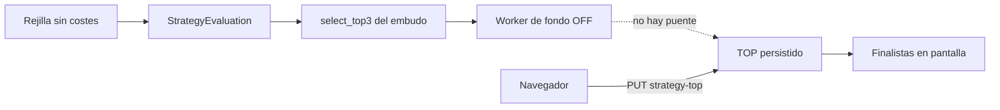

# Auditoría del universo LABORATORIO (LAB) · 2026-11-16

> **Padre:** [índice de ingeniería](./engineering-index-2026-08-03.md)
> **Slice:** auditoría (read-only). **No modifica producto.**
> **Alcance:** el universo LAB completo — puerta `/backtests`, pestaña *Laboratorio* de `/research`
> (`/asesor`), y el stack científico que los alimenta, incluido el puente hacia TRADING.
> **Plan de remediación:** [plan-remediacion-laboratorio-2026-11-16.md](./plan-remediacion-laboratorio-2026-11-16.md).
>
> **Invariantes de esta tanda:** `Δ motor = 0` · `Δ decisión = 0` · sin migración ·
> sin `contract:gen` · `openapi.json` y `schema.d.ts` intactos · sin `git add` ni commit.
> Este documento **no** arregla nada: declara qué es cierto hoy y con qué evidencia.

---

## 1 · Pregunta y método

La pregunta que esta auditoría debe responder es una sola, y es de negocio:

> ¿El LAB descubre y entrega a TRADING una operativa **rentable neta de costes**, o solo
> clasifica estrategias con métricas risk-adjusted que pueden perder dinero?

El método es lectura del árbol de trabajo y contraste de cada afirmación contra el código. No
se acepta ningún hallazgo por documento ni por informe intermedio: **toda cifra de este
documento se verificó en el fichero citado**. Las líneas son del árbol auditado y son
indicativas; el anclaje estable es el símbolo.

## 2 · Estado verificado (F0)

| Dato | Valor |
| --- | --- |
| `HEAD` | `357aed91` |
| Rama | `main` |
| Último commit | 2026-11-15 18:00:51 +0100 |
| Árbol | **sucio**: 156 entradas en `git status --porcelain` |

**Consecuencia de lectura:** los hallazgos de este documento se atribuyen al **contenido del
árbol**, no a un objeto publicado. Ningún hallazgo se imputa a los cambios sin commitear, y
varios de ellos viven en ficheros que no aparecen en ese diff. Antes de citar este documento
como certificación de un sello hay que repetir la medición sobre el commit del sello.

## 3 · Qué es hoy el LAB

### 3.1 Una puerta, un inquilino

`/backtests` es la puerta de producto del universo LAB ([ADR-040](./../adr/040-user-information-architecture.md)).
La pestaña *Laboratorio* del Asesor es **una segunda entrada al mismo destino**, con otro
nombre y sin chip de universo: el mismo contenido con hasta tres etiquetas distintas
(`Tesis`, `Investigación`, `Laboratorio`) según la superficie
([asesor-hub-tabs.tsx](../../apps/web/src/features/research/asesor-hub-tabs.tsx)).

Terminológicamente hay un problema previo que esta auditoría no resuelve pero sí registra:
**«LAB» tiene cinco sentidos** en el repo — universo, puerta de producto, capa de seguimiento
de estrategia en `PROJECT_PREMISES` §6.4, el conjunto de gates («las siete puertas del Lab») y
un namespace de parámetros. Cualquier frase del tipo «el LAB exige» es ambigua hasta que se
califique.

### 3.2 La cadena real de la evidencia

```
rejilla de parámetros  →  trial.score (bruto)  →  campeón  →  gates  →  TOP3  →  FINALISTA  →  ACTIVE
      simulación             sin costes           max score   4–7        selection   lifecycle   promote
```

El punto que importa: **la primera celda no aplica costes**, y todas las siguientes heredan esa
ausencia. Un gate colocado al final no puede reparar una medición que nació sin fricción.

### 3.3 Dos «mejores» que no se tocan

Existen hoy **dos productos distintos llamados TOP**, sin puente entre ellos:

- el **TOP3 del embudo**, que produce `select_top3` a partir de `StrategyEvaluation`
  ([strategy_top3_coach_phase.py](../../packages/py/application/src/bolsa_application/strategy_top3_coach_phase.py)),
  calculado en workers de fondo;
- el **TOP persistido por instrumento**, que la UI escribe con `PUT /instruments/{id}/strategy-top`
  ([instrument_strategy_tops.py](../../apps/api-python/src/bolsa_api/api/v1/routes/instrument_strategy_tops.py)).

`UpsertInstrumentStrategyTop` tiene **un único llamador en todo el repo**: esa ruta HTTP
([instrument_strategy_tops.py:116](../../apps/api-python/src/bolsa_api/api/v1/routes/instrument_strategy_tops.py)).
Es decir, **el TOP que ve el usuario nace en el navegador**, y los slots que produce el embudo
(`rank`, `candidateId`, `runId`, `score`, `evidenceLevel`) no llevan `ret`, `dd` ni `excess`
([strategy_top3_coach_phase.py:158-167](../../packages/py/application/src/bolsa_application/strategy_top3_coach_phase.py)).



Consecuencia: **«lo que el LAB eligió» y «lo que la UI muestra como elegido» son dos hechos
independientes**. Nada obliga a que el TOP en pantalla provenga de una evaluación del LAB.

## 4 · Hallazgo A-1 — La función objetivo no es una función de beneficio

Es el hallazgo que explica todos los demás.

### 4.1 La fórmula

Una sola línea decide «mejor» en el universo entero:

```python
return round(total_return_pct - (max_drawdown_pct * 0.25), 4)
```

([optimize/metrics.py](../../packages/py/analytics/src/bolsa_analytics/optimize/metrics.py), y su
copia operativa en [optimize/grid_is_metrics.py](../../packages/py/analytics/src/bolsa_analytics/optimize/grid_is_metrics.py) `:29`.)

Es un retorno **bruto** menos una fracción fija del drawdown. El peso `0,25` no procede de
ninguna calibración documentada: es una preferencia retorno-versus-drawdown, no una medida de
rentabilidad. El ranking ordena por `trial.score` y el campeón es su máximo
([grid_is_metrics.py:29-33](../../packages/py/analytics/src/bolsa_analytics/optimize/grid_is_metrics.py)).

### 4.2 Los costes no se aplican en ninguna parte de la rejilla

`compute_is_metrics` **no aplica** costes: recibe la curva de equity y los PnL de round trip ya
calculados y solo **declara** los bps del modelo
([backtest.py:171-243](../../packages/py/analytics/src/bolsa_analytics/backtest.py)).

Los cuatro simuladores de rejilla hacen aritmética de precio puro —`cost = quantity * fill_price`,
`proceeds = shares * fill_price`— sin comisión, deslizamiento ni horquilla, y no pasan el
argumento `costs`:

- [sma_grid.py:74-90](../../packages/py/analytics/src/bolsa_analytics/optimize/sma_grid.py)
- [rsi_grid.py:71-87](../../packages/py/analytics/src/bolsa_analytics/optimize/rsi_grid.py)
- [macd_grid.py:85-101](../../packages/py/analytics/src/bolsa_analytics/optimize/macd_grid.py)
- [rules_grid.py:97-113](../../packages/py/analytics/src/bolsa_analytics/optimize/rules_grid.py)

`finalize_grid_is_metrics` llama a `compute_is_metrics` **sin** `costs=`
([grid_is_metrics.py:20-28](../../packages/py/analytics/src/bolsa_analytics/optimize/grid_is_metrics.py)),
de modo que se aplica el valor por defecto de `BacktestCostModel`: **0 / 0 / 0 bps**
([backtest.py:50-55](../../packages/py/analytics/src/bolsa_analytics/backtest.py)).

**Corolario incómodo de representación:** el payload de cada trial sale con
`commissionBps: 0`, `slippageBps: 0`, `spreadBps: 0`. Un consumidor no puede distinguir «costes
medidos y nulos» de «costes no configurados». El cero aquí es un hueco disfrazado de dato.

La ruta humana (`run_backtest`) sí recibe un modelo de costes y sí añade benchmark
(`buyHoldReturnPct`, `excessReturnPct`); la ruta de rejilla, que es la que genera el universo de
candidatos, no.

### 4.3 El desajuste de unidades que hace el gate franqueable

Aquí está la aritmética que convierte el diseño en un agujero:

| Magnitud | Valor | Unidad |
| --- | --- | --- |
| Tolerancia del gate `backtest` | `1e-9` | puntos porcentuales |
| Umbral del gate `oos` (`min_oos_score`) | `0,1` | puntos porcentuales = **10 bps** |
| Coste de ida y vuelta que el propio repo asume | **22–32** | bps ([baseline_arms.py:52-58,74-76](../../packages/py/application/src/bolsa_application/baseline_arms.py)) |

Un round trip cuesta entre **0,22 y 0,32 puntos**. El umbral OOS pide **0,1 puntos**. Es decir:
**el gate se satisface con la mitad del coste de una sola operación.**

Ejemplo reproducible con los umbrales vigentes ([strategy_lab_phase.py:219-227](../../packages/py/application/src/bolsa_application/strategy_lab_phase.py)):

| Trial | Retorno bruto | DD máximo | `score` | Gate |
| --- | --- | --- | --- | --- |
| IS | +5,60 % | 22,0 % | 5,60 − 5,50 = **+0,10** | PASS (`> 1e-9`) |
| OOS | +1,10 % | 4,0 % | 1,10 − 1,00 = **+0,10** | PASS (`>= 0,1`, justo) |

Con 10 round trips cerrados a 32 bps, la fricción es **3,2 puntos**: el retorno neto real es
≈ **−2,1 %** y el LAB acaba de declarar el campeón válido.

### 4.4 Los gates no son monótonos entre estados

`risk` exige drawdown medido y muestra mínima de 30 round trips
([strategy_lab_phase.py:346-364](../../packages/py/application/src/bolsa_application/strategy_lab_phase.py)),
pero **no se exige para entrar en FINALISTA**:

```python
StrategyLifecycleState.FINALISTA: ("backtest", "robustness", "walk_forward", "oos"),
```

([strategy_lifecycle.py:119-133](../../packages/py/domain/src/bolsa_domain/entities/strategy_lifecycle.py))

Es decir: un campeón con un drawdown que **el propio LAB habría rechazado** en la fase de
promoción entra en FINALISTA con cuatro gates. El conjunto de requisitos debería crecer con el
estado y decrecer nunca; hoy hay un gate que aparece y desaparece.

### 4.5 P1 está medido en producción y sin cablear

Esta es la corrección más importante al diagnóstico inicial. No es que falte la medición: es
que **existe, en cuatro sitios, y ninguno alimenta un gate del LAB**.

| Productor | Qué mide | Dónde |
| --- | --- | --- |
| `BASELINE_THRESHOLDS` | política ya fijada **antes** de medir: `minNetReturnPct`, `minExcessVsBuyHoldPct`, `minRoundTripCostBps = 22` | [baseline_arms.py:52-58](../../packages/py/application/src/bolsa_application/baseline_arms.py) |
| `dia_d_equity_evidence` | `netReturnPct`, `buyHold.excessPct`, coste realizado por round trip, con **base de coste declarada** | [dia_d_equity_evidence.py:616-648](../../packages/py/application/src/bolsa_application/dia_d_equity_evidence.py) |
| `oos_finance` | `net_return_pct` y `net_return_pct_at_stress` por estrategia×instrumento; ratios `None` y lista `unmeasured` en vez de ceros | [oos_finance.py:126-158,342-441](../../packages/py/application/src/bolsa_application/oos_finance.py) |
| `auto_adaptive` | `net_expectancy_r`, `shrunk_expectancy_r`, `expectancy_interval` (bootstrap por episodios) | [auto_adaptive.py:403-460](../../packages/py/analytics/src/bolsa_analytics/cognitive/auto_adaptive.py) |

**El vocabulario «Sin dato todavía» ya está en `oos_finance`**, literal, en la lista de huecos
declarados ([oos_finance.py:412-430](../../packages/py/application/src/bolsa_application/oos_finance.py)).
La maquinaria del hueco declarado existe; solo no está conectada al embudo.

**Y hay una advertencia que impide usarla a ciegas:** el drawdown de `dia_d_equity_evidence` es
**pico-valle de caja realizada**, no de cartera a mercado, y el propio módulo lo declara
([dia_d_equity_evidence.py:622-628](../../packages/py/application/src/bolsa_application/dia_d_equity_evidence.py)).
No puede entrar como componente de riesgo sin leer su base.

## 5 · Checklist falsable de las premisas

Veredicto por premisa, con la evidencia que lo sostiene. **Cumple / Parcial / No cumple**
significa que el producto **hoy** lo satisface, no que sea alcanzable.

### P1 — beneficio neto de costes, expectancy/R positiva, exceso vs benchmark

**No cumple.** No existe ningún gate que lo exija, y la métrica que decide «mejor» es bruta.

- `PROMOTION_GATES` son exactamente siete y ninguno es de beneficio
  ([strategy_lifecycle.py:100-108](../../packages/py/domain/src/bolsa_domain/entities/strategy_lifecycle.py));
  un test fija ese conjunto como contrato
  ([test_auto_orchestrator.py:374-384](../../packages/py/application/tests/test_auto_orchestrator.py)).
- La barrera del TOP3 no son siete gates, sino los cuatro de FINALISTA, derivados y
  configurables: `LAB_VALIDATED_GATES = required_gates_for(FINALISTA)`
  ([strategy_top3_coach_phase.py:35](../../packages/py/application/src/bolsa_application/strategy_top3_coach_phase.py)).
  Además `min_gates` **admite relajación explícita** por parte del llamador
  ([strategy_top3_coach_phase.py:120-141](../../packages/py/application/src/bolsa_application/strategy_top3_coach_phase.py)):
  la barrera es un parámetro, no una invariante.
- El gate `backtest` acepta cualquier `score` positivo y el `oos` acepta 0,1 puntos (§4.3).
- El gate de paper del cliente no mira beneficio ni expectancy: solo `has_trades` y
  `saved_strategy` ([backtest-paper-gate.ts](../../apps/web/src/features/backtests/backtest-paper-gate.ts)).
- El veredicto de zona «mejoró» se decide con retorno y retorno/DD, sin coste ni benchmark
  ([lab-zone-verdict.tsx](../../apps/web/src/features/backtests/lab-zone-verdict.tsx)).

### P2 — entrada y salida inequívocas

**No cumple en el LAB.** No existe primer nivel de entrada/stop/objetivo en `/backtests`; el
plan solo aparece en la fila de Finalistas y en el bloque de decisión de TRADING. Un candidato
del LAB no declara cómo se entra ni cómo se sale.

### P3 — estrategia confirmada + especificación de indicadores

**Parcial.** El LAB nombra el campeón y su `presetKey`, y `indicatorSpecs` existe aguas abajo en
la proyección del análisis diario, pero **no** se publica en el primer nivel del resultado del
LAB. El usuario ve un Sharpe, no una estrategia con sus indicadores.

### P4 — evaluación DÍA-D multicapa

**Parcial, y con la capa de ejecución honesta.** Las capas `READY/INCONCLUSIVE`,
`MATCH/PARTIAL/DIVERGENT` y `OOS_SUPPORTED/MIXED/REFUTED` existen; `CONFIRMED` está **reservado
y ningún branch lo emite** ([paper_evidence_adapter.py](../../packages/py/application/src/bolsa_application/paper_evidence_adapter.py)).
El problema no es la honestidad del veredicto, es la ubicación: la certificación as-run vive
fuera del LAB y el usuario tiene que cambiar de superficie para verla.

### §6.4 — proyección sin recalcular, `UNKNOWN ≠ 0`

**No cumple en el LAB.** `backtest-paper-gate` coerciona valores ausentes a `0`:

```ts
const mean = evidence!.meanOosScore ?? evidence!.oosScore ?? 0;
```

([backtest-paper-gate.ts:73](../../apps/web/src/features/backtests/backtest-paper-gate.ts), y otra
vez en `:137` con `maxDrawdownPct` en `:215`)

Un OOS no medido se convierte en «0», que **no es negativo** y por tanto pasa. Es exactamente la
violación de `UNKNOWN ≠ 0` que la premisa prohíbe, en la superficie que decide si se despliega.

### §7 — todo simulado, sin órdenes reales, sin promesa de rentabilidad

**Cumple.** Ningún documento promete rentabilidad y el más explícito la desmiente
([PROJECT_PREMISES.md:364-368](./../PROJECT_PREMISES.md)). El incumplimiento de esta sección
**no** es una promesa de beneficio: es la **completitud de la promoción** y el **destino del
despliegue** (§7).

## 6 · Hallazgos B — confianza y alcanzabilidad

### B-1 · El embudo no se puede disparar por HTTP

`AutoOrchestrator.run_cycle` se invoca **solo** desde el worker de fondo, con
`AUTO_ORCHESTRATOR_ENABLED` por defecto OFF
([auto_orchestrator_worker.py](../../apps/api-python/src/bolsa_api/background/auto_orchestrator_worker.py)).
No existe ninguna ruta que ejecute `run_cycle`, `select_top3` ni `decide_promotion`. La UI puede
prometer un embudo que, en el mejor caso, corre de noche y nunca bajo demanda del usuario.

### B-2 · El TOP persistido es autoría del cliente

La ruta valida 1–3 slots, ranks consecutivos y `runId` **no vacío**. No comprueba que el `runId`
exista en `backtest_runs`, ni que pertenezca al instrumento, ni que ese run tenga evidencia de
LAB ([instrument_strategy_tops.py](../../apps/api-python/src/bolsa_api/api/v1/routes/instrument_strategy_tops.py)).
Un `runId` inventado con formato plausible es aceptado.

Esto importa más de lo que parece: `evidenceLevel: "lab_validated"` es el campo que hace que
otras superficies traten el slot como evidencia. **El nivel de evidencia lo declara el cliente.**

### B-3 · Una superficie de lectura muta estado persistente

El panel de Finalistas tiene un `useEffect` que, al detectar tipos desalineados, **reescribe el
TOP en el servidor y sube `version`**, sin acción del usuario
([instrument-strategy-top-panel.tsx:493-535](../../apps/web/src/features/backtests/instrument-strategy-top-panel.tsx)).

El mecanismo tiene su lógica (reparar datos legados), pero el efecto neto es que abrir una
pantalla puede cambiar el registro de evidencia. Con P1 como gate, esto adquiere otra gravedad:
una reparación silenciosa podría enmendar un slot que ya no cumple.

### B-4 · `deploy-paper` no escribe trades DEMO, y el copy dice tres veces lo contrario

El camino real: `paper_bridge` → `create_paper_account` →
`_create_investment_account`, que escribe

- una cuenta con `type="paper"`,
- una cartera legacy y una cartera de inversión,
- **un asiento `deposit`** etiquetado «Depósito inicial (paper forward-test)» en el ledger **de
  esa cuenta nueva**,
- y `settings_json.labEvidence` con la procedencia.

([paper_bridge.py:82-99](../../packages/py/application/src/bolsa_application/paper_bridge.py),
[account_repository.py:356-378](../../packages/py/infrastructure/src/bolsa_infrastructure/database/repositories/account_repository.py))

**Cero trades.** El asiento es un depósito, no una operación.

Y el copy canónico dice lo opuesto en tres documentos de referencia:

| Sitio | Texto |
| --- | --- |
| [paper-paths-copy.ts:19-26](../../apps/web/src/features/settings/paper-paths-copy.ts) | «Despliega sobre la cuenta activa DEMO (simulada)…» · «cuenta activa DEMO, no tipo Paper/broker» |
| [domain-language.md:125-126](./../domain-language.md) | «Paper (tipo cuenta): Futuro: cuenta **real** enlazada a broker» · «Desplegar en demo … **No** significa: crear cuenta tipo Paper» |
| [research-lifecycle.md:19](./research-lifecycle.md) | «Checklist = deploy en cuenta activa **DEMO**» |

Las tres frases son falsas respecto del código, y las tres viven donde se documenta la
autoridad. El documento que se presenta como «una palabra → un significado»
([domain-language.md:3](./../domain-language.md)) define `Paper` con el significado opuesto al
que el código implementa.

## 7 · Hallazgos C — honestidad de representación y documentos

### C-1 · `HELP.md` promete dos cosas que el código no hace

- «**Cómo se confirma (puertas que no se saltan)**» ([HELP.md:194](./../HELP.md)): las puertas
  se aplican en `decide_promotion`, **no** en la escritura del TOP. Escribir el TOP no exige
  ningún gate (B-2).
- «`CONFIRMED` **no existe en el código**» ([HELP.md:210](./../HELP.md)): la constante
  `VALUE_CONFIRMED = "CONFIRMED"` existe; lo cierto es que **ningún branch la emite**. La
  formulación correcta es más fuerte, no más débil: «está reservada y no se emite».
- La tabla de gates lista siete y describe `backtest` como «campeón IS con resultado positivo»
  ([HELP.md:196-205](./../HELP.md)), que es precisamente la definición que P1 invalida.

### C-2 · Documentos con cabecera obsoleta

`ADR-019` declara «Implementación: pendiente» y, dos líneas después, «Código: U1–U5
implementados» ([ADR-019:10,139-140](./../adr/019-dual-universes-lab-vs-trading.md)). El
diseño dual repite el estado «pendiente» con todas sus fases cerradas
([dual-universes-lab-trading-design-2026-08-02.md:7](./dual-universes-lab-trading-design-2026-08-02.md)).
Las premisas DÍA-D siguen declarando «as-is híbrido hasta U2» con U2 cerrado
([backtesting-dia-d-premises-2026-07-31.md:68](./backtesting-dia-d-premises-2026-07-31.md)).

### C-3 · `P1` tiene cinco sentidos

Prioridad de producto (§6.1), gate operativo de ≥60 días, severidad de hallazgo, id de auditoría
y, desde esta auditoría, el gate de beneficio. **Cualquier escritura sin calificar será ambigua**;
el plan de remediación usa `P1-gate` para el nuevo.

### C-4 · `H-8` está cerrado sin registro de cierre

La pestaña por defecto del Asesor era la más vacía (`H-8`,
[auditoria-operativa-asesor-2026-11-15.md:100](./auditoria-operativa-asesor-2026-11-15.md)). El
rediseño lo resolvió (cuatro pestañas, Cartera por defecto), pero la certificación del Asesor
solo registra `H-20`…`H-23` como cerrados. El cierre existe en código y no en el expediente.

## 8 · Cobertura y CI

- `pnpm test:optimize` **no ejecuta** ninguno de los tests de gates del LAB.
- `test_strategy_lifecycle_pg.py` no está en la lista `--ignore` del job offline
  ([python-ci.yml:431-533](../../.github/workflows/python-ci.yml)) y solo corre con PostgreSQL en
  el job dedicado: sin guarda anti-skip, el job offline puede registrar un `skipped` que aparenta
  cobertura.
- Los paneles `lab-*` no tienen test DOM: se afirman sobre el texto fuente.
- El append-only de Evidence no está fijado por ningún test.
- No hay e2e de `/research` ni de `/backtests`.

Ninguno de estos huecos **crea** un defecto; lo que hacen es permitir que los defectos de este
documento sobrevivan a una suite verde. Es la razón de que la cobertura sea una línea de
remediación y no una observación.

## 9 · Veredicto

**Verificación sólida. Generación de beneficio no demostrada, y hoy estructuralmente imposible de
demostrar con los gates vigentes.**

Desglose por capa:

| Capa | Veredicto |
| --- | --- |
| Filosofía y separación LAB/TRADING | **Sólida.** El diseño dual es coherente; el drift es documental, no conceptual. |
| Rigor estadístico (PBO, CPCV, WFE, DSR) | **Sólido como método.** Mide overfitting de una hipótesis; no mide rentabilidad. |
| Función objetivo | **Rota respecto del objetivo de negocio.** Optimiza una preferencia bruta retorno/DD. |
| Puerta de promoción | **Incompleta.** Siete gates sin beneficio neto, sin benchmark, sin expectancy; no monótona entre estados. |
| Alcanzabilidad | **Nula por HTTP.** Solo worker OFF. |
| Confianza del dato | **Débil.** TOP autorado por cliente; nivel de evidencia declarado por el cliente; auto-escritura. |
| Representación | **Contradictoria** en `deploy-paper` y en dos afirmaciones de `HELP.md`. |
| Cobertura | **Insuficiente donde importa.** |

La formulación honesta de una línea: **el LAB es un buen instrumento para saber si una
estrategia es robusta, y no es todavía un instrumento para saber si gana dinero.** No es un
fallo de implementación: es una ausencia en la definición de «mejor».

## 10 · Límites de esta auditoría

- No se ejecutó la batería de tests ni el CI: el veredicto es de **lectura**, no de ejecución.
- El árbol auditado está **sucio** (156 entradas). Un sello exige repetir la medición.
- No se verificó el comportamiento de `attach_lab_edge_report` cuando el holdout está desactivado
  línea a línea; la afirmación de que `sampleTradesCount` equivale a los round trips OOS del
  campeón descansa en `optimize.py` y en el runner, no en una lectura exhaustiva.
- El número de revisión de Alembic solo se comprobó por existencia; el plan de remediación no
  necesita migración, pero una implementación que promueva campos de P1 a columnas sí la
  necesitaría.
- Los umbrales citados son los **defaults de código**; un operador puede haberlos cambiado por
  entorno (`AUTO_ORCHESTRATOR_LAB_*`). La conclusión estructural no depende de sus valores
  concretos, solo la aritmética del ejemplo de §4.3.
- No se auditaron los módulos `core_r`, `adaptation_*` ni `dia_d_certification` en profundidad:
  pertenecen a la frontera con TRADING y su revisión corresponde a la auditoría de ese universo.
