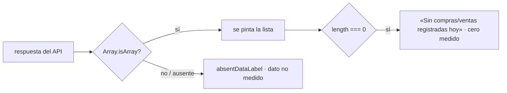

# Auditoría de la operativa de ASESOR · 2026-11-15

> **Padre:** [índice de ingeniería](./engineering-index-2026-08-03.md)
> **Slice:** A0 (auditoría). **No modifica producto.**
> **Alcance:** toda la puerta ASESOR (`/research`) — las seis pestañas, sus datos y sus guardas.
>
> **Invariantes de todo el frente:** `Δ motor = 0` · `Δ decisión = 0` · sin migración ·
> sin `contract:gen` · `openapi.json` y `schema.d.ts` intactos · `compute_stance`, umbrales,
> gate, sizing, ejecución y AUTO sin tocar · sin `git add` ni commit.

## 1 · Qué se audita y con qué método

Se audita la **puerta de producto** Asesor según [ADR-040](./../adr/040-user-information-architecture.md):
«¿qué pienso / estudio?». No se audita el motor, que está congelado por
[ADR-022](./../adr/022-estudio-daily-opinion-motor.md), ni la ventana DECISIÓN, ya
certificada en [S5](./certificacion-s5-rediseno-2026-11-12.md).

Método: lectura del árbol de trabajo, contraste contra las guardas existentes y verificación
de cada afirmación en el código. **Las líneas citadas corresponden al árbol del 2026-11-15 y
son indicativas; el anclaje estable es el símbolo.**

## 2 · Estado actual: seis pestañas y tres juegos de nombres

`HubTab` admite seis ids y `parseTab` cae en `dashboard` ante cualquier valor desconocido
([research-page.tsx](../../apps/web/src/features/research/research-page.tsx), `parseTab`).

| id | label en el hub | label en el menú superior | componente | contenido real |
| --- | --- | --- | --- | --- |
| `cartera` | Cartera | *(sin entrada)* | `AsesorCarteraPanel` | lista de 9 columnas por valor |
| `opiniones` | **Análisis** | **Opiniones** | `AsesorOpinionesPanel` | bandeja de dictamen y canales |
| `dashboard` | **Tesis** (por defecto) | **Resumen** | bloque inline | resumen del **Laboratorio** |
| `journal` | Journal | *(sin entrada)* | tarjeta inline | puente a `/decision-journal` |
| `diario` | Diario | Diario | `AsesorDailyOpsPanel` | resumen operativo del día |
| `history` | **Investigación** | **Historial** | bloque inline | historial del **Laboratorio** |

El mismo destino tiene hasta tres nombres distintos (`Análisis` / `Opiniones` /
`Opiniones de hoy`), y dos pestañas que dicen llamarse «Tesis» e «Investigación» son en
realidad las dos mitades del Laboratorio, que ya es puerta L1 propia en `/backtests`.

## 3 · Tres implementaciones del dictamen

La recomendación del día se pinta **a mano, tres veces**, y ninguna superficie usa el bloque
canónico de S1 (`OperativaDictamenBlock` en
[operativa-dictamen.tsx](../../apps/web/src/features/trading/operativa-dictamen.tsx)), que ya
está certificado y concentra `marketStanceLabel`, `visibleReasons`, `formatConfidence` y la
★ sin medir.

| Superficie | Cómo pinta la postura | ★ | Motivos | Chips propios |
| --- | --- | --- | --- | --- |
| Cartera (celda) | `row.recommendation.label` precalculado | `starsLabel` precalculado | `reasons[0]` truncado | riesgo, VETO/WARNING |
| Análisis (ítem) | `marketStanceLabel(...)` en el render | `formatDictamenStars` | primer visible + tooltip | TOP n |
| Diario (lista) | `marketStanceLabelFromKey` | `formatDictamenStars` | — | canal alarma/aviso |

Consecuencia: la misma opinión se traduce con dos mecanismos (proyección en
[asesor-cartera.ts](../../packages/shared/src/cognitive/asesor-cartera.ts) frente a
`market-vocabulary` en el render) y la ★ puede presentarse con dos formatos. Además,
`visibleReasons` se ejecuta en la proyección y **otra vez** al renderizar el bloque canónico
para la misma opinión.

## 4 · Deuda de datos y de red

- **Universo repetido.** Cartera, Análisis y Diario piden dictamen para el mismo conjunto de
  `instrumentId`. Cartera y Análisis comparten `queryKey`, así que se deduplican mientras la
  caché esté fresca; Diario vuelve a pedir el universo con su propio `refetchInterval`.
- **Análisis dispara tres lecturas** sobre los mismos ids: dictamen, `telemetry` y
  `auto-telemetry`.
- **N+1 de velas.** No hay endpoint batch de OHLCV: Cartera hace una petición por instrumento
  con concurrencia 4, amortiguada solo por la caché del gráfico.
- **Dos frescuras para las mismas velas**: `ASESOR_CARTERA_BARS_STALE_MS` (5 min) frente al
  `staleTime` interno del `fetchQuery` (60 s) en
  [use-asesor-cartera-data.ts](../../apps/web/src/features/research/use-asesor-cartera-data.ts).
- **Campos calculados y nunca consumidos** por el panel: `enriching`, `barsError`,
  `barsMissingIds` y `portfolioMeasured`. Un dato que se calcula y no se pinta es deuda:
  o se consume o se retira.

## 5 · Matriz «midiendo / ausente / medido»

| Panel | Midiendo | Ausente declarado | Riesgo observado |
| --- | --- | --- | --- |
| Cartera | por fuente (`quotes`, `bars`, `opinions`) y siete banners de ausencia | sí, con causa | correcto; es la referencia del frente |
| Análisis | telemetría y dictamen por separado | «sin dictamen» con `asesor-opinion-missing` | jerga técnica en primer nivel |
| Diario | «Generando resumen…» | `estudioStatus` vacío/no disponible | una cuenta válida sin informe dice «Selecciona una cuenta DEMO activa» |
| Laboratorio (`dashboard`) | resumen y salud | tarjeta «aún no hay experimentos» | sin rama de error para la salud del lab |
| Laboratorio (`history`) | lista y detalle | «No hay experimentos con estos filtros» | sin rama de error para el detalle |

## 6 · Hallazgos

Severidad: **A** = dato incorrecto o atribución errónea; **B** = claridad o contrato de
producto; **C** = higiene.

| id | Sev | Hallazgo | Evidencia |
| --- | --- | --- | --- |
| H-1 | A | Caché cruzada entre cuentas: `a6Query` usa `effectiveAccountId` en la `queryFn` pero no en la `queryKey`; al cambiar de cuenta se sirve la telemetría anterior | `asesor-opiniones-panel.tsx`, `queryKey` de `a6Query` |
| H-2 | A | `UNKNOWN ≠ 0` roto en el detalle del experimento: `commissionBps ?? 0`, `slippageBps ?? 0`, `spreadBps ?? 0` presentan un hueco como cero medido | `research-trial-result-block.tsx`, bloque de costes |
| H-3 | A | `—` como comodín en primer nivel: los KPI del Diario usan `formatPrice`, que devuelve `"—"`; existe `formatPriceOrAbsent` para el rótulo honesto | `asesor-daily-ops-panel.tsx` + `chart-utils.ts` (`formatPrice`) |
| H-4 | A | «Actuar en Hoy» navega a `/confirm`; «Hoy» es `/mesa` en todo el producto | `asesor-opiniones-panel.tsx` + `CONFIRM_PATH` en `confirm-nav.ts` |
| H-5 | B | `overbought` **sin posición** no está en el `switch` del clasificador: cae en la rama `default` y se declara «Dictamen no reconocido», que no es ninguna de las cinco categorías de producto · **cerrado en el cierre A5** (§6.b) | `classifyAsesorCarteraState` en `asesor-cartera.ts` |
| H-6 | B | Las causas de cartera no medida se evalúan **antes** de mirar la postura, así que se aplican a cualquier `stance`, no solo a `no_trade` · **intencionado** (§6.b) | mismo símbolo |
| H-7 | B | El dictamen tiene tres implementaciones y ninguna usa el bloque canónico de S1 | §3 |
| H-8 | B | «Tesis» e «Investigación» son el Laboratorio; la pestaña por defecto es además la más vacía, porque todas sus métricas viven dentro del `TechnicalDetail` | `research-page.tsx` |
| H-9 | B | `?tab=cartera` y `?tab=journal` no tienen entrada en el menú superior ni en la command palette: solo se llega clicando | `app-top-bar.tsx` (`RESEARCH_MENU`) |
| H-10 | B | Desincronización URL ↔ estado en Investigación: los filtros se leen una sola vez, `sort` y `page` no se serializan, y `trialId` sobrevive al cambio de pestaña manteniendo viva la petición de detalle | `research-page.tsx` |
| H-11 | B | El gate de primer nivel no cubre `asesor-opiniones-panel.tsx` ni `asesor-daily-ops-panel.tsx`: las superficies con más jerga quedan fuera de la guarda | `research-first-level.test.tsx`, `SOURCES` |
| H-12 | B | Jerga de ingeniería en primer nivel: «Telemetría A0/A6», «Proxy Outcomes», «P1–P5 en Consola», «Execute env», `prec.5d`, `recall≈` | `asesor-opiniones-panel.tsx` |
| H-13 | B | Pestañas del hub sin semántica de pestañas (`role`/`aria-selected`); filas del historial clicables sin soporte de teclado | `HubTabButton` y tabla de historial |
| H-14 | C | `data-testid` duplicado: `research-trial-technical` se emite dos veces en el mismo árbol | `research-page.tsx` y `research-trial-result-block.tsx` |
| H-15 | C | `data-testid` de estado por fila se repite: solo hay cinco valores únicos para toda la tabla | `asesor-cartera-panel.tsx` |
| H-16 | C | El predicado «posición abierta» está replicado aunque existe `position-open-hint.ts` | cuatro módulos |
| H-17 | C | El mismo concepto «aviso» usa ámbar en Análisis y azul en Diario | ambos paneles |
| H-18 | C | Copy de alcance repetida dos veces en la misma tarjeta de Cartera | `asesor-cartera-panel.tsx` |
| H-19 | C | Hero del Diario con gradiente hex, `text-white`, `bg-black/20` y `font-serif` fuera de tokens: no responde al tema | `asesor-daily-ops-panel.tsx` |
| H-20 | C | Tamaños inconsistentes entre pestañas: paneles hermanos aceptan `className` y el Diario no · **cerrado** (§6.c) | tres paneles |

## 6.b · Cierre de los hallazgos del clasificador (2026-11-15)

**H-5 · cerrado.** Una postura de salida medida deja de ser un mensaje de error:

| Antes | Ahora |
| --- | --- |
| `overbought` sin posición → rama `default` → `sin_datos` con grieta «Dictamen no reconocido» | `senal_de_salida_sin_posicion` |
| `reduce` / `sell_exit` sin posición → `sin_datos` con grieta «Dictamen de salida sin posición medida» | `senal_de_salida_sin_posicion` |

La sexta categoría se declara en `ASESOR_CARTERA_STATE_IDS` y en `ASESOR_CARTERA_STATES`
con `rank` 3, entre posición viva y «Sin oportunidad». Motivo: el invariante
`UNKNOWN ≠ 0` leído al revés — si el dictamen de salida se midió, declarar «falta un
dato» es falso. A la vez la categoría afirma lo contrario de una orden: **no abre
corto, no propone venta y no es una sobrecompra técnica**. El `default` del `switch`
sobrevive solo como red para claves realmente desconocidas, con el mismo texto.

El badge usa **violeta** (tono informativo del producto), no ámbar: ámbar ya significa
«Posición sin respaldo» y reutilizarlo para un hecho distinto repetiría H-17.

**H-6 · intencionado, no se cambia.** Las causas de cartera no medida se evalúan antes
de la postura. Invertir el orden pintaría un `buy` con datos caducados como
«Recomendación favorable», que es justo la recomendación que este frente evita. El
precio es que un `reduce` con cartera sin medir dice «Cartera sin medir» y no «señal de
salida»; es un hueco declarado, no un dato inventado.

**Hallazgos nuevos del cierre** (fuera del alcance de A1–A4):

| id | Sev | Hallazgo | Evidencia |
| --- | --- | --- | --- |
| H-21 | C | Contraste AA en tema claro del armazón global: `--bolsa-muted-foreground` `#64748b` sobre `--bolsa-background` `#f4f6f9` da **4,39:1** (mínimo 4,5) en el subtítulo de página y en las pestañas; `--bolsa-primary` `#0d9488` sobre el mismo fondo da **3,45:1** en los enlaces del subtítulo y en «Asesor» del menú superior. El hero del Diario **no** se ve afectado (va sobre `--bolsa-card` `#fff` → 4,76:1) | axe en ambos temas, §5 de la [verificación](./evidence/operativa-asesor-2026-11-15/verificacion-2026-11-15.md) |
| H-22 | B | `/research?tab=diario` cae en la pantalla de error si el parte llega sin `tradesToday`, `notes` o `week`: el panel lee `.length` sin guarda. **Preexistente** — las mismas lecturas están en `HEAD`; el backend envía siempre el bundle completo, así que solo aparece con respuestas parciales o mocks | `asesor-daily-ops-panel.tsx`, actividad del día y notas |
| H-23 | C | `heading-order`: Cartera y Análisis abren su pestaña con un `h3` colgando directamente del `h1` de la página. **Preexistente** y detectado al repetir el barrido axe de este cierre; el propio `CardTitle` documenta el arreglo (`level="h2"` cuando la card es el primer bloque de la página) | `gp-e2e-ui5-0-axe-touched-routes-mock`, `/research` |

### 6.c · Cierre de H-20, H-21, H-22 y H-23 (2026-11-16)

Los cuatro se cierran en el mismo cambio porque comparten superficie y ninguno toca el
contrato.

**H-20 · firmas de panel.** `AsesorDailyOpsPanel({ className })` acepta `className` y lo
compone con `cn("space-y-4", className)`, igual que `AsesorCarteraPanel` y
`AsesorOpinionesPanel`. No cambia ningún tamaño por sí solo: la pestaña ya aplicaba el
suyo; lo que desaparece es la asimetría de firma.

**H-22 · el Diario declara la ausencia, no la convierte en cero.** El arreglo es una regla
de lectura, no un tipo nuevo:

`asDeclaredList` devuelve `readonly T[] | null` y `asDeclaredNumber` devuelve
`number | null`; **ninguno** rellena con `[]` ni con `0`. Solo la rama que pasó por
`Array.isArray` puede afirmar «cero operaciones», que es la diferencia entre un hueco y un
cero medido. Se aplicó a `tradesToday`, `ledgerToday`, `notes`, `f3PendingCount`,
`channels`, `opinions`, `week` y `summary` (hero). El gráfico de la semana ya no dibuja un
SVG vacío: `null`/ausente dice «Sin dato todavía» y `[]` dice «Sin movimientos registrados
esta semana».

No se tocó `packages/shared/src/daily-ops-report.ts`: el contrato sigue declarando los
campos obligatorios y el cast de la prueba deja constancia de que el tipo es más optimista
que la red. La tolerancia vive en la frontera de lectura.

**H-21 · contraste AA del tema claro, medido antes y después.**

| Token | Antes | Antes sobre `#f4f6f9` | Después | Después sobre `#f4f6f9` | Sobre `#e8eef5` (muted) | Sobre `#e2e8f0` (accent) |
| --- | --- | --- | --- | --- | --- | --- |
| `--bolsa-muted-foreground` | `#64748b` | 4,39:1 ✗ | `#566578` | **5,50:1** ✓ | 5,10:1 ✓ | 4,83:1 ✓ |
| `--bolsa-primary` | `#0d9488` | 3,45:1 ✗ | `#0e7268` | **5,35:1** ✓ | 4,96:1 ✓ | 4,70:1 ✓ |

El par que decide el valor de `--bolsa-primary` no es el fondo de página sino
`--bolsa-accent` `#e2e8f0`, donde se sienta «Asesor» del menú superior: teal-700 puro
(`#0f766e`) daba 4,44:1 ahí y habría seguido incumpliendo, así que se bajó un paso más
hasta 4,70:1. El texto del botón primary (`#f0fdfa`) mantiene **5,55:1** sobre el nuevo
fondo. El tema oscuro no se tocó.

**H-23 · jerarquía de encabezados.** `CardTitle level="h2"` en Cartera y Análisis. Sin
cambios visuales: el nivel del tag es documental.

Verificación final: `0` violaciones `critical`/`serious` en claro y en oscuro sobre
Asesor → Cartera, Asesor → Diario, `/mesa` y `/backtests`; el barrido axe de las 35
combinaciones de rutas L1 sigue verde (y por primera vez sin el fallo de `heading-order`
que arrastraba H-23).

## 7 · Lo que el refactor no puede romper

- `data-testid` observados por tests y E2E: `asesor-cartera`, `asesor-cartera-row`,
  `asesor-cartera-totals`, `asesor-cartera-detalle-<SYMBOL>`, `asesor-cartera-price-source-<SYMBOL>`,
  `asesor-cartera-recommendation-<SYMBOL>`, `asesor-cartera-distress-<SYMBOL>`,
  `asesor-opinion-missing`, `asesor-daily-ops`, `asesor-daily-ops-see-all`,
  `operativa-dictamen`, `operativa-dictamen-motivos`.
- Ruta `?tab=cartera` (E2E S5) y `asesorHistoryHref()` → `/research?tab=history`.
- Ids `cartera`, `opiniones`, `diario`, `history`, `journal`, `dashboard`: los consumen el menú
  superior, los toasts de alarma y la navegación diaria. Se conservan como alias aunque la
  pestaña visible cambie.
- Gate de primer nivel: 22 tokens prohibidos y los detectores de `—`, `Gate <crudo>` y `?? 0`.
- Ratchet de formato: `toFixed(2)` no puede crecer por encima de la línea base.
- **Los tests de fuente leen el archivo por ruta** con `readFileSync`: renombrar un `.tsx`
  rompe el test por ENOENT antes que por semántica. Toda extracción actualiza la lista
  `SOURCES` en el mismo cambio.

## 8 · Slices propuestos

| Slice | Contenido | Toca producto |
| --- | --- | --- |
| A1 | Hub de cuatro pestañas (Cartera, Análisis, Diario, Laboratorio) + Journal como enlace; alias conservados; menú superior alineado | sí |
| A2 | Un único bloque de dictamen reutilizado en las tres superficies | sí |
| A3 | Descomposición de los monolitos y primitivas comunes; cierre de H-1, H-14 a H-18 | sí |
| A4 | Jerga detrás del detalle técnico, gate ampliado y corrección de H-2 y H-3 | sí |
| A5 | Documento de diseño, certificación y evidencia; verificación completa | no |

H-5 quedó cerrado en A5 con la sexta categoría de producto. H-6 se declara conducta
intencionada (§6.b). H-20 a H-23 se cerraron en el cierre del 2026-11-16 (§6.c). El resto
de hallazgos (H-1 a H-4 y H-7 a H-19) siguen abiertos salvo los cerrados por A3/A4, que se
marcan en el diseño y en la certificación.

## 9 · Qué no autoriza este documento

Es una auditoría. No autoriza cambios de código, ni migraciones, ni `contract:gen`, ni tocar
el motor, ni bump de versión, ni tag, ni `git add` o commit. Cada slice requiere su propia
autorización y su propio cierre documental.

## Ver también

- [Diseño S3 · Cartera del Asesor](./diseno-asesor-cartera-s3-2026-11-12.md)
- [Concordancia backend ↔ UI de Asesor](./diseno-asesor-backend-ui-2026-11-12.md)
- [Glosario canónico de mercado](./glosario-mercado-asesor-2026-11-12.md)
- [Certificación S5 · rediseño S1–S4](./certificacion-s5-rediseno-2026-11-12.md)
