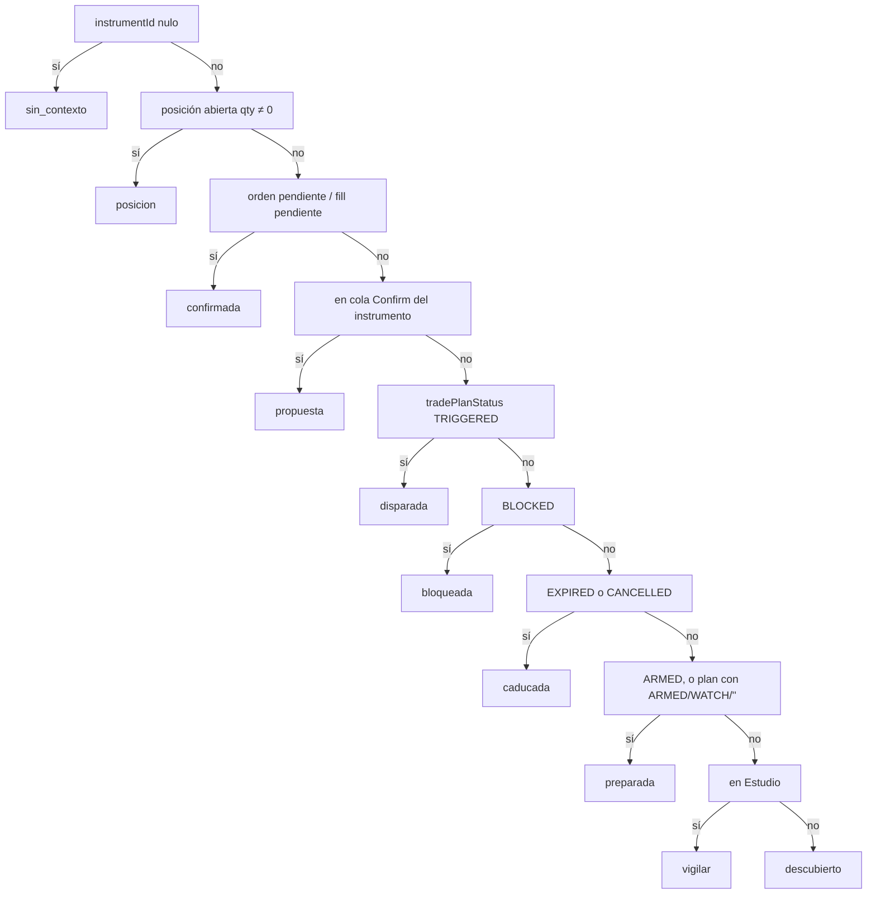

# Auditoría read-only — panel OPERATIVA DE MERCADO (bloques 1-3)

> **AsOf:** 2026-11-04 · **Base:** tag `v2.88.183-beta` (`package.json` `2.11.183-beta`), rama `fix/059-060-proveedores`, HEAD `09b395e5` (dos commits `docs(release)` posteriores al tag; `git diff --stat v2.88.183-beta..HEAD` solo toca `CHANGELOG.md` y `docs/engineering/PROJECT_STATE.md`).
> **Estado:** **AUDITORÍA EN SOLO LECTURA.** No se ha modificado ningún fichero de producto. Este documento es el único artefacto escrito.
> **Alcance:** bloques 1 (contexto), 2 (estados) y 3 (decisión) de la checklist acordada. Los bloques 4-10 quedan fuera de esta pasada.
> **Naturaleza:** UI / producto. `Δ` motor de decisión = 0. `Δ` FSM = 0. Sin cambios de contrato HTTP, sin migraciones, sin ejecución.
> **Certificación:** limitada a lo ejecutado aquí (§7). El CI verde de `.183` certifica el contenido y las pruebas de ese tag; no certifica los E2E live/integrated ni el producto completo, y esta pasada **no hereda** esa certificación.

---

## 0. Criterios rectores aplicados

- El cockpit de Mercado es el centro de la operativa.
- AUTO desarmado por defecto; el armado solo habilita PAPER.
- ARM no equivale a autorización para operar con dinero real.
- Confirm funciona como firma explícita.
- El ranking de oportunidades no equivale a una orden BUY.
- Diseño táctil y responsive.
- CI verificable para los cambios del panel.
- **Sin modificar el motor de decisión ni la FSM.**

Esta auditoría comprueba si el panel **hace más clara y controlable** la operativa existente, no si cambia sus reglas.

---

## 1. Veredicto por bloque

| Bloque | Veredicto | Resumen |
| --- | --- | --- |
| **1. Contexto** | **Con reservas** | La cadena de selección es única y coherente en el caso normal. Hay tres desincronías reales: precio de marca no fiable, `entryTruth` que ignora `inEstudio`, y divergencia DECISIÓN vs Operaciones con `activeChartId` colgado. |
| **2. Estados** | **Con reservas** | El resolver de fases es correcto y está bien probado. La fase **que ve el usuario** no es la fase resuelta: el chip pinta la etapa del journey y colapsa bloqueada/caducada en «Oportunidad». |
| **3. Decisión** | **Defecto (UX)** | En SEMI el invariante de una sola CTA primaria se cumple. En MANUAL con plan preparado o disparado, el bloque ACCIÓN queda **sin ningún botón** aunque la tarjeta anuncia «Preparar operación». Además el contador y el gate de Confirm en `disparada` usan la cola de **toda la cuenta**, no la del instrumento. |

No se ha detectado ninguna ruta en la que Preparar, Revisar o la propia CTA de Confirm **ejecuten** por sí mismas. No se ha detectado ningún texto `COMPRAR`/`BUY` en la UI de trading.

---

## 2. Cómo se resuelve hoy la fase (mapa real)



Fuente: [`resolveMercadoCockpitPhase`](packages/shared/src/cognitive/mercado-cockpit-phase.ts) l. 59-78.

---

## 3. Hallazgos — bloque 1 (contexto)

| Id | Sev. | Hallazgo | Evidencia | Cómo se falsa |
| --- | --- | --- | --- | --- |
| **C-1** | **Media** | **El precio de marca no tiene fuente fiable fuera de posición.** `instrumentsCatalogQuery` se declara con `enabled: false`, así que solo se puebla si otra superficie ya cargó la clave `["instruments"]` dentro del `gcTime`. Cuando no hay caché, `markPrice` queda `null` y la surface de entrada omite «Precio actual» y «Distancia». El mismo valor puede mostrar u ocultar esas filas según por dónde haya navegado el usuario. | [`trading-operativa-panel.tsx`](apps/web/src/features/trading/trading-operativa-panel.tsx) l. 141-160; [`decision-surface-compact.tsx`](apps/web/src/features/trading/decision-surface-compact.tsx) l. 324-346 | Abrir Mercado en sesión limpia, seleccionar un valor sin posición y comprobar si existe `entry-decision-mark`. Si no existe, el defecto está confirmado en ese recorrido. |
| **C-2** | **Media** | **`entryTruth` se construye sin `inEstudio` y asume `true`.** La tarjeta no pasa `inEstudio` al builder; el builder usa `input.inEstudio ?? true`. Si existe un `study` residual para un valor **fuera** de Estudio, el ESTADO pinta la surface de entrada y la rama `descubierto` reutiliza `primaryLabel` de `entryTruth`: el botón que **añade a Estudio** puede rotularse «Preparar operación». Además, `entryTruth` se evalúa **antes** que `showsPlanLevels`, así que los niveles aparecen aunque la fase sea `descubierto`. | [`operativa-cockpit-card.tsx`](apps/web/src/features/trading/operativa-cockpit-card.tsx) l. 221-232, l. 254-263, l. 455-500, l. 531-549; [`entry-operating-truth.ts`](packages/shared/src/cognitive/entry-operating-truth.ts) l. 122-131 | Con un `study` ARMED de un valor quitado de Estudio: si el ESTADO muestra niveles y el botón dice «Preparar operación» pero al pulsarlo añade a Estudio, confirmado. |
| **C-3** | **Baja** | **DECISIÓN y Operaciones pueden apuntar a instrumentos distintos.** DECISIÓN cae a `charts[0]` cuando `activeChartId` no coincide con ninguna pestaña; Operaciones se queda en `null` (cuenta entera). `selectChartTab` acepta un id inexistente y deja `activeChartId` colgado, así que la divergencia es alcanzable. | [`trading-operativa-panel.tsx`](apps/web/src/features/trading/trading-operativa-panel.tsx) l. 105; [`operations-panel.tsx`](apps/web/src/features/trading/operations-panel.tsx) l. 106-121; [`workspace-slice-charts.ts`](apps/web/src/stores/workspace-slice-charts.ts) l. 339-346 | Restaurar un workspace con un `activeChartId` que ya no exista: DECISIÓN pinta el primer valor y Operaciones dice «Cuenta entera». |
| **C-4** | **Baja** | **Ventana de arranque con Estudio sin hidratar.** La membresía arranca vacía y se hidrata una sola vez, sin flag de carga. En el primer render, un valor que sí está en Estudio puede resolverse como `descubierto` y ofrecer «Añadir a Estudio» (camino de escritura). | [`estudio-api-sync.tsx`](apps/web/src/features/trading/estudio-api-sync.tsx) l. 10-17; [`estudio-membership-store.ts`](apps/web/src/stores/estudio-membership-store.ts) l. 25; [`instrument-operational-facts.ts`](apps/web/src/features/trading/instrument-operational-facts.ts) l. 69-83 | Recarga en frío directamente en `/trading` con un valor de Estudio: si aparece «Descubierto» de forma transitoria, confirmado. |

**Observación (no defecto):** abrir un gráfico no añade a Estudio. La sincronización de membresía solo reconcilia `sourceListId`/`chartListContext` ([`use-chart-list-membership-sync.ts`](apps/web/src/features/trading/lists-tab/use-chart-list-membership-sync.ts) l. 120-131).

---

## 4. Hallazgos — bloque 2 (estados)

| Id | Sev. | Hallazgo | Evidencia | Cómo se falsa |
| --- | --- | --- | --- | --- |
| **E-1** | **Media** | **El chip visible no muestra la fase, muestra la etapa del journey.** `operatorStageFromCockpitPhase` mapea `preparada`, `bloqueada` y `caducada` a la misma etapa `oportunidad`. El chip pinta `OPERATOR_JOURNEY_STAGE_LABEL[stage]`; la fase real solo aparece en el atributo `title`. En táctil no hay tooltip. Resultado: un plan **bloqueado** se lee «Oportunidad» en el chip mientras la tarjeta dice «REVISAR»; un plan **caducado** se lee «Oportunidad» mientras la tarjeta dice «CADUCADA». | [`operativa-cockpit-card.tsx`](apps/web/src/features/trading/operativa-cockpit-card.tsx) l. 276, l. 431-436; [`operator-cabin-view.ts`](packages/shared/src/cognitive/operator-cabin-view.ts) l. 670-692, l. 708-736 | Abrir un valor con `tradePlanStatus=BLOCKED`: chip «Oportunidad» + tarjeta «REVISAR». |
| **E-2** | **Media** | **`entriesBlocked` y `gateStatus` no entran en la fase.** La tarjeta corrige la frase, la CTA (kind `none`) y el tono, pero el headline sigue siendo «Oportunidad · Esperar trigger» y el chip sigue en «Oportunidad». El estado resuelto no distingue «oportunidad operable» de «oportunidad vetada». | [`mercado-cockpit-phase.ts`](packages/shared/src/cognitive/mercado-cockpit-phase.ts) l. 59-78; [`entry-operating-copy.ts`](packages/shared/src/cognitive/entry-operating-copy.ts) l. 85-110; [`entry-decision-surface.ts`](apps/web/src/features/trading/entry-decision-surface.ts) l. 55-60; [`operativa-cockpit-card.tsx`](apps/web/src/features/trading/operativa-cockpit-card.tsx) l. 323-327 | Con kill switch activo y plan ARMED: comprobar si el headline sigue diciendo «Oportunidad · Esperar trigger». |
| **E-3** | **Baja-media** | **`confirmada` se activa con cualquier orden pendiente y adelanta a `disparada`.** Una orden limit en reposo (no un fill firmado pendiente) convierte el estado en «Confirmada» y oculta el estado de trigger. El código no distingue «orden firmada esperando fill» de «orden límite en reposo». | [`mercado-cockpit-phase.ts`](packages/shared/src/cognitive/mercado-cockpit-phase.ts) l. 65-67; [`use-pending-orders.ts`](apps/web/src/features/trading/use-pending-orders.ts) l. 34-41 | Con una orden limit viva y un plan TRIGGERED: si el chip/tarjeta pasa a Confirmada, confirmado. |
| **E-4** | **Baja** | **Allowlist de `preparada` con status vacío.** `PREPARADA_PLAN_STATUSES` incluye `""`; si `hasOperationalPlan` es `true` y `tradePlanStatus` viene vacío, el plan se lee como «Preparada» con CTA «Preparar operación». Es una decisión declarada en el comentario, pero convierte un dato ausente en un estado operable. **Requiere confirmar con datos reales** si ese caso existe. | [`mercado-cockpit-phase.ts`](packages/shared/src/cognitive/mercado-cockpit-phase.ts) l. 40-41, l. 72-73 | Consultar `decision-studies` y buscar `hasOperationalPlan=true` con status vacío. No ejecutado aquí (sin API). |
| **E-5** | **Baja** | **Tres nombres para el mismo estado.** `vigilar` se rotula «En estudio» en la tabla de fases, «Estudio» en el chip (journey) y «VIGILAR» en la tarjeta. | [`mercado-cockpit-phase.ts`](packages/shared/src/cognitive/mercado-cockpit-phase.ts) l. 30-38; [`operator-cabin-view.ts`](packages/shared/src/cognitive/operator-cabin-view.ts) l. 717-721 | Comparación visual en un valor en Estudio sin plan. |

**Lo que sí es correcto [V]:** la prioridad posición → confirmada → propuesta → disparada → bloqueada/caducada → preparada → vigilar → descubierto está bien implementada y cubierta por [`operativa-cockpit-phase.test.ts`](apps/web/src/features/trading/operativa-cockpit-phase.test.ts) (incluye el caso `FILLED` → `vigilar` y `BLOCKED`/`EXPIRED`/`CANCELLED` que nunca son `preparada`).

---

## 5. Hallazgos — bloque 3 (decisión)

| Id | Sev. | Hallazgo | Evidencia | Cómo se falsa |
| --- | --- | --- | --- | --- |
| **D-1** | **Alta (UX)** | **En MANUAL, `preparada`/`disparada` dejan el bloque ACCIÓN vacío.** `showPropose` y `showConfirm` exigen `paperAuto.requiresHumanConfirm`, que es `false` en MANUAL; `showAutoPosture` exige `autoActive`; las ramas de `descubierto`, `vigilar`, `bloqueada`, `caducada`, `posicion` y `confirmada` no aplican. Solo queda la etiqueta «Acción». La tarjeta de ESTADO, sin embargo, anuncia «Decisión · Preparar operación» como texto. El canal de propuesta además rechaza MANUAL por código. No es un riesgo de ejecución: es un callejón sin CTA y una promesa incumplida. | [`operativa-cockpit-card.tsx`](apps/web/src/features/trading/operativa-cockpit-card.tsx) l. 296-313, l. 504-644; [`paper-auto-posture.ts`](packages/shared/src/cognitive/paper-auto-posture.ts) l. 110-124; [`propose-instrument-supervised.ts`](apps/web/src/features/trading/propose-instrument-supervised.ts) l. 32-39 | Poner el libro en MANUAL y abrir un valor con plan ARMED: `[data-testid="decision-accion"]` solo contiene el rótulo «Acción». |
| **D-2** | **Media** | **El gate de Confirm en `disparada` y el contador usan la cola de toda la cuenta.** `inConfirmPath` consulta `context.confirmQueueCount` (total de la cuenta), no `context.inConfirmQueue` (por instrumento). Con una propuesta de otro valor, este instrumento muestra «Revisar y confirmar» y un sufijo `(N)` que no corresponde a sus propuestas. | [`operativa-cockpit-card.tsx`](apps/web/src/features/trading/operativa-cockpit-card.tsx) l. 296-306, l. 599-603; [`use-instrument-operational-context.ts`](apps/web/src/features/trading/use-instrument-operational-context.ts) l. 130-133, l. 206 | Encolar una propuesta del valor A y abrir el valor B en `disparada`: B ofrece Confirm y el contador sube. |
| **D-3** | **Media** | **Copy de AUTO contradictoria.** El bloque de postura AUTO se muestra cuando `autoActive` ya implica armado, pero el texto dice «AUTO ejecutará **si está armado**». Además la línea de permiso sigue diciendo «Confirm = firma» incluso en AUTO, donde la firma se omite por diseño. Se marca para el bloque 5 (AUTO), no se corrige aquí. | [`operativa-cockpit-card.tsx`](apps/web/src/features/trading/operativa-cockpit-card.tsx) l. 572-585; [`paper-auto-posture.ts`](packages/shared/src/cognitive/paper-auto-posture.ts) l. 76-78, l. 126-142 | Leer el bloque AUTO con armado y `PAPER_D_EXECUTE` on. |
| **D-4** | **Baja** | **La CTA de posición puede no coincidir con la acción que anuncia la tarjeta.** Si el POV devuelve `ESPERAR_APERTURA` o `MONITOR`, el mapeo a CTA de salida devuelve `undefined` y la ACCIÓN cae a la decisión del DTO. La tarjeta puede decir «Esperar apertura» mientras el botón dice «Mantener» u otra acción. | [`position-decision-surface.ts`](apps/web/src/features/trading/position-decision-surface.ts) l. 154-169; [`position-exit-drawer-actions.tsx`](apps/web/src/features/trading/position-exit-drawer-actions.tsx) l. 79-81 | Abrir una posición cuyo POV sea `ESPERAR_APERTURA` y comparar tarjeta y botón. |
| **D-5** | **Baja** | **CTA deshabilitada sin motivo visible.** El botón de preparar se deshabilita por `!canPropose` y el motivo solo vive en `title` (hover). En táctil o teclado no se explica el bloqueo. | [`operativa-cockpit-card.tsx`](apps/web/src/features/trading/operativa-cockpit-card.tsx) l. 553-559 | Con `canPropose=false`, inspeccionar el botón: `disabled` + `title`, sin texto visible. |
| **D-6** | **Baja** | **La salida MANUAL de una posición HUMAN_MANUAL no pasa por la cola Confirm.** Abre el diálogo de venta canónico, que sigue exigiendo firma humana. No es una violación de «Confirm = firma», pero la copy del cockpit no matiza que en MANUAL hay otra superficie de firma. | [`position-exit-drawer-actions.tsx`](apps/web/src/features/trading/position-exit-drawer-actions.tsx) l. 69-72, l. 108-122; [`open-sell-position-order.ts`](apps/web/src/features/trading/open-sell-position-order.ts) l. 1-16 | Revisar la copy con una posición HUMAN_MANUAL en MANUAL. |

**Correcto [V]:**

- Una sola CTA primaria en SEMI: `showPropose` excluye `inConfirmPath`; `showConfirm` y `showAutoPosture` son mutuamente excluyentes por `requiresHumanConfirm`.
- `unknownExecution` fuerza «Ver operaciones» y no ofrece Preparar/Confirm: no se reenvía una orden de estado desconocido.
- Preparar solo llama a `api.proposeRecommendation` y abre el drawer de Confirm; no hay llamada de ejecución ([`propose-instrument-supervised.ts`](apps/web/src/features/trading/propose-instrument-supervised.ts) l. 54-66).
- La ejecución real vive dentro de Confirm y está separada en dos pasos: `confirm-intent-cta` y `confirm-execute-cta`, este último deshabilitado salvo SEMI ([`supervised-f3-panel.tsx`](apps/web/src/features/settings/supervised-f3-panel.tsx) l. 460-470, l. 1294-1341).
- No hay `COMPRAR`/`BUY` en la UI de trading; los tests lo fijan explícitamente.

---

## 6. F8 PAPER AUTO: qué hace realmente el código

La diferencia documental que señalabas se resuelve así, con evidencia de código (no de documentación):

| Capa | Qué hace | Evidencia |
| --- | --- | --- |
| Preferencias UI | `auto` en storage se coacciona a `semi` salvo que el flag de UI esté activo **y** el armado local exista. | [`demo-book-prefs.ts`](apps/web/src/features/trading/demo-book-prefs.ts) l. 72-75 |
| Armado | Doble paso con frase exacta `ACTIVAR AUTO`; persiste en `localStorage` y emite evento. No autoriza ninguna operación. | [`demo-book-auto-arm.ts`](apps/web/src/features/trading/demo-book-auto-arm.ts) l. 49-66 |
| Postura | `autoActive = mode === "auto" && armed`; `requiresHumanConfirm=false`; `executeEligible` **solo** si el eco del servidor `PAPER_D_EXECUTE` está on. | [`paper-auto-posture.ts`](packages/shared/src/cognitive/paper-auto-posture.ts) l. 95-142 |
| Confirm | `demoBookAllowsExecute` solo devuelve `true` en SEMI, así que el botón de ejecutar de Confirm queda deshabilitado en AUTO. | [`demo-book-prefs.ts`](apps/web/src/features/trading/demo-book-prefs.ts) l. 202-218; [`supervised-f3-panel.tsx`](apps/web/src/features/settings/supervised-f3-panel.tsx) l. 251, l. 1314-1321 |
| Backend | El modo `paper_auto` por HTTP exige `PAPER_D_EXECUTE`; sin el flag lanza `paper_auto_env_blocked`. | [`paper_auto_http_gate.py`](packages/py/application/src/bolsa_application/paper_auto_http_gate.py) l. 32-38 |

**Conclusión:** F8 AUTO **es código real** (worker, gate y superficie UI), pero la ejecución está cerrada por defecto en dos capas (frontend: solo SEMI; backend: `PAPER_D_EXECUTE`). La cabecera de V1.42 que declara F8 como código **no** constituye autorización funcional, y los documentos que mantienen AUTO execute off describen el comportamiento efectivo. No se ejecutaron los tests de backend que lo cubren (requieren entorno Python/PG); la afirmación es de lectura de código.

---

## 7. Verificación ejecutada

| Comprobación | Comando | Resultado |
| --- | --- | --- |
| Unitarios del cockpit | `pnpm.cmd --filter @bolsa/web exec vitest run src/features/trading/operativa-cockpit-card.test.tsx src/features/trading/operativa-cockpit-phase.test.ts src/features/trading/auto-desk-panel.test.tsx src/features/trading/position-exit-drawer-actions.test.tsx` | **68 passed**, 4 ficheros, 2,36 s |
| Tipos del web | `pnpm.cmd --filter @bolsa/web typecheck` | **OK** (`tsc -b --noEmit` sin salida) |
| Lint del web | `pnpm.cmd --filter @bolsa/web lint` | **0 errores**, 23 warnings (`react-hooks/exhaustive-deps`), ninguno en los ficheros del cockpit |
| Árbol de trabajo | `git status --porcelain` | Limpio antes y después de la auditoría |

**No ejecutado (declarado):** Playwright/E2E, pruebas que requieren PostgreSQL, arranque de app/API, navegador real, barrido `axe`, tests de backend de `paper_auto`. Por tanto **no** hay verificación en vivo de transiciones de fase, ni de la interfaz, ni de los E2E live/integrated.

---

## 8. Cambios propuestos (UI-only, priorizados)

Todos son cambios de presentación y derivación en el cliente. **Ninguno toca motor de decisión, FSM, contratos HTTP, migraciones ni ejecución.**

| Prio | Id | Cambio propuesto | Hallazgo | Riesgo |
| --- | --- | --- | --- | --- |
| 1 | **U-1** | Pasar `inEstudio` a `buildEntryOperatingTruth` y gatear el ESTADO por `context.phase` (no por la mera existencia de `study`); usar la copy canónica de la fase para el botón de «Añadir a Estudio». | C-2 | Bajo: solo derivación UI. |
| 2 | **U-2** | Mostrar la fase de producto en el chip (`MERCADO_COCKPIT_PHASE_LABEL[phase]`) o chip doble «Fase · Etapa»; garantizar que `bloqueada`/`caducada` nunca se lean «Oportunidad». Mantener la etapa como texto secundario, no como `title`. | E-1 | Bajo. |
| 3 | **U-3** | En MANUAL, sustituir el bloque ACCIÓN vacío por una CTA explícita y honesta: «Cambiar a SEMI para preparar» (con motivo visible) o «Ver análisis». Ajustar el headline de la surface para que no anuncie una decisión sin botón. | D-1 | Bajo. |
| 4 | **U-4** | Derivar `confirmQueueCountForInstrument` de `queueItems` filtrados por `instrumentId`; usarlo en `inConfirmPath` y en el sufijo de la CTA. Mantener el total de cuenta solo en el panel de cola global. | D-2 | Bajo. |
| 5 | **U-5** | Resolver `markPrice` desde una fuente real: último cierre del gráfico activo o `api.getInstrument` (ya cacheado). Si no hay dato, mostrar «Precio actual: no disponible» en lugar de omitir la fila en silencio. Alternativa mínima: mantener la omisión pero declararla en el estado. | C-1 | Bajo-medio si se añade una petición por instrumento. |
| 6 | **U-6** | Exponer `isEstudioLoading` (o equivalente) y suprimir «Descubierto»/«Añadir a Estudio» hasta completar la hidratación. | C-4 | Bajo. |
| 7 | **U-7** | Motivo visible en CTAs deshabilitadas (texto junto al botón, no solo `title`). | D-5 | Bajo. |
| 8 | **U-8** | Unificar el selector del instrumento activo entre DECISIÓN y Operaciones (un helper compartido con el mismo fallback). | C-3 | Bajo. |
| 9 | **U-9** | Alinear la copy de AUTO: «AUTO ejecutará en PAPER» cuando ya está armado, y matizar «Confirm = firma» como regla SEMI. | D-3 | Bajo. Se aborda en el bloque 5. |
| 10 | **U-10** | Revisar la copy de salida MANUAL para declarar que la firma se hace en el diálogo de venta. | D-6 | Bajo. |

**Fuera de esta propuesta (bloques 4-10):** firma de Confirm, autoridad del stop, T1/T2/trailing, ranking, accesibilidad, integridad entre superficies y E2E.

---

## 9. Afirmaciones no verificadas (para no convertirlas en certificación)

- Que un `study` residual exista para valores fuera de Estudio (C-2): depende del filtrado del endpoint `decision-studies`, no ejecutado.
- Que `tradePlanStatus` pueda llegar vacío con `hasOperationalPlan=true` (E-4): requiere datos reales.
- Que `activeChartId` pueda quedar colgado en un flujo normal (C-3): alcanzable por código, no reproducido.
- Que la caché de `["instruments"]` esté poblada en un recorrido típico (C-1): depende de la navegación previa.
- Cualquier comportamiento del backend (`paper_auto`, kill switch, reconciliación): solo lectura de código.
- Que MANUAL sin CTA sea intencional (D-1): el código no lo declara; la conclusión es que, si es intencional, la copy actual lo contradice.

---

## 10. Reproducción

```bash
# Rama y sello
git status --porcelain
git describe --tags --always
git diff --stat v2.88.183-beta..HEAD

# Fase compartida
rg -n "PREPARADA_PLAN_STATUSES|resolveMercadoCockpitPhase" packages/shared/src/cognitive/mercado-cockpit-phase.ts

# Chip = etapa, no fase
rg -n "operatorStageLabel|OPERATOR_JOURNEY_STAGE_LABEL" apps/web/src/features/trading/operativa-cockpit-card.tsx

# Gate de Confirm con la cola de la cuenta
rg -n "confirmQueueCount|inConfirmPath" apps/web/src/features/trading/operativa-cockpit-card.tsx apps/web/src/features/trading/use-instrument-operational-context.ts

# entryTruth sin inEstudio
rg -n "buildEntryOperatingTruth|inEstudio" apps/web/src/features/trading/operativa-cockpit-card.tsx packages/shared/src/cognitive/entry-operating-truth.ts

# Precio de marca desde un catálogo deshabilitado
rg -n "queryKey: \[\"instruments\"\]|enabled: false" apps/web/src/features/trading/trading-operativa-panel.tsx

# Pruebas del cockpit
pnpm.cmd --filter @bolsa/web exec vitest run src/features/trading/operativa-cockpit-card.test.tsx src/features/trading/operativa-cockpit-phase.test.ts src/features/trading/auto-desk-panel.test.tsx src/features/trading/position-exit-drawer-actions.test.tsx
pnpm.cmd --filter @bolsa/web typecheck
pnpm.cmd --filter @bolsa/web lint
```

---

## 11. Cierre

- Cada hallazgo tiene evidencia `fichero:línea` o está marcado como no verificado.
- Defectos, riesgos y mejoras están separados: §3-§5 son observaciones; §8 son propuestas.
- No se ha modificado ningún fichero de producto; el árbol de trabajo sigue limpio.
- La certificación de esta pasada se limita a §7: unitarios del cockpit, tipos y lint del web. No cubre E2E, navegador, PostgreSQL ni backend.
