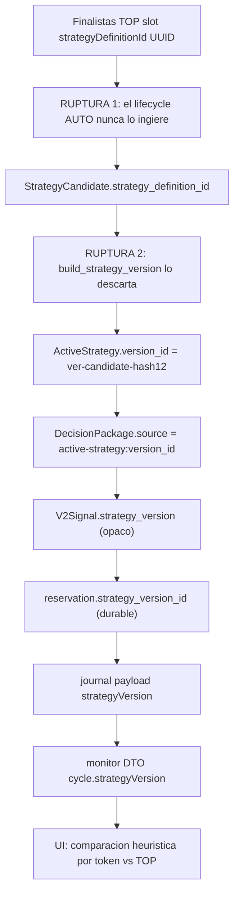

# Auditoría profundizada — AUTO: identidad de estrategia (H1), blindaje SIM, DÍA-D y bucle diario certificado (v2.88.106-beta)

> **AsOf:** 2026-10-11 · **Objeto auditado:** `v2.88.106-beta` / package `2.11.106-beta` (tag anotado `v2.88.106-beta`, objeto `37d4b6a8` → commit `2070dd47`).
> **Naturaleza:** documento de **auditoría** (solo `docs/`). No toca código, motor, contrato ni UI. Profundiza y **corrige** dos auditorías previas (Auditoría 1 sobre `v2.88.103-beta`; Auditoría 2 sobre `v2.88.106-beta`).
> **Método:** toda afirmación va con `file:line` verificable. Lo que no se puede demostrar con código se marca explícitamente como **hueco**, nunca se rellena. Vocabulario de estado: «Sin dato todavía» (ausencia), «No disponible» (fallo de lectura), `UNKNOWN ≠ 0`.
> **Premisas de referencia:** [`PROJECT_PREMISES.md`](../PROJECT_PREMISES.md) §5.2 (`DÍA-D AUTO`, cuatro capas no equivalentes, `CONFIRMED` reservado) y §6 (prioridades P1–P4).

---

## 1. Veredicto y alcance

### 1.1 Resumen ejecutivo

| Pieza | Estado verificado | Evidencia |
| --- | --- | --- |
| P3/P4 en las premisas | **Sí, explícitas** (§6 ratificada 2026-10-08 + §5.2) | [`PROJECT_PREMISES.md`](../PROJECT_PREMISES.md) §5.2/§6 |
| DÍA-D automático (pasivo, por valor) | **Implementado y conectado**, modo declarado `PRECOMPUTED_ARTIFACT` | [`auto_dia_d_feedback.py`](../../apps/api-python/src/bolsa_api/api/v1/routes/auto_dia_d_feedback.py) |
| DÍA-D manual (verificar tú mismo) | **Implementado, con contrafactual real contra el #1 de producción** | [`trading-dia-d-replay-panel.tsx`](../../apps/web/src/features/trading/trading-dia-d-replay-panel.tsx) |
| Puente AUTO → DÍA-D (CTA) | **Cerrado en `v2.88.104-beta`** (slice `S5`) — la Auditoría 1 lo daba por ausente | [`auto-operation-strategy-card.tsx`](../../apps/web/src/features/auto-monitor/auto-operation-strategy-card.tsx) |
| P3 a nivel de operación (qué estrategia la sustenta) | **Parcial**: se pinta el TOP **actual**, no el **ejecutado** ⇒ depende de H1 | [`auto-operation-strategy.ts`](../../apps/web/src/features/auto/auto-operation-strategy.ts) |
| H1 · identidad exacta de estrategia por ciclo | **ABIERTO** — causa raíz en el lifecycle, no solo en la UI | [`strategy_promotion_phase.py:51-75`](../../packages/py/application/src/bolsa_application/strategy_promotion_phase.py) |
| Blindaje SIM vs XTB | **Tres capas duras** (la Auditoría 2 lo veía más débil de lo que es) | [`simulated_settlement.py:41-42`](../../packages/py/application/src/bolsa_application/simulated_settlement.py) |
| Bucle diario con motor real | **ABIERTO** — el E2E `S5` siembra el ciclo; el worker no arranca | [`gp-v288-s5-...-integrated.spec.ts:10-13`](../../apps/web/e2e/gp-v288-s5-auto-dia-d-bridge-integrated.spec.ts) |
| Validación OOS por valor | **ABIERTO** — ranking ≠ rentabilidad | §8 de este documento |

### 1.2 Qué confirma, qué corrige, qué profundiza

- **Confirma** de la Auditoría 1: P3/P4 están en las premisas con rigor; existen dos piezas DÍA-D (automática y manual) bien construidas.
- **Corrige** de la Auditoría 1: el «hueco de conexión» AUTO → DÍA-D **ya no existe** (cerrado en `v2.88.104-beta`) y la URL que proponía (`focus=finalists`) es la equivocada (el CTA real usa `focus=detail&verify=1`).
- **Corrige** de la Auditoría 2: el blindaje SIM **no** es solo un banner; hay tres barreras duras (venue fail-closed + doble gate de entorno + invariante AST en CI). El residuo honesto es distinto: es separación **estructural**, no un permiso **runtime**.
- **Profundiza** en H1: la causa raíz **no** es la heurística de la UI, sino que el motor **nunca conoce el `strategyDefinitionId`**; el lifecycle lo descarta en la promoción FINALISTA→ACTIVE. Cualquier parche de UI es cosmético mientras no exista la clave de unión.

Este documento **no** implementa nada: fija el estado verificado y planifica (al detalle en §5–§8) el cierre.

---

## 2. Correcciones a la Auditoría 1 (sobre `v2.88.103-beta`)

### 2.1 El «hueco de conexión» ya está cerrado (slice `S5`)

La Auditoría 1 afirmaba que desde la operativa de AUTO no había «ningún camino» hacia el verificador DÍA-D. Eso era cierto en `v2.88.103-beta`, pero `v2.88.104-beta` entregó el puente `S5` y `v2.88.105-beta` lo endureció. Hoy existe la cadena completa:

```mermaid
flowchart LR
    Op["/auto/operar/operacion/:cycleId"] --> Story["AutoOperationStoryPanel"]
    Story --> Card["AutoOperationStrategyCard"]
    Card -->|"onVerify"| Launch["useDiaDVerifyLaunch"]
    Launch -->|"enterDiaDSession + navigate"| Lab["/backtests?verify=1"]
    Lab --> Host["DiaDVerifyHost"]
    Host --> Panel["TradingDiaDReplayPanel"]
```



- Montaje de la operación: [`auto-operacion-page.tsx:68`](../../apps/web/src/features/auto/auto-operacion-page.tsx) monta `AutoOperationStoryPanel`.
- Composición y wiring del CTA: [`auto-operation-story-panel.tsx:292-293`](../../apps/web/src/features/auto-monitor/auto-operation-story-panel.tsx) (`useDiaDVerifyLaunch` + `startDiaDVerification`) y `:453-455` (`onVerify={startDiaDVerification}`).
- Botón: [`auto-operation-strategy-card.tsx:24,166`](../../apps/web/src/features/auto-monitor/auto-operation-strategy-card.tsx) — el rótulo es la constante compartida [`VERIFY_DIA_D_CTA`](../../apps/web/src/features/platform/product-universe.ts) = «Verificar D→hoy».
- Lanzamiento: [`use-dia-d-verify-launch.ts:57-93`](../../apps/web/src/features/trading/use-dia-d-verify-launch.ts) — fail-closed (si falta instrumento o estrategia, no navega), entra la sesión LAB y navega.

### 2.2 La URL propuesta por la Auditoría 1 es incorrecta

La Auditoría 1 proponía `/backtests?tab=run&instrumentId=<id>&focus=finalists`. El CTA real construye `focus=detail&verify=1`:

```31:39:apps/web/src/features/platform/product-universe.ts
export function diaDVerifyHref(instrumentId: string): string {
  const q = new URLSearchParams({
    tab: "run",
    instrumentId,
    focus: "detail",
    verify: "1",
  });
  return `/backtests?${q.toString()}`;
}
```

`verify=1` es **imprescindible**: el host del verificador solo se monta con ese parámetro. En cambio `focus=finalists` pertenece a otro control distinto — el enlace «Volver a Finalistas» del banner ([`trading-dia-d-banner.tsx:92-95`](../../apps/web/src/features/trading/trading-dia-d-banner.tsx)); el botón «Salir verificación» de ese mismo banner solo cierra la sesión (`exitSession()`), no navega.

### 2.3 P3 a nivel de operación: parcial, por culpa de H1

La tarjeta **sí** pinta estrategia #1, indicadores y razones ([`auto-operation-strategy.ts:200-212`](../../apps/web/src/features/auto/auto-operation-strategy.ts)). Pero ese #1 es el **TOP vigente** del instrumento, no la estrategia que **ejecutó** la señal histórica. Por eso P3 queda **parcial** hasta cerrar H1 (§3.1, §5). La propia UI lo declara honestamente como heurística:

```56:63:apps/web/src/features/auto/auto-operation-strategy.ts
export const AUTO_OPERATION_STRATEGY_MATCH_IS_HEURISTIC =
  "La coincidencia es una aproximación textual (igualdad por token), no una identidad exacta: el enlace entre la estrategia ejecutada y la mejor del valor todavía no lo materializa el motor del ciclo." as const;
```

---

## 3. Profundización sobre la Auditoría 2

La Auditoría 2 acertó al mantener **H1 abierto** y al separar «mejor estrategia del valor» de «estrategia ejecutada». Aquí se profundiza en cuatro frentes: la **causa raíz** de H1, el **blindaje SIM** (donde la auditoría fue demasiado pesimista), el **DÍA-D** y el **E2E `S5`**.

### 3.1 H1 — causa raíz real: el motor no conoce el `strategyDefinitionId`

El monitor ya distingue dos conceptos (correcto):

- **Mejor estrategia disponible**: TOP #1 de Finalistas del instrumento.
- **Estrategia ejecutada declarada por el ciclo**: el sello `cycle.strategyVersion` (opaco).

El problema no es la heurística de comparación, sino que **el motor no tiene con qué comparar de forma exacta**: el `strategy_definition_id` que identifica la estrategia en Finalistas **no llega jamás** al motor AUTO. Se descarta en el lifecycle.



Evidencia de la ruptura:

- El `strategy_definition_id` existe **solo** en la candidata: [`strategy_lifecycle.py:112-123`](../../packages/py/domain/src/bolsa_domain/entities/strategy_lifecycle.py) (`StrategyCandidate.strategy_definition_id`) y en el slot del TOP ([`instrument-strategy-top.ts:13`](../../packages/shared/src/instrument-strategy-top.ts)).
- `build_strategy_version()` construye la versión inmutable a partir de `candidate.id` + `definition_hash` y **no** copia `strategy_definition_id`:

```51:75:packages/py/application/src/bolsa_application/strategy_promotion_phase.py
def build_strategy_version(
    *,
    candidate: StrategyCandidate,
    name: str,
    definition: Mapping[str, Any] | None = None,
) -> StrategyFinalist:
    ...
    return StrategyFinalist(
        candidate_id=candidate.id,
        version_id=f"ver-{candidate.id}-{definition_hash(effective)[7:19]}",
        name=name,
        definition_hash=definition_hash(effective),
        definition=effective,
    )
```

- `StrategyFinalist` y `ActiveStrategy` no tienen el campo: [`strategy_lifecycle.py:182-190`](../../packages/py/domain/src/bolsa_domain/entities/strategy_lifecycle.py) y [`strategy_lifecycle.py:484-494`](../../packages/py/domain/src/bolsa_domain/entities/strategy_lifecycle.py).
- La tabla `strategy_versions` tampoco tiene la columna: [`tables.py:2412-2430`](../../packages/py/infrastructure/src/bolsa_infrastructure/database/models/tables.py). El `INSERT` del store no la escribe: [`strategy_lifecycle_store.py:382-390`](../../packages/py/application/src/bolsa_application/strategy_lifecycle_store.py), y `get_active` reconstruye desde `StrategyVersionRow` (mismo déficit): [`strategy_lifecycle_store.py:659-698`](../../packages/py/application/src/bolsa_application/strategy_lifecycle_store.py). Nótese que `strategy_lifecycle_store.py:278,289,889` sí tocan `strategy_definition_id`, pero **sobre la candidata** (`StrategyCandidateRow`), no sobre la versión/activa.

Cómo llega el sello opaco al ciclo (cadena verificada):

- `DecisionPackage.source = f"active-strategy:{version_id}"` ([`auto_orchestrator.py:765`](../../packages/py/application/src/bolsa_application/auto_orchestrator.py)).
- El worker lo reduce a la versión: [`auto_simulation_worker.py:527-540`](../../apps/api-python/src/bolsa_api/background/auto_simulation_worker.py) (`_strategy_version_from_source`), asignado a `V2Signal.strategy_version` en `:2402,2452-2461`.
- Sellado durable: reserva [`auto_v2_entry.py:2038`](../../packages/py/application/src/bolsa_application/auto_v2_entry.py) (`strategy_version_id=signal.strategy_version`), decisión [`auto_v2_entry.py:2334-2335`](../../packages/py/application/src/bolsa_application/auto_v2_entry.py), posición [`auto_operational_audit.py:434`](../../packages/py/application/src/bolsa_application/auto_operational_audit.py), régimen [`auto_cycle_journal.py:107`](../../packages/py/application/src/bolsa_application/auto_cycle_journal.py).
- Monitor: [`auto_operational_monitor.py:276,395-396,875`](../../packages/py/application/src/bolsa_application/auto_operational_monitor.py).
- Shared type: [`auto-operational-monitor.ts:153`](../../packages/shared/src/cognitive/auto-operational-monitor.ts) (`strategyVersion?: string | null`).

**Conclusión H1.** El motor puede probar *qué versión opaca* corrió, pero **no** a qué `strategyDefinitionId` corresponde, porque no existe la clave de unión. La heurística de UI ([`auto-operation-strategy.ts:145-177`](../../apps/web/src/features/auto/auto-operation-strategy.ts)) es solo el síntoma. Esto confirma el veredicto de la Auditoría 2 (H1 es trazabilidad, no diseño visual) y **precisa el alcance**: cerrarlo exige migración de esquema + propagación por el lifecycle + sello en motor + contrato + UI (plan completo en §5).

### 3.2 Blindaje SIM vs XTB — la Auditoría 2 fue demasiado pesimista

La Auditoría 2 concluyó: «no daría todavía por certificada la imposibilidad absoluta de enviar órdenes reales». El código muestra que la garantía **no** es un banner: hay **tres capas duras** y una cuarta de composición.

1. **Whitelist fail-closed de venue (liquidación AUTO).** Cualquier venue distinto de `{paper, simulated}` se bloquea y produce **cero fills / cero dinero**:

```41:42:packages/py/application/src/bolsa_application/simulated_settlement.py
AUTO_SETTLE_VENUES: frozenset[str] = frozenset({"paper", "simulated"})
```

```88:98:packages/py/application/src/bolsa_application/simulated_settlement.py
def normalized_auto_venue(venue: str) -> str | None:
    """Normaliza un venue de liquidación AUTO. ... cualquier venue live/xtb/real/broker_live/otro => None (bloqueo fail-closed)."""
    v = str(venue or "").strip().lower()
    if v in {"sim", "simulated"}:
        return "simulated"
    if v in {"paper", "dry", "paper_auto"}:
        return "paper"
    return v if v in AUTO_SETTLE_VENUES else None
```

El camino AUTÓ genuino (`auto_simulation_worker._settle` → `submit_simulated_order`) normaliza por ahí y el applier financiero es un `ExecuteTrade` de ledger SIM, no un adapter de broker ([`auto_simulation_worker.py:1610-1627,1704-1782`](../../apps/api-python/src/bolsa_api/background/auto_simulation_worker.py)). Además [`simulated_finance.py:126-135`](../../packages/py/application/src/bolsa_application/simulated_finance.py) (`guard_sim_only_venue`) levanta error antes de tocar el ledger.

2. **Doble gate de entorno en el único adapter monetario.** La única clase capaz de hacer POST real es `XtbBrokerAdapter.submit`, y exige **dos** barreras independientes, ambas **off** por defecto:

```48:53:packages/py/application/src/bolsa_application/live_execution_runtime.py
def live_execution_ready() -> bool:
    return live_execution_authorized() and live_execution_unlocked()
```

Envs: `LIVE_EXECUTION_UNLOCKED` / `LIVE_EXECUTION_AUTHORIZED` ([`live_execution_runtime.py:25-27`](../../packages/py/application/src/bolsa_application/live_execution_runtime.py)); `BROKER_VENUE` default `paper` ([`config.py:171`](../../packages/py/infrastructure/src/bolsa_infrastructure/config.py)); `XTB_BRIDGE_URL` default `None` ([`config.py:47`](../../packages/py/infrastructure/src/bolsa_infrastructure/config.py)). Con defaults, `submit` devuelve `not_wired` / `live_virtual_sandbox` ([`broker_adapter.py:176-177,211-264`](../../packages/py/application/src/bolsa_application/broker_adapter.py)). El router, además, rechaza cuentas no-paper ([`execution_router.py:756-764`](../../packages/py/application/src/bolsa_application/execution_router.py)) y su modo `live_auto` es **dry-run** (nunca envía orden): [`execution_router.py:1202-1421`](../../packages/py/application/src/bolsa_application/execution_router.py).

3. **Invariante estructural en CI (AST).** Un test parsea los módulos AUTO (incl. el worker) y **falla** si alguno referencia los símbolos de la vía real (`IBrokerAdapter`, `resolve_broker_adapter`, `XtbBrokerAdapter`): [`test_a8_m0_auto_live_invariant.py:34-101`](../../packages/py/application/tests/test_a8_m0_auto_live_invariant.py).

**Residuo honesto (matiz a la Auditoría 2).** La garantía es **estructural/capacidad + list-based**, no un **permiso runtime positivo** en el punto de movimiento de dinero. Si mañana se añade un módulo AUTO nuevo fuera de la lista `_AUTO_MODULES`, el invariante AST no lo cubre por sí solo. Eso —no «la ausencia de barrera»— es el hueco real (§7). El banner [`auto-reality.ts:119-131`](../../apps/web/src/features/auto/auto-reality.ts) es presentacional y no constituye la barrera; la auditoría acierta en eso, pero la barrera existe en backend.

### 3.3 DÍA-D — pasivo vs manual, correctamente separados

- **Pasivo (automático).** `GET /api/auto/dia-d-feedback[/{window}]` es read-only y declara su modo real: [`auto_dia_d_feedback.py:36-45,204,225`](../../apps/api-python/src/bolsa_api/api/v1/routes/auto_dia_d_feedback.py) (`serving = PRECOMPUTED_ARTIFACT`, sin recompute on-demand). El panel lo pinta y declara el modo en primer nivel: [`dia-d-auto-feedback-panel.tsx:59-63,235-259`](../../apps/web/src/features/auto-monitor/dia-d-auto-feedback-panel.tsx). Correcto: no finge «en vivo».
- **Manual (verificar tú mismo).** El panel corre un replay real y un **contrafactual contra el #1 de producción**:

```399:422:apps/web/src/features/trading/trading-dia-d-replay-panel.tsx
  const productionTopQuery = useQuery({
    queryKey: ["instrument-strategy-top", session?.instrumentId, String(runCtx.timeframe || "1d")],
    queryFn: () => api.getInstrumentStrategyTop(session!.instrumentId, String(runCtx.timeframe || "1d")),
    enabled: Boolean(session?.instrumentId),
    staleTime: 30_000,
    retry: false,
  });

  const prod1 = useMemo(() => {
    const slots = productionTopQuery.data?.data?.slots ?? [];
    return [...slots].sort((a, b) => a.rank - b.rank)[0] ?? null;
  }, [productionTopQuery.data?.data?.slots]);

  const sameAsExperiment =
    Boolean(session?.strategyDefinitionId) &&
    Boolean(prod1?.strategyDefinitionId) &&
    session!.strategyDefinitionId === prod1!.strategyDefinitionId;
```

y, cuando el experimento **no** coincide con el #1, re-simula la misma ventana con la #1 real ([`trading-dia-d-replay-panel.tsx:423-454`](../../apps/web/src/features/trading/trading-dia-d-replay-panel.tsx)). El host que lo monta es [`dia-d-verify-host.tsx:26,38`](../../apps/web/src/features/backtests/dia-d-verify-host.tsx).

- **Montaje en el workspace AUTO.** La operación en `/auto/operar/operacion/:cycleId` ([`auto-operacion-page.tsx:69`](../../apps/web/src/features/auto/auto-operacion-page.tsx)); el DÍA-D pasivo vive en `/auto/analisis?tab=dia-d` ([`auto-analisis-page.tsx:133`](../../apps/web/src/features/auto/auto-analisis-page.tsx)). El detalle de OPERACIÓN no monta el DÍA-D pasivo por valor: enlaza por CTA al LAB manual.

### 3.4 E2E `S5` — qué prueba de verdad y qué siembra

El E2E integrado es honesto y lo declara en su cabecera: el worker del motor AUTO **no** arranca en el harness, así que **siembra** un ciclo durable con el CLI dev.

```10:13:apps/web/e2e/gp-v288-s5-auto-dia-d-bridge-integrated.spec.ts
El ciclo lo produce el MOTOR AUTO (worker de simulación), que el harness E2E no arranca. Para que este journey sea REPRODUCIBLE, el propio beforeAll siembra un ciclo durable en la cuenta efímera reutilizando el CLI dev scripts/dev/seed_auto_cycle_for_ui.py… NO reimplementa lógica de backend.
```

Qué **sí** prueba (falsable y útil):

- La tarjeta resuelve `#1` + indicadores + razón sembrada y el CTA queda habilitado (`GP-V288-S5-02`, [`…integrated.spec.ts:710-742`](../../apps/web/e2e/gp-v288-s5-auto-dia-d-bridge-integrated.spec.ts)).
- Al pulsar el CTA se observa un **`POST /api/backtests/run` REAL** (`page.waitForRequest`), con la URL exacta `tab=run&instrumentId&focus=detail&verify=1`, y el host DÍA-D montado (`GP-V288-S5-03`, `:744-794`).
- `H2`: recursos registrados desde el inicio, TOP global guardado/restaurado/verificado, cuenta efímera cerrada y borrada, 0 ciclos residuales, y gate `E2E_S5_REQUIRED=1` (precondición ausente = fallo, no skip): `:513-551,632-648,799-808`.

Qué **no** prueba (límite declarado):

- No prueba que el **motor** haya generado espontáneamente la señal ni que la estrategia elegida sea la mejor: el ciclo se **siembra** ([`seed_auto_cycle_for_ui.py`](../../scripts/dev/seed_auto_cycle_for_ui.py)) y el TOP global se **sobreescribe y restaura** en el propio test. El precio sembrado es fijo (compra 100 / venta 110).
- El mock ([`gp-e2e-s5-...-mock.spec.ts:58-76`](../../apps/web/e2e/gp-e2e-s5-auto-dia-d-bridge-mock.spec.ts)) ni siquiera observa el run real.

Por tanto, el E2E `S5` certifica la **cadena de presentación + el lanzamiento real de la verificación** con datos persistidos reales, **no** un ciclo generado por el motor (§6).

### 3.5 H2 / H3 / H4 — estado verificado (cerrados)

- **H2** (ciclo de vida del E2E): corregido; CI obligatorio `playwright-integrated-auto-s5` en `certify.needs` con guardia anti-skip. Evidencia: [`evidence/v2.88.106/README.md`](evidence/v2.88.106/README.md) §1 y [`release-tag-ci.yml`](../../.github/workflows/release-tag-ci.yml).
- **H3** (P&L realizado): política **detail-only** declarada (lista `total_realized_pnl = None` a propósito; el detalle sí lo calcula). Evidencia: `summary.py` / `accounts.py` / `test_list_account_summaries.py` citados en la evidencia de `v2.88.106`.
- **H4** (etiquetas económicas): desambiguadas («Resultado de posiciones abiertas» / «Resultado de operaciones cerradas» / «Efectivo simulado»). Evidencia: [`auto-account-figures.ts`](../../apps/web/src/features/auto/auto-account-figures.ts), [`auto-operation-card.ts`](../../apps/web/src/features/auto/auto-operation-card.ts).

No hay motivo, con la evidencia disponible, para reabrir H2/H3/H4. La auditoría 2 acierta.

---

## 4. Inventario verificado de superficies

### 4.1 Endpoints

| Endpoint | Modo | Evidencia |
| --- | --- | --- |
| `GET /api/auto/dia-d-feedback` | read-only, `serving=PRECOMPUTED_ARTIFACT` | [`auto_dia_d_feedback.py:267`](../../apps/api-python/src/bolsa_api/api/v1/routes/auto_dia_d_feedback.py) |
| `GET /api/auto/dia-d-feedback/{window}` | read-only, fail-closed por cuenta | [`auto_dia_d_feedback.py:295`](../../apps/api-python/src/bolsa_api/api/v1/routes/auto_dia_d_feedback.py) |
| `GET /api/auto/operational-monitor` | read-model del ciclo (9 etapas) | [`auto_operational_monitor.py`](../../apps/api-python/src/bolsa_api/api/v1/routes/auto_operational_monitor.py) |
| `POST /api/backtests/run` | lanzamiento del replay (manual) | consumido por [`trading-dia-d-replay-panel.tsx:192-203`](../../apps/web/src/features/trading/trading-dia-d-replay-panel.tsx) |

### 4.2 Hooks y tipos (web/shared)

- Hooks: [`use-auto-operation-strategy.ts`](../../apps/web/src/features/auto/use-auto-operation-strategy.ts), [`use-dia-d-verify-launch.ts`](../../apps/web/src/features/trading/use-dia-d-verify-launch.ts), [`use-auto-dia-d-feedback.ts`](../../apps/web/src/features/auto-monitor/use-auto-dia-d-feedback.ts).
- Tipos: `AutoOperationStrategyViewV1` ([`auto-operation-strategy.ts:79-109`](../../apps/web/src/features/auto/auto-operation-strategy.ts)), `cycle.strategyVersion` ([`auto-operational-monitor.ts:153`](../../packages/shared/src/cognitive/auto-operational-monitor.ts)).

### 4.3 Persistencia relevante

| Tabla | Rol | Columna de estrategia |
| --- | --- | --- |
| `strategy_candidates` | candidata de LAB | `strategy_definition_id` **sí** ([`tables.py:2405-2406`](../../packages/py/infrastructure/src/bolsa_infrastructure/database/models/tables.py)) |
| `strategy_versions` | versión inmutable / finalista | **no** tiene `strategy_definition_id` ([`tables.py:2412-2430`](../../packages/py/infrastructure/src/bolsa_infrastructure/database/models/tables.py)) |
| `portfolio_reservations` | reserva del ciclo | `strategy_version_id` (**opaca**) |
| `sim_fill_finance_context` | atribución de fill | `strategy_version_id` (**opaca**) |
| `decision_journal_entries` | spine append-only | `payload.strategyVersion` (**opaca**) |

Alembic head actual: `052_top3_opportunities` (ver [`versions/052_top3_opportunities.py`](../../packages/py/infrastructure/alembic/versions/052_top3_opportunities.py)).

---

## 5. Plan de cierre H1 (full) — propagación de `strategy_definition_id`

> **Naturaleza del cambio:** `Δ motor ≠ 0` (aditivo), `Δ decisión = 0` (no toca umbrales, reparto, `TOP_N`, régimen, selección ni protección). Requiere **migración Alembic** y **contrato** (`contract:gen`). Es la «versión dedicada siguiente» que declaró `v2.88.106-beta`.

**Objetivo falsable:** cada operación conserva y presenta la **definición y versión exactas** que generaron la señal, sin heurísticas de tokens. Criterio: para un ciclo, `strategyDefinitionId` sellado = `strategyDefinitionId` del TOP y diagnóstico `same`/`differs` **exactos**, o «Sin dato todavía» si el ciclo es histórico (pre-migración).

### Fase 0 — Migración Alembic `053_strategy_version_definition_id`

- Añadir columna `strategy_definition_id` **nullable** a `strategy_versions` ([`tables.py:2412-2430`](../../packages/py/infrastructure/src/bolsa_infrastructure/database/models/tables.py)); head pasa de `052_top3_opportunities` a `053_...`.
- Nullable a propósito: los ciclos/versiones previos no se fabrican ⇒ «Sin dato todavía».
- Tests: migración desde DB limpia y desde DB existente; `alembic upgrade head`/`downgrade`.

### Fase 1 — Dominio: `StrategyFinalist` y `ActiveStrategy` ganan el campo

- `StrategyFinalist` ([`strategy_lifecycle.py:182-190`](../../packages/py/domain/src/bolsa_domain/entities/strategy_lifecycle.py)) y `ActiveStrategy` ([`strategy_lifecycle.py:484-494`](../../packages/py/domain/src/bolsa_domain/entities/strategy_lifecycle.py)) añaden `strategy_definition_id: str | None = None`.
- `build_strategy_version()` propaga `candidate.strategy_definition_id` ([`strategy_promotion_phase.py:51-75`](../../packages/py/application/src/bolsa_application/strategy_promotion_phase.py)).
- Test de dominio: una candidata con `strategy_definition_id` produce finalista/activa con el mismo id; una sin él ⇒ `None` (nunca inventado).

### Fase 2 — Store del lifecycle

- `save_version` escribe la columna ([`strategy_lifecycle_store.py:382-390`](../../packages/py/application/src/bolsa_application/strategy_lifecycle_store.py)) y `get_active` la reconstruye ([`strategy_lifecycle_store.py:659-698`](../../packages/py/application/src/bolsa_application/strategy_lifecycle_store.py)).
- Test PG: round-trip `save_version` → `get_active` conserva el id; filas antiguas sin valor ⇒ `None`.

### Fase 3 — Motor: sellar `strategyDefinitionId` en el ciclo

- Propagar desde la activa/paquete al `V2Signal` y sellarlo durable en: reserva ([`auto_v2_entry.py:2038`](../../packages/py/application/src/bolsa_application/auto_v2_entry.py)), decisión ([`auto_v2_entry.py:2334-2335`](../../packages/py/application/src/bolsa_application/auto_v2_entry.py)), posición ([`auto_operational_audit.py:434`](../../packages/py/application/src/bolsa_application/auto_operational_audit.py)), régimen ([`auto_cycle_journal.py:107`](../../packages/py/application/src/bolsa_application/auto_cycle_journal.py)).
- Alternativa sin columna nueva en la reserva: viajar **solo en el payload del journal** (JSONB) como ya viaja `strategyVersion`; decidir en Fase 0 si se materializa columna. Preferible columna explícita para consulta/índice.
- Regla dura: si no hay `strategy_definition_id`, la clave **se omite** (no se sella cadena vacía), igual que `strategyVersion`.
- Test: un ciclo con estrategia identificable sella el id; sin él, el campo no aparece.

### Fase 4 — Monitor: exponerlo en el DTO

- Añadir `strategyDefinitionId` al ciclo/señal en [`auto_operational_monitor.py:276,395-396,875`](../../packages/py/application/src/bolsa_application/auto_operational_monitor.py), con la misma política de huecos (`UNKNOWN ≠ 0`).
- Test: el DTO distingue «no medido» de «medido sin estrategia».

### Fase 5 — Contrato + shared

- Ampliar el tipo shared `cycle.strategyVersion`/nuevo `strategyDefinitionId` en [`auto-operational-monitor.ts:153`](../../packages/shared/src/cognitive/auto-operational-monitor.ts) y el schema OpenAPI; `contract:gen` + `contract:check`.

### Fase 6 — UI: identidad exacta en vez de heurística

- Sustituir `resolveAutoOperationStrategyMatch` por comparación **exacta** de `strategyDefinitionId` en [`auto-operation-strategy.ts:145-177`](../../apps/web/src/features/auto/auto-operation-strategy.ts) y [`use-auto-operation-strategy.ts`](../../apps/web/src/features/auto/use-auto-operation-strategy.ts); retirar el rótulo de heurística ([`auto-operation-strategy.ts:56-63`](../../apps/web/src/features/auto/auto-operation-strategy.ts)) y mantener el tri-estado `same`/`differs`/`unknown`.
- La tarjeta ([`auto-operation-strategy-card.tsx`](../../apps/web/src/features/auto-monitor/auto-operation-strategy-card.tsx)) pasa a declarar «Estrategia ejecutada» por identidad, no por token.
- Tests vitest: `same` exacto, `differs` exacto, hueco ⇒ `unknown`.

### Criterios de aceptación (falsables)

1. Existe una columna durable `strategy_versions.strategy_definition_id` y el lifecycle la propaga (test PG).
2. Un ciclo nuevo sella `strategyDefinitionId` y el monitor/UI lo exponen.
3. La coincidencia ejecutada↔TOP se resuelve por **igualdad exacta** de id; se elimina la heurística de tokens.
4. Un ciclo histórico (sin id) declara «Sin dato todavía»; jamás rellena.
5. `Δ decisión = 0` certificado (replay-repro) y `contract:check` verde.

### Riesgos y mitigaciones

- **Migración nullable**: segura; sin backfill forzado.
- **Ciclos históricos**: degradan a «Sin dato todavía» de forma honesta.
- **Acoplamiento lifecycle↔TOP**: el id de Finalistas nace en `strategy_candidates`; si una activa no proviene de una candidata con `strategy_definition_id`, se declara el hueco.

---

## 6. Bucle diario certificado (motor AUTO real)

**Hueco:** el E2E `S5` y el seed prueban la presentación, no que el **motor** genere espontáneamente señal→decisión→reserva→fill→liquidación→P&L y DÍA-D.

**Plan de alto nivel (no implementado aquí):**

- Test integrado que arranca el worker real (`AUTO_SIMULATION_WORKER_ENABLED`, default **OFF** hoy; [`auto_simulation_worker.py:280,366-373`](../../apps/api-python/src/bolsa_api/background/auto_simulation_worker.py)) contra PostgreSQL + API reales, **sin** `seed_auto_cycle_for_ui.py`.
- Recorrer y **asertar** las 9 etapas canónicas (`SIGNAL → TOP_N → RISK → RESERVATION → ORDER → FILL → PROTECTION → SETTLEMENT → CYCLE_CLOSED`) leyendo hechos durables, no proyección.
- **Criterio de aceptación:** un ciclo aparece en el monitor generado por el worker; instrumento, estrategia (con H1, id exacto) y condiciones temporales son coherentes; DÍA-D enlaza al **mismo** ciclo. Debe **rechazar** una asociación incorrecta (no basta con que se abra el laboratorio).
- Encaje con §5.2/§5.1 de premisas: el sandbox `DÍA-D AUTO` usa precio inyectado (`AUTO_ENGINE_SIM_REAL_PRICE=0`); la ventana PAPER usa precio real (`1`). El test debe declarar qué régimen usa.

---

## 7. Endurecimiento del blindaje SIM (propuesta)

El código ya tiene whitelist de venue + doble gate + invariante AST (§3.2). El residuo es que la separación es **estructural y list-based**, no un **permiso runtime positivo** en el punto de dinero. Propuesta (no implementada en este documento):

1. **Permiso positivo**: que el punto de movimiento de dinero exija una capacidad explícita «SIM-only» del llamante, de modo que un adapter real sea **inalcanzable por defecto** aunque alguien cablee una llamada (no dependa solo de envs off).
2. **Derivar la lista AST**: que el invariante de [`test_a8_m0_auto_live_invariant.py`](../../packages/py/application/tests/test_a8_m0_auto_live_invariant.py) descubra automáticamente los módulos AUTO (p. ej. por convención de nombre/paquete) en vez de una lista fija, para que un módulo nuevo quede cubierto sin editar el test.
3. **Prueba negativa end-to-end** de `_evaluate_live_dry_run` que asierte «no submit» (hoy está garantizado por construcción, no por test explícito).

---

## 8. Validación OOS por valor (financiera)

**Hueco:** ocupar el puesto #1 de Finalistas **no** demuestra rentabilidad. La propia evidencia lo declara.

**Criterios de aceptación (por estrategia × instrumento, fuera de muestra):**

- Retorno neto (con costes), **drawdown** máximo, ratio de Sharpe cuando proceda, tasa de acierto, **profit factor**, número de operaciones y **sensibilidad a costes/deslizamiento`.
- Selección y parámetros **fijados sin consultar** el periodo de prueba (evitar overfitting y sesgo de selección).
- Resultados **reproducibles**; un dato no medido ⇒ «Sin dato todavía», nunca `0`.

---

## 9. Matriz priorizada P1–P4 y orden de cierre

| Prioridad | Trabajo | Criterio de aceptación | Depende de |
| --- | --- | --- | --- |
| P1 | Identidad exacta de estrategia por ciclo (H1, §5) | Definición y versión exactas selladas y presentadas; sin heurísticas | — |
| P1 | Bucle con motor AUTO real (§6) | Test integrado genera el ciclo sin sembrar | H1 (para identidad) |
| P1 | Blindaje SIM runtime (§7) | Pruebas negativas: AUTO no alcanza vía real | — |
| P2 | DÍA-D enlazado al ciclo | Verificación registra instrumento/estrategia/fechas/resultado y es auditable | H1 |
| P2 | Auditoría por cada valor de ESTUDIO | Por instrumento: estrategia elegida, por qué, señal, resultado | H1 + §6 |
| P3 | Validación financiera OOS (§8) | Métricas reproducibles con costes | §6 |

**Orden recomendado:** H1 (§5) → bucle motor real (§6) → blindaje SIM (§7) → DÍA-D enlazado al ciclo (P2) → auditoría por valor (P2) → OOS (§8). La validación financiera solo tiene sentido **después** de demostrar la trazabilidad y el bucle real.

---

## 10. Anexo — índice de evidencia file:line

**Premisas**
- [`PROJECT_PREMISES.md`](../PROJECT_PREMISES.md) §5.2 (DÍA-D AUTO, 4 capas, `CONFIRMED` reservado), §6 (P1–P4).

**Auditoría 1 / puente S5**
- [`auto-operation-strategy-card.tsx:24,166`](../../apps/web/src/features/auto-monitor/auto-operation-strategy-card.tsx)
- [`auto-operation-story-panel.tsx:292-293,453-455`](../../apps/web/src/features/auto-monitor/auto-operation-story-panel.tsx)
- [`use-dia-d-verify-launch.ts:57-93`](../../apps/web/src/features/trading/use-dia-d-verify-launch.ts)
- [`product-universe.ts:29-39`](../../apps/web/src/features/platform/product-universe.ts)
- [`trading-dia-d-banner.tsx:92-95`](../../apps/web/src/features/trading/trading-dia-d-banner.tsx)
- [`auto-operacion-page.tsx:69`](../../apps/web/src/features/auto/auto-operacion-page.tsx), [`auto-analisis-page.tsx:133`](../../apps/web/src/features/auto/auto-analisis-page.tsx)

**H1 (cadena de identidad)**
- [`strategy_lifecycle.py:112-123`](../../packages/py/domain/src/bolsa_domain/entities/strategy_lifecycle.py) (candidata), `:182-190` (finalista), `:484-494` (activa)
- [`strategy_promotion_phase.py:51-75`](../../packages/py/application/src/bolsa_application/strategy_promotion_phase.py)
- [`tables.py:2405-2406,2412-2430`](../../packages/py/infrastructure/src/bolsa_infrastructure/database/models/tables.py)
- [`strategy_lifecycle_store.py:382-390,659-698`](../../packages/py/application/src/bolsa_application/strategy_lifecycle_store.py)
- [`auto_orchestrator.py:765`](../../packages/py/application/src/bolsa_application/auto_orchestrator.py)
- [`auto_simulation_worker.py:527-540,2402,2452-2461`](../../apps/api-python/src/bolsa_api/background/auto_simulation_worker.py)
- [`auto_v2_entry.py:2038,2334-2335`](../../packages/py/application/src/bolsa_application/auto_v2_entry.py)
- [`auto_operational_audit.py:434`](../../packages/py/application/src/bolsa_application/auto_operational_audit.py)
- [`auto_cycle_journal.py:107`](../../packages/py/application/src/bolsa_application/auto_cycle_journal.py)
- [`auto_operational_monitor.py:276,395-396,875`](../../packages/py/application/src/bolsa_application/auto_operational_monitor.py)
- [`auto-operational-monitor.ts:153`](../../packages/shared/src/cognitive/auto-operational-monitor.ts)
- [`instrument-strategy-top.ts:13`](../../packages/shared/src/instrument-strategy-top.ts)
- [`auto-operation-strategy.ts:56-63,79-109,145-177,200-212`](../../apps/web/src/features/auto/auto-operation-strategy.ts)

**Blindaje SIM**
- [`simulated_settlement.py:41-42,88-98,295-309`](../../packages/py/application/src/bolsa_application/simulated_settlement.py)
- [`simulated_finance.py:124-135`](../../packages/py/application/src/bolsa_application/simulated_finance.py)
- [`live_execution_runtime.py:25-27,48-53`](../../packages/py/application/src/bolsa_application/live_execution_runtime.py)
- [`broker_adapter.py:176-177,211-264`](../../packages/py/application/src/bolsa_application/broker_adapter.py)
- [`execution_router.py:582-585,756-764,1202-1421`](../../packages/py/application/src/bolsa_application/execution_router.py)
- [`config.py:47,171`](../../packages/py/infrastructure/src/bolsa_infrastructure/config.py)
- [`auto_simulation_worker.py:1610-1627,1704-1782`](../../apps/api-python/src/bolsa_api/background/auto_simulation_worker.py)
- [`test_a8_m0_auto_live_invariant.py:34-101`](../../packages/py/application/tests/test_a8_m0_auto_live_invariant.py)
- [`auto-reality.ts:119-131`](../../apps/web/src/features/auto/auto-reality.ts)

**DÍA-D**
- [`auto_dia_d_feedback.py:36-45,204,225,267,295`](../../apps/api-python/src/bolsa_api/api/v1/routes/auto_dia_d_feedback.py)
- [`dia-d-auto-feedback-panel.tsx:59-63,235-259`](../../apps/web/src/features/auto-monitor/dia-d-auto-feedback-panel.tsx)
- [`trading-dia-d-replay-panel.tsx:192-203,399-454`](../../apps/web/src/features/trading/trading-dia-d-replay-panel.tsx)
- [`dia-d-verify-host.tsx:26,38`](../../apps/web/src/features/backtests/dia-d-verify-host.tsx)

**E2E S5**
- [`gp-v288-s5-...-integrated.spec.ts:10-13,66-68,513-551,632-648,710-794,799-808`](../../apps/web/e2e/gp-v288-s5-auto-dia-d-bridge-integrated.spec.ts)
- [`auto-cycle-seed.ts:3-13`](../../apps/web/e2e/helpers/auto-cycle-seed.ts)
- [`gp-e2e-s5-...-mock.spec.ts:58-76`](../../apps/web/e2e/gp-e2e-s5-auto-dia-d-bridge-mock.spec.ts)
- [`seed_auto_cycle_for_ui.py`](../../scripts/dev/seed_auto_cycle_for_ui.py)

**H2/H3/H4**
- [`evidence/v2.88.106/README.md`](evidence/v2.88.106/README.md), [`release-tag-ci.yml`](../../.github/workflows/release-tag-ci.yml)

---

_Límite de este documento: es auditoría y plan, no implementación. Toda cifra de código citada es verificable en el árbol de `v2.88.106-beta`._
