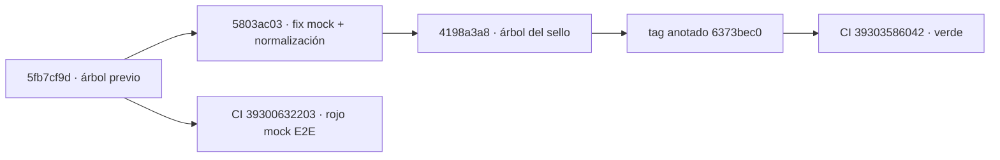

# Auditoría — `v2.88.152-beta`: evidencia por valor ESTUDIO y DÍA-D del valor

> **Fecha:** 2026-10-19 · **Base auditada:** tag `v2.88.152-beta` (**anotado**, unsigned;
> objeto `6373bec0`) → commit **`4198a3a8`**. **Base anterior:** `v2.88.151-beta` → `8bef1757`.
> **Alcance:** procedencia y linaje del tag, delta funcional AUTO / DÍA-D / UI, contrato backend
> y ejecución de CI del sello efectivo.
> **Naturaleza:** `Δ motor = 0` · `Δ decisión = 0` · contrato HTTP **aditivo** · **sin migración**
> (head `056_auto_ops_jobs`).
> **Método:** auditoría **solo de evidencia** — lectura de código, `git` y `gh run view`. **No** se
> ejecutaron tests ni E2E locales en esta revisión; toda medida se atribuye al run de CI citado.
> **Documentos contrastados:** [`evidence/v2.88.152/README.md`](./evidence/v2.88.152/README.md),
> [`plan-v2-88-152-evidencia-por-valor-dia-d-2026-10-19.md`](./plan-v2-88-152-evidencia-por-valor-dia-d-2026-10-19.md)
> y [`auditoria-ui-auto-dia-d-v2.88.145-2026-10-19.md`](./auditoria-ui-auto-dia-d-v2.88.145-2026-10-19.md).

## 0. Premisa que gobierna la auditoría

Toda la operativa (manual, AUTO, cualquier cuenta/broker) es **SIMULADA** contra un ledger
virtual/PAPER: no se envían órdenes reales a XTB ni a ningún broker
([`PROJECT_PREMISES.md` §7](../PROJECT_PREMISES.md:291)). Un `ok` del parte diario es un **plan
propuesto en dry-run** (`"execute": False` en `estudio_daily_ops.py`), nunca una orden. El DÍA-D
del valor es un **sandbox con watch de un símbolo**, no una ejecución real.

Consecuencia: esta auditoría puede certificar **instrumentación, aislamiento y trazabilidad**; no
puede certificar rentabilidad ni promocionar la ventana PAPER.

## 1. Procedencia y linaje del sello

| Ref | Objeto | Commit (`^{}`) | Fecha | Nota |
| --- | --- | --- | --- | --- |
| `v2.88.151-beta` | `8461e503` (anotado) | `8bef1757` | 2026-10-19 18:01:36 +0200 | sello anterior |
| `v2.88.152-beta` | `6373bec0` (anotado) | `4198a3a8` | 2026-10-19 20:33:43 +0200 | mensaje: «(fix mock E2E)» |

- **Local y remoto coinciden**: `git ls-remote` devuelve `6373bec0` → `4198a3a8`, idéntico a
  `git rev-parse v2.88.152-beta^{}`. El tag es **anotado** y **unsigned** (sin bloque de firma).
- **El tag fue reanclado.** El primer `Release tag CI`
  ([`39300632203`](https://github.com/jvelasca/Bolsa_V1/actions/runs/39300632203)) se ejecutó
  sobre **`5fb7cf9d`** y salió **rojo** en `playwright (mock E2E)` (y, como agregado,
  `certify`). La corrección **`5803ac03`** (5 ficheros, +287/−11) normaliza la respuesta de la
  cadena y sirve el mock nuevo; el tag se reenvió sobre el árbol corregido **`4198a3a8`**.
- **Advertencia operativa:** un `git fetch` normal **no sobrescribe** tags ya existentes. Un
  checkout que conservaba el objeto anterior apuntaba a `5fb7cf9d`. Para auditar hay que usar
  `git fetch --tags --force` y verificar siempre la forma *peeled* (`^{}`), no solo el nombre.



**Delta `.151` → `.152`:** **48 ficheros, +4078/−46**, 6 commits (`0913a12f`, `b883f6ef`,
`5fb7cf9d`, `5803ac03`, `4198a3a8`, `85697955` — este último es el POST-TAG documental de `.151`).
El tag apunta al commit del **re-anclaje del pin** (`4198a3a8`), no al commit de contenido
(`b883f6ef`): mismo patrón que los sellos anteriores, exigido por el gate `window:freeze`.

## 2. Delta funcional

### 2.1 Read-model de la cadena (nuevo, read-only)

- **NUEVO** `GET /api/auto/estudio-chain`
  ([`auto_estudio_chain.py`](../../apps/api-python/src/bolsa_api/api/v1/routes/auto_estudio_chain.py:108)),
  `limit` 1..200 (`:52`, `:115`), acotado por `resolve_account_scope_or_default` —sin cuenta
  propia devuelve `available=false` + `no_account_scope`, **nunca** lectura global
  ([`dependencies.py`](../../apps/api-python/src/bolsa_api/api/dependencies.py:420)).
- Reutiliza **un solo** lector (`read_estudio_chain_evidence`) y **un solo** P&L
  (`build_chain_evidence_artifact`); no hay segunda verdad. Un fallo de lectura se devuelve como
  `available=false` + `error` (`:157`), no como lista vacía.
- El lector expone `entryDay`/`exitDay` en la vista de ciclo
  ([`auto_chain_durable_reader.py`](../../packages/py/application/src/bolsa_application/auto_chain_durable_reader.py:461))
  para poder anclar el DÍA-D del valor.

### 2.2 DÍA-D de un valor (nuevo `kind`, artefacto propio)

- **NUEVO** `JOB_KIND_DIA_D_VALUE_REPLAY = "dia_d_value_replay"`; `payload.symbol` es
  **obligatorio**, se normaliza a mayúsculas y una fecha futura se rechaza
  ([`auto_ops_jobs.py`](../../packages/py/application/src/bolsa_application/auto_ops_jobs.py:102)).
- El handler pasa `--watch <SÍMBOLO>` y escribe **solo**
  `…/<cuenta>/values/<SÍMBOLO>/dia-d-auto-<D>.json`
  ([`auto_ops_dia_d.py`](../../apps/api-python/src/bolsa_api/background/auto_ops_dia_d.py:283),
  `:293`, `:316`); el artefacto del día completo no se toca. La ruta se compone en
  [`dia_d_artifacts.py`](../../packages/py/application/src/bolsa_application/dia_d_artifacts.py:145)
  con `symbol_segment` (`:94`) y saneado idéntico al de cuenta.
- **Validación fail-closed**: `exit 0` + artefacto + día + `meta.account` exacto + **`meta.watch
  == [symbol]`** (`auto_ops_dia_d.py:391`, `:428`). Cualquier desviación falla el job con motivo.
- **NUEVA ruta** `GET /api/auto/dia-d-replay/{day}/value/{symbol}`
  ([`auto_dia_d.py`](../../apps/api-python/src/bolsa_api/api/v1/routes/auto_dia_d.py:277)):
  `available=false` si no hay artefacto, si la cuenta no coincide
  (`_artifact_matches_scope`, `:222`) o si `meta.watch != [símbolo]` (`value_mismatch`, `:317`).
  Otra cuenta es **indistinguible de inexistente**.
- **Serialización declarada**: el índice único parcial de `(kind, cuenta, día)` admite un solo job
  activo por día; un segundo símbolo recibe el job activo del primero y la UI lo declara
  (`occupiedBy`), sin pintarlo como propio.

### 2.3 Contrato

- `openapi.json` **+323/−0** y `schema.d.ts` **+165/−0**: ampliación **puramente aditiva**
  (dos endpoints read-only + `kind`). `contract:check` verde en CI.
- **Sin migración**: el delta no toca `alembic/`; head `056_auto_ops_jobs`.
- No se modifican motor, umbrales, pesos A/B, `TOP_N`, régimen, sizing ni salidas
  (`Δ motor = 0`, `Δ decisión = 0`).

### 2.4 UI de la ficha diaria

- **Sección 5 · «Cadena y resultado (evidencia durable)»**
  ([`estudio-chain-evidence.tsx`](../../apps/web/src/features/auto-monitor/estudio-chain-evidence.tsx:375))
  con seis bloques: estrategia e indicadores (`:441`), por qué esa y no otra (`:468`), señal y
  vela (`:523`), entrada/salida del `TradePlan` (`:543`), operación simulada con nueve etapas y
  P&L conciliado (`:551`) y DÍA-D/suficiencia (`:585`). El hueco se rotula «Sin dato»; no se
  convierte en cero.
- **Una sola query por informe**, indexada por `instrumentId`
  ([`use-estudio-chain.ts`](../../apps/web/src/features/auto-monitor/use-estudio-chain.ts:34)),
  integrada en el panel ([`estudio-daily-ops-panel.tsx`](../../apps/web/src/features/auto-monitor/estudio-daily-ops-panel.tsx:429)).
- **Resiliencia**: `normalizeEstudioChain` (`use-estudio-chain.ts:65`) convierte un payload sin
  forma (mock, proxy o servidor antiguo) en **hueco declarado**, no en cadena vacía; el panel
  normaliza antes de leer (`estudio-daily-ops-panel.tsx:462`). Es la corrección post-tag.
- **DÍA-D del valor**: botón «Verificar DÍA-D de este valor»; el hook rehidrata solo el job cuyo
  `payload.symbol` coincide, limpia al cambiar cuenta/día/símbolo y declara el conflicto de otro
  símbolo ([`use-dia-d-value-replay.ts`](../../apps/web/src/features/auto-monitor/use-dia-d-value-replay.ts:100),
  `:79`). El día se toma del `entryDay` del ciclo o, si no existe, de la vela del parte, y la UI
  declara el origen.
- No se emite `CONFIRMED`; la ventana global se muestra `INCONCLUSIVE` y la atribución histórica
  exige `planId`/`signalId` exactos.

## 3. La contradicción sobre el E2E integrado, resuelta

Los dos dictámenes previos describían **jobs distintos** del workflow:

| Job | Definición | Ejecución en `39303586042` |
| --- | --- | --- |
| `playwright (integrated AUTO S5)` | Gate **duro**, PostgreSQL + API reales, `E2E_S5_REQUIRED=1` y guard anti-skip ([`release-tag-ci.yml`](../../.github/workflows/release-tag-ci.yml:349), `:449`, comando `:465`) | **success** |
| `playwright (integrated E2E, opt-in)` | Solo en `workflow_dispatch` con `run_e2e_integration == true` ([`release-tag-ci.yml`](../../.github/workflows/release-tag-ci.yml:173)) | **skipped** |

Por tanto: **el flujo integrado AUTO → estrategia → DÍA-D sí se ejecutó** en el tag (AUDITORÍA 1
es correcta en ese punto). El `skipped` que cita AUDITORÍA 2 corresponde al job opt-in, que cubre
otras rutas y **no** es el que valida S5; tampoco se ejecutó en local (sin stack), y así se declara.

**Matiz medido (no declarado en el README del sello):** el job S5 terminó con **7 `passed` + 1
`flaky`**, no con 8 `passed`.

- `GP-V288-S5-04` falló en el **primer intento** a los 60 s esperando el botón «Guardar Evidence»
  (`expect(save).toBeVisible({ timeout: 60_000 })`,
  [`gp-v288-s5-auto-dia-d-bridge-integrated.spec.ts`](../../apps/web/e2e/gp-v288-s5-auto-dia-d-bridge-integrated.spec.ts:928))
  y pasó en el **reintento en 7,31 s**.
- `GP-V288-S5-05` a `S5-08` figuran **`skipped` en el intento 1** y pasan en el reintento: es el
  efecto de Playwright al reintentar el worker tras el fallo de `S5-04`, no un skip de
  certificación. El guard anti-skip leyó el reporter final (`7 passed`, `1 flaky`, **0 skipped**)
  y pasó.
- `S5-08` sí ejerce lo nuevo: cadena read-only sin `CONFIRMED`, aislamiento por cuenta, rechazo
  del job sin símbolo, normalización del símbolo y serialización declarada
  ([spec](../../apps/web/e2e/gp-v288-s5-auto-dia-d-bridge-integrated.spec.ts:1342)).

Conclusión: la cobertura integrada **existe y es gate duro**, pero la corrida verde **depende de
un reintento** por arranque en frío. El fallo original es de `S5-04` (espera de la evidencia de la
sesión LAB), **no** de la superficie nueva: `S5-08` pasó en el reintento. No es una regresión; es
fragilidad medida, heredada de sellos anteriores.

## 4. Verificación medida en CI (run `39303586042`)

`Release tag CI` sobre `4198a3a8`, evento `push`, `18:34:13Z → 18:46:44Z` (**12m31s**),
`conclusion: success`.

| Job / comprobación | Resultado medido |
| --- | --- |
| `playwright (mock E2E)` | **success** (era el fallo del primer intento) |
| `playwright (integrated AUTO S5)` | **success** (`7 passed`, `1 flaky`, 2,9m) |
| `frontend (typecheck/lint/test/build + contract:check)` | **success** — **313 ficheros / 2312 tests passed** |
| `python (ruff/imports/mypy/pytest offline)` | **success** — **5257 passed, 55 skipped** (156 s); ruff `All checks passed!`; imports `4 kept, 0 broken`; mypy `567 source files` |
| `shared (build/typecheck/test)` | **success** — **98 ficheros passed**; `[window-pin] freeze OK (4198a3a8)` |
| `replay-repro` | **success** — `VEREDICTO REPRODUCIDO`; `sha256 E9B7376B…7F5625`; 3 383 461 B (LF) frente al sello 3 488 758 B (CRLF) |
| `lifecycle-pg`, `a7-gate`, `decision-spine`, `integrated axe`, `security`, `dr-verify` | **success** |
| `playwright (integrated E2E, opt-in)` | **skipped** (por diseño) |
| `certify (aggregate + artifact)` | **success** |

- El hash `E9B7376B…7F5625` es el **baseline nuevo** de la ventana desde `.150` (segmentación
  ADR-047), no el histórico `1E3ADAC2…929A37E7`. Que el replay lo reproduzca confirma
  **`Δ decisión = 0` respecto a `.151`**, no respecto a `.149` y anteriores.
- **Precisión documental:** el README del sello dice «13 jobs `success` + `certify`»; el run real
  tiene **12 jobs `success` + `certify`** (13 `success` en total) y **1 skipped**. El fallo
  `certify` del primer intento es la **agregación** del mock rojo, no una causa independiente.
- **Discrepancia documental (no funcional):** los recuentos locales difieren entre el README
  (`166` tests de `auto-monitor`, `23` focalizados) y `PROJECT_STATE` (`165`, `22`). El CI, que es
  la medida que bloquea el tag, da **313/313 ficheros y 2312 tests**. La corrida local con
  `1 failed` de `auto-monitor.test.tsx` es previa a la corrección y queda superada por el CI; debe
  reconciliarse el texto, no el código.
- Los números locales de `pytest` (`4094 passed / 1 failed`) cubren `apps/api-python/tests` +
  `packages/py/application/tests`, un subconjunto del pase offline del CI (`5257`).

## 5. Correcciones y mejoras frente a `.145`

| Hallazgo de `.145` | Estado en `.152` |
| --- | --- |
| H1 «Plan disparado» describía un dry-run | Corregido en `.146`; se mantiene «Plan propuesto» y la leyenda de dry-run. |
| H2 atribución por ticker sin vínculo causal | Se mantiene la atribución solo por `planId`/`signalId`; la sección 5 repite «no atribuido». |
| H3 identidad de estrategia constante | Se muestran preset/versión ejecutados, declarados y DÍA-D; el hueco del ganador se declara. |
| H4/H5 vela y cobertura invisibles | Se mantienen vela verificada y cobertura; la sección 5 añade `signalId`/`planId`/`opportunityId`. |
| H6 fallo de auditoría pintado como «sin dato» | Se mantiene el error declarado con reintento; se añade el error de cadena a nivel de ficha. |
| D1 artefacto DÍA-D por día (colisión entre cuentas) | Cerrado en `.146`; `.152` añade un tercer nivel de aislamiento por **símbolo**. |
| D2/D3 procedencia y rehidratación | Cerrado en `.146`; `.152` rehidrata filtrando `payload.symbol` y limpia al cambiar de valor. |
| D5/D6/D7 lectura de primer nivel, enlace y estado vacío | Se mantienen; el enlace contextual ahora permite **verificar ese valor**, no solo mirar el día. |
| — (nuevo en `.152`) | Evidencia durable por valor, solicitud de DÍA-D por símbolo, aislamiento `values/<SÍMBOLO>`, `meta.watch` verificable y resiliencia ante payload sin forma. |

## 6. Huecos abiertos (sin fabricar)

1. **Identidad de la estrategia ganadora.** La foto durable `top3_opportunities` guarda
   `asset_id`, `combined`, `components`, `regime` y `reasons`
   ([`tables.py`](../../packages/py/infrastructure/src/bolsa_infrastructure/database/models/tables.py:3022)),
   pero **no** la identidad de estrategia/preset. Por eso el lector fija
   `bestScoredPresetKey: None` y `presetMatch: None`
   ([`auto_chain_durable_reader.py`](../../packages/py/application/src/bolsa_application/auto_chain_durable_reader.py:273))
   y la ruta lo publica como límite
   ([`auto_estudio_chain.py`](../../apps/api-python/src/bolsa_api/api/v1/routes/auto_estudio_chain.py:145)).
   La UI dice «preset sin dato (la foto cross-asset no lo sella)». **No se puede demostrar todavía
   que el indicador ganador originó la operación**; la comparación ejecutada vs mejor puntuada es
   un hueco **declarado**, no un defecto de presentación. Cerrarlo exige sellar esa identidad en la
   foto durable (cambio de contrato/escritura, fuera de este sello).
2. **`S5-04` en frío.** El gate integrado es verde, pero con un `flaky` y 60 s de espera agotados
   en el primer intento. La política de reintentos es la configurada y el guard anti-skip no se
   relajó; aun así, la certificación **no debe citarse como «8/8 en el primer intento»**.
3. **Recuentos locales inconsistentes** entre `evidence/v2.88.152/README.md` y `PROJECT_STATE.md`
   (165/166, 22/23). Documental.
4. **Job opt-in no ejecutado.** Cubre otras rutas; no certifica ni invalida S5. Un `skipped` no
   cuenta como prueba y así debe seguir leyéndose.
5. **AUTO sigue OFF.** El delta no toca flags de habilitación ni el orquestador; la cadencia
   automática no se enciende con este sello.
6. **Ventana PAPER `INCONCLUSIVE`.** Sin ciclos PAPER reales, la evidencia por valor sigue en
   hueco; este sello demuestra trazabilidad, no rentabilidad.
7. **Tag movido y unsigned.** Quien audite debe re-descargar tags con `--force` y comparar el
   *peeled* `4198a3a8`; el objeto anotado no está firmado.

## 7. Dictamen

**El sello `v2.88.152-beta` es técnicamente sólido y honesto en lo que declara.** La procedencia
queda resuelta (`6373bec0` → `4198a3a8`, local = remoto), el delta es acotado (read-model + cola +
UI), el contrato es **puramente aditivo** y no hay migración. El DÍA-D del valor está aislado por
cuenta, día y símbolo, con validación fail-closed en worker y en ruta, y la UI declara los huecos
en lugar de rellenarlos. La CI del tag efectivo está **verde** e incluye la prueba integrada AUTO
S5 como gate duro.

Lo que **no** sostengo con esta evidencia:

- que se pueda atribuir la operación al indicador «ganador» (la foto TOP3 no sella su identidad);
- que la ventana PAPER esté medida o que AUTO esté habilitado;
- que la corrida integrada sea limpia al primer intento (`S5-04` es `flaky` y depende del reintento).

**Siguiente prioridad, en orden:**

1. Sellar la identidad de la estrategia/indicador ganador y el motivo de selección en la foto
   durable (no inferirla del activo mejor puntuado).
2. Completar la cadena de identidad señal → plan → ciclo → replay DÍA-D con las mismas claves y
   fechas en todos los eslabones.
3. Cerrar la fragilidad de `S5-04` midiendo la fase de arranque (sin tocar timeouts/retries a
   ciegas) y reconciliar los recuentos locales del README/`PROJECT_STATE`.
4. Mantener `Δ motor = 0` y la lectura honesta de suficiencia: un resultado OOS respalda una
   hipótesis, no confirma la ventana PAPER ni garantiza rentabilidad.

## 8. Reproducción (solo lectura)

```powershell
git fetch --tags --force
git rev-parse "v2.88.152-beta" "v2.88.152-beta^{}"
git diff --stat "v2.88.151-beta^{}" "v2.88.152-beta^{}"
git diff --numstat "v2.88.151-beta^{}" "v2.88.152-beta^{}" -- apps/web/api/openapi.json apps/web/src/api/schema.d.ts

gh run view 39300632203 --repo jvelasca/Bolsa_V1   # primer intento (rojo en mock E2E)
gh run view 39303586042 --repo jvelasca/Bolsa_V1   # tag efectivo (verde)
```
