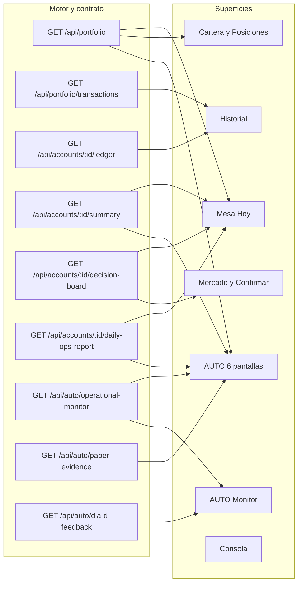

# Auditoría profunda de UI — ¿la representación de la operativa es correcta?

> **AsOf:** 2026-10-28 · **Árbol:** `2.11.169-beta` (raíz; `apps/web` = `0.1.0`) · **Sello vigente:**
> `v2.88.169-beta` → commit `3ce94048` · **Base documental al redactar:** `34c3a8f7`.
> **Naturaleza:** **auditoría POST-TAG** — hallazgos observados **después** del tag `v2.88.169-beta`, que se
> registran como posteriores a su contenido y **no** se le atribuyen retroactivamente. Auditoría
> **read-only del producto** — **docs-only**, **sin bump, sin tocar `src`/tests/
> `package.json`/workflows/migraciones, sin mover el tag**. `Δ motor = 0`, `Δ contrato = 0`.
> **Alcance de superficies:** operativa **completa** — Mesa/Hoy, Cartera/Posiciones, Historial,
> Mercado/Confirmar, AUTO (seis pantallas), AUTO Monitor y Consola operacional.
> **Pregunta:** *¿lo que la UI pinta como «la operativa» representa fielmente lo que el sistema sabe, ignora o
> no ha medido?*
> **Veredicto:** **correcta en vocabulario, no correcta en aritmética y estado.** El vocabulario de ausencia y
> las mediciones AUTO son sólidos; hay defectos verificados de **falso vacío**, **falso cero/verde**, **bases
> financieras mezcladas** y **estado de ejecución afirmado sin respaldo**. **Ningún P0** (no se ha hallado una
> firma ni una acción con lenguaje de backend, ni una cifra de dinero inventada en primer nivel).
> **Lo que este acta NO dice:** no certifica AUTO, no certifica rentabilidad, no reabre el sello. La ventana
> PAPER sigue **`INCONCLUSIVE`** (`0/2` episodios, `0/32` ciclos).

---

## 0. Alcance, vara y método

**Método.** Lectura `file:line` de las superficies y de su contrato (endpoint → DTO → hook → transformación
cliente). Se contrasta cada cifra de primer nivel con su fuente declarada en el backend y con la unidad/signo
que el motor produce. No se ejecuta la aplicación ni se generan datos nuevos (§9).

**Vara aplicada** (la de la casa, sin inventar una nueva):

| Instrumento | Invariante | Fuente |
| --- | --- | --- |
| `absentDataLabel()` | `Sin dato todavía` / `No aplica` / `No disponible`; `—` **solo** nivel 3 | [`absent-data.ts:13-54`](../../apps/web/src/components/absent-data.ts) |
| `findFirstLevelFalseZeros` | `UNKNOWN ≠ 0`: ningún `?? 0` en primer nivel fuera de `TechnicalDetail` | [`first-level-gate.ts:99-112`](../../apps/web/src/components/first-level-gate.ts) |
| `findFirstLevelDashes` | El comodín `—` **literal** no existe en primer nivel | [`first-level-gate.ts:63-80`](../../apps/web/src/components/first-level-gate.ts) |
| `findFirstLevelViolations` | Jerga de ingeniería solo dentro de `TechnicalDetail`/`AutoTechnicalDetail` | [`first-level-gate.ts:15-60`](../../apps/web/src/components/first-level-gate.ts) |
| Mediciones AUTO | Un paso sin traza durable se declara `NO MEDIDO`; el dinero se retiene si el cierre no es `COMPLETE` | [`auto-operational-monitor.py:1181-1256`](../../packages/py/application/src/bolsa_application/auto_operational_monitor.py) |
| Regla de la casa | Ninguna cifra sin comando; un hueco se declara, jamás un `0` fingido | `PROJECT_STATE.md` §protocolo |

**Cobertura real de los gates (medida, no supuesta).**

- **Ceros falsos:** el censo contiene **3 ficheros**, todos de la Consola
  ([`barrido-global-first-level.test.tsx:242-255`](../../apps/web/src/features/barrido-global-first-level.test.tsx)).
  `mesa-hoy-page.tsx`, `mesa-candidates-panel.tsx`, `mesa-operational-bar.tsx`, `operations-panel.tsx` y todas
  las pantallas AUTO quedan **fuera** de este gate aunque usen `?? 0` en primer nivel (§7, I-02).
- **Comodín `—`:** el censo incluye `history-page.tsx`, `mesa-libro-panel.tsx` y `operations-panel.tsx`
  ([`:220-230`](../../apps/web/src/features/barrido-global-first-level.test.tsx), `:78-79`, `:383-392`), y
  **pasan** — porque el gate busca el **literal** `—`, no el `—` que devuelve `formatPrice` (§4.4).
- **Sin censo:** `operations-page.tsx` no figura en ninguna lista
  (`grep features/operations/` del test solo devuelve `mesa-operational-bar.tsx`, `:178` y `:267`).

**Verificación de esta cobertura (medida, no supuesta).** `vitest run barrido-global-first-level`
→ **324 passed / 1 fichero**; `vitest run history-first-level mesa-hoy-first-level` → **11 passed / 2
ficheros**. Es decir: los gates están **verdes** con los hallazgos de §3 y §4 presentes en el árbol. Ese es,
precisamente, el resultado que este acta documenta — un gate verde **no** equivale a una representación
correcta.

**Reparto de severidad.** `P1` = la UI afirma algo falso sobre el estado de la operativa (vacío, ejecutado,
acumulado). `P2` = la cifra existe pero su base, unidad o día no es la que la etiqueta promete. `P3` =
residuo de presentación declarado, sin consecuencia sobre la decisión.

---

## 1. Mapa contrato ↔ pantalla ↔ cifra



### 1.1 Superficie → pregunta → cifra → fuente

| Superficie | Pregunta | Cifra de primer nivel | Endpoint | Transformación cliente | Evidencia |
| --- | --- | --- | --- | --- | --- |
| Mesa/Hoy · cabecera | ¿en qué estado opero? | Régimen, **P&L cartera (R)**, riesgo abierto (R), stress (R), capital + % inv., frescura, estado, modo | `/portfolio`, `/accounts/:id/summary`, `/decision-board`, `/data-status` | Σ `operational.unrealizedR`; `investedPct = (equity−cash)/equity`; **mezcla dos endpoints** | `mesa-operational-header.tsx:86-131`; `mesa-next-action.ts:290-293,335-346` |
| Mesa/Hoy · Libro | ¿cuántas posiciones y cuánto valen? | Posiciones abiertas, Patrimonio, **P&L no realizado (€)** | `/api/portfolio` | `positions.length`, `totalEquity`, `totalUnrealizedPnl` directos | `mesa-libro-panel.tsx:29,70-84` |
| Mesa/Hoy · Protección | ¿está protegida la cartera? | `N / M protegidas`, `%`, discrepancias | `/portfolio` + `/decision-board` | `aggregateMesaProtectionKpi(states)` | `mesa-hoy-page.tsx:329-335,699`; `mesa-proteccion-kpi.tsx:20-99` |
| Mesa/Hoy · Inbox | ¿qué requiere atención? | badge `N`, `🔴 x · 🟠 y · 🟢 z` | `/decision-board`, `/paper-desk/daily-report` | `count = items.length` (suma los cuatro cubos) | `daily-desk.ts:140-161,611`; `daily-desk-inbox.tsx:153-166` |
| Mesa/Hoy · Candidatas | ¿cuáles son las mejores oportunidades? | Universo, Oportunidades, Operables, Top, calidad máx. | scans + estudio | `funnel?.universeCount ?? 0`, `maxQuality ?? 0` | `mesa-candidates-panel.tsx:464-507,525-563` |
| Cartera/Posiciones | ¿qué tengo y qué hago? | R, Stop, T1, T2, Resultado, P&L €, pendientes | `/portfolio`, `/decision-board`, `/decision-studies?limit=200`, `/pending-orders` | `formatR`, `formatPriceOrAbsent`, `(unrealizedPnl ?? 0) >= 0` | `operations-panel.tsx:255-380,428-474` |
| Historial | ¿qué ha pasado? | Movimientos, Operaciones, **Comisiones acumuladas** | `/accounts/:id/ledger?limit=100`, `/portfolio/transactions?limit=100` | Σ `|amount|` de filas `fee` **de la página** | `history-page.tsx:167-187,219-228,250-260` |
| Mercado/Confirmar | ¿qué hago con este valor? | IO/TA/FA, rank, dictamen, TOP #, activas/confirm | opiniones + estrategia top + board | `allowTrading: true`, `hasEodBar: true` **fijos** | `trading-operativa-panel.tsx:211-212,340-520` |
| AUTO · Home | ¿qué hace y cuánto tengo? | Estado, actividad, TOP3, dinero (4 cifras) | monitor + `summary` | `auto-account-figures.ts:38-82` | `auto-home-page.tsx:181-426` |
| AUTO · Operar/Actividad | ¿qué pasó y por qué no operó? | ciclos, peldaño, HOLD, no-trade | monitor + `paper-desk/daily-report?asOf=hoy` | `operationLadderRungFromCycle`, `buildAutoNoTradeExplanation` | `auto-operar-page.tsx:107-211`; `auto-no-trade-panel.tsx:180` |
| AUTO · Monitor | ¿cómo está la cadena? | estado, venue, reloj, ejecución, PnL por ciclo | `/auto/operational-monitor` | `MeasurementValue` con `withhold` | `auto-cycle-timeline.tsx:99-162` |
| AUTO · Evidencia | ¿está validada la estrategia? | `0/4` días · `0/2` episodios · `0/32` ciclos | `/auto/dia-d-feedback`, `/auto/paper-evidence` | `window_gate` espejado en cliente | `operability_window.py:560-598`; `paper-confirmation-contract.ts` |
| Consola | ¿qué excepciones hay? | estado operativo, cuadre, incidencias, outbox | `/lifecycle/*`, `/financial-integrity` | rejilla gateada por presencia de dato | `operational-console-sections.tsx:163-274` |

### 1.2 Las seis definiciones distintas de «operación» que la UI mezcla bajo la misma palabra

| Término interno | Definición exacta | Dónde se pinta | Evidencia |
| --- | --- | --- | --- |
| **fila de ledger `buy`/`sell`** | una pata de ejecución; la comisión es **otra fila** | `week[].tradeCount`, `tradesToday` | `daily_ops_report.py:146-153,160-172` |
| **transacción** | una ejecución con `total = qty×price` (**sin comisiones**) | Historial · Operaciones | `history-page.tsx:124-157` |
| **fila de ledger `fee`** | un cargo de comisión, importe **positivo** | Historial · Movimientos | `trade.py:196-213` |
| **ciclo AUTO** | todos los fills de un `cycleId`, FIFO; cerrado si `open_qty==0`; `pnl` **bruto de comisiones** | Monitor, Operar | `auto_self_evaluation_feed.py:177-221` |
| **episodio (ventana)** | **régimen de mercado distinto** declarado por los ciclos | `0/2` de Evidencia | `operability_window.py:567-576` |
| **episodio (paper evidence)** | **grupo de `cycleId`** con al menos un fill | `windowEpisodes` | `paper_evidence_reconciliation.py:322-341` |

> La misma palabra —«episodios»— designa dos cantidades distintas en dos superficies del mismo espacio AUTO.
> El `0/2` de la ventana **no** es el de paper evidence (§4.7).

---

## 2. Dictamen

| Dimensión | Dictamen | Motivo |
| --- | --- | --- |
| Vocabulario de ausencia | **Correcto** | `absentDataLabel` en la mayoría de superficies; `—` reservado a nivel 3 |
| Mediciones AUTO (pasos, cierres, PnL de ciclo) | **Correcto y ejemplar** | `MeasurementValue` con `withhold`; el servidor no publica `result` si el cierre es `PARTIAL` |
| Higiene de primer nivel (jerga) | **Correcto** | 34 superficies censadas; `PAPER_D_EXECUTE`, `WFE`, `runId` plegados |
| **Representación del vacío** | **Incorrecta** | Un error de API se pinta como «no hay nada» en 6 superficies (P1) |
| **Representación del resultado** | **Incorrecta** | P&L no medido en verde; comisiones en verde; comisiones «acumuladas» de una página (P1/P2) |
| **Representación de la ejecución** | **Incorrecta** | Un fill `skipped`/`unknown` se anuncia «ejecutada» y se reintenta (P1) |
| **Coherencia de bases financieras** | **Incorrecta** | Bruto y neto de comisiones conviven sin etiqueta; bruto del motor vs neto fiscal (P2) |
| **Coherencia temporal** | **Incorrecta** | Día UTC del motor vs día local de la UI; dos relojes en la misma pantalla (P2) |
| **Trazabilidad de la ventana PAPER** | **Correcta pero insuficiente** | `INCONCLUSIVE` se declara; `0/32` es cobertura, no rendimiento, y no siempre se explica |

**Respuesta a la pregunta del encargo.** La representación de **toda la operativa** *no* es correcta: es
correcta en el **lenguaje** y en la **honestidad de los huecos AUTO**, y falla en la **aritmética** y en el
**estado**. El riesgo práctico no es que el usuario vea una cifra falsa de dinero (no se ha hallado ninguna
inventada), sino que lea **«no hay nada», «está todo bien» o «se ejecutó»** cuando el sistema, en realidad,
**no lo sabe**.

---

## 3. P1 — afirmaciones falsas sobre el estado de la operativa

### 3.1 P1-01 · Un fallo de lectura se presenta como «no hay nada»

| Superficie | Patrón | Efecto |
| --- | --- | --- |
| Historial | `movementsQuery.data ?? []` / `transactionsQuery.data?.data ?? []` (`history-page.tsx:180-181`) con vacíos en `:30-36` y `:105-112` sin `isError` | «Sin movimientos contables.» / «Sin operaciones ejecutadas.» con la API caída |
| Resultados (Mercado) | `sessionsQuery.data?.data ?? []` (`operativa-outcomes.tsx:87`) → vacío `:161-163` | «Aún no hay sesiones de este valor» |
| Pendientes (Mesa/Mercado) | `pendingOrders: query.data ?? []` (`use-pending-orders.ts:96`) → vacío `operations-panel.tsx:420-426` | «Sin órdenes pendientes»; además `useInstrumentOrderPending` devuelve `false` (`:106-111`), alterando la verdad operativa de la posición |
| DÍA-D · Operaciones | `detail?.tradeCount ?? 0` (`dia-d-trades-panel.tsx:34-37`) | `0` operaciones con la tabla vacía mientras carga o falla |
| DÍA-D · panel AUTO | `summary?.divergent ?? 0`, `oos?.unmeasuredCount ?? 0`, `limits?.length ?? 0` (`dia-d-auto-panel.tsx:284-305`) | ceros de divergencia y de límites sin dato |
| Consola · incidentes | `!isLoading && incidents.length === 0` sin excluir `isError` (`ops-incidents-and-links.tsx:37-47`) | «Sin incidentes activos» con la consulta fallida |

**Regla violada:** `UI5-14` — el vacío *medido y vacío* y el vacío *no disponible* son estados distintos
(`No aplica` ≠ `No disponible` ≠ `Sin dato todavía`). **Por qué es P1:** la consecuencia es una decisión (no
revisar el historial, no mirar la cola, no comprobar la protección) tomada sobre información que la UI
declara inexistente.

### 3.2 P1-02 · Un fill `skipped`/`unknown` se anuncia como «ejecutada»

`pending-orders-monitor.tsx:106-131` solo trata dos desenlaces: `rejected_by_gate` (lanza) y `expired`
(cancela). El caso de uso devuelve **cuatro** desenlaces más, todos con `transactionId: null`:

```text
SubmittedFill.status            transactionId   orden borrada   UI actual
executed                        tx_id           sí              toast "ejecutada @ limit"
expired                         null            sí              toast "cancelada — vencida"
rejected_by_gate / skipped      null            no              excepción → toast de error
submitted → "unknown"           null            no              toast "ejecutada @ limit"
unknown (paperOrder/paperBr.)   null            no              toast "ejecutada @ limit"
skipped (live_not_wired)        null            no              toast "ejecutada @ limit"
```

Evidencia del contrato: [`fill_pending_order.py:166-203`](../../packages/py/application/src/bolsa_application/fill_pending_order.py)
(`not_wired`, `rejected`, `submitted`, `unknown`) y `:229-237` (`executed`).

**Efectos medibles:** (a) el usuario lee «ejecutada» sin que exista transacción; (b) la orden **no se borra**,
así que el bucle de 15 s vuelve a intentarlo indefinidamente; (c) el toast imprime `limitPrice`, no el precio
aplicado — el fill se ejecuta al precio de la orden
([`fill_pending_order.py:160-165`](../../packages/py/application/src/bolsa_application/fill_pending_order.py)),
de modo que la cifra mostrada no es la del dinero movido si el adapter aplica otra.

**Por qué es P1:** es una afirmación de **ejecución** (dinero movido) sin respaldo en la respuesta.

### 3.3 P1-03 · «Comisiones acumuladas» calculadas sobre las últimas 100 filas

`history-page.tsx:167-174` pide `getAccountLedger(id, 100)` y `:182-187` suma
`Math.abs(amount)` de las filas `type === "fee"` **de esa página**; el rótulo `:221-222` dice
**«Comisiones acumuladas»** y la tarjeta solo aparece si `feeTotal > 0` (`:219`).

El ledger es descendente con `limit` 1..200 por defecto 50
([`ledger-repository.py:182-187`](../../packages/py/infrastructure/src/bolsa_infrastructure/database/repositories/ledger_repository.py));
no existe aquí agregado de comisiones por otro camino. Con más de 100 entradas el número está
**sistemáticamente subestimado** y aun así se presenta como el total del histórico. Con la consulta en error,
la tarjeta **desaparece** — que se lee como «no he pagado comisiones».

**Por qué es P1:** es una cifra de coste rotulada como acumulada, y el coste es una de las tres variables que
deciden si la operativa es rentable.

### 3.4 P1-04 · El color del ledger invierte el signo económico de las comisiones

`history-page.tsx:87-92` colorea por `entry.amount >= 0 ? emerald : red`. En el motor, `buy` es **negativo**
(salida de caja) y las **comisiones son positivas**
([`trade.py:160-170`](../../packages/py/application/src/bolsa_application/accounts/trade.py),
`append_fee(amount=fees.total)` en `:206-213`). Resultado: **una comisión se pinta en verde** (como un ingreso)
y **una compra en rojo**. El signo del importe es correcto; el semáforo afirma lo contrario.

**Por qué es P1:** el color es la lectura dominante en una tabla de dinero; aquí invierte la interpretación de
coste.

### 3.5 P1-05 · Universo «0» y aviso «tu universo es pequeño» sin dato

`mesa-candidates-panel.tsx:468-473` calcula `maxQuality = ranking?.maxQuality ?? 0` y
`smallUniverse = (funnel?.universeCount ?? 0) < 20`; `:499-507` pinta `Universo 0 · Operables 0` y
`:525-543` emite el CTA **«Tu universo de análisis es pequeño»**. Con `ranking`/`funnel` ausentes (carga o
error) la pantalla acusa al usuario de tener un universo vacío. `mesa-hoy-page.tsx:363-364` fabrica además
`screenedCount: scanResult?.scannedCount ?? 0` y `hitCount: … ?? 0`.

**Por qué es P1:** la UI **atribuye una causa al usuario** a partir de un dato que no ha leído.

### 3.6 P1-06 · Cartera caída → «Sin posiciones abiertas — no hay stop que confirmar»

`mesa-hoy-page.tsx:236` hace `positions = portfolio?.positions ?? []`; ese array alimenta
`aggregateMesaProtectionKpi` (`:329-331`) y se pasa al Libro (`:696-700`). La tarjeta
`mesa-proteccion-kpi.tsx:86-89` traduce `open === 0` a **«Sin posiciones abiertas — no hay stop que
confirmar»**. Un fallo de `/api/portfolio` produce exactamente la misma frase que una cartera vacía.

**Por qué es P1:** «no hay stop que confirmar» es una afirmación de **seguridad** de la cartera (nada queda
sin proteger) emitida a partir de un fallo de red.

---

## 4. P2 — la cifra existe, pero no representa lo medido

### 4.1 P2-01 · P&L no medido pintado en verde

`(position.unrealizedPnl ?? 0) >= 0` decide el color en `mesa-position-row.tsx:278` (pintado en `:401-409`) y
en `operations-panel.tsx:280` (pintado en `:368-380`). `unrealizedPnl` es `null` cuando la posición no tiene
mark observable ([`portfolio_repository.py:163-172`](../../packages/py/infrastructure/src/bolsa_infrastructure/database/repositories/portfolio_repository.py)).
El texto sí declara el hueco (`formatPriceOrAbsent`), pero **el color dice «positivo»**. Un `null` y un `0,00 €`
real se leen igual.

### 4.2 P2-02 · «El riesgo está controlado» con incidencias no medidas

`auto-risk-summary.ts:94` hace `const issues = input.fillLinkIssuesCount ?? 0`; con `stateTone` distinto de
`attention`/`blocked` el veredicto cae en `ok` (`:96-107`) y emite la frase
**«El riesgo está controlado. No hay bloqueos ni incidencias activas.»** (`:60-63`). El propio helper sí sabe
distinguir el hueco para la celda (`fillLinkIssuesAvailable`, `:178-183`) pero **no** para el veredicto.

**Precondición exacta:** `operationalState === "OK"` (o cualquier valor reconocido como sano) **y**
`fillLinkIssuesCount === null`. En ese caso la celda dice `Sin dato todavía` y el titular, en la misma tarjeta,
dice «No hay incidencias activas». La suite cubre `null` con estado **no** reconocido
([`auto-risk-summary.test.ts:72-84`](../../apps/web/src/features/auto/auto-risk-summary.test.ts)) — donde el
veredicto sí es `Sin dato todavía` — pero **no** la combinación estado sano + recuento ausente, que es la que
afirma de más.

### 4.3 P2-03 · Bases financieras mezcladas sin etiqueta

| Cifra | Base | Fuente | Superficie |
| --- | --- | --- | --- |
| P&L **no realizado** | **bruto** de comisiones (`avg_cost` sobre `qty×price`) | [`portfolio_repository.py:297-300`](../../packages/py/infrastructure/src/bolsa_infrastructure/database/repositories/portfolio_repository.py) | Libro, fila de posición, OperationsPanel, AUTO Home |
| P&L **realizado** | **neto** de comisiones (FIFO con fee en coste y en proceeds) | [`tax_report.py:94-137`](../../packages/py/domain/src/bolsa_domain/tax_report.py) | AUTO Home (`auto-account-figures.ts:63-70`) |
| `realizedPnl` de AUTO self-eval | **bruto** de comisiones, FIFO de precios | [`auto_self_evaluation_feed.py:121-148`](../../packages/py/application/src/bolsa_application/auto_self_evaluation_feed.py) | Evidencia / self-eval |
| «Total» de una operación | **sin** comisiones (`qty×price`) | [`history-page.tsx:154-157`](../../apps/web/src/features/history/history-page.tsx) | Historial · Operaciones |
| Caja | **con** comisiones (`cash − total − fees`) | [`portfolio_repository.py:294`](../../packages/py/infrastructure/src/bolsa_infrastructure/database/repositories/portfolio_repository.py) | Cabecera |

La disposición no es incorrecta en cada cifra aislada; lo es **presentarlas contiguas** (dos de ellas en la
misma tarjeta de AUTO Home, `auto-account-figures.ts:54-82`) sin declarar que una es neta y la otra bruta. El
usuario que resta «no realizado» de «total» obtiene un número que no es ningún P&L.

### 4.4 P2-04 · El `—` de primer nivel es invisible al gate

`formatPrice` devuelve `—` cuando el valor es `null` ([`chart-utils.ts:273-279`](../../apps/web/src/features/charts/chart-utils.ts)).
Se usa en **primer nivel** en `mesa-libro-panel.tsx:74,82`, `operations-page.tsx:82,88` y
`history-page.tsx:96` (columna Saldo), y `dataFreshness.label` puede ser `—`
([`data-freshness.ts:71,80`](../../packages/shared/src/cognitive/data-freshness.ts)) en la cabecera de Mesa.

`findFirstLevelDashes` solo marca el **literal** (`DASH_WILDCARD`,
[`first-level-gate.ts:76-80`](../../apps/web/src/components/first-level-gate.ts)); un `—` **producido** por un
helper no genera coincidencia. Por eso `history-page.tsx` y `mesa-libro-panel.tsx` están censados **y pasan**
(§0). Es un falso negativo estructural del gate: la superficie cumple la letra y viola la regla `UI5-14`.

### 4.5 P2-05 · Día UTC del motor frente a día local de la UI

- El informe diario usa por defecto **la fecha UTC**: `day = as_of or datetime.now(tz=UTC).date()`
  ([`daily_ops_report.py:135-137`](../../packages/py/application/src/bolsa_application/daily_ops_report.py)) y
  agrupa por **prefijo de fecha del ISO** (`_day_key`, `:146-150`).
- La UI pide `todayIso()` **local** para el informe de Mesa (`mesa-hoy-page.tsx:177-183`) y para el no-trade de
  AUTO (`auto-no-trade-panel.tsx:180`).
- Hubo un cierre previo del P2 de fechas para **fechas ISO imposibles** (`W-169-1`), que es otro defecto
  distinto: aquél era una fecha que no existe, éste es una fecha que existe pero **no es el día del usuario**.
- En la misma pantalla de Actividad conviven dos relojes: `activityClockLabel` imprime `HH:mm` **crudo del
  ISO** ([`auto-activity-feed.ts:87-93`](../../apps/web/src/features/auto/auto-activity-feed.ts)) y las
  declaraciones de HOLD formatean en local
  ([`auto-hold-declarations.ts:227-272`](../../apps/web/src/features/auto/auto-hold-declarations.ts)).

**Consecuencia:** una operación de tarde en Madrid puede caer en el día siguiente del informe, y el titular
«hoy» puede referirse a dos días distintos en dos paneles de la misma ruta.

### 4.6 P2-06 · Tasa de acierto con dos denominadores y sesión cerrada siempre «ok»

`operativa-outcomes.tsx:127-129` muestra `learning.matureHitRate ?? learning.hitRate` sin declarar cuál se
usó; el motor advierte que `hitRate` incluye `premature_mtm`
([`decision_outcome.py:464`](../../packages/py/analytics/src/bolsa_analytics/cognitive/decision_outcome.py)).
Además `:154-156` pinta **`ok`** para **cualquier** sesión cerrada, sea acierto o fallo.

### 4.7 P2-07 · «Episodios» y «ciclos» designan dos cosas distintas

`window_gate` cuenta **regímenes distintos** como episodios y **ciclos con R medible** como ciclos
([`operability_window.py:567-577`](../../packages/py/application/src/bolsa_application/operability_window.py));
`paper_evidence_reconciliation` cuenta **grupos de `cycleId`** como `windowEpisodes`
([`paper_evidence_reconciliation.py:322-341`](../../packages/py/application/src/bolsa_application/paper_evidence_reconciliation.py)).
Ambas nociones se rotulan «episodios» en el espacio AUTO. Y `0/32` es **cobertura** (ciclos medidos), no
rendimiento: un `0/32` puede convivir con ciclos reales cerrados y excluidos, y solo se explica si la UI
muestra `closedCyclesRead`/`excludedCycles`.

### 4.8 P2-08 · Cierre de ciclo con `default` fail-open en el Monitor

`auto-cycle-timeline.tsx:99-103` calcula
`(cycle.closedMeasurement ?? "COMPLETE") === "COMPLETE"` y colorea el badge como cierre afirmado; el peldaño
de la operación exige `=== "COMPLETE"` sin default
([`auto-operation-ladder.ts:87-96`](../../apps/web/src/features/auto/auto-operation-ladder.ts)). Hoy el
servidor **siempre** envía la medición
([`auto_operational_monitor.py:1183-1186,1238-1239`](../../packages/py/application/src/bolsa_application/auto_operational_monitor.py)),
así que el defecto es **latente**: un DTO parcial o un cambio de contrato convertiría un cierre desconocido en
«cerrado». Es una divergencia de criterio entre dos pantallas sobre el mismo hecho.

### 4.9 P2-09 · Alcance de cuenta ambiental en dos endpoints de operativa

El `X-Account-Id` se inyecta por middleware en tiempo de petición
([`api.ts:84-92`](../../apps/web/src/lib/api.ts)); `/api/portfolio` y `/api/portfolio/transactions` **no**
llevan la cuenta en la ruta (`api.ts:2178-2182` y `getPortfolio`). Las `queryKey` sí separan por cuenta
(`operations-panel.tsx:123-129`, `mesa-hoy-page.tsx:108-113`), pero la cartera de `operations-panel` se pide
**sin** `enabled`, así que una carrera cambio-de-cuenta/petición puede cachear datos de otra cuenta bajo la
clave nueva. En Historial se mezclan además dos scopes: movimientos por **path** de cuenta
(`history-page.tsx:169-173`) y operaciones por **cabecera** (`:176-181`), y los contadores de pestaña
(`:250-260`) pueden referirse a cuentas distintas.

### 4.10 P2-10 · Truncación silenciosa del informe diario y contrato opaco

`daily_ops_report.py:140` lee **solo las últimas 400 filas** de ledger; `week[].tradeCount`/`netAmount`
([`:160-174`](../../packages/py/application/src/bolsa_application/daily_ops_report.py)) pueden quedar
subestimados en una cuenta activa **sin ninguna bandera**. Y el endpoint del informe diario declara
`AiEffectivenessResponseDto = { data: { [key: string]: unknown } }`
([`schema.d.ts:4445-4451`](../../apps/web/src/api/schema.d.ts)): un renombre en el servidor **no** rompe
TypeScript.

### 4.11 P2-11 · Sin conversión de divisa en los totales

`marginUsed` suma `market_value` de todas las posiciones y los totales de cartera suman `market_value` sin
FX ([`summary.py:89-97`](../../packages/py/application/src/bolsa_application/accounts/summary.py),
`portfolio_repository.py:174-204`). En una cuenta con instrumentos en divisas distintas, «Patrimonio» y
«P&L no realizado» son sumas de unidades monetarias heterogéneas presentadas con un solo símbolo.

### 4.12 P2-12 · «N posiciones» incluye las que el patrimonio no valora

`positions_count = len(portfolio_summary.positions)`
([`summary.py:109`](../../packages/py/application/src/bolsa_application/accounts/summary.py)) incluye las
posiciones **sin precio observable**, mientras `total_market_value`, `total_cost` y `total_equity` las
**excluyen** (`portfolio_repository.py:167-182,199-204`). La tarjeta de AUTO Home muestra «N posiciones en la
cuenta simulada» encima de un P&L que puede no incluirlas todas
([`auto-account-figures.ts:54-82`](../../apps/web/src/features/auto/auto-account-figures.ts)), y Mesa usa
`positions.length` para «Posiciones abiertas» junto a un patrimonio que omite las no valoradas
(`mesa-libro-panel.tsx:29,64-84`). Un lector que sume filas no obtiene el total de la cabecera, y nada se lo
declara.

---

## 5. P3 — residuos declarados (presentación, sin efecto en la decisión)

| # | Residuo | Evidencia |
| --- | --- | --- |
| P3-01 | `heartbeatsPersisted` se rotula con medición `COMPLETE` **fija**; «Próxima decisión» se formatea con la medición de la **última** | `auto-monitor-header.tsx:125-131,143-146` |
| P3-02 | `operational.status` crudo y «sin plan persistido» en primer nivel | `operations-panel.tsx:328-330` |
| P3-03 | El badge «Hoy» suma los cuatro cubos (atención + oportunidades + posiciones + no operar) y el cubo colapsado afirma «todo lo demás está bien» | `daily-desk.ts:611`; `daily-desk-inbox.tsx:153-158,259` |
| P3-04 | `formatPrice` no firma los positivos mientras `formatPct` sí: «+1,20 %» junto a «120,00» | `chart-utils.ts:273-287,330-334` |
| P3-05 | El disparo de una pendiente usa `xtb.last ?? reference.price` sin comprobar antigüedad del quote | `pending-orders-monitor.tsx:19-22,90-93` |
| P3-06 | Toda orden pendiente se relee forzada a `stop_limit` y la tabla la rotula «a precio», ignorando `orderType` | `use-pending-orders.ts:12-14`; `operations-panel.tsx:453` |
| P3-07 | `instrumentId` (identificador largo) se usa como símbolo en primer nivel en varias superficies AUTO | `auto-activity-feed.ts:117`; `auto-operation-card.ts:188-191` |
| P3-08 | `allowTrading: true` y `hasEodBar: true` **fijos** al construir la opinión del valor | `trading-operativa-panel.tsx:211-212` |
| P3-09 | «Consola read-only» convive con un `POST` de dry-run en la misma página | `ops-incidents-and-links.tsx:138-141`; `operational-console-page.tsx:175-183` |

---

## 6. Lo que ya está bien (y no debe reabrirse)

1. **El servidor no publica dinero sobre evidencia parcial.** `result` es `null` si
   `closed_measurement != COMPLETE`
   ([`auto_operational_monitor.py:1247-1254`](../../packages/py/application/src/bolsa_application/auto_operational_monitor.py));
   la UI usa `MeasurementValue` con `incomplete="withhold"`
   ([`auto-cycle-timeline.tsx:150-162`](../../apps/web/src/features/auto-monitor/auto-cycle-timeline.tsx)).
2. **`UNKNOWN ≠ 0` está implementado donde más importa**: las figuras de cuenta de AUTO declaran hueco con
   `summary: null` y no fabrican `0,00 €` (`auto-account-figures.ts:54-82` + su test).
3. **El contrato de evidencia es falsable y no promueve**: `verdict` es `NO_CONFIRMED`; datos ausentes no se
   marcan cumplidos; medido-pero-insuficiente es `unmet`, no `unknown`
   (`paper-confirmation-contract.ts` + su test).
4. **El cierre del `O6-06`** (los tres paneles de lifecycle colapsaban el hueco a `0`/verde) sigue cerrado con
   gate y test de render.
5. **Los umbrales de la ventana son únicos y están espejados**: 4 días / 2 episodios / 32 ciclos en
   `operability_window.py`, `window-forward.mjs` y el view-model de la UI.
6. **`absentDataLabel` y `formatOrAbsent` existen y se usan** en la mayoría de primer nivel: el problema no es
   que falte vocabulario, es que hay caminos que lo esquivan (§3.1, §4.1).

---

## 7. Invariantes que hoy **no** están guardados

Son las afirmaciones de este acta que ninguna suite puede falsar todavía. Se proponen como censo futuro, **no**
se implementan en este slice.

| # | Invariante no guardado | Cómo se falsaría hoy | Censo propuesto |
| --- | --- | --- | --- |
| I-01 | Un error de lectura nunca se pinta como colección vacía | Añadir `?? []` a cualquier query con vacío existente: ninguna suite falla | `findErrorRenderedAsEmpty` sobre superficies de operativa |
| I-02 | Ningún contador de operativa colapsa el hueco a `0` fuera de la Consola | `FALSE_ZERO_SURFACES` solo tiene 3 ficheros; `mesa-operational-bar.tsx:83,88-90`, `mesa-hoy-page.tsx:210,473-476`, `mesa-candidates-panel.tsx:468-473` tienen `?? 0` vivos | ampliar `FALSE_ZERO_SURFACES` a Mesa/Mercado/AUTO |
| I-03 | Un P&L no medido nunca se colorea como positivo | `(x ?? 0) >= 0` pasa todas las suites | gate sobre comparaciones con `?? 0` que deciden color |
| I-04 | Un `—` **producido** por un helper tampoco vale en primer nivel | El censo de guiones solo ve el literal (§4.4) | gate que resolviere `formatPrice` en superficies L1 (`formatPriceOrAbsent`) |
| I-05 | Las comisiones se descuentan con signo coherente en el resultado mostrado | `cost_coverage` compara recuentos; ningún test mira el importe ni el color | assert de signo y de base (bruto/neto) en las tarjetas de dinero |
| I-06 | El día que se pinta es el día que se mide | `todayIso()` local vs `now(UTC).date()` no se contrasta en ningún test | test de frontera de día (23:30 local en verano) sobre el informe |
| I-07 | Un fill no ejecutado nunca se anuncia «ejecutada» | el monitor no está cubierto por ningún test de desenlaces | tabla de desenlaces `executed/expired/skipped/unknown` en el monitor |

---

## 8. Falsabilidad de esta auditoría

| # | Afirmación del acta | Cómo se rompe |
| --- | --- | --- |
| 1 | §3.1: un error se pinta como vacío | Que `history-page.tsx`/`operativa-outcomes.tsx`/`use-pending-orders.ts` ganen rama `isError` explícita → el hallazgo deja de ser cierto |
| 2 | §3.2: `skipped`/`unknown` se anuncia «ejecutada» | Que `pending-orders-monitor.tsx` trate `status` distinto de `executed` antes del toast |
| 3 | §3.3: comisiones «acumuladas» sobre 100 filas | Que exista un endpoint/agregado de comisiones totales o que la tarjeta deje de decir «acumuladas» |
| 4 | §3.4: color invertido en comisiones | Que `history-page.tsx` coloree por `type` y no por `amount` |
| 5 | §3.5/§3.6: ceros y «sin posiciones» sin dato | Que `ranking`/`portfolio` ausentes rendericen `absentDataLabel()` |
| 6 | §4.1: verde con P&L nulo | Que el color se derive de `isAbsent()` |
| 7 | §4.3: bases mezcladas | Que alguna superficie rotule «bruto»/«neto» o unifique la base |
| 8 | §4.4: el `—` de helper escapa al gate | Que `findFirstLevelDashes` resuelva `formatPrice` en L1 — hoy devuelve `[]` con el `—` presente en pantalla |
| 9 | §4.5: día UTC vs local | Que `asOf` se derive de la zona del usuario o que la UI declare la zona |
| 10 | §4.8: default fail-open del Monitor | Que `auto-cycle-timeline.tsx` exija `=== "COMPLETE"` sin `??` |

---

## 9. Límites declarados

- **Auditoría estática.** No se ha ejecutado la aplicación en navegador ni se han generado datos PAPER. Los
  hallazgos son de **lectura de código y contrato**; ninguno se apoya en una captura o en una medición nueva.
- **Sin `axe` ni Playwright.** No se re-certifica accesibilidad ni se ejecutan los E2E integrados. La deuda
  `axe` opt-in sigue abierta (§6 de la [auditoría 6.x](./auditoria-ui-6-x-global-2026-10-08.md)).
- **Sin datos financieros nuevos.** `0/2` episodios y `0/32` ciclos son el estado **vigente de la ventana**,
  no un resultado de esta auditoría; siguen siendo `INCONCLUSIVE`.
- **`Δ motor = 0`, `Δ contrato = 0`.** No se ha tocado `packages/py/**`, `apps/api-python/**`, workflows,
  migraciones ni `contract:gen`. Este documento **no** demuestra ni desmiente rentabilidad.
- **Cobertura.** Se auditó la operativa completa (las superficies de §1.1). Quedan fuera DÍA-D de backtests y
  el laboratorio de investigación, salvo donde alimentan una cifra de operativa (citado).
- **Un hallazgo puede ser residual de diseño.** Los P3 se declaran como tales; los P1/P2 se declaran como
  defectos de representación, **no** como defectos del motor.

---

## 10. Dictamen final y siguiente paso

**La representación de la operativa es correcta como lenguaje y deficiente como espejo.** El sistema sabe
declarar lo que no mide —y lo hace bien en AUTO—, pero en el camino de la operativa diaria sigue habiendo
puntos donde la UI **rellena, colorea o afirma** en lugar de declarar: un error de red se convierte en «no hay
nada» (6 superficies), un fill no ejecutado se anuncia «ejecutada», el coste se pinta como ingreso y se llama
«acumulado» a lo que es una página.

**Nada de esto cambia el dictamen del sello.** `v2.88.169-beta` sigue cerrado con CI verde; AUTO sigue OFF;
PAPER sigue `INCONCLUSIVE`; no se ha demostrado rentabilidad ni se autoriza operar con dinero real.

**Siguiente paso recomendado (fuera de este slice):** abrir un slice de corrección **acotado a P1** (3.1 a
3.6) con sus gates (I-01, I-02, I-03 de §7), en un sello propio — **sin** tocar `v2.88.169-beta` y **sin**
reabrir su evidencia.

---

## 11. Fuentes

| # | Fuente | Qué responde |
| --- | --- | --- |
| 1 | [`absent-data.ts`](../../apps/web/src/components/absent-data.ts) · [`first-level-gate.ts`](../../apps/web/src/components/first-level-gate.ts) | Vara `UI5-14` y alcance real de los gates |
| 2 | [`barrido-global-first-level.test.tsx`](../../apps/web/src/features/barrido-global-first-level.test.tsx) | Censos (`TOKEN`/`DASH`/`FALSE_ZERO`) y qué queda fuera |
| 3 | [`portfolio_repository.py`](../../packages/py/infrastructure/src/bolsa_infrastructure/database/repositories/portfolio_repository.py) · [`tax_report.py`](../../packages/py/domain/src/bolsa_domain/tax_report.py) | Bases de P&L (bruto vs neto), valoración y `equity` |
| 4 | [`trade.py`](../../packages/py/application/src/bolsa_application/accounts/trade.py) · [`ledger_repository.py`](../../packages/py/infrastructure/src/bolsa_infrastructure/database/repositories/ledger_repository.py) | Signo del ledger, fila de comisión, secuenciador |
| 5 | [`fill_pending_order.py`](../../packages/py/application/src/bolsa_application/fill_pending_order.py) | Desenlaces `executed`/`skipped`/`unknown` y precio aplicado |
| 6 | [`daily_ops_report.py`](../../packages/py/application/src/bolsa_application/daily_ops_report.py) | Día UTC, truncación a 400 filas, agregados semanales |
| 7 | [`operability_window.py`](../../packages/py/application/src/bolsa_application/operability_window.py) · [`paper_evidence_reconciliation.py`](../../packages/py/application/src/bolsa_application/paper_evidence_reconciliation.py) | `0/2`/`0/32`, definiciones de episodio y ciclo |
| 8 | [`auto_operational_monitor.py`](../../packages/py/application/src/bolsa_application/auto_operational_monitor.py) | Cierre medido, `result` retenido, mediciones por paso |
| 9 | [`auditoria-ui-olas-2-6-2026-10-13.md`](./auditoria-ui-olas-2-6-2026-10-13.md) | Precedente `O6-06` (hueco colapsado a `0`) y censos de ola |
| 10 | [`auditoria-externa-v2.88.169-beta-2026-10-28.md`](./auditoria-externa-v2.88.169-beta-2026-10-28.md) | Límites del sello vigente: AUTO OFF, PAPER `INCONCLUSIVE` |

> **Nota:** este acta **audita** la representación y **no la corrige**. No modifica el tag, el código, el contrato
> ni los documentos del sello `v2.88.169-beta`.
