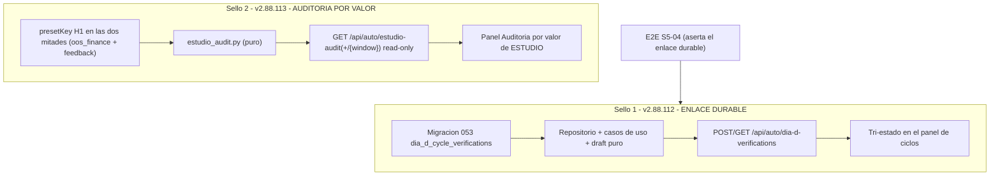

# Auditoría — `v2.88.113-beta` (`P2` sello 2) · auditoría por VALOR de ESTUDIO + cierre de prioridades AUTO

> **AsOf:** 2026-10-11 · **Auditado:** `v2.88.113-beta` · **Base del diff:** `v2.88.111-beta`
> **Rango auditado:** `v2.88.111-beta` → `v2.88.113-beta` (incluye el sello 1 `P2` = `v2.88.112-beta`, porque su tag no se publicó; ver §6).
> **Naturaleza:** sellos **aditivos**. `Δ motor ≠ 0` (módulos puros nuevos, ruta read-only, tabla `053`, UI) pero **`Δ decisión = 0`** en ambos: sin motor de decisión, sin umbrales, sin reparto ni `TOP_N`/régimen/selección/protección.
> **Tag:** objeto anotado `7713925b4fa73f2ed7705705624cac06c2a5a857` → commit `3dd15193881895a5bfa7a55937aca7e14963b500` (**unsigned**, limitación de certificación: `"verified": false, "reason": "unsigned"`).
> **Redactada por:** el agente auditor, a petición del propietario. Transcripción al paquete de ingeniería.

---

## Veredicto

- **`v2.88.113-beta`: APROBADA técnicamente**, con deudas declaradas (§6). La aprobación **no** se deduce del CI verde: se sostiene en el **cotejo del diff real** `111→113` y en la **reproducción byte a byte** del artefacto congelado (`replay-repro`).
- **`P2` (ambos sellos): CERRADO** en su alcance declarado — enlace durable verificación↔ciclo (sello 1) y composición por valor de ESTUDIO (sello 2).
- **Prioridades acordadas:** `AUTO/SIM` **CERRADO**; `trazabilidad de ciclo` **CERRADO**; `verificación DÍA-D` **CERRADO**; `banda K + OOS` **ABIERTO (parcial)** — el dinero OOS está implementado y la banda se **declara**, pero la banda `K` **medida** (`§8-c`) sigue pendiente.
- **`Δ decisión = 0` CONFIRMADO por CI:** `replay-repro` regenera el artefacto del sello y su `sha256` es **idéntico** al de los sellos previos.

## 1. Por qué el tag daba 404 (diagnóstico, no defecto)

El tag y la comparación devolvían 404 porque **`v2.88.112-beta` y `v2.88.113-beta` solo existían en el clon local**: nunca se habían publicado en `origin`. `gh api .../git/ref/tags/v2.88.113-beta` → `404 Not Found`. `main` iba **ahead 2** con exactamente los dos sellos de `P2` (`d955da59` + `3dd15193`). No era un tag mal formado: no existía el ref remoto. Una vez publicado el tag, el ref resuelve y la comparación funciona.

## 2. Cita del CI (Release tag CI `38177610756`)

Run [`38177610756`](https://github.com/jvelasca/Bolsa_V1/actions/runs/38177610756) → **`success`**.

- **12 jobs `success`** (`security`, `shared`, `decision-spine`, `frontend`, `python`, `playwright-mock`, `playwright-integrated-auto-s5`, `lifecycle-pg`, `replay-repro`, `dr-verify`, `a7-gate`) **+ `certify` `success`**; `playwright (integrated E2E, opt-in)` `skipped` (esperado).
- Artefacto `certify`: [`release-tag-ci-summary.json`](https://github.com/jvelasca/Bolsa_V1/actions/runs/38177610756) → `"status": "GREEN"`, `"tag": "v2.88.113-beta"`, `"sha": "3dd15193…"`.
- **`lifecycle-pg`** → **`success`**; el paso PG grande corrió con el gate nuevo `DIA_D_CYCLE_VERIFICATION_PG_REQUIRED=1` y **`test_dia_d_cycle_verification_pg.py` registrado** ⇒ **`200 passed in 67.85s`**, sin skips reales (los 10 bloques con guard anti-skip quedaron verdes).
- **`replay-repro`** → **`REPRODUCIDO`**: `sha256` `1E3ADAC26543FC7BFC7DA4CAA8733D3B24937A0E3E0E78650DC059FA929A37E7` **idéntico** a los sellos previos ⇒ **prueba directa** de que los sellos **no** movieron el artefacto congelado (`Δ decisión = 0` confirmado por CI).

**Nota de rigor — el CI de 113 NO es idéntico al de 111.** El diff toca el propio [`.github/workflows/release-tag-ci.yml`](../../.github/workflows/release-tag-ci.yml): añade el gate `DIA_D_CYCLE_VERIFICATION_PG_REQUIRED: '1'` al job `lifecycle-pg`, registra `test_dia_d_cycle_verification_pg.py` en ese job y lo añade al `--ignore` del job `python`. `lifecycle-pg` entra en `certify.needs`, así que el gate PG del enlace DÍA-D **bloquea el tag** — y pasó.

## 3. Diff real `111 → 113` (65 ficheros, +5270 / −235)

**Núcleo Python/DDD (sello 1):**
- Migración [`053_dia_d_cycle_verifications.py`](../../packages/py/infrastructure/alembic/versions/053_dia_d_cycle_verifications.py) (`down_revision = "052_top3_opportunities"`, cadena lineal): tabla `dia_d_cycle_verifications` con `cycle_id` indexado, identidad de estrategia **nullable a propósito**, `result` JSONB y **unique idempotente** `(cycle_id, dia_d, end_date, mode)`.
- Entidad, modelo, repositorio (`upsert` idempotente + `list_verifications` acotado por cuenta/ciclo) y casos de uso + helper puro [`build_dia_d_cycle_verification_draft`](../../packages/py/application/src/bolsa_application/dia_d_cycle_verification.py): **sin lo indispensable el draft es `None`** (no se fabrica enlace).

**Núcleo Python (sello 2):**
- [`estudio_audit.py`](../../packages/py/application/src/bolsa_application/estudio_audit.py) (puro: sin DB/red/reloj): `build_estudio_audit_report` compone por símbolo **estrategia + porqué + señal + R + dinero**, con **suelos de muestra** (`DEFAULT_MIN_CYCLES = 5`, `DEFAULT_MIN_TRADES = 10`), **ambigüedad declarada** (`_first_distinct`: dos identidades ⇒ `None` + «ambigua») y `pointCitable = false`.
- [`oos_finance.py`](../../packages/py/application/src/bolsa_application/oos_finance.py): `OosFill`/`GroupMetrics` ganan `strategy_preset_key`; por grupo se toma el **primer `presetKey` NO vacío** (sin identidad ⇒ `None`, **jamás** `""`).

**API y contrato:**
- [`auto_dia_d_verification.py`](../../apps/api-python/src/bolsa_api/api/v1/routes/auto_dia_d_verification.py): `POST /api/auto/dia-d-verifications` (sin cuenta ⇒ `400`; payload incompleto ⇒ `400`) y `GET` (**fail-closed por cuenta**: sin cuenta ⇒ `data: []` + `no_account_scope`).
- [`auto_estudio_audit.py`](../../apps/api-python/src/bolsa_api/api/v1/routes/auto_estudio_audit.py): `GET /api/auto/estudio-audit` y `GET /api/auto/estudio-audit/{window}` (`serving = PRECOMPUTED_ARTIFACT`; ventana inválida ⇒ `available = false`). Ambos registrados en [`router.py`](../../apps/api-python/src/bolsa_api/api/v1/router.py:83).
- **Contrato ampliado** (`contract:gen`/`contract:check`): [`openapi.json`](../../apps/web/api/openapi.json) y [`schema.d.ts`](../../apps/web/src/api/schema.d.ts) regenerados.

**UI (superficie):**
- Sello 1: [`dia-d-cycle-verification-status.ts`](../../apps/web/src/features/auto-monitor/dia-d-cycle-verification-status.ts) (tri-estado `linked` / `not-verified` / `unknown`) + [`dia-d-auto-feedback-cycles.tsx`](../../apps/web/src/features/auto-monitor/dia-d-auto-feedback-cycles.tsx).
- Sello 2: [`estudio-audit-view.ts`](../../apps/web/src/features/auto-monitor/estudio-audit-view.ts) (helpers puros; un dato ausente ⇒ «Sin dato todavía», **nunca** `0`) + [`estudio-audit-panel.tsx`](../../apps/web/src/features/auto-monitor/estudio-audit-panel.tsx), integrado en la pestaña «¿Qué ha pasado?».

**Pruebas nuevas:** [`test_estudio_audit.py`](../../packages/py/application/tests/test_estudio_audit.py), [`test_auto_estudio_audit_route.py`](../../apps/api-python/tests/test_auto_estudio_audit_route.py), [`test_dia_d_cycle_verification_pg.py`](../../apps/api-python/tests/test_dia_d_cycle_verification_pg.py), [`test_auto_dia_d_verification_route.py`](../../apps/api-python/tests/test_auto_dia_d_verification_route.py), [`GP-V288-S5-04`](../../apps/web/e2e/gp-v288-s5-auto-dia-d-bridge-integrated.spec.ts).

## 4. Observaciones verificadas por prioridad

| # | Tesis verificada | Veredicto |
|---|---|---|
| 1 | **Unión por clave EXACTA `presetKey` (H1)**: el dinero se atribuye a la estrategia exacta, no al «primero del símbolo» (`test_money_group_selected_by_exact_preset_key_when_several_share_symbol`) | 🟢 |
| 2 | `presetKey` **ausente o AMBIGUA** ⇒ `None` + motivo («Sin dato todavía»); **nunca** se elige una «ganadora» (`test_ambiguous_preset_key_is_declared_not_chosen`) | 🟢 |
| 3 | Un valor solo se declara `measured` si **ambas** mitades superan su suelo; bajo el suelo los ratios son `None`, **jamás `0`** (`test_missing_money_is_declared_never_zero`, `test_result_r_below_floor_is_declared`) | 🟢 |
| 4 | `pointCitable = false` coherente en [`estudio_audit.py`](../../packages/py/application/src/bolsa_application/estudio_audit.py) y [`oos_finance.py`](../../packages/py/application/src/bolsa_application/oos_finance.py), con la razón citada (banda `K=12` cruza el cero, [v2.88.16.3](evidence/v2.88.16.3/README.md)) | 🟢 |
| 5 | Salida **ordenada por símbolo** y **determinista** (`test_deterministic_and_ordered_by_symbol`) | 🟢 |
| 6 | **AUTO/SIM — permiso POSITIVO**: `SimOnlyScope` no es booleano ni env; solo lo acuña [`require_sim_only_scope`](../../packages/py/application/src/bolsa_application/simulated_finance.py), y [`build_simulated_execute_trade_applier`](../../packages/py/application/src/bolsa_application/simulated_finance.py:301) **exige** el sello (`_sealed_sim_only_scope` ⇒ `TypeError` si falta o está forjado) | 🟢 |
| 7 | **Invariante AST derivado**: [`test_a8_m0_auto_live_invariant.py`](../../packages/py/application/tests/test_a8_m0_auto_live_invariant.py) deriva los módulos AUTO del árbol (no censo manual) y aplica **allowlist invertida** sobre todo el paquete y todo `apps/*/src`; ningún módulo de app referencia la vía real | 🟢 |
| 8 | **Enlace durable** verificación↔ciclo: migración `053` idempotente por clave natural, huecos persistidos como `NULL`; la ruta es **fail-closed por cuenta** (escritura `400` sin cuenta; lectura vacía con `no_account_scope`) | 🟢 |
| 9 | **E2E `S5-04`** no se conforma con abrir el laboratorio: parte del no-residuo, lanza desde la operación, guarda y **aserta el registro durable enlazado al `cycleId`** | 🟢 |
| 10 | **`Δ decisión = 0` en CI**: `replay-repro` reprodujo el artefacto con `sha256` idéntico ⇒ la clave nueva (opcional) y el reporte de ESTUDIO (opt-in) **no** entran en el payload del replay | 🟢 |
| 11 | `lifecycle-pg` corrió con el **gate nuevo** `DIA_D_CYCLE_VERIFICATION_PG_REQUIRED=1` y `test_dia_d_cycle_verification_pg.py` registrado (`200 passed`) | 🟢 |
| 12 | **Banda `K` medida** (`§8-c`): la capa de banda [`dia_d_multi_uncertainty.py`](../../packages/py/application/src/bolsa_application/dia_d_multi_uncertainty.py) **declara** la regla (`MIN_DRAWS_FOR_BAND = 2`, `CI95_Z = 1.96`, `crossesZeroR`) pero la banda `K` **medida** no viaja en este sello | 🟠 |
| 13 | **`§8-c` no reproducible sin PG**: la validación OOS financiera por valor **está** (sello `§8`, `v2.88.111`) y ahora se une por `presetKey`, pero la banda `K` medida merece su propio sello | 🟠 |

## 5. Límites declarados (no disfrazados)

- **La evidencia `112`/`113` conserva su cita POST-TAG «Pendiente»** en el repo; el tag se publicó **después** de escribirla, así que el objeto/commit/run reales viven en **este informe** (§2) y no se han reinyectado en `docs/engineering/evidence/v2.88.11{2,3}/README.md`. **Residuo de documentación** (§6).
- **El informe COMPONE, no afirma.** No recalcula el motor ni proclama una estrategia «ganadora»; el dinero es **edge medido**, no rentabilidad afirmada.
- **Costes `modelados`** en el overlay OOS; la fricción **medida** del SIM (`applied_cost`/`reference_mid`) va aparte, sin doble contabilización.
- **`CONFIRMED` sigue reservado** a evidencia PAPER real; los sellos no emiten `CONFIRMED`.

## 6. Deudas y residuos declarados

- **R-1 (publicación asimétrica):** se publicó **solo** el tag `v2.88.113-beta` (decisión del propietario). El tag `v2.88.112-beta` **no** se publicó ⇒ **no hay `Release tag CI` propio del sello 1**; su migración `053` y su ruta sí quedan certificadas **dentro** del CI de `113` (`lifecycle-pg` con el gate nuevo). Si se quiere el run propio del sello 1, publicar `v2.88.112-beta`.
- **R-2 (`origin/main` sin avanzar):** al empujar solo el tag, los 2 commits (`d955da59`, `3dd15193`) son alcanzables por el tag pero **no** por `main` ⇒ **no corrió el CI de rama** sobre ellos (solo el CI de tag). El `main` remoto sigue en `3d8e74ad` (POST-TAG de `111`). **→ RESUELTO en `v2.88.114-beta` (2026-10-12):** `main` empujado a `origin` (`3d8e74ad..1c33e7c1`); CI de rama `success`.
- **R-3 (tag unsigned):** `verification.verified = false` (`reason: unsigned`). Limitación de certificación, no defecto funcional.
- **R-4 (`§8-c` pendiente):** la banda `K` **medida** del OOS (re-ejecutar el replay `K` veces, no reproducible sin PG) queda como sello propio.
- **R-5 (documentación):** reinyectar la cita POST-TAG en las evidencias `112`/`113`.

## Conclusión

`v2.88.113-beta` cierra el hueco `P2` de la [auditoría profundizada](auditoria-profundizada-auto-h1-sim-dia-d-2026-10-11.md) con **honestidad estructural**: la identidad exacta (`presetKey`) une las dos mitades, la ambigüedad se declara en vez de resolverse, y bajo el suelo de muestra los ratios son `None` (jamás `0`). El endurecimiento `SIM` (§7) y el enlace durable del `DÍA-D` quedan verificados en código y certificados por CI. La única prioridad aún **abierta** es la **banda `K` medida**, declarada y no fabricada. La aprobación se apoya en el **diff real** y en la **reproducción byte a byte** del artefacto, no en el mero verde del CI.
