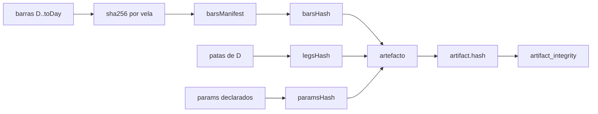

# Cierre de auditoría del DÍA-D as-run — costes homogéneos, benchmark comparable y hashes verificables

**Fecha:** 2026-11-13 · **Bump:** `2.11.189-beta` · **ADR:** [049](../adr/049-adaptacion-gobernada-por-ia.md) · **Método:** [`dia-d-as-run-2026-11-13.md`](./dia-d-as-run-2026-11-13.md)

**Veredicto de este cierre.** El dictamen externo era *PASS de implementación* con cinco comprobaciones críticas pendientes y un punto extra sobre el coste de los fills reales. Las seis quedan convertidas en **invariantes que la certificación recalcula**, no en promesas del productor. Lo que sigue: `activationAllowed` continúa en `false` y este documento **no** declara validación histórica (nivel 3) ni aptitud operativa (nivel 4).

---

## 1. Respuesta punto por punto

### 1.1 Gaps: stop y target en la misma vela, prioridad conservadora

**Dictamen:** verificar que un hueco que atraviesa stop y target en la misma vela no se resuelve a favor.

**Estado.** Ya se comportaba bien y ahora está pinzado por contrato y por test:

- `_trigger` comprueba el **stop antes** que el target en la misma barra.
- Si el `open` ya está más allá del stop, el fill es el **`open` real**, no el precio teórico del stop (`gap_policy = "open"` por defecto).
- Test: `test_gap_beyond_stop_and_below_target_exits_at_the_stop` — una vela que abre en 90 (stop 95, target 110) sale por stop al open (`-2,0 R`), con `targets = 0`.
- Test previo conservado: `test_stop_is_checked_before_target_on_the_same_bar`.

### 1.2 Liquidez: un cierre diferido no puede ser retroactivo

**Dictamen:** un cierre diferido por falta de liquidez no puede usar el precio del disparo.

**Estado.** El cierre se ejecuta al `open` de la **primera barra posterior que absorbe la cantidad** y la decisión lleva la **fecha del fill**, nunca la del disparo:

- `test_deferred_exit_dates_the_fill_not_the_trigger` — disparo el día 2 sin liquidez; fill el día 3 a 93, `reason = "stop_deferred"` y `date = 2026-01-03`.
- La excursión se corta en el `open` ejecutado (§1.4): el mínimo del día del disparo no contamina la medida del día del fill.
- Si no existe barra que absorba la cantidad, `liquidity_insufficient` y el brazo queda **no medido** (nunca se rellena el hueco).

### 1.3 Benchmark: mismo capital, universo, periodo y coste

**Dictamen:** `market_bh` debe ser comparable con la estrategia.

**Cambios en `run_market_bh_arm`:**

| Antes | Ahora |
| --- | --- |
| universo = claves de `bars_by_instrument` | universo **declarado en D** (`audit.pointInTime.universe`) |
| equiponderación por instrumento sin capital | capital = **notional inicial de las patas**, repartido equiponderado (`audit.benchmark.capitalBasis`) |
| periodo = todas las barras cargadas | primera barra posterior a D hasta la última `<= toDay` |
| liquidez evaluada con `quantity = 1.0` | liquidez evaluada con la **cantidad real** (`allocation / precio`) |
| coste por lado con dos factores | **misma** `executionCostBps` sobre el notional de cierre que el resto de brazos |
| solo `returnPct` | `pnlCurrency` + `returnPct`, con `realizedR = null` (no tiene stop: no se inventa un R) |

Tests: `test_market_benchmark_uses_the_same_capital_and_cost_as_the_strategy` (mismo PnL que `hold_structural` al mismo precio de salida), `test_market_benchmark_period_is_clipped_to_to_day`, `test_market_benchmark_respects_the_declared_universe`, `test_market_benchmark_liquidity_uses_the_real_quantity`.

La certificación exige ahora `benchmarkUniverse`, `benchmarkCapitalBasis`, `benchmarkCostBps` y `pnlCurrency`, y que el universo del benchmark sea el del punto en el tiempo.

### 1.4 Look-ahead: cambiar datos posteriores no altera decisiones anteriores

**Dictamen:** modificar los datos después de D no puede cambiar ninguna decisión anterior a D (ni a la fecha de la decisión).

**Estado.** Se mantiene el invariante por prefijo y se añade el caso que faltaba, el de la **excursión**:

- `test_later_bars_do_not_change_earlier_decisions` compara las **decisiones completas** (no solo el R) con y sin barras futuras.
- `_hold_exit` ya no acumula MAE/MFE con el rango completo de la barra de salida: **al disparar deja de acumular** y en esa barra solo cuenta el `open` y el precio ejecutado. Un máximo posterior a la salida ya no infla `mfeR` ni `capture` (`test_exit_bar_high_does_not_inflate_mfe`).
- Universo declarado: una candidata sobre un instrumento del que hay barras pero que **no** pertenece al universo de D no se mide (`test_bars_do_not_widen_the_declared_universe_for_the_candidate`).

### 1.5 Hashes: manipular vela, pata, parámetro o versión invalida la certificación

**Dictamen:** el hash debía detectar manipulación, no solo existir.

**Cadena nueva:**

- `audit.data.barsManifest[instrumento] = [[día, sha256(día|open|high|low|close|volume)], …]`, y `barsHash = artifact_hash(barsManifest)`.
- `verify_bars_manifest(manifest, barras)` re-verifica el manifest contra la fuente; el CLI lo aplica con `--verify-bars` y **aborta** si no coincide.
- `audit.params` publica los parámetros y `paramsHash` se **recomputa** al certificar.
- Nueva condición `artifact_integrity`: `hash` recalculado del artefacto completo.

| Manipulación | Condición que falla | Test |
| --- | --- | --- |
| una vela del manifest | `real_market_data:bars_hash_mismatch` | `test_tampered_bar_breaks_real_market_data`, `test_verify_bars_manifest_detects_one_changed_bar` |
| `audit.params` | `audit:params_hash_mismatch` | `test_tampered_params_break_audit` |
| `versions.bump` | `artifact_integrity:artifact_hash_mismatch` | `test_tampered_bump_breaks_artifact_integrity` |
| `realizedR` de un brazo | `artifact_integrity:artifact_hash_mismatch` | `test_tampered_result_breaks_artifact_integrity` |
| patas del estado inicial | `initial_state:legs_hash_mismatch` | `test_tampered_legs_hash_is_rejected` |
| artefacto v1 sin manifest/params | `NOT_EVALUATED` explícito, nunca `PASS` | `test_legacy_artifact_without_manifest_or_params_is_not_certified` |

**Modelo de amenaza declarado.** La cadena detecta cualquier edición posterior al sellado. **No** distingue a un productor que reescriba el artefacto *y* sus hashes de forma coherente: para eso hace falta una firma o un sello externo al propio fichero. La certificación acredita integridad, no autenticidad; se declara aquí para no vender más de lo que hay.

### 1.6 Punto extra: el `as_run` no puede cobrar deslizamiento que ya está en el fill

**Dictamen:** la rentabilidad `as_run` no debe incorporar deslizamiento contrafactual si ya tiene fills reales a precios efectivos.

**Cambios:**

- Nuevo campo declarado `AsRunExecutionModel.real_fills_cost_basis`:
  - `quoted` (por defecto): el precio del fill es bruto y se cobra `executionCostBps` en caja.
  - `effective`: el precio ya incorpora el coste, no se cobra nada y `executionCostBps` debe ser **0** (constructor lo rechaza si no).
- Se publica en `audit.execution.realFillsCostBasis` y en el tipo TS `DiaDAsRunExecutionModelV1`.
- `realistic_execution` exige el campo y su coherencia (`effective` con coste en caja ⇒ `FAIL:effective_fills_with_cash_cost`).
- El deslizamiento sigue aplicándose **solo** a los brazos contrafactuales, que es donde es una hipótesis y no un hecho.

Tests: `test_effective_fills_charge_no_cash_cost_and_keep_the_round_trip_declared`, `test_effective_basis_rejects_cash_cost_double_counting`.

### 1.7 Bonus exigido por la revisión del código: un solo coste entre brazos

El dictamen no lo pedía, pero al verificar el punto extra apareció una incoherencia real: `_cost_currency` cobraba `executionCostBps` una vez sobre el notional de salida, mientras `run_as_run_arm` cobraba medio coste sobre entrada **y** salida. Para 1.000 € y 32 bps eran 3,20 € frente a ≈3,36 €: el brazo real y los contrafactuales no eran comparables.

- Nueva función única `_execution_cost_currency(exit_price, quantity, model)`: `|cantidad × precio de salida| × executionCostBps/10⁴`.
- La usan `_run_hold_like`, `_r_after_cost`, `run_as_run_arm`, `run_market_bh_arm` y `_real_fill_cost_currency`.
- Test invariante: `test_same_cycle_costs_the_same_measured_as_run_or_as_hold` — mismo ciclo medido por fills y por barras ⇒ **mismo `pnlCurrency`** (−3,20 € con 1.000 € y 32 bps) y **mismo `realizedR`**.

---

## 2. Universo declarado y certificación de 8 condiciones

- `build_as_run_artifact(..., universe_instruments=[...])` declara el universo de D; `_candidate_gap_reason` usa **ese** conjunto.
- Sin declaración: `audit.pointInTime.universeSource = "derived"` y `initial_state` ⇒ `NOT_EVALUATED` (`universe_not_declared`). El artefacto se sigue midiendo; lo que no se puede afirmar es que el universo se conociera en D.
- CLI: `--universe-instrument` (repetible) y `--verify-bars`; payload del job: `universeInstruments` y `verifyBars`.
- `CERTIFICATION_CHECKS` pasa de 7 a 8: `artifact_integrity`, `temporal_freeze`, `initial_state`, `sequential_replay`, `real_market_data`, `realistic_execution`, `benchmarks`, `audit`.

Contrato TypeScript actualizado en [`packages/shared/src/dia-d-as-run.ts`](../../packages/shared/src/dia-d-as-run.ts): `realFillsCostBasis`, `data.barsManifest`, `versions.params`, `audit.benchmark`, `pointInTime.universe/universeSource`. El DTO HTTP no cambia (expone `audit` como objeto), así que no hay regeneración de OpenAPI.

---

## 3. Distinción de niveles (lo que este cierre NO reclama)

| Nivel | Qué exige | Estado tras este cierre |
| --- | --- | --- |
| 1. Implementado | código, DTO, auditoría, certificación, UI | **Sí** |
| 2. Verificado técnicamente | tests dirigidos y amplios, mypy, ruff, tipos, contrato | **Sí** (§4) |
| 3. Validado históricamente | varios D reales, cohorte `certified`, muestra ≥ 12, datos de mercado medidos | **No** — requiere ejecuciones reales |
| 4. Apto para consideración operativa | robustez y rentabilidad neta demostradas + aprobación humana | **No** — `activationAllowed = false` |

Una certificación acredita que la reconstrucción satisface condiciones metodológicas; **no** demuestra rentabilidad. La línea base medida sigue siendo negativa y este método no la cambia: la mide.

---

## 4. Verificación ejecutada (2026-11-13, árbol sin sellar)

| Comando | Resultado |
| --- | --- |
| `pytest packages/py/application/tests/test_dia_d_as_run_eval.py -q` | **55 passed** |
| `pytest packages/py/application/tests/test_adaptation_validation.py apps/api-python/tests/test_ai_adaptation_routes.py -q` | **26 passed** |
| `pytest apps/api-python/tests/test_auto_ops_dia_d_as_run.py apps/api-python/tests/test_auto_dia_d_as_run_route.py apps/api-python/tests/test_dia_d_as_run_scheduler.py -q` | **27 passed** |
| `pytest apps/api-python/tests/test_dia_d_bump_guard.py -q` | **3 passed** (incluye el guardián nuevo de `_BUMP`) |
| `mypy packages/py/application/src/bolsa_application/dia_d_as_run.py dia_d_certification.py` | **Success: no issues found** |
| `ruff check` sobre los ficheros tocados | **All checks passed** |
| `npx vitest run --root packages/shared src/dia-d-as-run.test.ts` | **5 passed** |
| `npm test -- dia-d-as-run` (apps/web) | **7 passed** |
| `tsc --noEmit` (packages/shared y apps/web) | **limpio** |

Estos números son de **este** árbol y de **este** cierre; no sustituyen la suite completa ni el sello del tag.

---

## 5. Incidencia `chaos/live_a7`: invocación/configuración, no defecto funcional

**Qué se observó.** Al ejecutar la batería de caos `A7` (`apps/api-python/tests/chaos/live_a7`) fuera de su job, la batería no pasa; invocada con el `pyproject.toml` correcto (`apps/api-python/pyproject.toml` como configuración efectiva de pytest) y una base dedicada, sí.

**Por qué es configuración y no función.** La batería es asíncrona (`pytestmark = pytest.mark.asyncio`, fixtures `pytest_asyncio` con scope de loop) y exige una base **dedicada** `bolsa_v1_a7`; además el job la corre con `LIVE_A7_PG_REQUIRED=1`, que convierte en fallo duro cualquier escenario que se saltaría por no haber base. La raíz del repo declara su propio `[tool.pytest.ini_options]` (solo `markers`), sin las opciones de asyncio que la batería necesita: invocada con **esa** configuración, la batería no puede ni montar sus fixtures. Evidencia en el árbol:

- [`.github/workflows/python-ci.yml`](../../.github/workflows/python-ci.yml): el job offline **ignora** `apps/api-python/tests/chaos/live_a7` (no hay PostgreSQL) y la batería se certifica en su gate propio.
- [`.github/workflows/release-tag-ci.yml`](../../.github/workflows/release-tag-ci.yml): job `a7-gate`, base `bolsa_v1_a7` recién creada, `LIVE_A7_PG_REQUIRED: '1'` y `uv run pytest apps/api-python/tests/chaos/live_a7 -q --tb=short`.
- `apps/api-python/pyproject.toml` declara `asyncio_mode = "auto"` y `testpaths = ["tests"]`; el `pyproject.toml` de la raíz no.

**Cómo se declara.** Es una **incidencia de invocación/configuración**: el fallo aparece cuando la batería se lanza con la configuración de la raíz en vez de la del paquete. No se cuenta como defecto funcional del DÍA-D ni de `live_a7`, y **no** se declara verde desde la raíz: el verde de esta batería es el job `a7-gate` (requiere PostgreSQL dedicado) o la invocación con `apps/api-python/pyproject.toml` como configuración efectiva. Queda registrado aquí para que nadie lo lea como «pasa siempre» ni como «roto siempre».

---

## 6. Lo que sigue abierto

1. **Nivel 3 (validación histórica):** ejecutar el as-run sobre varios D reales hasta tener una cohorte `certified` con muestra ≥ 12, y publicar ese artefacto como evidencia.
2. **Nivel 4 (aptitud operativa):** robustez demostrada y aprobación humana explícita. `activationAllowed` sigue en `false`; este cierre no lo toca.
3. **Autenticidad del artefacto:** si se quiere detectar a un productor que reescriba artefacto y hashes de forma coherente, hace falta firma o sello externo. Hoy no existe y se declara.
4. **Cohortes con `market_bh`:** el benchmark no compite en R (no tiene stop); si en el futuro se quiere comparar en retorno, la cohorte deberá declarar esa comparación en lugar de mezclarla con R.

---

## 7. Referencias

- [ADR-049 — Adaptación gobernada por IA y DÍA-D retrospectivo as-run](../adr/049-adaptacion-gobernada-por-ia.md) §3.3
- [Método DÍA-D as-run](./dia-d-as-run-2026-11-13.md) §2–§5, §10
- [Dictamen externo del cierre DÍA-D as-run `2.11.189-beta`](./dictamen-externo-dia-d-as-run-2026-11-13.md)
- [Operativa secuencial extremo a extremo](./operativa-secuencial-extremo-a-extremo-2026-11-13.md) §E5
- Código: [`dia_d_as_run.py`](../../packages/py/application/src/bolsa_application/dia_d_as_run.py), [`dia_d_certification.py`](../../packages/py/application/src/bolsa_application/dia_d_certification.py)
- Tests: [`test_dia_d_as_run_eval.py`](../../packages/py/application/tests/test_dia_d_as_run_eval.py)
