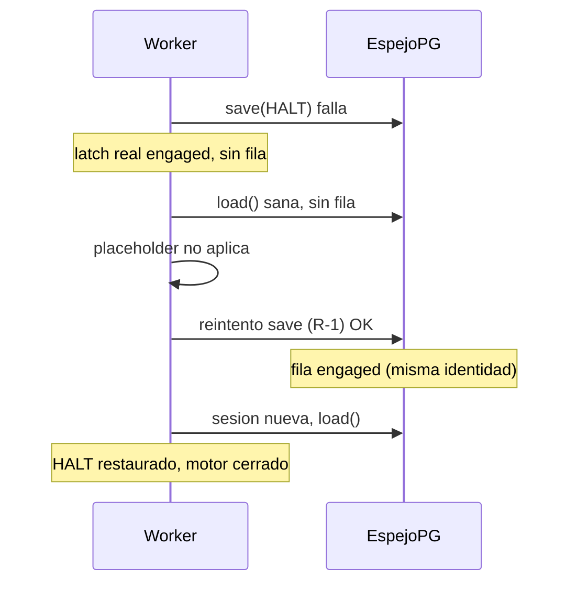

# Cierre de condiciones R-1, U-1 y O-3 — pre-sello (2026-11-02)

> **Objeto:** el árbol de trabajo sobre `f1db2b60` (POST-TAG de `v2.88.176-beta`).
> **Veredicto:** las tres comprobaciones que el dictamen de `.176` dejaba **obligatorias** quedan
> **medidas** y cerradas.
> **No** se crea sello: no hay bump, no hay tag y el pin **no** se re-ancla en este acto.
> **Qué es:** cierre de hallazgos del dictamen, no una aceptación nueva ni una enmienda del sello `.176`.

## 0. Qué cierra este documento

El dictamen de `v2.88.176-beta` condicionaba el siguiente paso a tres comprobaciones:

| # | Condición del dictamen | Cómo se cierra aquí |
| --- | --- | --- |
| 1 | **R-1** — ciclo completo contra PostgreSQL real: fallo de escritura, lectura posterior sana, re-persistencia y reinicio del worker | §2 — 3 pruebas nuevas en [test_auto_v46_hardkill_recovery_pg.py](../../apps/api-python/tests/test_auto_v46_hardkill_recovery_pg.py), **5 passed** contra `bolsa_v1_a7` |
| 2 | **U-1** — conservar las pruebas de error/recuperación **y** añadir comprobación de navegador para cuenta activa y ledger cuando `/accounts` falla | §3 — [gp-e2e-overview-account-error-mock.spec.ts](../../apps/web/e2e/gp-e2e-overview-account-error-mock.spec.ts), **4 passed** con `axe` sin `critical`/`serious` |
| 3 | **O-3** — mantener la advertencia de alcance del digest en **todos** los documentos que usen `Δ motor = 0`, no solo en el dictamen principal | §4 — [PROJECT_PREMISES.md](../PROJECT_PREMISES.md) acotado y punteros desde el dictamen y la evidencia de `.176` |

Esto **no** adelanta el sello `.177`: el bump, el re-anclaje del pin y la publicación son un acto
posterior y separado, con su propia evidencia.

## 1. Estado del pin (declarado, no re-anclado)

Medido **antes** de commitear los cambios de `apps/`:

```
[window-pin] freeze OK (f1db2b60)
  appsHash     e080cca169533e73e4dcbc21ea7ab5031e75428f
  packagesHash 7091cc8d05624249a35377d7e541773c1313b889
```

Medido **después** de commitear este cierre (el commit medido fue `e68b9862`; reescribir este mismo
párrafo con el resultado medido mueve el SHA, y el pin **sigue** en `TREE_MOVED` porque el árbol de
`apps/` ya está commiteado — la comparación no depende del hash documental):

```
[window-pin] TREE_MOVED — el pin NO coincide con el arbol de HEAD
  campo         pin                                  HEAD
  commit        2c7d8b11                             <HEAD del cierre>
  appsHash      e080cca169533e73e4dcbc21ea7ab5031e75428f  cbdc9f96d8c41d750a911f7f4704220dfac2e6bd
  packagesHash  7091cc8d05624249a35377d7e541773c1313b889  7091cc8d05624249a35377d7e541773c1313b889
```

`TREE_MOVED` es el resultado **esperado** y **no** se corrige aquí: re-anclar el freeze es parte del
sello, no de este cierre. La asimetría es informativa: solo se mueve `appsHash`; `packagesHash` sigue
idéntico (`7091cc8d…`), que es coherente con que este acto no toca el paquete del motor de decisión.

## 2. R-1 — el HALT local cuya escritura no llegó al espejo

### 2.1 Qué se mide

El hallazgo: si el espejo no acepta la escritura en la activación, la parada vive solo en la RAM del
worker. Cuando el store vuelve, la lectura es **sana pero sin fila** (o con una fila liberada
**anterior** al halt) y antes se devolvía sin más: el reinicio siguiente leía «la parada nunca se
activó» y **reabría el motor**. R-1 reintenta la escritura (idempotente) sin cambiar la regla de
adopción ni la de liberación explícita.

### 2.2 Las tres pruebas nuevas

`_FaultyKillSwitchStore` envuelve el `PostgresKillSwitchStore` **real** y falla las primeras
`load`/`save` **antes de tocar la sesión** (no la envenena). `saved` guarda solo las escrituras que
llegaron al store: distingue «se intentó persistir» de «la parada es durable».

| Prueba | Secuencia | Qué acredita |
| --- | --- | --- |
| `test_r1_a_failed_write_is_repersisted_after_a_healthy_read_against_postgres` | `engage_kill_switch_durable` con `save` fallando → sin fila → `_v2_load_kill_state()` (lectura sana, sin fila) → reintento → **sesión nueva** que restaura | el ciclo completo del hallazgo; el reintento conserva `engagement_id` y `engaged_at` (no inventa otra activación) y el reinicio **no** reabre el motor |
| `test_r1_a_halt_newer_than_a_released_row_is_repersisted_against_postgres` | fila `released` sembrada por el store real (`08:00`) + halt local posterior (`09:00`) cuya escritura falló → lectura sana → reintento → segunda lectura (idempotencia) → sesión nueva | una liberación **anterior** al halt no lo borra; persistirlo **no** es un latido por tick (`saves` no cambia en la lectura siguiente) |
| `test_r1_the_unreadable_placeholder_never_becomes_a_durable_row_against_postgres` | `load` fallando → placeholder `KILL_STATE_UNREADABLE` y **0 escrituras** → `_v2_persist_kill_state()` explícito → lectura sana sin fila → placeholder liberado | **criterio de auditoría del dictamen**: ningún camino convierte el placeholder en parada real persistida, ni una lectura incompleta en autorización para operar |



### 2.3 Ejecución medida

```
$env:AUTO_HARDKILL_PG_REQUIRED="1"; $env:DB_NAME="bolsa_v1_a7"
uv run pytest apps/api-python/tests/test_auto_v46_hardkill_recovery_pg.py -q
.....                                                                    [100%]
5 passed in 2.06s
```

- **BD dedicada `bolsa_v1_a7`**, no la compartida: se respeta `L-175-1` (la convivencia sobre
  `bolsa_v1` compartida sigue fuera de alcance por decisión). Cada prueba crea su `account_id` y lo
  borra en `finally`.
- El gemelo hermético sigue verde: `test_auto_v2_audit_regressions.py` → **37 passed** (incluye los
  dos escenarios de R-1 con stores en memoria).
- El fichero ya corre en CI por commit: job `auto-v2-durable-pg` de
  [python-ci.yml](../../.github/workflows/python-ci.yml) y del run del tag
  ([release-tag-ci.yml](../../.github/workflows/release-tag-ci.yml)) con
  `AUTO_HARDKILL_PG_REQUIRED=1` — un skip ahí es fallo duro. No hubo que tocar workflows.

### 2.4 Límite honesto de esta medida

El «reinicio» es una **sesión nueva con un worker nuevo** (cero RAM compartida), no un proceso del
SO distinto ni un corte de red real. Lo que se mide es lo que el hallazgo exige: que la parada
sobreviva a perder la memoria del proceso. Un fallo del **proceso** durante la escritura (crash entre
`save` y `commit`) sigue siendo un hueco no medido aquí, y no se presenta como cubierto.

## 3. U-1 — error no significa ausencia de cuenta (navegador)

### 3.1 Qué se mide

Sobre `/overview` con la API mockeada (`installApiMocks` + override de ruta; la última ruta gana):

| Prueba | Escenario | Aserciones |
| --- | --- | --- |
| 1 | `/api/accounts` **500** | `alert` «No se pudieron cargar tus cuentas.»; **0** botones «Nueva demo»; «Reintentar» visible; el ledger declara que no se pudo cargar la **cuenta activa**; **0** textos «Sin movimientos.»; **0** peticiones al ledger |
| 2 | error → **Reintentar** | vuelve la cuenta activa («Toda la app opera con esta cuenta», «Movimientos de «E2E Demo»»), desaparece el `alert` y el vacío del ledger pasa a ser un hecho recibido |
| 3 | ledger **500** con cuentas sanas | `alert` «No se pudieron cargar los movimientos.» + «Reintentar»; **0** «Sin movimientos.»; **0** error de cuentas; tras reintentar se pinta el asiento («Depósito inicial») |
| 4 | `/api/accounts` **`[]`** (sano) | «No hay cuenta activa», **sí** «Nueva demo», **0** «Reintentar»: el vacío real no se confunde con el error |

La prueba 1 es la que cierra la decisión del dictamen: **no se ofrece crear una demo cuando el
sistema no ha podido consultar las existentes**. La comprobación de que el ledger **no** se consulta
sin cuenta activa se hace con un listener de `request` (la query está deshabilitada: su `isError`
sería siempre `false` y el fallo de `/accounts` se leería como «sin movimientos»).

### 3.2 Accesibilidad del propio estado de error

Los cuatro estados pasan el barrido `axe` del repo (`wcag2a`, `wcag2aa`, `wcag21a`, `wcag21aa`) con
**0 violaciones `critical`/`serious`**. El fix no se limita a cambiar texto: los mensajes usan
`role="alert"` y los botones de reintento son focales y accesibles.

### 3.3 Ejecución medida

```
$env:E2E_RUN="1"; pnpm --filter @bolsa/web e2e -- gp-e2e-overview-account-error
Running 4 tests using 4 workers
  4 passed (11.4s)
```

El spec entra en el filtro `gp-e2e` del job `Run mock browser E2E` sin tocar el workflow. Unitarias
del mismo ámbito (`vitest` de `src/features/accounts` + `src/features/dashboard`):
**74 passed / 12 ficheros**.

### 3.4 Límite honesto de esta medida

Son **mocks de red**: se certifica la semántica de la UI ante `500` y ante `[]`, no el
comportamiento del backend real ni la latencia. Tampoco mide `L-OVW-2` (varias cuentas activas),
que sigue abierto con su propia condición.

## 4. O-3 — alcance de `Δ motor = 0`

### 4.1 Lo corregido

- [PROJECT_PREMISES.md](../PROJECT_PREMISES.md) afirmaba que «no se edita `auto_simulation_worker.py`
  ni ningún módulo congelado». Ya no: la afirmación se acota a **lo que el replay ejercita en su
  camino**, y se declara que el worker **sí** cambió en `.175` (placeholder `KILL_STATE_UNREADABLE`;
  `packagesHash` `741ed1a8…` → `7091cc8d…`) y en R-1. La cobertura de esos deltas son `test_p1b_*` y
  las pruebas PG de R-1, **no** el digest.
- El [dictamen de `.176`](./dictamen-tecnico-v2.88.176-beta-2026-11-01.md) (§3) y la
  [evidencia de `.176`](./evidence/v2.88.176/README.md) (§5, fila 8) ya acotaban `Δ motor = 0` al
  camino replay; ambos apuntan ahora a este documento.

### 4.2 Decisión explícita sobre los documentos históricos

**No** se reescriben `.170`–`.175`, los packs de auditoría ni los breadcrumbs históricos de
`CURRENT_SYSTEM.md`: son registros cerrados de lo que se afirmó y midió en su momento. La
advertencia **viaja hacia delante** desde los documentos vivos y desde los dos documentos del sello
`.176`. Reescribir un sello anterior para «mejorar» su alcance sería exactamente lo que el propio
dictamen prohíbe: enmendar el objeto aceptado.

## 5. Verificación de este cierre

| Comprobación | Comando | Resultado |
| --- | --- | --- |
| Regresiones herméticas R-1 | `uv run pytest apps/api-python/tests/test_auto_v2_audit_regressions.py -q` | **37 passed** (1.66 s) |
| R-1 contra PostgreSQL real (BD dedicada) | `AUTO_HARDKILL_PG_REQUIRED=1 DB_NAME=bolsa_v1_a7 uv run pytest apps/api-python/tests/test_auto_v46_hardkill_recovery_pg.py -q` | **5 passed** (2.06 s) |
| Unitarias web (cuentas + Overview) | `pnpm --filter @bolsa/web exec vitest run src/features/accounts src/features/dashboard` | **74 passed / 12 ficheros** |
| Navegador U-1 (+ axe) | `E2E_RUN=1 pnpm --filter @bolsa/web e2e -- gp-e2e-overview-account-error` | **4 passed** (11.4 s), 0 `critical`/`serious` |
| TypeScript | `pnpm --filter @bolsa/web typecheck` | limpio |
| ESLint web | `pnpm --filter @bolsa/web lint` | **0 errores**, 23 warnings **preexistentes** (ninguno en los ficheros tocados) |
| Ruff | `pnpm lint:py` | **All checks passed!** |
| Prettier | `prettier --check` de los ficheros web tocados | limpio |
| Pin | `pnpm window:freeze` | `freeze OK (f1db2b60)` **antes** del commit y **`TREE_MOVED`** después (solo `appsHash`); **no** se re-ancla |

Sobre el typecheck de los specs: el `tsconfig` de `apps/web` incluye solo `src/`, así que `e2e/` no
forma parte del programa de `tsc -b`. Un `tsc` puntual sobre el spec nuevo no señala errores en él
(solo los desajustes de tipos **preexistentes** de `e2e/helpers/*`); la certificación efectiva del
spec es su ejecución en Playwright, que es la que se cita.

## 6. Criterio de auditoría del dictamen

El dictamen pedía comprobar que «ningún camino de recuperación convierte un placeholder
`KILL_STATE_UNREADABLE` en una parada real persistida, ni permite que una lectura incompleta se
interprete como autorización para operar». Queda medido en dos planos:

- **Hermético**: `test_p1b_*` de `test_auto_v2_audit_regressions.py` (placeholder no persistido;
  una causa real lo asciende y ya no es liberable por una lectura válida).
- **PostgreSQL real**: `test_r1_the_unreadable_placeholder_never_becomes_a_durable_row_against_postgres`
  (no se escribe fila al fallar la lectura ni al intentar persistir el placeholder; la lectura sana
  posterior lo libera sin fabricar fila) y las otras dos pruebas R-1 (una lectura sana **incompleta**
  respecto del latch real no devuelve el control: re-persiste antes de seguir).

## 7. Qué **no** acredita este cierre

- **No** es un sello: no hay bump, tag, re-anclaje del pin ni publicación.
- **No** acredita el motor completo: `Δ motor = 0` sigue siendo «en el camino replay».
- **No** cierra `L-OVW-1` ni `L-OVW-2`.
- **No** acredita la ventana PAPER (`INCONCLUSIVE`) ni resultados de rentabilidad.
- **No** sustituye la aceptación de `.176`: este documento registra el cierre de sus condiciones
  pendientes, no reescribe el objeto aceptado.
