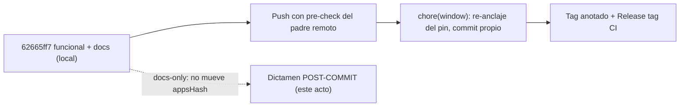

# Dictamen POST-COMMIT — `62665ff7` (simplificación de Overview)

> **AsOf:** 2026-11-01 · **Objeto:** commit **`62665ff7`** (`feat(web): simplifica Overview a cuenta activa,
> accesos y movimientos`) sobre la rama `fix/059-060-proveedores`, padre `62997f81`.
> **Naturaleza:** **registro de aceptación POST-COMMIT**. Este documento **no está dentro** del objeto que
> evalúa: nace en un commit descendiente, para no aprobar un commit dentro de sí mismo.
> **Veredicto:** **aceptación técnica favorable** del commit como **cierre local** (funcional + documental). No
> es una aceptación **publicada**: no hay push, ni tag, ni CI de tag asociado. Esa distinción es el eje de §0.

---

## 0. Identidad del objeto y qué clase de aceptación es esta

| Elemento | Valor |
| --- | --- |
| Commit | **`62665ff7`** (`62665ff714f601492d1b0d379fb94b32afca7415`) |
| Mensaje | `feat(web): simplifica Overview a cuenta activa, accesos y movimientos` |
| Autor / fecha | `jvelasca` · `2026-11-01T20:52:22+01:00` |
| Padre | `62997f81` (`docs(dictamen): registra la aceptacion de v2.88.175-beta…`) |
| Rama | `fix/059-060-proveedores` |
| Alcance | **16 ficheros**, `+1006 / −460` |
| Remoto | `origin/fix/059-060-proveedores` = `62997f81` ⇒ rama **ahead 1** |
| Estado | **local**, sin push · sin tag · sin re-anclaje del pin · sin `CHANGELOG`/bump/`PROJECT_STATE` |

Dos precisiones que este registro fija y que no se deben difuminar:

1. **Aceptar `62665ff7` no es aceptar una publicación.** El commit está certificado por lo que se midió en el
   árbol de trabajo; nada de eso pasó por CI de tag, porque no hay tag.
2. **El objeto aceptado contiene su propia documentación de aceptación** (el dictamen de Overview). Por eso este
   segundo dictamen se escribe **fuera** del commit: si el acto de aceptar un commit viajara dentro de él, la
   aceptación no sería contrastable con el objeto.

Lo que el commit contiene, en dos naturalezas:

| Naturaleza | Ficheros |
| --- | --- |
| Código | `dashboard-page.tsx` (reescrito), `dashboard-page.test.tsx` (nuevo), `data-sync-summary-card.tsx` (borrado) |
| Documentación y evidencia | dictamen de Overview, seguimiento, `README.md` de evidencia y 10 ficheros de evidencia (6 de texto, 4 capturas) |

---

## 1. Qué se acepta del registro

Se aceptan los seis puntos que el dictamen de Overview valora, y se aceptan **por la razón concreta** que los
hace valiosos, no por su presencia:

| # | Punto aceptado | Por qué se acepta |
| --- | --- | --- |
| 1 | Los **596 px** quedan descompuestos en 524 px de contenido + 72 px de separación | el número deja de ser un total suelto y se puede **recomponer**: un total sin composición no sería verificable |
| 2 | El borrado del componente se contrasta contra `platform-config-dialog.tsx` | identifica la superficie que **conserva** la funcionalidad; sin ese contraste, «sin consumidores» sería una afirmación sin ancla |
| 3 | La evidencia queda **acotada**: altura de la cuenta demo canónica; 2 686 del árbol de trabajo, no de un tag | impide que una medición de este árbol se lea como certificación de un sello |
| 4 | `L-OVW-1` y `L-OVW-2` tienen **condición explícita de reapertura** | un límite sin condición de apertura es una nota al pie; con condición, es falsable |
| 5 | La **falsabilidad** documentada en ocho puntos | permite comprobar la aceptación, en vez de creerla |
| 6 | **No** se atribuye al navegador la validación de «otras cuentas activas», que solo cubre un test | es la corrección de honestidad más importante del registro: la cobertura es del caso unitario, no de una comprobación visual |

---

## 2. Estado de verificación: medido aquí vs. citado

La columna «medido en este acto» es la que este dictamen puede afirmar sin heredar nada. Lo «citado» se acepta
como medición publicada, no reproducida.

| Comprobación | Medido en este acto | Citado del commit |
| --- | --- | --- |
| `vitest run src/features/dashboard src/test/heading-order.test.tsx` | **19/19** (re-ejecutado tras el `lint-staged` del commit) | 19/19 en `vitest-area.txt` |
| `tsc -b --noEmit` (`pnpm --filter @bolsa/web typecheck`) | **limpio** | `tsc.txt` sin salida de error |
| `eslint` en `dashboard` / `settings` / `sync` | **0 problemas** | 0 errores en `eslint.txt` (23 avisos preexistentes en `src/` completo) |
| Suite web completa | **no reproducida** | **2 686** pruebas, cifra publicada en el seguimiento §6 |
| `axe` rutas tocadas | **no reproducido** | **35/35**, con `/overview` @desktop y @móvil sin `critical`/`serious` |
| Identidad del commit | **`62665ff7`**, 16 ficheros, `+1006/−460` | — |
| Codificación de `api-overview.txt` | **UTF-8 sin BOM**: 426 bytes, primeros bytes `47 45 54` (`GET`), **0 bytes NUL** | la evidencia va en texto legible, no como binario opaco en GitHub |

Sobre la conversión de codificación: se acepta como **decisión documental**, porque el contenido textual no
cambia y el fichero pasa de `Bin 0 -> 854 bytes` a texto que se puede leer y citar. Se registra aquí para que
el recuento `+1006` no se lea como un fichero más de lo que es.

El **pre-check de publicación** queda comprobado en este acto y **no se da por heredado**: el remoto sigue en
`62997f81`, exactamente `HEAD^`. Es decir, hoy el push sería **fast-forward**; ese dato caduca en cuanto alguien
escriba en el remoto, así que debe repetirse justo antes de publicar.

---

## 3. El pin PAPER: `TREE_MOVED` es el estado previsto, no un defecto

Medido con `node scripts/window-pin.mjs --check`:

| Campo | Pin | `HEAD` |
| --- | --- | --- |
| `commit` (etiqueta) | `4b3bbad3` | `62665ff7` |
| `appsHash` | `a2dfcf854cc5bf749c22b810d8a480dbcba731b7` | **`ac05717e536f64820f64b8d2b5503eed6a6d70b2`** |
| `packagesHash` | `7091cc8d05624249a35377d7e541773c1313b889` | `7091cc8d05624249a35377d7e541773c1313b889` (**sin cambio**) |

Lectura correcta de ese resultado:

* **`appsHash` cambia y `packagesHash` no**, que es exactamente lo que produce tocar solo `apps/web/src`.
* **No se corrige dentro de `62665ff7`.** El re-anclaje va en su **propio** commit `chore(window)`, con su
  evidencia, igual que en `.173` (`9a78606a`) y `.174` (`ea1432fb`). Mezclarlo aquí convertiría un cierre
  funcional y documental en un commit de sello a medias.
* **Un run del `Release tag CI` sobre este commit sería rojo en el step `Window freeze gate`, por diseño.** No
  es un fallo que haya que arreglar: es la señal de que falta la fase de re-anclaje. Lanzarlo y presentar ese
  rojo como problema sería un error de lectura; lanzarlo esperando verde, también.
* El pin **solo** hashea `HEAD:apps` y `HEAD:packages` (lectura en `scripts/window-pin.mjs`), de modo que el
  commit **docs-only** de este mismo dictamen **no moverá ninguno de los dos hashes**: el par debe seguir siendo
  `ac05717e…` / `7091cc8d…` después de commitearlo. Si cambiara, algo más se coló.

### Fases separadas (no se colapsan)

La regla que queda escrita: **no se re-ancla antes de que esté decidido el push, y no se etiqueta antes de
re-anclar.** El orden se documenta porque, invertido, deja el árbol `TREE_MOVED` justo antes del tag.

---

## 4. Límites vigentes

No se reabren ni se cierran aquí: se **mantienen visibles**, que es lo que el dictamen pide. El texto de cada
uno vive en [`dictamen-overview-simplificada-2026-11-01.md`](./dictamen-overview-simplificada-2026-11-01.md) §4
y no se duplica.

| Identificador | Situación | Cierre necesario |
| --- | --- | --- |
| `L-OVW-1` | El estado de sync ya no se ve en Overview | Confirmar que Configuración → «Automatización: velas y servidores» conserva el estado y sigue siendo alcanzable |
| `L-OVW-2` | «Otras cuentas activas» cubierto **solo** por test | Prueba real con dos cuentas: texto, enlace, cambio de cuenta y repintado a 390×740 |

Ninguno de los dos impide aceptar la simplificación; ambos impiden llamarla «completamente verificada». Ese es
el punto exacto de la aceptación.

---

## 5. Falsabilidad de esta aceptación

| # | Afirmación aceptada | Cómo se rompe |
| --- | --- | --- |
| 1 | El objeto aceptado es `62665ff7` y su contenido | enmendarlo, reescribirlo o hacerle `rebase` ⇒ cambia el SHA y esta aceptación deja de apuntar a nada |
| 2 | El commit es local, no publicado | aparecer `62665ff7` en `origin/fix/059-060-proveedores` sin que este registro se actualice ⇒ la afirmación «sin push» queda desmentida por el remoto |
| 3 | El push sería fast-forward **hoy** | escribir cualquier cosa en la rama remota ⇒ el pre-check de §2 deja de valer y hay que repetirlo antes de publicar |
| 4 | El re-anclaje no se mezcla en este commit | re-anclar el pin en un commit que también toque `apps/` o enmiendas a `62665ff7` ⇒ el cierre funcional y el de sello se confunden |
| 5 | El `Release tag CI` sobre este commit es rojo | obtener verde con el pin sin re-anclar ⇒ `appsHash` del pin ya coincidía, y entonces §3 es falso |
| 6 | Los 19/19 del área son del área, no de la suite | citar 19/19 como regresión completa ⇒ contradice §2 y el propio `vitest-area.txt` |
| 7 | Un commit docs-only no mueve el pin | cambiar `appsHash` tras commitear este dictamen ⇒ se coló contenido fuera de `docs/` |
| 8 | `L-OVW-1` y `L-OVW-2` siguen abiertos | declararlos cerrados sin la comprobación de §4 ⇒ la aceptación dice más de lo que midió |

---

## 6. Alcance de este registro (no-cambios)

* **No** modifica código, tests ni evidencia. **No** enmienda `62665ff7`: le añade un descendiente.
* **No** re-ancla el pin ni ejecuta `node scripts/window-pin.mjs --write`: eso es la fase 3 de §3.
* **No** hace push, **no** crea tag, **no** lanza `Release tag CI`.
* **No** toca `CHANGELOG`, `package.json`, versión ni `PROJECT_STATE`: no es un sello.
* **No** re-mide la suite web completa ni el barrido `axe`: los cita como citados y los marca como tales en §2.

---

## 7. Cierre

Se acepta `62665ff7` como **cierre local, funcional y documental**, de la simplificación de Overview: 16
ficheros, código y evidencia en el mismo commit, `19/19` del área re-verificado tras el formateo, `tsc` limpio,
`0` problemas de ESLint en las tres áreas tocadas, y una evidencia legible (UTF-8 sin BOM) que incluye las cuatro
capturas del antes y el después.

Se acepta **sin** publicar y **sin** re-anclar: son fases distintas y así quedan separadas. El `TREE_MOVED` del
pin es el estado previsto, y el rojo del `Release tag CI` sobre este commit sería la señal de que falta su fase,
no un defecto del commit.

Se acepta, además, que el siguiente movimiento **autorizado** es el push con el pre-check repetido en el momento,
y que el re-anclaje del pin será **otro** commit, con su evidencia. Ni este dictamen ni el de Overview autorizan
un tag.
