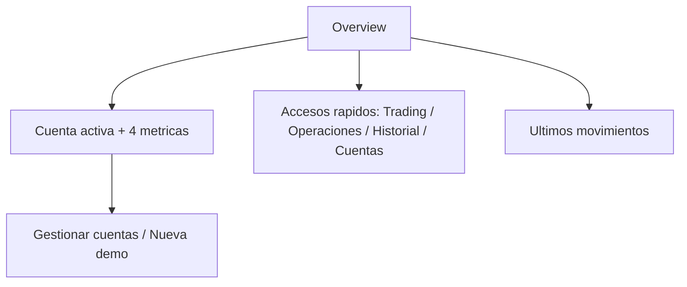

# Dictamen de aceptación — simplificación de Overview (`/overview`)

> **AsOf:** 2026-11-01 · **Objeto:** reescritura de la pantalla Overview (solo frontend, `apps/web/src/features/dashboard/dashboard-page.tsx`)
> medida sobre el árbol de trabajo con padre `62997f81` en la rama `fix/059-060-proveedores`; este registro se
> incorpora en el mismo commit que los cambios que acepta.
> **Naturaleza:** **registro de aceptación**. No es una re-auditoría ni una re-medición: no modifica código,
> tests, contrato, CI, migraciones, `package.json`, `CHANGELOG` ni tags.
> **Veredicto:** se acepta la simplificación de Overview como **cerrada técnicamente**, con dos límites
> nombrados —`L-OVW-1` y `L-OVW-2` (§4)— que quedan declarados como parte de la aceptación.

---

## 0. Qué añade este documento

El cambio tiene seguimiento propio ([`seguimiento-ui-overview-2026-11-01.md`](./seguimiento-ui-overview-2026-11-01.md))
y evidencia propia ([`evidence/overview-simplificada-2026-11-01/README.md`](./evidence/overview-simplificada-2026-11-01/README.md)).
Lo que faltaba es el **acto de aceptación**: qué se da por bueno, contra qué se ancla y —sobre todo— **qué no se
acepta como cerrado** al aceptarlo. Ese es el contenido de §1, §3 y §4.

Este dictamen **no re-mide** las suites: cita la medición publicada en la evidencia y la contrasta con el estado
del árbol (identidad de los ficheros tocados, consumidores del componente borrado, superficie que sustituye al
estado de sync). Donde la evidencia no existe, lo dice en vez de inferirlo del verde.

---

## 1. Qué se acepta

### 1.1 El problema y la decisión

Antes del cambio, a 1440×900, el contenido medía **1749 px** sobre un viewport útil de 853 px, con jerga interna
(`Score_FUND`, `Piotroski`, `FIE`, `Paper D`, `whitelist`, `PAPER_D_EXECUTE=1`) y ocho tarjetas de acceso que
repetían la barra L1 y el `AdminRail`.

Se acepta la decisión de recorte: Overview responde a **una** pregunta —*¿qué tengo y por dónde sigo?*— con tres
bloques, cada hecho una sola vez.

### 1.2 La tabla de resultados, con su ancla

Cada fila se acepta **en los términos en que está medida**, y se ancla al fichero de evidencia que la respalda.

| Área | Resultado | Ancla en evidencia |
| --- | --- | --- |
| Jerarquía visual | `h1` → tres `h2`, sin saltos | `vitest-area.txt` (incluye `src/test/heading-order.test.tsx`) |
| Desktop 1440×900 | **596 px**, sin scroll (`scrollH = clientH = 853`) | `overview-despues-1440x900.png` |
| Móvil 390×740 | `scrollWidth = 390`, sin desbordamiento horizontal | `overview-despues-movil-390x740.png` |
| Accesos rápidos | 4 destinos (`/trading`, `/operations`, `/history`, `/accounts`) con clic real | `vitest-area.txt` + §5 del seguimiento |
| Datos financieros | Contraste de UI con `GET /api/accounts`, `/summary`, `/ledger?limit=8` | `api-overview.txt` |
| Regresión | **19/19** del área · **2 686/2 686** de la suite web | `vitest-area.txt` (área); completa citada en §6 del seguimiento |
| Tipado y lint | `tsc -b --noEmit` limpio; **0 errores** ESLint (23 avisos preexistentes) | `tsc.txt`, `eslint.txt` |
| Contratos API | `contract:check` **OK**, sin cambios de DTO | `contract-check.txt` |
| Accesibilidad | axe **35/35**, 0 `critical`/`serious` (incluye `/overview` @desktop y @móvil) | `axe-touched-routes.txt` |

La altura se descompone en los cuatro bloques medidos —**56 / 209 / 85 / 174 px**— más los tres huecos de
`space-y-6`: 524 + 72 = **596 px**. La coincidencia importa: el número publicado no es un total suelto, se
recompone.

### 1.3 El borrado del componente, contrastado aquí

`apps/web/src/features/settings/data-sync-summary-card.tsx` se elimina. Se acepta porque **no tiene
consumidores**, y eso se comprueba en este acto, no se hereda: la superficie real de sincronización vive en
[`sync-settings-panel.tsx`](../../apps/web/src/features/sync/sync-settings-panel.tsx), embebida en la pestaña
`other` de [`platform-config-dialog.tsx`](../../apps/web/src/features/config/platform-config-dialog.tsx) junto a
`MarketProvidersStatusCard`. El borrado no deja una ruta de la aplicación sin información: deja una **superficie
menos** que ofrecía la misma información dos veces.

---

## 2. Decisiones acertadas

Se aceptan las cinco, con el motivo por el que se aceptan y no solo el hecho:

| # | Decisión | Por qué se acepta |
| --- | --- | --- |
| 1 | Eliminar la jerga del primer nivel | `Score_FUND`, `PIE`, `Paper D`, `PAPER_D_EXECUTE` y `whitelist` son vocabulario de implementación; en una pantalla de entrada incumplen `RT-01` y `R-G1` |
| 2 | Evitar duplicidades | Retirar las ocho tarjetas que repetían la barra L1 y el `AdminRail` reduce ruido **sin** perder destinos: los cuatro que quedan no duplican el catálogo, lo resumen |
| 3 | Conservar el detalle en su lugar | Laboratorio, Asesor y sincronización siguen en Ayuda y Configuración; el cambio reubica, no elimina información |
| 4 | Mantener los movimientos recientes | Es el único bloque que responde «qué ha pasado en mi cuenta»; quitarlo habría dejado la pantalla sin actividad |
| 5 | Eliminar el componente sin consumidores | Ya contrastado en §1.3; conservarlo habría dejado código muerto con apariencia de vivo |

La jerarquía documental que se fija es `h1 Overview` → `h2 Cuenta activa` → `h2 Accesos rápidos` →
`h2 Últimos movimientos`, sin saltos ni `h3` intermedio. No se renombra la ruta `/overview` ni el ítem del
`AdminRail`: cero impacto en e2e y en el barrido axe.

---

## 3. Alcance exacto de la evidencia

Lo que la evidencia **acredita** es el conjunto de escenarios y contratos efectivamente medidos sobre este árbol.
Lo que **no** acredita es una demostración ilimitada de ausencia de defectos.

* **596 px sin scroll** acredita que a 1440×900 el contenido cabe con los datos de la cuenta demo canónica
  (`default-account-seed`, 2 asientos). No acredita que quepa con nombres de cuenta muy largos, con muchas
  posiciones o con el ledger lleno: la altura depende del contenido y no se midió esa variación.
* **`scrollWidth = 390`** acredita ausencia de desbordamiento horizontal en esa captura; el scroll vertical a
  390×740 (1103 px de contenido) es **esperado** en móvil y no se cuenta como defecto.
* **19/19 del área** acredita los nueve casos de `dashboard-page.test.tsx` y los diez de
  `heading-order.test.tsx`. En particular, los casos anti-jerga acreditan que **las cadenas listadas** no
  vuelven al primer nivel; no acreditan que no pueda aparecer jerga nueva no listada.
* **2 686/2 686** es la suite web completa del árbol de trabajo, **no de un tag**. No se hereda a ningún sello.
* **35/35 de axe** acredita 0 `critical`/`serious` en las rutas tocadas con los datos del mock; no es una
  auditoría de accesibilidad completa ni sustituye una revisión manual con lector de pantalla.
* **`contract:check` OK** acredita que `openapi.json` y `schema.d.ts` no divergen del commit: el cambio no toca
  contrato, y eso es lo que se lee, no «el contrato es correcto».

---

## 4. Límites expresos de la aceptación

Aceptar esta simplificación significa aceptar estos dos límites. No se suavizan.

### 4.1 `L-OVW-1` — el estado de sincronización deja de mostrarse en Overview

**Estado:** límite **aceptado y nombrado**, no una deuda pendiente.

**Qué cambia.** El bloque «Datos de mercado» (auto-sync, comprobación de servidores, intervalo de escaneo y
cola pendiente) salía en Overview. Tras el cambio no se muestra ahí: la información no desaparece, **cambia de
superficie**.

**Qué lo hace aceptable.** Configuración → pestaña «Automatización: velas y servidores» (`case "other"` de
`platform-config-dialog.tsx`) monta `SyncSettingsPanel` —ajustes, cola y «Comprobar ahora»— y, debajo,
`MarketProvidersStatusCard` —estado medido por proveedor—. Es decir: lo que Overview resumía sigue disponible
**con más detalle** y en una sola superficie, alcanzable desde la barra superior y desde la paleta de comandos
(`openPlatformConfig("other")`).

**Cómo se rompe (condición de apertura).** Si esa superficie pierde el estado —por ejemplo, si el panel deja de
mostrar la cola o el estado por proveedor—, o si deja de ser alcanzable desde la navegación, el límite deja de
ser aceptable: el estado de sync pasaría a no estar en ninguna superficie y habría que reabrirlo. Mientras ambas
cosas se mantengan, `L-OVW-1` queda declarado y no se persigue.

### 4.2 `L-OVW-2` — «otras cuentas activas» no se comprobó en navegador real

**Estado:** límite **aceptado y nombrado**; cobertura por test, no por medición.

**Qué no está probado.** El estado con **dos o más cuentas activas**: la fila «N otras cuentas activas —
cambiar en Cuentas» con su enlace `overview-other-accounts-link`, y el cambio de cuenta desde ahí. No se
ejecutó en navegador con ese estado; la verificación en vivo se hizo con la cuenta demo canónica y una sola
cuenta activa.

**Qué lo cubre hoy.** El caso unitario `señala cuántas otras cuentas activas hay` de
[`dashboard-page.test.tsx`](../../apps/web/src/features/dashboard/dashboard-page.test.tsx) fija el texto y la
presencia del enlace con dos cuentas.

**Qué no cubre.** Un test de componente no mide si la fila desborda en móvil con nombres largos, ni si el
cambio de cuenta deja la pantalla en un estado coherente (métricas y movimientos de la cuenta nueva). Eso
requiere navegador.

**Cómo se rompe (condición de apertura).** Una comprobación en navegador real con **dos cuentas activas** que
verifique (a) el texto «1 otra cuenta activa», (b) el enlace a `/accounts`, (c) el cambio de cuenta y (d) que
Overview repinta métricas y movimientos de la cuenta nueva, sin desbordamiento a 390×740. Hasta entonces, el
límite se cita por su identificador y no se lee como verificado.

---

## 5. Lo verificado aquí y lo que no

**Contrastado en este acto:** que la evidencia existe y corresponde a los ficheros citados; que las cifras del
área (19/19) salen de `vitest-area.txt`; que `DataSyncSummaryCard` no tiene consumidores y que la superficie que
lo sustituye es la pestaña `other` de Configuración; que el PNG externo no forma parte de la evidencia (§7).

**No verificado aquí:** no se re-ejecutaron las suites (ni la del área ni la completa), no se repitió el barrido
axe, no se re-midieron las alturas ni se repitieron los clics reales en los cuatro accesos. No hay tag ni CI de
tag asociado a este cambio: es trabajo de rama. No se comprobó el estado con varias cuentas activas en
navegador (`L-OVW-2`).

---

## 6. Falsabilidad de esta aceptación

| # | Afirmación aceptada | Cómo se rompe |
| --- | --- | --- |
| 1 | Overview no muestra jerga interna en primer nivel | volver a pintar `Score_FUND`, `PAPER_D_EXECUTE`, `whitelist`, `FIE` o `Paper D` ⇒ rojo en `dashboard-page.test.tsx` (caso anti-jerga) |
| 2 | Overview no reabsorbe Investigación, tutorial ni estado de sync | reintroducir «Investigación», «Por dónde seguir», «Datos de mercado» o «Backtesting» ⇒ rojo en el mismo caso |
| 3 | Hay cuatro accesos y apuntan a cuatro destinos concretos | añadir, quitar o reordenar destinos ⇒ rojo en `resume la navegación en cuatro enlaces con su destino` |
| 4 | La jerarquía es `h1` + tres `h2` sin saltos | añadir o quitar un nivel ⇒ rojo en `tiene un solo h1 y no salta de nivel` y en `heading-order.test.tsx` |
| 5 | Se avisa de otras cuentas activas | retirar la fila o el enlace ⇒ rojo en `señala cuántas otras cuentas activas hay` |
| 6 | Sin cuenta activa se declara el hueco, no ceros | pintar métricas con `0` sin cuenta ⇒ rojo en `sin cuenta activa declara el hueco en vez de ceros fabricados` |
| 7 | El borrado no deja código muerto ni superficie perdida | volver a importar `data-sync-summary-card` ⇒ falla la resolución del módulo; retirar el panel de sync de Configuración ⇒ `L-OVW-1` deja de ser aceptable |
| 8 | No cambia el contrato API | tocar `openapi.json`/`schema.d.ts` sin tocar backend ⇒ rojo en `contract:check` |

---

## 7. Alcance de este registro (no-cambios)

* **No** modifica backend, DTO, contrato HTTP, rutas ni el `AdminRail`.
* **No** toca `CHANGELOG`, `package.json`, versión ni `PROJECT_STATE`: tratarlo como sello sería otra cosa, y
  esto no lo es.
* **No** crea, mueve ni anota tags. No hay `Release tag CI` asociado.
* **No** re-ancla el pin PAPER (`scripts/lib/window-forward.mjs`): `window:freeze` solo se exige en el
  `Release tag CI`, y el re-anclaje, cuando toque, se hará en el chore de sello con `node scripts/window-pin.mjs
  --write`, no aquí.
* **No** reescribe el seguimiento ni la evidencia: se enlazan, y la única modificación en el seguimiento es
  rotular sus límites con los identificadores de §4.
* **No** incorpora el PNG externo `overview-despues-desktop.png` del escritorio: es un residuo ajeno al
  repositorio, no se cita como ancla y no se copia a la evidencia. Las capturas acreditadas son las cuatro que
  viven en `evidence/overview-simplificada-2026-11-01/`.

---

## 8. Cierre

Se acepta la simplificación de Overview: tres bloques —cuenta activa con cuatro métricas, cuatro accesos y
últimos movimientos—, sin jerga de implementación en el primer nivel, sin duplicar la navegación y sin código
muerto, con `19/19` del área, suite web completa verde, `tsc` limpio, `0` errores de ESLint, `contract:check` OK
y axe `35/35` con 0 `critical`/`serious`.

Se acepta **con** `L-OVW-1` y `L-OVW-2`: el estado de sync vive ahora en Configuración y el estado con varias
cuentas activas está cubierto por test, no por navegador.

Se acepta, además, como **criterio de diseño de referencia** para el resto de la aplicación: información
esencial primero, lenguaje comprensible, acciones claras y diagnósticos avanzados fuera del recorrido habitual
del usuario básico.

Lo aceptado son los **resultados medidos y los contratos cubiertos** por la evidencia citada. No es una
verificación independiente del repositorio ni una certificación de que Overview no pueda degradarse: para eso
están los ocho puntos de §6, que sí se rompen si algo de esto vuelve.
