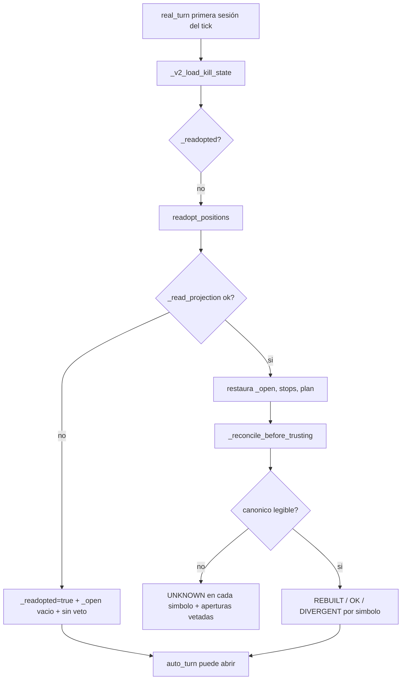

# Dictamen — operativa PAPER multi-día de AUTO (read-only)

- **Fecha:** 2026-10-26
- **Rama auditada:** `audit/c1-c4-integrity-fold-2026-10-25`
- **HEAD local = HEAD remoto:** `6a9f7cab` (`6a9f7cab3bb1a69775ba09ed3c7c6ddf8ace7a7d`)
- **Naturaleza:** auditoría **read-only**. No se modifica código, CI, migraciones, `package.json`,
  PR [#76](https://github.com/jvelasca/Bolsa_V1/pull/76), tags ni el pin PAPER.
- **Objeto:** el siguiente riesgo funcional declarado en
  [`dictamen-c4-postgresql-real-2026-10-26.md`](./dictamen-c4-postgresql-real-2026-10-26.md) §5 —
  readopción de posiciones entre sesiones/reinicios, parada dura durable y ventana de evidencia
  multi-día.
- **C-4 no se reabre.** Este dictamen **no certifica rentabilidad** ni autoriza el paso a dinero
  real. AUTO sigue **OFF**; PAPER es **virtual**.

> **Nota de publicación (2026-10-26, posterior a la redacción).** Este dictamen se redactó como
> **snapshot** con `HEAD = 6a9f7cab` y se publica **sin retocar sus veredictos ni sus mediciones**.
> Con posterioridad, el commit `b11e26ae` cerró **R-1**, **R-2**, **P-1**, **P-2**, **W-1** y **R-4**
> y cableó la guarda anti-skip del HALT durable en CI (**P-3**), con run verde
> [`40314593833`](https://github.com/jvelasca/Bolsa_V1/actions/runs/40314593833) sobre `2fa7d33d`.
> Por tanto:
>
> - **§1** (tabla de veredictos) describe el código **anterior** al cierre: `PARCIAL`/`HUECO
>   DECLARADO` en readopción, stop y HALT son el estado **pre-fix**, no el vigente.
> - **§2.1** (verificado en GitHub) y **§2.2** (local sin publicar) son la foto del momento: el HEAD
>   remoto era `6a9f7cab` y los dos dictámenes estaban `untracked`.
> - **§11.6** («el fichero es local») queda superado por esta publicación.
>
> El estado vigente, con los tres residuales que siguen abiertos, es
> [`dictamen-aceptacion-cierre-siete-todos-2026-10-26.md`](./dictamen-aceptacion-cierre-siete-todos-2026-10-26.md).
> El cuerpo de este documento **no se edita**: se conserva como evidencia de lo que se midió antes
> del cierre.

---

## 1. Dictamen en una tabla

| Frente | Veredicto | Qué lo sostiene | Qué NO acredita |
| --- | --- | --- | --- |
| Readopción de cantidad y base de coste | **PARCIAL** | Reconstrucción desde el libro canónico, guarda de coste ambiguo de C-4 y 126 pruebas herméticas verdes en local | Un fallo de lectura deja el arranque **fail-open**; el canónico es de **cuenta**, no de motor |
| Readopción de estado parcial (T1, P&L realizado, FSM V2) | **PARCIAL** | El plan durable (`stop`, `t1_state`, `trailing_state`, `position_state`) se conserva en el espejo | `_t1_done`, `_sim_realized_pnl` y `_v2_positions` **no** se restauran; la adopción V2 es **perezosa** |
| Durabilidad del HALT (kill switch) | **PARCIAL** | Semántica durable certificada: se lee **antes** de readoptar, liberar exige `reconciliation_id` y un fallo de escritura no desengancha el latch | Un fallo de **lectura** en el arranque deja el latch fresco (P-1); la prueba PG de recuperación sólo corre en el **tag** |
| Stop de posición (protección) | **HUECO DECLARADO** | La geometría se persiste y el stop se evalúa por el mismo espinazo | El modelo declarado es `BAR_OHLC` (`Low(D) <= stop`) y lo ejecutado es **un único precio: `open(B)`** |
| Ventana de evidencia multi-día | **NO CERTIFICADO** | Tres `MEDIDO` con material durable y un gate honesto que declara `INCONCLUSIVE` | 5 días de material proceden de **3 runs**; **0 episodios**, **0 ciclos**; 2 días perdidos; el vigía no mira el gate |
| Rentabilidad | **NO CERTIFICADO** | — | `0/32` ciclos medibles, `INCONCLUSIVE`, `evidence_ready=false`. El verde de CI no es evidencia estadística |

> Lectura de la tabla: **CERTIFICADO** = hay prueba ejecutada que sostiene la afirmación en el
> alcance declarado; **PARCIAL** = hay mecanismo y prueba para una parte y hueco declarado para el
> resto; **NO CERTIFICADO** = falta la muestra o la medición; **HUECO DECLARADO** = el
> comportamiento no coincide con el contrato que el propio sistema declara.

---

## 2. Evidencia publicada vs evidencia local

### 2.1 Lo verificado hoy en GitHub

| Objeto | Verificación | Resultado |
| --- | --- | --- |
| Run [`40287111793`](https://github.com/jvelasca/Bolsa_V1/actions/runs/40287111793) | `headSha` | `b345689700848682f62b0fac04ad0247768023eb` |
| Mismo run | jobs | **5/5 `success`**: `quality`, `lifecycle-pg`, `auto-v2-durable-pg`, `paper-forward-pg`, `grammar-discovery-pg` |
| Mismo run · job `auto-v2-durable-pg` | pasos 9 y 10 | `Pytest C-4 coste ambiguo PG (fail if skipped)` = `success` (**3 passed in 1.79s**); `Fail on skipped C-4 ...` = `success` |
| Mismo run · job `auto-v2-durable-pg` | lote durable | **124 passed in 24.11s** |
| Mismo run · job `quality` | `Pytest` | **5367 passed, 50 skipped** |
| Commit `6a9f7cab` | contenido | **1 fichero**, 71 líneas (`evidencia-c4-coste-ambiguo-pg-2026-10-26.md`) |
| Commit `6a9f7cab` | runs de CI | **ninguno** (`gh run list --commit 6a9f7cab` devuelve `[]`) |
| Rama remota | `refs/heads/audit/c1-c4-integrity-fold-2026-10-25` | `6a9f7cab…` (igual al local) |
| `main` remoto | `refs/heads/main` | `26250187…` (intacto) |
| PR #76 | estado | **OPEN**, **draft**, cabeza `fccdd69a…` (intacta) |
| Tag `v2.88.161-beta` | objeto | tag anotado `9de9e08f…` → commit `9b6d3252…` |
| Run del tag [`39977948590`](https://github.com/jvelasca/Bolsa_V1/actions/runs/39977948590) | `headSha` / jobs | `9b6d3252…`, **`success`**, **13 `success` + 1 `skipped`** (`playwright (integrated E2E, opt-in)`) |

### 2.2 Lo que es **local y no está publicado**

| Fichero | Estado | Contenido |
| --- | --- | --- |
| [`dictamen-c4-postgresql-real-2026-10-26.md`](./dictamen-c4-postgresql-real-2026-10-26.md) | **untracked** | Dictamen C-4 completo |
| [`evidencia-c4-coste-ambiguo-pg-2026-10-26.md`](./evidencia-c4-coste-ambiguo-pg-2026-10-26.md) | **modificado sin commit** | Enlaces al dictamen (+4 líneas sobre lo publicado en `6a9f7cab`) |
| [`PROJECT_STATE.md`](./PROJECT_STATE.md) | **modificado sin commit** | Entrada del dictamen C-4 (+2 líneas) |
| `operability_runs/window-runs/day-watch.json(l)` | **fuera de git** (ignorado por `.gitignore`) | Artefactos de ejecución del vigía, mutables |
| `logs/dev/*.log`, `apps/api-python/logs/estudio_auto_propose.jsonl` | **fuera de git** (ignorados por `.gitignore`) | Logs de ejecución |

**Consecuencia:** el dictamen C-4 y su entrada en `PROJECT_STATE` **no están publicados**. Cualquier
lector de GitHub ve la evidencia técnica de `6a9f7cab`, pero **no** el dictamen que la interpreta.

### 2.3 La capa que casi siempre se omite: **el código auditado no es el código que midió la ventana**

| Día medido / árbol | `apps` | `packages` | Nota |
| --- | --- | --- | --- |
| `2026-10-19` (`MEDIDO`) | `4ab620fe…` | `4bf6673a…` | Árbol anterior al `.160` |
| `2026-10-21` (`MEDIDO`) | `f37b6da0…` | `b33bf1e0…` | Árbol anterior al `.160` |
| `2026-10-22` (`MEDIDO`) | `4be4a32f…` | `0824c030…` | Árbol `.160` |
| **Pin actual** (`.161`, commit sello `64e23eaf`) | **`d06695ab…`** | **`243cd09c…`** | Coincide con el árbol del commit del tag `9b6d3252` |
| **HEAD de esta auditoría** (`6a9f7cab`) | `82c9d91f…` | `fb2d1870…` | **`TREE_MOVED`** contra el pin |

Verificado con `git rev-parse "HEAD:apps" "HEAD:packages"` y
`git rev-parse "64e23eaf:apps" "64e23eaf:packages"`.

Esto obliga a una precisión que el dictamen mantiene en todo momento:

- Los días medidos corrieron con árboles **anteriores** al pin actual → bajo el pin `.161` están
  **STALE** (declarado en `PROJECT_STATE.md`, AsOf `.161` §6).
- Los módulos que sostienen los hallazgos de las secciones 3 y 4 (`auto_simulation_worker.py` en
  readopción y kill state, `sim_durable_store.py`, `sim_reconciliation.py`, `applied_fills.py`,
  `kill_switch_store.py`, `exit_plan.py`, `auto_price_provider.py`, `operability_window.py`) están
  **sin cambios** entre el commit del tag y `HEAD` (`git diff --stat 9b6d3252..HEAD` sobre esos
  ficheros devuelve vacío).
- Lo que **sí** cambió post-tag: la zona de adopción V2 del worker (**+321 líneas**, C-1..C-4) y el
  vigía (**+180 líneas**, marcado del aviso). En el vigía, el mapa de veredictos que sostiene W-1
  **no** cambió.

Sin esta distinción, atribuir a la ventana el comportamiento del `HEAD` sería un error de
trazabilidad.

---

## 3. Readopción entre sesiones

### 3.1 Qué hace el arranque (verificado en código)



- Orden de arranque: `auto_simulation_worker.py:7565-7574` (kill state → readopción → reservas).
- `readopt_positions()`: `auto_simulation_worker.py:1513-1578`.
- Reconciliación: `auto_simulation_worker.py:1594-1788`.
- Veto de aperturas: `auto_simulation_worker.py:1790-1795`.
- El worker **persiste** entre ticks (`AutoSimRuntime` conserva `_open`/`_journal`,
  `:8440-8441`); la readopción ocurre **una sola vez por proceso** (`:7571-7573`).

### 3.2 Hallazgos

#### R-1 (P1) — fallo de lectura en la readopción: **fail-open** · CONFIRMADA

`readopt_positions()` captura cualquier excepción de `_read_projection`, registra
`auto_sim readopt_positions failed`, marca `_readopted = True` y devuelve `_open` vacío
(`auto_simulation_worker.py:1536-1541`). `_reconciliation` queda vacío y
`_openings_vetoed()` devuelve `False` para cualquier símbolo (`:1790-1795`). El turno continúa y
un BUY puede abrirse **como si no hubiera posición**.

- La prueba que existe (`test_a9_1_crash_battery.py:171-182`, `_FailingPositionStore(fail_on="readopt")`)
  sólo comprueba que **no se inventa una posición**; no comprueba que se **bloquee una apertura**.
- La reconciliación sí es fail-closed cuando el lector canónico falla
  (`:1600-1620`: `UNKNOWN` y `{}`), pero ese camino **no se ejecuta** si la proyección falla antes.
- Alcance: en un proceso nuevo el fallo puede ocurrir en el primer tick y ese mismo tick puede
  abrir. En ticks posteriores la lectura se reintenta (ver R-5), de modo que la exposición es
  **por tick**; si el store queda ilegible de forma persistente, la parada/posición no se recupera
  durante toda la vida del proceso.

**Por qué es P1:** el estado durable es la única defensa contra un segundo BUY tras un reinicio; un
fallo transitorio de lectura la desactiva en silencio, sin código de journal ni veto.

#### R-2 (P1) — el libro canónico es de **cuenta**, la proyección es de **motor** · CONFIRMADA (código) / NO MEDIBLE (efecto con material real)

- `read_projection(account_id, engine_id)` filtra por motor
  (`sim_durable_store.py:853-888`) y la clave del espejo es `(account_id, engine_id, symbol)`
  (`:890-941`).
- `_compose_canonical_reader()` construye el canónico con
  `read_applied_fill_facts(..., account_id)` — **sin** `engine_id` — y `PositionLedger`
  suma **todos** los fills aplicados de la cuenta (`auto_simulation_worker.py:7994-8049`).
- La reconciliación compara, símbolo a símbolo, la proyección **del motor** contra el canónico
  **de la cuenta** (`sim_reconciliation.py:130-171,229-259`). Si la cantidad de la cuenta no
  coincide con la fila del motor, el veredicto es `REBUILT` y se escribe la cantidad canónica en
  **esa** fila (`auto_simulation_worker.py:1660-1710`, `upsert` en `:890-941`).

**Escenario que se sigue del código:** dos motores vivos con 100 del mismo símbolo ⇒ canónico 200
⇒ cada fila (100) se reconstruye a **200** ⇒ total proyectado 400 sobre una posición real de 200.
El siguiente arranque ya no lo detecta: 200 == 200.

C-4 cubrió la **ambigüedad de coste** (no escribir el coste medio de la cuenta en una fila por
motor, `test_a9_1_crash_battery.py:301-336`), pero **la cantidad sí se adopta** en el mismo caso
(`:328-336`), y el test del camino `REBUILT` repite la regla (`:339+`). No hay prueba con canónico
= suma de dos motores, ni con `REBUILT` sobre dos filas vivas.

**Alcance hoy:** la ventana usa una sola identidad de motor (`auto-window-1484e253`), así que el
disparador exige una segunda fila viva del mismo símbolo — precisamente lo que produjo el material
histórico de `2026-10-21` (dos motores huérfanos, documentado en
`v2_76_forward_market_material.py:625-642`). Es un mecanismo **vivo**, no histórico.

#### R-3 (P2) — estado parcial no restaurado · CONFIRMADA

No se restauran:

- `_t1_done` (`:1222`), usado sólo en el camino legacy (`:6988`). Con `AUTO_ENGINE_SIM_V2=1` la
  política legacy no se evalúa (`:6964`), así que el efecto hoy es **nulo**; el hueco es de
  coherencia si se vuelve a encender el camino legacy.
- `_sim_realized_pnl` (`:1391`), que entra en la equity de marca (`:2354`). Sólo se lee con el
  gobernador ON (`AUTO_ENGINE_SIM_V2_GOVERNOR`), que es **OFF** por defecto
  (`auto_v2_entry.py:239,453`); con el flag OFF el reinicio no altera decisiones. Con el flag ON,
  el P&L realizado de la sesión anterior desaparece de la equity ⇒ el drawdown se subestima.
- `_v2_positions` (`:1259`): se adopta de forma **perezosa** en el primer tick de gestión
  (`:6197-6217`). El plan durable (`stop`, `t1_state`, `trailing_state`, `position_state`) sí
  sobrevive en el espejo (`:1694-1710`), lo que limita el daño.

#### R-4 (P2) — la continuidad entre días depende del **runner**, no del worker · CONFIRMADA

- El script forward acuña un id **efímero** si falta la variable
  (`v2_76_forward_market_material.py:639-642`: `auto-v76-{urandom}`), y el comentario del propio
  script documenta el efecto medido: dos motores huérfanos, 0 ciclos cerrados.
- El worker sólo lee `AUTO_ENGINE_SIM_ENGINE_ID` (`:8736-8745`); su fallback es `auto-sim`, estable,
  pero **no hay guarda dura** que exija identidad estable para operar.
- Quien inyecta la identidad es el runner (`window-forward.mjs:748`). Si un operador lanza el
  script a mano sin la variable, la cadena vuelve al comportamiento histórico sin aviso.

#### R-5 (P2) — readopción una sola vez y sin re-adopción ante sospecha · CONFIRMADA

- Único llamante de producción: `:7571-7573`, guardado por `_readopted`.
- No hay re-adopción tras un fallo ni lectura de filas escritas por otro proceso. La única
  corrección de rumbo es el reinicio del proceso.

#### R-6 (P3) — coste recién nacido en el mismo tick: `OK` y hueco declarado · CONFIRMADA

Si el crash ocurre entre el fill y el `upsert` del espejo, la fila nace sin `entry_price`. La
readopción rehidrata el plan durable o reconstruye la geometría (`auto_simulation_worker.py:5724`)
y resuelve la base de coste con el libro como autoridad, el espejo como respaldo y `None` declarado
si el libro es ambiguo (`:5923-5957`). La ventana puede registrar `RECONCILIATION_REQUIRED` con
`entryPrice=null` y veredicto de reconciliación `OK` a la vez. No hay backfill: el hueco se
declara, que es la política correcta, pero conviene que sea explícito en el contrato.

#### R-7 (P3) — un símbolo **ausente** de la proyección no genera veto · CONFIRMADA

`_read_projection()` no captura excepciones (`:1580-1592`): un fallo de lectura sube a R-1. Lo que
sí ocurre es que una fila **no visible** (escritura de otro proceso aún no confirmada, o fila con
`quantity <= 0` filtrada en `sim_durable_store.py:870-873`) no aparece en `projection`; ese símbolo
no entra en `_reconciliation` y `_openings_vetoed()` devuelve `False` (`:1790-1795`). No hay un
`UNKNOWN` «por símbolo esperado»: el silencio de la fila es indistinguible de «no hay posición»
para el veto de aperturas.

### 3.3 Positivos que conviene conservar

- Kill state **antes** de readoptar y de reconciliar (`:7565-7574`).
- Reconciliación fail-closed: lectura incompleta ⇒ `UNKNOWN` ⇒ aperturas vetadas
  (`:1600-1620`, `sim_reconciliation.py:106-111`).
- La cantidad se reconstruye desde los **fills aplicados**, no desde `position_state`
  (`:7994-8049`), y el coste ambiguo no se inventa (C-4).
- Liberar el HALT exige `reconciliation_id` (`:2445-2455`).

---

## 4. Parada dura durable

### 4.1 Dos cosas distintas que el nombre «parada dura» mezcla

| Mecanismo | Qué es | Dónde vive | Qué garantiza |
| --- | --- | --- | --- |
| **HALT latcheado** | Bloquea aperturas y fuerza salidas protectoras hasta liberación explícita | `auto_kill_state` + `HardKillSwitch` | Que un reinicio no reabra el motor |
| **Stop de posición** | `current_stop` del plan de salida | `sim_auto_positions.position_state` + `ExitPlan` | Que una posición se cierre al tocar el stop |

El primer mecanismo está **bien construido en su semántica normal** (restauración, liberación y
fallo de escritura); P-1 mide su **borde de arranque**. El segundo tiene un hueco de modelo.

### 4.2 Hallazgos

#### P-1 (P1) — fallo de lectura al arrancar deja el latch **desenganchado** · CONFIRMADA (con matiz)

`_v2_load_kill_state()` marca `_v2_kill_state_loaded = True` y, si `store.load()` lanza, registra y
**retorna** sin tocar el latch (`:2407-2419`). En un proceso nuevo el latch está fresco
(`:1297`), de modo que el turno puede operar **sin HALT** aunque la fila durable dijera
`engaged`.

Matiz verificado: el flag `_v2_kill_state_loaded` **se escribe pero nunca se lee**; `real_turn`
llama a `_v2_load_kill_state()` **en cada tick** (`:7567-7568`). El comentario de `:1294-1295`
(«una vez por proceso») es incorrecto, pero el comportamiento resultante es más seguro: un fallo
transitorio se corrige en el tick siguiente. La exposición real es **el tick que falla**; si el
store queda ilegible de forma persistente, el HALT no se restaura nunca mientras el proceso sigue
operando.

#### P-2 (P1) — el modelo de protección declarado **no es el ejecutado** · CONFIRMADA

- El gate de granularidad habilita **sólo** `ProtectionModel.BAR_OHLC`
  (`operative_granularity.py:78`) y el contrato del modelo es `Low(D) <= stop`
  (`:31-39`).
- El diseño interno lo exige de forma explícita: precedencia dentro de la barra, qué hacer en un
  **gap** de apertura, qué precio de ejecución usar, y rechazo si falta OHLC completo
  (`rethink-granularidad-operativa-auto-v2-2026-09-30.md:139-162`).
- La ejecución real usa **un solo precio por turno**: `_v2_price_exec()` →
  `OhlcvPriceSource.execution()` → **`open` de la barra corriente `B`**
  (`auto_price_provider.py:163-172,235-246`), y el propio lector declara que `high`/`low`/`close`
  de `B` **no se leen nunca** (`:264-268`).
- El stop se evalúa con `mark <= stop` sobre ese único precio (`exit_plan.py:97-102,182-187`).

Consecuencia operativa, en una barra `Open 100 · Low 80 · Close 105` y stop `95`: el motor **no**
dispara el stop, porque 100 > 95; sólo lo haría si el **open** estuviera por debajo. Tampoco
existe prueba de gap overnight ni de breach intrabar (búsqueda en
`test_auto_v44_exit_crash_matrix.py` sin coincidencias de `overnight|gap`).

No se discute aquí si el modelo correcto es A o B; se declara que **lo habilitado no implementa
`BAR_OHLC`** y que el propio documento de diseño prohíbe llamar «protección» a evaluar un precio
único.

#### P-3 (P1) — cobertura CI asimétrica de la durabilidad · CONFIRMADA

| Prueba | Por commit | Por tag |
| --- | --- | --- |
| `test_auto_v46_hardkill_recovery.py` (in-memory) | **sí** (pase de directorio `apps/api-python/tests`, `python-ci.yml:404`) | sí |
| `test_auto_v46_hardkill_recovery_pg.py` (PG real) | **no** (`--ignore`, `python-ci.yml:459`) | **sí** (`release-tag-ci.yml:1847-1865`) |
| `test_auto_v46_crash_injection_pg.py` | **no** (`:460`) | sí |
| `test_auto_v46_multiprocess_pg.py` | **no** (`:461`) | sí |

El censo de selección de tests (`scripts/ci/test_selection.py --report`, ejecutado hoy: **656
ficheros, 656 ejecutados, 0 sin ejecutar**) acredita que **algún** job ejecuta cada fichero; **no**
acredita que se ejecute **por commit**. Un verde de Python CI en un push **no** prueba la
persistencia real del HALT en PostgreSQL.

#### P-4 (P2) — liberación por comparación de instantes · NO MEDIBLE

`released_at >= engaged_at` (`:2445-2455`) no tiene prueba de desfase de reloj entre procesos. El
código compara instantes, no un orden durable (secuencia/`engagement_id`). No hay evidencia
ejecutada de skew; queda como hueco declarado, no como defecto demostrado.

### 4.3 Positivos

- El HALT durable se adopta **siempre** si está `engaged`; una fila liberada **no** levanta un halt
  local más nuevo (`:2400-2455`).
- Un fallo de **escritura** no desactiva el latch en memoria (`:2456-2473`).
- El HALT entra en la decisión de entrada (`auto_v2_entry`, `halted=...` en
  `auto_simulation_worker.py:4759`) y en la gestión como `KILL_SWITCH` (`:6237-6306`).

---

## 5. Ventana de evidencia multi-día

### 5.1 Estado real del ledger (leído hoy, read-only)

`operability_runs/window-runs/ledger.jsonl` — **12 filas**:

| Día | Estado | Gate |
| --- | --- | --- |
| `20261014`–`20261017` | `NO_MEDIDO_REGIMEN` (×4) | — |
| `20261017`, `20261018` | `NON_MARKET_DAY` | — |
| `20261019` | `HARD_ERROR` y después `MEDIDO` | `d=2 e=0 c=0 INCONCLUSIVE` |
| `20261021` | `HARD_ERROR` y después `MEDIDO` | `d=4 e=0 c=0 INCONCLUSIVE` |
| `20261022` | `MEDIDO` | `d=5 e=0 c=0 INCONCLUSIVE` |
| `20261025` | `NON_MARKET_DAY` (domingo) | — |

Último gate leído del ledger:

```json
{"days":5,"episodes":0,"cycles":0,"minDays":4,"minEpisodes":2,"minCycles":32,
 "ready":false,"measured":true,"verdict":"INCONCLUSIVE",
 "dayList":["2026-10-19","2026-10-20","2026-10-21","2026-10-22","2026-10-23"],
 "regimes":[]}
```

`day-watch.json` marca **`20261020:MISSED`** y **`20261023:MISSED`**
(`ledger_sin_dia_previo`). `20261025` es `NON_MARKET_DAY` por fin de semana.

### 5.2 Hallazgos

#### W-1 (P1) — un día `MEDIDO` con **0 ciclos** no alerta · CONFIRMADA

`_STATUS_VERDICT` traduce `MEDIDO → ("OK", "ok")` (`window_day_watch_worker.py:110-117`). El vigía
sólo alerta `MISSED` y `HARD_ERROR`; **no** consulta `gate`, `measurableCycles` ni
`INCONCLUSIVE` (búsqueda de `cycles|INCONCLUSIVE` en el fichero: **sin coincidencias**). La
ventana puede quedarse estancada en `MEDIDO/0 ciclos` indefinidamente sin aviso.

#### W-2 (P1) — los episodios son **estructuralmente inalcanzables** sin ciclos · CONFIRMADA

`window_gate()` deriva los episodios de los regímenes **declarados por los ciclos**
(`operability_window.py:560-595`), y `build_window_row()` sólo rellena `regimes` desde `cycles`
(`:360-368,446-450`). Con `cycles=[]`, `regimes=[]` y `episodes=0`, aunque el ledger del runner
declare un régimen operativo diario distinto. El gate exige `>= 2` episodios
(`:579-581`): sin ciclos, **nunca** se satisface, con independencia de la diversidad real de
mercado.

#### W-3 (P1) — identidad de ciclo: el numerador nace en 0 · CONFIRMADA (documental, no medición propia)

`bucket_closed_cycles()` separa `unattributed` (sin `cycleId`) de `undated_with_identity`
(`:499-557`) y **no fabrica** identidad. El AsOf `.161` de `PROJECT_STATE.md` declara el material
medido: **24 fills, 24 sin `cycle_id`** (20 con `v283-window-a`, 4 `sell` con versión `NULL`), **0
ciclos medibles**, y `portfolio_reservations`/`auto_exit_orders` con `n_tup_ins = 0`. Este
dictamen **cita** esa medición; no la ha reproducido (no se ha consultado PostgreSQL en esta
auditoría).

#### W-4 (P1) — el gate cuenta **días con material**, no **días ejecutados** · CONFIRMADA

`v2_80_market_window.py:208` construye los días como unión de días con fills, ciclos o journal;
**no** de días con `run-day`. Por eso `dayList` incluye `2026-10-20` y `2026-10-23`, que el vigía
declara `MISSED`: son las colas post-medianoche de los runs del 19 y del 22. Los tres `MEDIDO`
duraron:

| Run | Inicio (UTC) | Fin (UTC) | Duración | Día de material extra |
| --- | --- | --- | --- | --- |
| `20261019` | 2026-10-19T16:08:55Z | 2026-10-20T06:36:52Z | 14h27m | `2026-10-20` |
| `20261021` | 2026-10-21T17:45:59Z | 2026-10-22T15:54:32Z | 22h08m | `2026-10-22` |
| `20261022` | 2026-10-22T16:30:01Z | 2026-10-23T11:54:20Z | 19h24m | `2026-10-23` |

Es decir: **5 días de material proceden de 3 runs**, y 2 de esos 5 días no tuvieron run propio. El
criterio de «≥4 días de calendario» se cumple en el numerador del gate con días que el vigía
declara perdidos. Ambas cosas pueden ser correctas a la vez (material ≠ ejecución), pero el
dictamen no puede leer «4/4 días» como «4 ciclos diarios completos».

#### W-5 (P2) — el certificador no habla de `freeze`; el estado sí · CONFIRMADA

- `resolveVerifiedGate()` sólo publica un gate si `verifyWindowProvenance()` cuadra contra el pin
  (`window-forward-runner.mjs:1170-1208`), y ese verificador rechaza hashes no congelados
  (`window-forward.mjs:1209-1214`).
- El certificador (`window:certify` → `v2_98_paper_window_certification.py`) lee las filas
  durables y aplica `window_gate` **sin** comprobar el freeze (`window-certify.mjs:126-140`).

Resultado: un gate puede mostrar `days=5` contando días medidos bajo árboles **STALE** sin que el
certificador lo declare. El «5» no equivale a «5 días válidos bajo el pin».

#### W-6 (P2) — cobertura CI de la ventana · CONFIRMADA

| Prueba / gate | Por commit | Por tag |
| --- | --- | --- |
| `test_window_day_watch.py` | sí (pase de directorio `apps`, `python-ci.yml:404`) | sí |
| `test_operability_window.py` | sí (ancla explícita, `:390`) | sí |
| `test_paper_window_certification.py` | sí (pase de directorio `packages/py/application/tests`, `:331`) | sí |
| `test_paper_window_certification_pg.py` | **no** (`--ignore`, `:456`) | **sí** (`release-tag-ci.yml:1770-1788`) |
| `pnpm window:test` (JS) | **no** | **sí** (`release-tag-ci.yml:61-62`) |
| `pnpm window:freeze` | **no** | **sí** (`:66-67`) |

Además, `v2_98` sale con **código 0 aunque el veredicto sea `INCONCLUSIVE`**
(`v2_98_paper_window_certification.py:21-24`). Es honesto por diseño, pero significa que un CI
verde del certificador **no** acredita la ventana.

#### E-1 — procedencia del pin · CONFIRMADA (no es un fallo del pin)

- `WINDOW_CONFIG` (`window-forward.mjs:716-750`): `commit: '64e23eaf'`, `apps` `d06695ab…`,
  `packages` `243cd09c…`, cuenta `1484e253…`, motor `auto-window-1484e253`.
- Esos dos hashes coinciden con el árbol del **commit del tag** `9b6d3252` (verificado con
  `git rev-parse "9b6d3252:apps" "9b6d3252:packages"`); `freezeStatus()` compara **sólo** los
  tree hashes y trata `commit` como etiqueta (`window-pin.mjs:57-68`). El pin **está
  autoconsistente**.
- El HEAD de esta auditoría **no** es el árbol pinneado ⇒ lanzar `run-day` desde aquí daría
  `TREE_MOVED`. Es correcto que así sea: la ventana se mide desde el árbol sellado, no desde una
  rama de auditoría.
- Los días `2026-10-19..23` se midieron con árboles **anteriores**; bajo el pin `.161` quedan
  **STALE** (declarado en `PROJECT_STATE.md`, AsOf `.161` §6). No se re-ancla nada.

---

## 6. Matriz CI: job → test → ejecutado por commit/tag → resultado

Run de referencia por commit: [`40287111793`](https://github.com/jvelasca/Bolsa_V1/actions/runs/40287111793),
`headSha` `b3456897`, **5/5 `success`**.

| Job (por commit) | Qué ejecuta de este objeto | Resultado |
| --- | --- | --- |
| `quality` | `pytest` con pase de directorio `packages/py/application/tests` (`:331`) y `apps/api-python/tests` (`:404`) ⇒ incluye `test_a9_1_crash_battery.py`, `test_a9_1_durability_integrity.py`, `test_auto_v46_hardkill_recovery.py`, `test_window_day_watch.py`, `test_operability_window.py`, `test_paper_window_certification.py`, `test_auto_v44_exit_crash_matrix.py`, `test_auto_v2_worker_integration.py` | **5367 passed, 50 skipped** |
| `auto-v2-durable-pg` | lote durable de 22 ficheros PG (`python-ci.yml:873-897`, **124 passed in 24.11s**), incluido `test_auto_paper_evidence_restart_pg.py` y `test_auto_v2_lifecycle_pg.py` | `success` |
| `auto-v2-durable-pg` | paso propio **C-4** (`test_auto_v88_161_c4_ambiguous_cost_pg.py`) + guarda anti-skip | **3 passed in 1.79s**, guarda `success` |
| `lifecycle-pg` | `test_a11_discovery_to_auto_sim_pg.py` (E2E A12 con READOPT) | `success` |
| `paper-forward-pg` | `test_a13_paper_forward_pg.py` | `success` |
| `grammar-discovery-pg` | `test_a14_grammar_discovery_pg.py` | `success` |

**Sólo en el tag** ([`39977948590`](https://github.com/jvelasca/Bolsa_V1/actions/runs/39977948590),
`9b6d3252`, **13 `success` + 1 `skipped`**):

| Gate (tag) | Fichero / comando | Por qué importa aquí |
| --- | --- | --- |
| `shared` → `Window runner guards` | `pnpm window:test` (`release-tag-ci.yml:62`) | 50 pruebas JS del runner/pin/procedencia |
| `shared` → `Window freeze gate` | `pnpm window:freeze` (`:67`) | `TREE_MOVED` fail-closed del sello |
| `Pytest W-G2/2 PostgreSQL batch` | incluye `test_auto_engine_state_store_hermetic.py` (`:1471-1490`) | Estado del motor y arranque con PG |
| `Pytest PAPER window + ESTUDIO + identidad` | `test_paper_window_certification_pg.py` (`:1770-1788`) | Certificador con material durable |
| `Pytest HardKill recovery` | `test_auto_v46_hardkill_recovery_pg.py` (`:1847-1865`) | **Persistencia real del HALT** |
| `Pytest crash recovery day process` | `test_crash_recovery_day_process_pg.py` (`:1801`) | Reinicio del día completo |
| `Pytest concurrent AUTO` | `test_concurrent_auto_pg.py` (`:1824`) | Dos procesos |
| `Pytest crash injection` | `test_auto_v46_crash_injection_pg.py` (`:1870`) | Inyección por transición |

Censo ejecutado hoy (read-only): **656 ficheros, 656 ejecutados por algún job, 0 sin declarar**
(`uv run --no-sync python scripts/ci/test_selection.py --report`). Es una garantía de **cobertura
de jobs**, no de **frecuencia por commit**.

**Observación:** el job `quality` tolera **50 skips** y no tiene guarda anti-skip para las suites
herméticas de este objeto (sí la tienen los pasos PG). Un skip por entorno en
`test_a9_1_crash_battery.py` o `test_window_day_watch.py` pasaría inadvertido. El censo evita que
un fichero **desaparezca**; no evita que se **salte**.

---

## 7. Operativa AUTO real: qué se puede afirmar

Con la evidencia leída (ledger, `day-watch`, gate, pin) y **sin** consultar PostgreSQL:

1. **Tres runs completos** en nueve días de calendario (`19`, `21`, `22`), con duraciones de 14–22 h
   que invaden el día siguiente. El resto de días laborables del tramo o no tuvieron run (`20`,
   `23`) o fueron fines de semana.
2. **5 días de material / 0 episodios / 0 ciclos medibles** ⇒ `INCONCLUSIVE`. La ventana no está
   bloqueada por días: está bloqueada por **ciclos**.
3. **Dos días perdidos** (`20`, `23`) que el gate **sí** cuenta como días de material: dos
   instrumentos miden cosas distintas y ambos son correctos en su definición, pero no son
   intercambiables.
4. El vigía **no** habría avisado del estancamiento en `0 ciclos`: sólo avisa de días ausentes.
5. La identidad de motor está fijada **por el runner**; no hay guarda en el worker. Sin la
   variable, la cadencia vuelve a acuñar motores efímeros y la readopción pierde la posición.

Lo que **no** se afirma: que la ventana vaya a completarse, que los 24 fills históricos se vayan a
atribuir, ni que el motor sea rentable. Nada de eso se sigue de los datos.

---

## 8. Rentabilidad

- **NO CERTIFICADO.** `0/32` ciclos medibles; gate `INCONCLUSIVE`; `evidence_ready = false`
  (`PROJECT_STATE.md`, AsOf `.161`; gate del ledger).
- El verde de CI **no** es evidencia estadística: mide integridad de rutas, no ventaja.
- `PRODUCER_READY` (si se emitiera) acredita que el **recorrido** funciona, no que la **muestra**
  sea suficiente.
- No hay tamaño de muestra, ni intervalo de confianza, ni corrección por múltiples pruebas, ni
  comparación con un benchmark. Cualquier lectura de rentabilidad a partir de este material sería
  una extrapolación sin base.

---

## 9. Criterio de cierre falsable (qué evidencia cerraría cada hueco)

| Hueco | Prueba que lo cerraría |
| --- | --- |
| R-1 | Test hermético: `readopt_positions()` con `fail_on="readopt"` ⇒ un BUY queda **vetado** con código de journal propio y `_reconciliation` en `UNKNOWN`; se levanta sólo tras una lectura correcta |
| R-2 | Test: dos filas vivas del mismo símbolo, canónico = suma; `REBUILT` **no** escribe el total de la cuenta en cada fila (o el canónico pasa a ser por motor) |
| R-3 | Test: reinicio con `AUTO_ENGINE_SIM_V2_GOVERNOR=1` restaura `_sim_realized_pnl` (o la equity de marca se deriva de hechos durables) |
| R-4 | Guarda dura en el worker: sin `AUTO_ENGINE_SIM_ENGINE_ID` **no** se opera la cadena multi-día (fallo explícito, no id efímero) |
| P-1 | Test: primer `load()` falla ⇒ no se abre y se declara `KILL_STATE_UNREADABLE`; y corrección del comentario/flag `_v2_kill_state_loaded` |
| P-2 | Test de barra `Open 100 · Low 80 · Close 105` con stop 95 ⇒ stop disparado con precio de ejecución declarado; o se declara el modelo como «precio único» y se deja de habilitar `BAR_OHLC` |
| P-3 | Mover `test_auto_v46_hardkill_recovery_pg.py` a un job por commit con guarda anti-skip (o declarar por escrito que la certificación del HALT es sólo del tag) |
| W-1 | Test del vigía: `MEDIDO` + `measurableCycles=0` + gate `INCONCLUSIVE` durante N días ⇒ alerta |
| W-2 | Test del gate: sin ciclos pero con régimen operativo distinto por día ⇒ o cuenta episodios, o se declara que «episodio» es exclusivamente por ciclo y se revisa el umbral |
| W-3 | **No** se cierra con una prueba: exige material nuevo con `cycle_id` durable. No se backfillea la identidad; el cierre es operativo (que los próximos fills nazcan con ciclo), no de código |
| W-4 | Que el gate distinga «día con material» de «día ejecutado» y que el numerador de días certificables use el segundo |
| W-5 | Que el certificador consulte el freeze por día, o que el gate marque `STALE` explícito |

Ninguna de estas pruebas se ha añadido: este dictamen es **read-only** y no toca el árbol.

---

## 10. Reproducción y límites

### 10.1 Comandos ejecutados

```bash
# Publicado
gh run view 40287111793 --json headSha,conclusion,workflowName
gh run view 40287111793 --json jobs
gh api repos/jvelasca/Bolsa_V1/actions/jobs/121453273112   # pasos 9 y 10 de C-4
gh run view --job 121453273112 --log                       # "3 passed in 1.79s", 124 passed
gh run view --job 121453273130 --log                       # 5367 passed, 50 skipped
gh run list --commit 6a9f7cab                              # []
gh api repos/jvelasca/Bolsa_V1/git/ref/heads/audit/c1-c4-integrity-fold-2026-10-25
gh api repos/jvelasca/Bolsa_V1/git/ref/tags/v2.88.161-beta
gh run view 39977948590 --json headSha,conclusion,jobs     # 13 success + 1 skipped

# Árboles y freeze
git rev-parse "HEAD:apps" "HEAD:packages"                  # 82c9d91f / fb2d1870
git rev-parse "64e23eaf:apps" "64e23eaf:packages"          # d06695ab / 243cd09c
git rev-parse "9b6d3252:apps" "9b6d3252:packages"          # d06695ab / 243cd09c
git diff --stat 9b6d3252..HEAD -- <módulos auditados>      # vacío en los módulos clave

# Censo de selección de tests (read-only)
uv run --no-sync python scripts/ci/test_selection.py --report   # 656 / 656 / 0

# Suite hermética LOCAL (no CI)
uv run --no-sync python -m pytest \
  apps/api-python/tests/test_a9_1_crash_battery.py \
  apps/api-python/tests/test_a9_1_durability_integrity.py \
  apps/api-python/tests/test_auto_v46_hardkill_recovery.py \
  apps/api-python/tests/test_window_day_watch.py \
  packages/py/application/tests/test_operability_window.py \
  packages/py/application/tests/test_paper_window_certification.py \
  -q
# => 126 passed in 1.71s
```

### 10.2 Lo **no ejecutado** (declarado)

- **Ninguna** prueba PostgreSQL ejecutada en local. El entorno responde en `localhost:5432`, pero la
  auditoría es read-only y esas suites crean y destruyen esquemas en la base configurada por el
  `.env`; no se ha tocado. `test_auto_v88_161_c4_ambiguous_cost_pg.py`,
  `test_auto_v46_hardkill_recovery_pg.py` y `test_paper_window_certification_pg.py` **no** se han
  ejecutado aquí: su evidencia es la **publicada** en CI (`b3456897` y el tag).
- **Ningún** `run-day`, `window:*`, `v2_76`, `v2_80` ni ciclo diario: no se ha escrito en
  `operability_runs/` ni se ha mutado el estado durable.
- **Ningún** test nuevo: no se ha modificado código, CI, pin, rama, PR ni tag.
- **Ninguna** consulta a la base de datos: los hechos de `PROJECT_STATE.md` (24 fills sin
  `cycle_id`, 0 reservas, 0 intents de salida) se **citan**, no se han medido en esta sesión.

### 10.3 Límites del dictamen

- La suite local (126 pruebas) demuestra que las suites herméticas **pasan**; **no** demuestra que
  cubran los huecos de las secciones 3–5. De hecho, se ha verificado que **no** los cubren (R-1, P-2,
  W-1 no tienen prueba).
- El dictamen lee el código de `HEAD`, no el de los árboles que midieron la ventana; la §2.3 lo
  acota y los módulos clave están sin cambios desde el tag.
- El dictamen **no** reabre C-4: los tres escenarios de coste ambiguo siguen certificados en
  `b3456897`, y este documento no aporta evidencia contradictoria contra ellos. R-2 es un hueco
  **adyacente** (cantidad), no una refutación de C-4 (coste).
- El dictamen **no** autoriza dinero real. AUTO sigue **OFF**, la operativa es **PAPER virtual**, la
  ventana está **`INCONCLUSIVE`** y la rentabilidad **no está certificada**.

---

## 11. Cierre

1. **C-4 permanece cerrado** en su alcance (integridad y certificación PostgreSQL documentada,
   `b3456897` certificado por CI, `6a9f7cab` como evidencia documental).
2. **Readopción:** el mecanismo es sólido en cantidad/coste/plan, pero **falla abierto** si la
   proyección no se puede leer y **confunde** el canónico de cuenta con la fila de motor. Veredicto
   **PARCIAL**.
3. **Parada dura:** el **HALT durable** está bien construido en su semántica normal —la prueba PG
   sólo en el tag— pero su **lectura de arranque es fail-open** (P-1); el **stop de posición** no
   implementa el modelo que declara. Veredicto **PARCIAL** con **HUECO DECLARADO** en la
   protección.
4. **Ventana:** `INCONCLUSIVE` por **0 ciclos**, con 5 días de material procedentes de 3 runs, 2
   días perdidos y un vigía que no mira el gate. Veredicto **NO CERTIFICADO**.
5. **Rentabilidad:** **NO CERTIFICADO**. `0/32`, `evidence_ready=false`.
6. **Sin cambios** en ramas, PR #76, tags, pin ni código. El fichero es **local**; publicarlo es una
   decisión separada.
