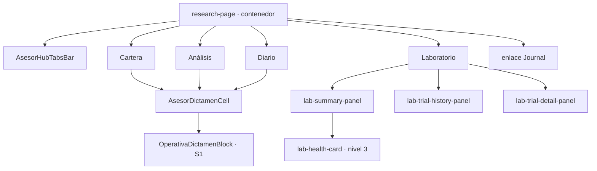

# Diseño de la operativa de ASESOR · 2026-11-15

> **Padre:** [índice de ingeniería](./engineering-index-2026-08-03.md)
> **Origen:** [auditoría A0](./auditoria-operativa-asesor-2026-11-15.md)
> **Cierre:** [certificación](./certificacion-operativa-asesor-2026-11-15.md)
> **Slices:** A1 (IA) · A2 (dictamen) · A3 (descomposición) · A4 (primer nivel) · A5 (cierre: sexta categoría y E2E)

## Invariantes del frente

`Δ motor = 0` · `Δ decisión = 0` · sin migración · sin `contract:gen` ·
`openapi.json` y `schema.d.ts` intactos (`contract:check OK`) · `compute_stance`,
umbrales, gate, sizing, ejecución y AUTO sin tocar · sin commit ni tag.

## 1 · Una sola historia

Antes, `/research` contaba la misma historia seis veces con tres renders distintos
del dictamen y dos pestañas que eran en realidad el Laboratorio. Ahora cuenta cuatro
pestañas y un enlace:

| id interno | pestaña visible | qué responde |
| --- | --- | --- |
| `cartera` (por defecto) | **Cartera** | ¿qué tengo y qué riesgo corre? |
| `opiniones` | **Análisis** | ¿qué dicta el motor para cada valor que sigo? |
| `diario` | **Diario** | ¿qué ha pasado hoy? |
| `dashboard` / `history` | **Laboratorio** | ¿qué he experimentado y qué mide? |

`journal` deja de ser pestaña: es un enlace en el encabezado a `/decision-journal`.
Los seis ids se conservan porque los consumen el menú superior, los toasts de alarma,
`asesorHistoryHref()` y el E2E.

## 2 · Decisiones de producto y su motivo

**La pestaña por defecto es Cartera.** La anterior por defecto era la más vacía:
sus métricas vivían dentro de un detalle técnico y su contenido pertenecía al
Laboratorio. Llegar a Asesor y no ver nada medido era el peor recibimiento posible.

**«Tesis» e «Investigación» se fusionan en Laboratorio.** Eran dos mitades del mismo
destino, que además ya es puerta propia en `/backtests`. Se conservan ambos ids y
ambos montan el Laboratorio, de modo que ningún enlace existente se rompe.

**Un solo bloque de dictamen.** `OperativaDictamenBlock` gana `variant="cell"`
(aditivo; los tres llamadores de trading siguen en `compact`/`hero`) y un slot de
chips. `AsesorDictamenCell` lo envuelve para las tres superficies de Asesor. Deja de
haber tres traducciones de la misma postura.

**La ★ exige IO medido.** Es la regla certificada de S1: sin IO no se pinta un tres
fabricado. Consecuencia declarada: el Diario ya no muestra ★ porque su fila no
transporta IO y el API no rellena `opinionDetails`. Preferimos una regla única y
declarada a tres formatos distintos del mismo dato.

**Seis categorías de cartera, no cinco (A5).** `classifyAsesorCarteraState` clasifica
cada fila en una de estas categorías de **presentación**; ninguna es una orden:

| rank | id | etiqueta | cuándo |
| --- | --- | --- | --- |
| 0 | `posicion_sin_respaldo` | Posición sin respaldo | posición abierta + `overbought` o `review_strategy` |
| 1 | `recomendacion_favorable` | Recomendación favorable | sin posición + `buy` |
| 2 | `posicion_abierta` | Posición abierta | posición abierta + resto de posturas evaluadas |
| 3 | `senal_de_salida_sin_posicion` | Señal de salida sin posición | sin posición + `overbought` / `reduce` / `sell_exit` |
| 4 | `evaluado_sin_oportunidad` | Sin oportunidad | sin posición + `hold_watch` / `no_trade` / `review_strategy` |
| 5 | `sin_datos` | Sin datos suficientes | cartera sin medir, sin dictamen o `no_trade` por causa de medición |

Antes, `overbought` sin posición caía en el `default` del `switch` y se leía como
«Dictamen no reconocido» —un mensaje de error—, y `reduce`/`sell_exit` se declaraban
«sin datos» con una grieta. Las dos cosas son falsas: el dictamen de salida **se midió**.
La sexta categoría lo declara y, a la vez, niega lo que no es: no es una orden de venta,
no abre corto y no es una sobrecompra técnica. El `default` queda solo como red para
claves desconocidas.

El tono del badge es violeta (informativo) porque ámbar ya identifica «Posición sin
respaldo»: dos hechos distintos no comparten color (H-17). La pista de actuación
(`resolveOperativaActionHint`) declara para esta categoría «Sin actuación» con un texto
propio: no hay venta que proponer ni entrada que preparar.

## 3 · Inventario resultante

`research-page.tsx` era el hub monolítico de 828 líneas; hoy es un contenedor que
solo lee la URL, decide la pestaña y monta paneles.

- Hub y primitivas: `asesor-hub-tabs.tsx` (121), `asesor-ui.tsx` (170),
  `asesor-dictamen-cell.tsx` (66).
- Laboratorio: `lab-summary-panel.tsx` (280), `lab-health-card.tsx` (67),
  `lab-trial-history-panel.tsx` (284), `lab-trial-detail-panel.tsx` (98),
  `asesor-journal-bridge.tsx` (38).
- Cartera: `asesor-cartera-panel.tsx` (242, antes 841), `asesor-cartera-row.tsx` (268),
  `asesor-cartera-filters.tsx` (76), `asesor-cartera-technical-detail.tsx` (259),
  `asesor-strength-bar.tsx` (32).
- Análisis: `asesor-opiniones-panel.tsx` (470, antes 574),
  `opinion-channel-map.tsx` (62), `asesor-telemetry-strip.tsx` (178).
- Diario: `asesor-daily-ops-panel.tsx` (317, antes 576), `asesor-daily-hero.tsx` (134),
  `asesor-week-chart.tsx` (92), `asesor-daily-channels.tsx` (141).

Ningún archivo de Asesor supera las 500 líneas, y ninguno mezcla tres superficies.

## 4 · Primer nivel honesto

- La telemetría A0/A6, «Proxy Outcomes», «P1–P5 en Consola», «Execute env» y los
  códigos de diagnóstico se pliegan en un único `TechnicalDetail`. El primer nivel
  se queda con alarmas, avisos y valores sin dictamen.
- `UNKNOWN ≠ 0`: los costes del experimento dejan de colapsar a cero (usan el guion
  de auditoría de nivel 3) y los KPI del Diario dejan de pintar `—` (usan
  `formatPriceOrAbsent`). Se cerró además una tercera fuga en el recuento del EOD.
- Un solo tono para «aviso» (ámbar), con fuente única en `asesor-ui.tsx`.
- El hero del Diario usa tokens del sistema: funciona en claro y oscuro.
- El Diario distingue tres estados que antes se confundían: sin cuenta, midiendo y
  sin dato todavía.

## 5 · Deuda cerrada

- `a6Query` cacheaba por estudio y no por cuenta: cambiar de cuenta servía la
  telemetría de la anterior. Ahora la clave incluye la cuenta y ordena los ids.
- Un solo `staleTime` para OHLCV (antes 60 s interno frente a 5 min externo).
- Un solo predicado de posición abierta, en lugar de cuatro copias inline.
- Retirados los campos que el hook calculaba y nadie leía.
- Un único `research-trial-technical`.
- El clasificador deja de responder «Dictamen no reconocido» a una postura conocida y de
  declarar «sin datos» una señal de salida medida (H-5).
- El gate de primer nivel deja de tener una exención ciega: un fragmento de nivel 3
  solo se acepta si tiene un único importador y ese importador lo monta dentro de un
  `TechnicalDetail`. El invariante se prueba a sí mismo con casos negativos.

## 6 · Fuera de alcance, declarado

- Endpoint batch de OHLCV: no existe y no se ha creado. Cartera sigue pidiendo velas
  por instrumento.
- `opinionDetails` existe en el contrato pero el backend no lo rellena. Mientras siga
  así, el Diario declara la confianza y la ★ como no medidas.
- El reparto de `data-testid` de estado por fila sigue repitiendo seis valores posibles:
  hay nueve aserciones que dependen de él y el valor no aporta información nueva.
- `PROJECT_STATE.md` y `CHANGELOG.md` no se tocan mientras no se autorice el cierre.
