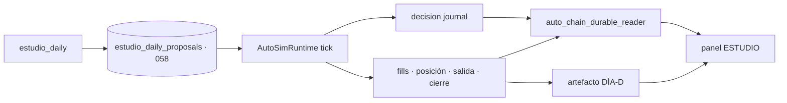

# Evidencia — Cierre de UI y trazabilidad diaria AUTO (`audit/auto-daily-chain-ui`)

**Fecha**: 2026-10-23
**Base**: `3ea4eb5a`
**Rama**: `audit/auto-daily-chain-ui` (se trabaja aquí; **`main` no se toca**)
**Commits**: `17252f27` (handoff), `0398bba2` (UI), `a82bdcaa` (E2E), más el de esta evidencia
**Migración**: `058_estudio_daily_proposals` — `alembic heads` → `058_estudio_daily_proposals (head)`; aplicada en la BD local (`alembic current` → mismo head)
**Sello**: `.161` intacto · **tags**: no se corta ni se mueve ninguno · **pin**: no se re-ancla
**AUTO**: OFF · **Cuenta de la ventana**: BLOCKED · **Ventana**: INCONCLUSIVE · **`evidence_ready=false`**

> Esta fase **no promete rentabilidad**. Promete que la cadena `parte diario → señal → ciclo → hechos → artefacto DÍA-D → UI`
> sea demostrable por igualdad de identificadores durables, y que lo que la UI afirma sea lo que el servidor mide.



---

## 0. Resumen en una tabla

| Eje | Qué se pidió | Qué se demostró | Dónde |
| --- | --- | --- | --- |
| **Backend / handoff** | El productor consume el plan del parte y sella sus ids | `signalId`/`planId` del parte == journal durable == artefacto DÍA-D; `cycle_id` idéntico en fill, posición, salida y cierre | §2, §7.2 |
| **Cobertura** | Universo reconciliable, sin recorte silencioso | `universe.expectedCount = expectedIds.length = values.length + missing.length + excluded.length` en el parte real | §4, §7.2 |
| **UI** | Cuatro preguntas delante, técnica detrás | Resumen humano inicial; ids/selector/DÍA-D dentro de `AutoTechnicalDetail`; testids conservados | §5, §7.3 |
| **DÍA-D** | Verdad de servidor y alcance del artefacto | `POST /auto/ops-jobs` devuelve `slot.state/activeJobId/activeSymbol/matchesRequest/message`; la UI no infiere | §6, §7.3 |
| **E2E** | Real, fail-if-skipped | Python 1 passed (`AUTO_DAILY_CHAIN_E2E_PG_REQUIRED=1`), navegador 2 passed (`E2E_LIVE_REQUIRED=1`) | §7 |
| **Gobierno** | Sin tag, sin `main`, sin re-anclaje | AUTO OFF, PAPER, BLOCKED, INCONCLUSIVE intactos | §10 |

---

## 1. Punto de partida medido (baseline)

`StartPoint` — al abrir la rama, antes de ningún cambio:

- `main` en `3ea4eb5a`; **AUTO OFF**; **PAPER virtual**; cuenta de la ventana **BLOCKED**.
- **24 fills sin `cycle_id`** y **0/32** en la ventana de validación → `INCONCLUSIVE`, `evidence_ready=false`.
- El parte diario publicaba contadores globales, pero **recortaba a 100 valores** sin declarar excluidos
  (`estudio_daily_ops._MAX_VALUES`), y el productor **no consumía** el plan del parte: solo coincidía el símbolo.

`Resultado` — tras la rama: los 24 fills antiguos **siguen sin `cycle_id`** (no se reescribe historia);
la ventana sigue **INCONCLUSIVE / 0/32**; la cuenta sigue **BLOCKED**. Lo nuevo es que **los fills nuevos**
nacen con la cadena atribuida, y que la UI ya no puede decir «validada» ni «completa» sin que el servidor lo respalde.

---

## 2. Brecha cerrada: handoff durable del parte al ciclo (migración 058)

El problema no era cosmético: el parte sellaba `signal.id = edo-…` y `TradePlan.decisionId = tp-…`, mientras el
productor derivaba su propio `signalId` de `signal_identity_for_bar(...)`. **La cadena exacta era indemostrable**;
solo se podía inferir por símbolo, que es justo lo que el dictamen prohíbe.

- **Tabla** `estudio_daily_proposals` (`058_estudio_daily_proposals`): `account_id`, `day`, `instrument_id`, `symbol`,
  `decision_id` (plan), `signal_id`, `strategy_definition_id`, `strategy_version`, `preset_key`, `bar_date`,
  `plan` JSONB, `status` (`proposed|consumed|rejected|expired`), `consumed_cycle_id`, `consumed_at`, timestamps.
  Única por `(account_id, day, instrument_id)` con índice **parcial** `WHERE status='proposed'` y única por `decision_id`.
- **Persistencia**: el handler real del job `estudio_daily` (`auto_ops_job_worker.py`) guarda de forma **idempotente**
  cada valor `ok` con plan `TRIGGERED`; el servicio `RunEstudioDailyOps` sigue siendo puro (la persistencia es un caso de uso aparte).
- **Consumo atómico**: el productor (`auto_simulation_worker.py`) busca la propuesta pendiente por
  `(cuenta, día de la barra, instrumento)`, adopta `signalId`, `TradePlan.decisionId` y la geometría, y marca `consumed`
  con el `cycle_id` resultante. Plan rechazado por gates → `rejected` con motivo; **no se sustituye por otro plan**.
  Sin propuesta → camino actual y la cadena declara `not_proposed` (nunca se infiere por símbolo).
- **Código**: `packages/py/application/src/bolsa_application/estudio_daily_proposals.py` (544 líneas),
  `packages/py/infrastructure/.../estudio_daily_proposal_repository.py` (324), `entities/estudio_daily_proposal.py`,
  `versions/058_estudio_daily_proposals.py`, `tables.py`.

`Resultado` — el id del plan y el de la señal se heredan, no se regeneran; la reserva se consume **una vez**
(`consumed_cycle_id` único por propuesta) y el journal de decisión sella esos mismos ids.

---

## 3. Atribución explícita en la cadena

El lector durable (`auto_chain_durable_reader.py`, nuevo) calcula un estado **por igualdad de ids durables**, no por símbolo:

| `attribution.state` | Significado |
| --- | --- |
| `exact` | La propuesta del parte existe y sus `signalId`/`planId` == los del journal == los del ciclo |
| `mismatch` | Hay propuesta, pero los ids del ciclo **no** son los de la propuesta (se muestra el desacuerdo, no se oculta) |
| `not_proposed` | El valor del parte no llegó a propuesta (plan no TRIGGERED / valor sin señal) |
| `unmeasured` | El ciclo existe pero no hay con qué comparar (datos insuficientes) |
| `ambiguous` | Más de un candidato durable; se declara en vez de elegir el más conveniente |

La UI **muestra el estado tal cual** (incluido `mismatch`) dentro del desplegable técnico.

---

## 4. Cobertura reconciliable del universo ESTUDIO

El parte ya no recorta en silencio. El contrato público (`packages/shared/src/estudio-daily-ops.ts`) declara:

```ts
export type EstudioDailyUniverseV1 = {
  expectedCount: number;
  expectedIds: string[];   // universo COMPLETO antes del recorte
  scannedIds: string[];
  excluded: Array<{ instrumentId: string; reason: string }>;
  missing:  Array<{ instrumentId: string; reason: string }>;
  reconciled: boolean;     // todo esperado tiene fila terminal o exclusión declarada
  complete: boolean;       // además, no hubo recorte
  reason: string | null;
};
```

- Estados terminales por valor: `ok | no_signal | no_plan | error`, cada uno con motivo legible.
- `reconciled` exige `expectedIds ⊆ values ∪ excluded`; un hueco nunca desaparece: pasa a `missing[]` con motivo.
- La UI pinta «Cobertura: N de M; faltan X» con la lista desplegable y su motivo; **no** dice «parte completo» si no cuadra.
- `handoff` (`EstudioDailyHandoffV1`) declara `proposed`, `skipped[]` con motivo estable y no omite valores en silencio.

---

## 5. UI: cuatro preguntas delante, técnica detrás

- Nuevo módulo puro compartido `packages/shared/src/estudio-daily-summary.ts` (`deriveValueSummary`) que responde en la ficha:
  1. **¿Qué propone?** (plan o «no propone»),
  2. **¿Por qué?** (motivo legible, sin jerga de ids),
  3. **¿Qué falta para actuar?** (gate/estado/ventana),
  4. **¿Está validado?** (siempre separado de la clasificación).
- **Etiquetas separadas con leyenda** — «Clasificación del selector: #1 de la foto (run …, barra …)» ≠ «Validación
  estadística: no validada · K=0/32 · ventana INCONCLUSIVE». «Mejor puntuada» solo vive dentro de «ranking del día»;
  nunca se usa «mejor» como sinónimo de validada.
- Todos los ids, la cadena, el selector y el DÍA-D se mueven **dentro** de `AutoTechnicalDetail` (desplegable ya existente).
- **Testids conservados** aunque cambien de sitio: `estudio-daily-value-{proposal,why,missing,validation}`,
  `estudio-daily-value-technical`, `estudio-chain-dia-d-artifact-meta`, etc.

`Resultado` — el panel pasó de 3 a 4 preguntas y de contadores a estado terminal + motivo. La vista inicial responde
a las cuatro preguntas; los ids técnicos exigen abrir el desplegable.

---

## 6. DÍA-D: verdad de servidor y alcance del artefacto

- `POST /api/auto/ops-jobs` devuelve ahora `slot` (`AutoOpsJobSlotDto`):
  `state` (`free|active_same_request|active_other_symbol`), `activeJobId`, `activeSymbol`, `requestedSymbol`,
  `matchesRequest`, `startedAt` y `message` **compuesta en servidor**. La UI dejó de inferir `occupiedBy` del payload
  (`use-dia-d-value-replay.ts` consume `slot.matchesRequest`, única fuente de verdad).
- Mensaje de cola (servidor): «Verificación en curso para BBB (job …, iniciado …). La cola admite una por cuenta y día;
  este valor queda pendiente».
- Se declara explícitamente: **día solicitado y su origen** (vela del parte vs día de entrada del ciclo),
  **watch real** del artefacto y que la ruta es de **solo lectura** (no ejecuta el replay).
- El artefacto declara `meta.account`, `meta.day`, `meta.watch` y `executedDetail`; `meta.day` se escribe ahora en el script
  (`v2_89_dia_d_auto_replay.py`) de modo que **el día declarado == día solicitado/replayado**.
- Al cambiar cuenta/día/valor, la vista solo muestra el artefacto del nuevo contexto o «sin artefacto»; nunca el anterior como actual.

---

## 7. E2E real (PostgreSQL + worker + CLI + navegador)

### 7.1 Harness único de siembra

`apps/api-python/tests/support/auto_chain_e2e.py` (915 líneas) extrae el mundo que antes vivía duplicado en
`test_auto_real_route_producer_pg.py` (que pasa de ~690 a un cliente fino): barras D1 reales en `ohlcv_bars`,
estrategia ACTIVE real, cuenta, reservas y sondas de fill. Reloj **pinned** (`CLOCK_DAY = 2026-10-05`) para que el
escenario sea reproducible. Lo reutilizan el test Python y el seed del navegador; no hay dos mundos.

### 7.2 Python — `test_auto_daily_chain_full_real_e2e_pg.py`

Con `AUTO_DAILY_CHAIN_E2E_PG_REQUIRED=1`, un PostgreSQL ausente es **FALLO**, no skip (`require_or_skip`).

- Siembra **231 barras D1** (210 de contexto + `D` + 20 de horizonte) para que SMA200 sea calculable dentro de la
  ventana composite de 260.
- Ejecuta el job real `estudio_daily` → parte con `signalId`/`planId`.
- Ejecuta el productor real con handoff → reserva → orden → **fill** → posición → salida → **cierre**, con los mismos ids.
- Encola y ejecuta `dia_d_value_replay` real (sin monkeypatch) → artefacto con `meta.account`, `meta.day`,
  `meta.watch == [símbolo]` y `executedDetail` con los mismos ids.
- Lee con la app ASGI real `/api/auto/estudio-daily`, `/api/auto/estudio-chain`, `/api/auto/dia-d-replay/{día}/value/{símbolo}`
  y compara identidades; comprueba aislamiento por cuenta, conflicto de cola y que releer no devuelve evidencia ajena ni anterior.

`Resultado` medido:

```
1 passed in 17.88s   # pytest apps/api-python/tests/test_auto_daily_chain_full_real_e2e_pg.py
```

### 7.3 Navegador — `gp-e2e-auto-daily-chain-live.spec.ts`

API real + worker real (`AUTO_OPS_JOB_WORKER_ENABLED=1`) + PostgreSQL + seed `scripts/dev/seed_estudio_daily_for_ui.py`
(210 barras deterministas, `--bars` rechaza <210). Gate `E2E_LIVE_REQUIRED=1`: precondición ausente = **FALLO**.

Recorrido: pulsar «Calcular operativa diaria» → esperar el job → por valor comprobar estado terminal, explicación legible,
validación **no** afirmada y cobertura → pulsar «Verificar DÍA-D de este valor» → comprobar cola (verdad de servidor),
artefacto y que los ids técnicos **solo** aparecen dentro del desplegable → provocar el conflicto de cola y leer la respuesta
del servidor.

`Resultado` medido:

```
2 passed (24.8s | 31.4s)   # pnpm exec playwright test gp-e2e-auto-daily-chain-live (antes y después del fix)
8 passed (1.5m)      # pnpm exec playwright test gp-v288-s5  (batería previa, sin regresión)
```

**Dos defectos reales que el viaje en vivo encontró y se corrigieron** (no eran del test):

1. El artefacto DÍA-D salía con `data-artifact-day=""`: el script escribía `meta` sin `day`. Corregido en
   `v2_89_dia_d_auto_replay.py` (`meta["day"] = day`) y **aserado** en el test Python (`meta["day"] == artifact["day"]`).
2. El helper `ensureDiaDEvidenceOpen` cerraba el panel recién abierto al pulsar el toggle a ciegas. Corregido leyendo el
   texto del botón antes de pulsar.

**Un tercer defecto, este de comportamiento, lo destapó el CI (no el navegador):** el handoff pasaba siempre
`signal.target_price` como `target1` del plan, también **sin** propuesta. Un `target1` por encima de `target2`
(`entry + 2R`) convertía en `plan_invalid` decisiones que nada tenían que ver con el parte: **22 tests de aplicación**
en rojo. Corregido en `feat(auto)` → `fix(auto)`: sin propuesta `stop_price`/`target_price` son `None` (valor por
defecto histórico) y el motor deriva la geometría del ATR (**Δ = 0**). Se añadió
`packages/py/application/tests/test_estudio_daily_proposal_handoff.py` (4 tests) que fija las dos propiedades:
con propuesta se hereda identidad + geometría y se sella `dailyProposal`; sin propuesta el tick es el histórico y
**no** aparece `dailyProposal`.

---

## 8. CI

- **`python-ci.yml`** — paso nuevo en `auto-v2-durable-pg` con `AUTO_DAILY_CHAIN_E2E_PG_REQUIRED=1` y guarda anti-skip
  junto al gate de la ruta real; `timeout-minutes` holgado para el CLI real.
- **`release-tag-ci.yml`** — job nuevo `playwright-live-auto-daily` (+190 líneas), calcado de `playwright-integrated-auto-s5`:
  PostgreSQL como servicio, API + worker reales, seed y `E2E_LIVE_REQUIRED=1`.
  **Declaración explícita**: el job es **no bloqueante** de `certify` mientras se estabiliza (arranque de worker + PG en
  runner); se promociona a bloqueante cuando acumule verde sostenido. No se declara verde lo que no lo es.

Runs de esta rama:

| Workflow | Run | Estado |
| --- | --- | --- |
| Python CI (`a82bdcaa`) | [40002381117](https://github.com/jvelasca/Bolsa_V1/actions/runs/40002381117) | **failure** — `Pytest`: 22 tests de aplicación por el defecto descrito en §7.3 |
| Frontend CI (`a82bdcaa`) | [40002381109](https://github.com/jvelasca/Bolsa_V1/actions/runs/40002381109) | success |
| Fase 2 scientific (`a82bdcaa`) | [40002381230](https://github.com/jvelasca/Bolsa_V1/actions/runs/40002381230) | success |
| **Python CI** (`02e7fb79`, tras el fix) | [40004115803](https://github.com/jvelasca/Bolsa_V1/actions/runs/40004115803) | **success** — `quality` 2m16s · `auto-v2-durable-pg` 1m31s |
| Fase 2 scientific (`02e7fb79`) | [40004115741](https://github.com/jvelasca/Bolsa_V1/actions/runs/40004115741) | success |
| Optimize lab (`02e7fb79`) | [40004115731](https://github.com/jvelasca/Bolsa_V1/actions/runs/40004115731) | success |
| Frontend CI (`02e7fb79`) | — | no se dispara: el workflow filtra por `apps/web/**`, `packages/shared/**`, lockfiles y su propio YAML; este commit solo toca rutas Python y docs. El último run con cambios de UI (`a82bdcaa`) fue **success**. |
| **Frontend CI** (`04764b47`, fin del `cycles[0]`) | [40029061992](https://github.com/jvelasca/Bolsa_V1/actions/runs/40029061992) | **success** — `headSha` del run == `04764b47010bea2e202a6ee4e5085092f29db5e6`; job `quality` con build, typecheck y tests de `shared`, typecheck general, lint, tests y build |
| Frontend CI (`cad1a775`, titular mixto honesto) | — | se cita el run del commit siguiente cuando exista; este cambio solo añade el matiz de presentación descrito abajo |

Alcance de [40029061992](https://github.com/jvelasca/Bolsa_V1/actions/runs/40029061992): cubre el módulo compartido
`packages/shared/src/estudio-daily-summary.ts` y sus tests, y los gates estáticos y unitarios del monorepo. **No**
ejecuta el E2E live con PostgreSQL ni el worker reales (§7), y **no** demuestra validación estadística: la ventana
sigue `INCONCLUSIVE`, `evidence_ready=false` y 0/32 ciclos medibles.

### 8.0.1 Matiz de presentación de la atribución mixta

El run anterior cerró el defecto de `cycles[0]`, pero `mixed` con al menos un ciclo `exact` publicaba
«Nada pendiente: al menos un ciclo ejecutó esta propuesta», que un lector básico puede leer como cadena completa.
Se corrigió en `cad1a775`: ese caso pasa a «Hay al menos un ciclo atribuido a esta propuesta, pero la cadena contiene
ciclos con atribución discrepante», con el recuento por estado y `measurement: PARTIAL`. Solo un agregado `exact`
**puro** autoriza «Nada pendiente».

### 8.1 Resultado de los runs

El primer run de Python CI **falló y se dice aquí**: no fue un fallo del entorno, fue un defecto real del handoff
(§7.3) que la suite de aplicación detectó y que ningún test focalizado previo cubría, porque hasta esta fase el
handoff no tenía tests unitarios. Se corrigió, se añadió la cobertura unitaria que faltaba y se re-ejecutó todo
(`2848 passed` en `packages/py/application/tests`, E2E PG y Playwright live verdes de nuevo).

El run posterior ([40004115803](https://github.com/jvelasca/Bolsa_V1/actions/runs/40004115803)) quedó **verde** con
los cinco jobs. El paso dedicado de la cadena diaria corrió **de verdad**, con el gate puesto:

```
Pytest AUTO cadena diaria señal→ciclo→DÍA-D PG (fail if skipped)   AUTO_DAILY_CHAIN_E2E_PG_REQUIRED=1
  apps/api-python/tests/test_auto_daily_chain_full_real_e2e_pg.py
  1 passed in 15.28s
Pytest AUTO 2.0 durable PG (fail if skipped)                        124 passed in 22.60s
Pytest AUTO ruta REAL del productor PG (fail if skipped)              7 passed in 8.80s
```

Estado final de la rama: **CI verde** en los workflows aplicables, **cero skips silenciosos** en la cadena diaria
(un PostgreSQL ausente habría sido FALLO, no skip), y `main`, tags, sello y ventana intactos.

---

## 9. Verificación local (comandos y resultados medidos)

```powershell
# Python
uv run --no-sync python -m pytest apps/api-python/tests/test_auto_daily_chain_full_real_e2e_pg.py        # 1 passed, 17.81s
uv run --no-sync python -m pytest packages/py/application/tests                                         # 2848 passed
uv run --no-sync python -m pytest packages/py/application/tests/test_estudio_daily_proposal_handoff.py   # 4 passed
uv run --no-sync python -m pytest -k "proposal"                                                          # 96 passed
uv run --no-sync python -m pytest apps/api-python/tests/test_auto_ops_job_worker.py `
  apps/api-python/tests/test_auto_ops_jobs_route.py apps/api-python/tests/test_auto_daily_dia_d_chain_integration.py  # 21 passed
uv run --no-sync ruff check packages/py apps/api-python --config pyproject.toml   # All checks passed
uv run --no-sync mypy packages/py/domain/src packages/py/market/src `
  packages/py/infrastructure/src packages/py/application/src apps/api-python/src `
  --follow-imports=silent                                                        # Success: 570 files
uv run --no-sync lint-imports --config packages/py/.importlinter                 # 4 kept, 0 broken

# Web
pnpm --filter @bolsa/shared test                    # 842 passed, 1 todo
pnpm --filter web exec vitest run src/features/auto-monitor/estudio-daily-ops-panel.test.tsx `
  src/features/auto-monitor/use-dia-d-value-replay.test.tsx                                             # 40 passed
pnpm exec tsc --noEmit -p apps/web/tsconfig.json    # limpio
pnpm exec eslint apps/web/src apps/web/e2e          # limpio
pnpm exec playwright test gp-e2e-auto-daily-chain-live                                                  # 2 passed (31.4s)
pnpm exec playwright test gp-v288-s5                                                                    # 8 passed, 1.5m
```

---

## 10. Dictamen separado (cuatro ejes)

**1) Sello.** `.161` **intacto**: no se corta tag, no se mueve ningún tag, no se re-ancla el pin.
La fase sí introduce migración (`058`), declarada aquí y en `PROJECT_STATE`. El sello no se reescribe: se construye **encima**.

**2) Backend.** El handoff durable funciona y es **idempotente**: la propuesta se persiste una vez por
`(cuenta, día, instrumento)` en estado `proposed`, se consume **una vez** con `consumed_cycle_id`, y el ciclo hereda
`signalId`/`planId` del parte. Sin propuesta no hay sustitución por otro plan. **La atribución ya no se infiere por símbolo.**
La cobertura es reconciliable y el recorte dejó de ser silencioso. *Límite*: `mismatch` y `ambiguous` existen como estados
declarados; en este mundo sembrado se observó `exact`, y no se ha ejercitado `ambiguous` con datos reales (queda como
capacidad declarada, no como caso demostrado). *Corrección honesta*: el primer run de CI puso en rojo 22 tests de
aplicación porque el handoff filtraba el `target_price` de la señal en decisiones **sin** propuesta; corregido (Δ = 0)
y cubierto con `test_estudio_daily_proposal_handoff.py`.

**3) UI.** La vista inicial responde a las cuatro preguntas y los ids técnicos quedan detrás de un desplegable.
Clasificación y validación están **separadas por construcción** (funciones puras con tests), no por copy.
La cola DÍA-D usa **verdad de servidor** (`slot.matchesRequest`), no inferencia. El viaje en vivo encontró dos defectos
reales —`meta.day` vacío y el toggle que cerraba el panel— y ambos quedaron corregidos y aserados.

**4) Validez operativa.** **Sin cambios**: AUTO **OFF**, PAPER virtual, cuenta **BLOCKED**, ventana **INCONCLUSIVE**,
`evidence_ready=false`, **K=0/32**. Nada de esta fase autoriza a decir que la estrategia valida. Lo que se demuestra es
**trazabilidad**, no rentabilidad: hoy la cadena se puede auditar de punta a punta; antes solo se podía suponer.

---

## 11. Límites y lo que NO se ha demostrado

- No se ha ejecutado con la cuenta real ni con datos de mercado en vivo: el mundo es **sembrado y determinista** (pinned).
- No se ha ejercitado `ambiguous` ni `mismatch` con datos reales; existen y se muestran, pero no hay evidencia de campo.
- El agregado `mixed` (varios ciclos del mismo valor con estados distintos) se demuestra hoy **solo con tests puros** de
  `packages/shared/src/estudio-daily-summary.test.ts`; ningún mundo sembrado ni dato real ha producido todavía varios
  ciclos discrepantes para un mismo valor.
- El job `playwright-live-auto-daily` es **no bloqueante** de `certify` hasta acumular verde sostenido.
- Los 24 fills históricos sin `cycle_id` **siguen sin `cycle_id`**: no se reescribe historia. La cadena demuestra desde aquí.
- El recorte del universo sigue existiendo (ventana/composite); lo que cambia es que ahora es **declarado y reconciliable**.

---

## 12. Reproducir

```powershell
# 1) Migración
cd packages/py/infrastructure; uv run --no-sync alembic upgrade head

# 2) E2E Python (PG real, falla si falta)
$env:AUTO_DAILY_CHAIN_E2E_PG_REQUIRED="1"
uv run --no-sync python -m pytest apps/api-python/tests/test_auto_daily_chain_full_real_e2e_pg.py -s

# 3) Semilla del navegador + E2E live
uv run --no-sync python scripts/dev/seed_estudio_daily_for_ui.py
$env:E2E_LIVE_REQUIRED="1"; $env:AUTO_OPS_JOB_WORKER_ENABLED="1"
pnpm exec playwright test gp-e2e-auto-daily-chain-live
```
