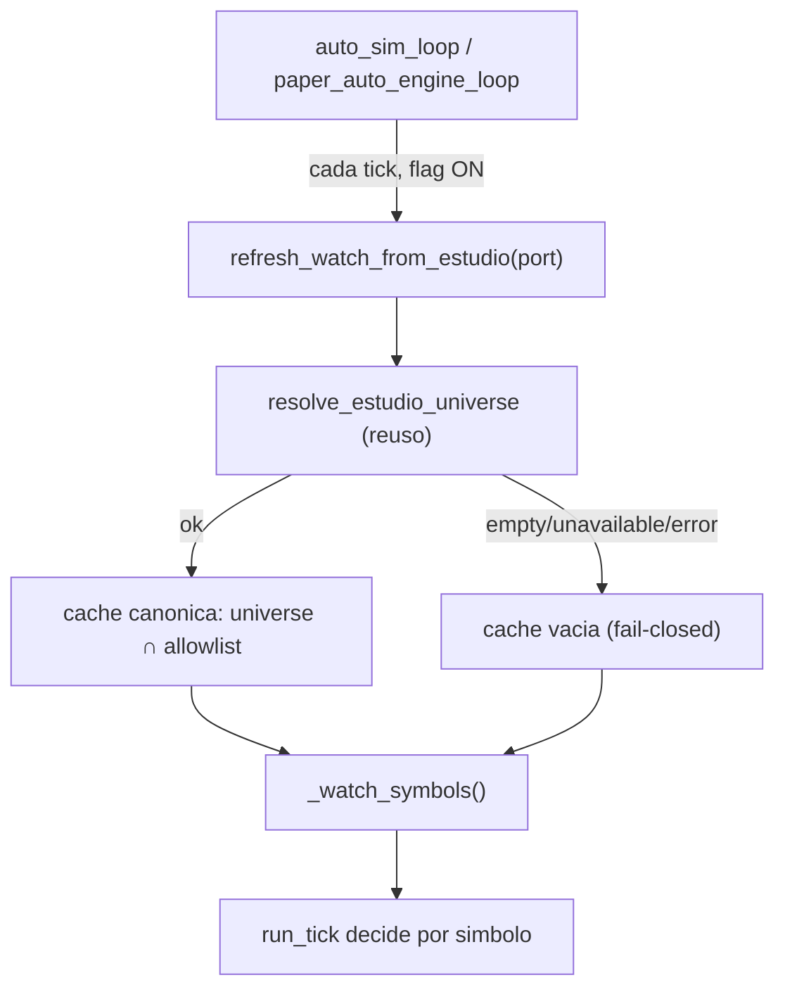

# Evidencia `v2.88.123-beta` — `S2` cerrado: la lane diaria AUTO acopla su watch al universo ESTUDIO

> **Bump:** `2.11.122-beta` → **`2.11.123-beta`** (`package.json` + `meta.bump` del CLI OOS `v2_87` y de los 9 CLIs `v2_89`…`v2_97`; guardián [`test_dia_d_bump_guard`](../../../../apps/api-python/tests/test_dia_d_bump_guard.py) verde).
>
> **Naturaleza:** sello **de producto acotado**. **`Δ motor ≠ 0`** **acotado al origen del watch/agendado** de la lane diaria · **`Δ decisión = 0`** · **SIN migración** (head `053_dia_d_cycle_verifications`) · **SIN cambio de contrato HTTP**. **Rollout reversible:** flag `AUTO_ENGINE_SIMULATED_WATCH_FROM_ESTUDIO` (alias `AUTO_ENGINE_DRY_WATCH_FROM_ESTUDIO`) **default OFF** ⇒ con OFF **no** se consulta ESTUDIO ni se toca la BD (**Δ comportamiento byte-idéntico** al CSV estático). Tag **unsigned**.

Este sello **cierra** el hallazgo `S2` que `v2.88.122` dejó **declarado (no cerrado)**: el watch de la lane de operación diaria AUTO (`paper_auto_engine_worker` / `auto_simulation_worker`) salía de un **CSV estático** (default `AAA,IBEX`) y un valor añadido a la lista canónica **ESTUDIO** **no** entraba solo.

---

## 1. El hueco (`S2`, declarado en `v2.88.122`)

| Lane | Fuente del instrumento (antes) | Evidencia |
|------|--------------------------------|-----------|
| Estrategia/orquestación | lista **ESTUDIO** (universo canónico); el CSV `AUTO_ORCHESTRATOR_INSTRUMENTS` solo **intersecta** | [`auto_orchestrator_worker._instruments_for_cycle`](../../../../apps/api-python/src/bolsa_api/background/auto_orchestrator_worker.py) |
| Operación diaria | **CSV estático** `AUTO_ENGINE_SIMULATED_WATCH` / `AUTO_ENGINE_DRY_WATCH` (default `AAA,IBEX`); **no** consultaba ESTUDIO | [`paper_auto_engine_worker._watch_symbols`](../../../../apps/api-python/src/bolsa_api/background/paper_auto_engine_worker.py) |

**Consecuencia para el operador (antes):** un valor que entraba en ESTUDIO **no** entraba solo en el día AUTO; había que sincronizar CSV y ESTUDIO **a mano**.

---

## 2. El acoplamiento (mismo contrato que el orquestador; env-gated)

Nuevo módulo [`bolsa_api.background.estudio_watch`](../../../../apps/api-python/src/bolsa_api/background/estudio_watch.py):

- `SessionScopedEstudioList(session_factory)`: puerto `EstudioListPort` real (una sesión por `execute`), factorizado aquí y **reutilizado** por `auto_orchestrator_worker._estudio_universe_resolver` (antes duplicado; cambio de identidad, no semántico).
- `resolve_daily_watch(estudio_list, *, allowlist=())`: **reutiliza** `resolve_estudio_universe` (el MISMO resolver del Paper Desk y del orquestador; no se duplica la lógica de ESTUDIO) y devuelve `DailyWatchResolution(status, instrument_ids, allowlist)`.

**Contrato (idéntico al orquestador):**

| Regla | Comportamiento |
|-------|----------------|
| Universo canónico | **ESTUDIO** (`resolve_estudio_universe`) |
| CSV `AUTO_ENGINE_SIMULATED_WATCH` | **allowlist que intersecta** (vacío ⇒ universo completo; sin intersección ⇒ `[]`) |
| `unavailable` / `empty` / error / lista vacía | **fail-closed** ⇒ watch `[]` (el worker decide `0`, **no** opera); **NUNCA** cae al CSV |
| Flag OFF (default) | no se consulta ESTUDIO ni la BD; **byte-idéntico** al CSV estático |



---

## 3. Wiring

[`paper_auto_engine_worker.py`](../../../../apps/api-python/src/bolsa_api/background/paper_auto_engine_worker.py):

- `_watch_from_estudio_enabled()` (gate; canónico SIM, alias DRY), cache módulo `_CANONICAL_WATCH`, `_watch_allowlist()` (CSV **sin** el default `AAA,IBEX`).
- `refresh_watch_from_estudio(estudio_list)`: **no-op** si el gate OFF; con ON resuelve y **sustituye** la cache.
- `_watch_symbols()`: gate OFF ⇒ CSV estático (bytes iguales a hoy); gate ON ⇒ ids de la cache (o `[]`).
- `sync_decider_watch(decider, watch)`: realinea la membresía del spine determinista **sin recrear el motor** (preserva retén/cooldown); no-op para un decider sin atributo `watch`.
- `paper_auto_engine_loop(..., watch_refresher=None)`: refresca **antes** de `run_tick`; `start_paper_auto_engine_worker` usa su `session_factory` (antes «legacy unused»).
- Telemetría **aditiva** (`watchSource`/`watchCount`), sin cambiar estados.

[`auto_simulation_worker.py`](../../../../apps/api-python/src/bolsa_api/background/auto_simulation_worker.py):

- `auto_sim_loop(..., watch_refresher=None)`: invoca `watch_refresher()` **antes** de `decider_refresher()` y de `runtime.run_tick()`.
- `start_auto_sim_worker(...)`: compone el refresco con el resolver real (`SessionScopedEstudioList(session_factory)`) o un `estudio_list` inyectado, **solo** si el gate está ON; la estrategia ACTIVE sigue a ESTUDIO con ON y al CSV histórico (`AUTO_ENGINE_SIM_WATCH`) con OFF.

---

## 4. Verificación

### 4.1 Hermético — `test_auto_daily_watch_coupling.py`

| Grupo | Aserto |
|-------|--------|
| **OFF** | default `AAA,IBEX`; CSV manda (SIM preferido sobre alias DRY); con `resolve_daily_watch` booby-trapeado el watch **no se inmuta** (no-op); `refresh_watch_from_estudio` devuelve `None` sin cambiar nada |
| **ON** | watch = universo ESTUDIO; CSV **intersecta**; sin intersección ⇒ `[]`; `empty`/`unavailable`/error/sin refresco ⇒ `[]`; alias DRY enciende; `sync_decider_watch` realinea membresía; el loop refresca **antes** del tick |
| **Guarda** | el módulo cablea el gate + el refresco + el resolver (inverso de la guarda de `v2.88.122`) |

### 4.2 PostgreSQL real — `test_auto_daily_watch_from_estudio_pg.py`

Gate fail-if-skipped `AUTO_DAILY_WATCH_ESTUDIO_PG_REQUIRED=1` (patrón de `test_auto_estudio_universe_coverage_pg.py`):

| # | Escenario | Resultado |
|---|-----------|-----------|
| 1 | sembrar ESTUDIO ⇒ `refresh_watch_from_estudio` ⇒ `_watch_symbols()` ⊇ universo | ✅ |
| 2 | valor **añadido** entra / **retirado** sale (tras refrescar) | ✅ |
| 3 | ESTUDIO **vacío** ⇒ `[]` (la allowlist CSV **no** rescata) | ✅ |
| 4 | allowlist CSV **intersecta**; sin intersección ⇒ `[]` | ✅ |
| 5 | el refresco se dispara dentro de `auto_sim_loop` **antes** de `run_tick` | ✅ |

Helpers de siembra/edición de ESTUDIO/limpieza factorizados a [`_estudio_pg_helpers.py`](../../../../apps/api-python/tests/_estudio_pg_helpers.py) (los comparte con `test_auto_estudio_universe_coverage_pg.py`).

Reproducción local:

```bash
uv run pytest \
  apps/api-python/tests/test_auto_daily_watch_coupling.py \
  apps/api-python/tests/test_auto_estudio_universe_coverage_pg.py \
  apps/api-python/tests/test_auto_daily_watch_from_estudio_pg.py -q
# con el gate del job PG:
AUTO_DAILY_WATCH_ESTUDIO_PG_REQUIRED=1 uv run pytest \
  apps/api-python/tests/test_auto_daily_watch_from_estudio_pg.py -q
```

---

## 5. Cableado CI y censo

- El test PG entra en el **paso DEDICADO** de `lifecycle-pg` de [`release-tag-ci.yml`](../../../../.github/workflows/release-tag-ci.yml) (`Pytest AUTO universe coverage + DÍA-D trace + daily watch ESTUDIO (PG, fail if skipped)`) con **guard anti-skip** (log + `grep` de `skipped`) y su env-gate `AUTO_DAILY_WATCH_ESTUDIO_PG_REQUIRED: '1'` en el `env:` del job.
- Va al `--ignore` de los jobs **offline** ([`python-ci.yml`](../../../../.github/workflows/python-ci.yml) y job offline de `release-tag-ci.yml`): sin PG skipearía en mudo dentro del pase de directorio.
- **Censo** ([`scripts/ci/test_selection.py`](../../../../scripts/ci/test_selection.py), guarda `test_ci_test_selection_census.py`, `maxUndeclared: 0`): **0 sin declarar** (`--missing` vacío).

---

## 6. Límites declarados (sin fabricar)

1. **`Δ decisión = 0`:** el acoplamiento cambia **de dónde sale el watch**, no cómo se decide. Un símbolo nuevo de ESTUDIO pasa por los **MISMOS** gates (RiskGate, kill switch, Simulation-Gate, límites de posición).
2. **Rollout reversible:** con el flag OFF (default) el comportamiento es **byte-idéntico** al CSV estático; no se consulta ESTUDIO ni la BD.
3. **No** se cierra la cobertura diaria completa por valor (paso 2 del veredicto).
4. **No** se cierra el DÍA-D funcional por ciclo (paso 3).
5. **P3-2/P3-3 PAPER longitudinal** (ADR-046) y **olas 2..6 de auditoría UI:** fuera de alcance.
6. **Aislamiento XTB real y magnitud del P&L:** ajenos a este sello (el acoplamiento es del universo del watch, no del resultado).

---

## 7. Verificación (local)

| Comprobación | Resultado |
|--------------|-----------|
| `ruff check` (ficheros tocados) | **All checks passed** |
| `mypy` (lista CI) | **no issues** |
| `import-linter` | **4 kept, 0 broken** |
| Focal hermético + PG (gates ON) | **passed** |
| Censo de selección (`--missing`) | **0 sin declarar** |
| Guardián de bump | **passed** |
| `alembic heads` | `053_dia_d_cycle_verifications` (**sin migración**) |
