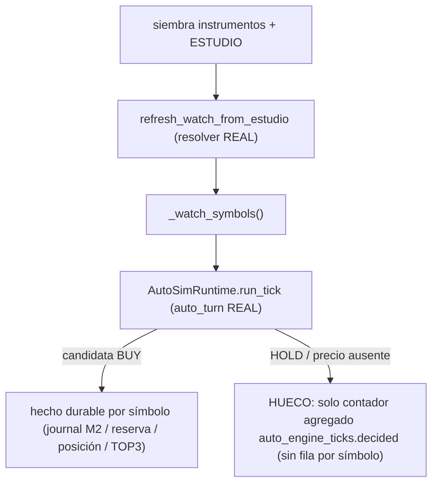

# Evidencia `v2.88.124-beta` — `paso 2` CERRADO-EN-ALCANCE: cada valor de ESTUDIO se EVALÚA en la lane diaria AUTO y los BUY dejan hecho durable (hueco HOLD declarado)

> **Bump:** `2.11.123-beta` → **`2.11.124-beta`** (`package.json` + `meta.bump` del CLI OOS `v2_87` y de los 9 CLIs `v2_89`…`v2_97`; guardián [`test_dia_d_bump_guard`](../../../../apps/api-python/tests/test_dia_d_bump_guard.py) verde).
>
> **Naturaleza:** sello de **VERIFICACIÓN** (no de producto). **`Δ motor = 0`** (solo `apps/api-python/tests/**`, `.github/workflows/**` y metadatos de versión) · **`Δ decisión = 0`** · **SIN migración** (head `053_dia_d_cycle_verifications`) · **SIN cambio de contrato HTTP**. Tag **unsigned**.

Cierra **en alcance** el **paso 2** del veredicto de auditoría (`S2` acopló el origen del watch en [`v2.88.123`](../v2.88.123/README.md); aquí se certifica la **cobertura de la lane diaria sobre el universo canónico ESTUDIO**), con su **límite declarado**: un valor **evaluado** que **no opera** (HOLD / precio ausente) **no** deja hoy hecho durable por símbolo.

---

## 1. Qué certifica (y con qué)

| # | Caso | Aserto falsable |
|---|------|-----------------|
| a | **Cobertura por valor** | cada valor elegible de ESTUDIO está en `_watch_symbols()` y el turno los **evalúa** (`report.decided`); todo valor que **produce candidata BUY** deja **≥1 fila durable por símbolo** (journal M2 `auto_entry_decision` / reserva / posición / TOP3) |
| b | **Añadido entra** | un valor añadido a ESTUDIO aparece en `_watch_symbols()` tras el refresco y deja hecho durable |
| c | **Retirado sale** | un valor retirado de ESTUDIO sale del watch y **no** emite hechos nuevos (cuenta M2 estable) |
| d | **Universo vacío** | `set_estudio([])` + refresco ⇒ `_watch_symbols() == []` y el turno **no decide** (`decided == 0`, fail-closed) |
| e | **Error de ESTUDIO** | puerto que **lanza** ⇒ watch `[]`, el turno no decide y **no** emite hechos nuevos (nunca cae al CSV) |
| f | **Exclusiones** | el CSV `AUTO_ENGINE_SIMULATED_WATCH` pasa a **allowlist que intersecta** (intersección ⇒ subconjunto exacto; sin intersección ⇒ `[]`) |

Fichero: [`test_auto_daily_coverage_pg.py`](../../../../apps/api-python/tests/test_auto_daily_coverage_pg.py) · **Gate (fail-if-skipped): `AUTO_DAILY_COVERAGE_PG_REQUIRED=1`**.

**Arnés (lane diaria REAL, no un stub):** se compone el [`AutoSimRuntime`](../../../../apps/api-python/src/bolsa_api/background/auto_simulation_worker.py) de producción con un `AutoSimulationWorker` y **un único seam inyectado** (el `decider` determinista BUY/HOLD por símbolo, igual que [`test_auto_v2_durable_pg.py`](../../../../apps/api-python/tests/test_auto_v2_durable_pg.py)); el runtime, los stores, el RiskGate y el sumidero M2 son los de producción. **Antes de cada turno** se refresca el watch desde ESTUDIO con el resolver **real** (`refresh_watch_from_estudio(SessionScopedEstudioList(factory))`) y se aísla el módulo con `reset_watch_memory_for_tests()`.

**Régimen y envs** (todas por `monkeypatch`, reversibles): `AUTO_ENGINE_SIMULATED_WATCH_FROM_ESTUDIO=1` (acopla el watch a ESTUDIO), `AUTO_OPERATIONAL_AUDIT=1` (sella los hechos durables M2), `AUTO_ENGINE_SIM_V2=1` + `AUTO_ENGINE_SIM_V2_REGIME=BULL_TREND` + `AUTO_ENGINE_SIM_V2_EQUITY=100000` (pipeline AUTO 2.0), `AUTO_ENGINE_SIMULATED_VENUE=simulated` y `AUTO_SIMULATION_WORKER_ENABLED=1`. **NUNCA** abre el bridge LIVE.

---

## 2. El HUECO DECLARADO (no se maquilla)

| Evaluación | Evidencia durable hoy | Aserto del sello |
|------------|-----------------------|------------------|
| Produce **candidata BUY** | `auto_entry_decision` en `decision_journal_entries` (con `AUTO_OPERATIONAL_AUDIT=1`) y/u otra fila ligada al símbolo (reserva / posición / TOP3) | **exige** ≥1 fila por símbolo |
| **HOLD** / precio ausente | **ninguna fila por símbolo** — solo el contador **agregado** por tick (`auto_engine_ticks.decided`) | exige únicamente que **fue evaluado** (estuvo en el watch) y **declara la AUSENCIA** de fila `auto_entry_decision` por símbolo |

El caso (a) hace el hueco **falsable**: si apareciera una fila M2 para el valor HOLD, el aserto **falla**. **NO** se inventa un hecho durable nuevo ni se cambia el motor: cerrar ese hueco exigiría tocar el motor (fuera del alcance del sello y prohibido por su regla dura).

---

## 3. Cableado CI y censo

- El test PG entra en el **paso DEDICADO** de `lifecycle-pg` de [`release-tag-ci.yml`](../../../../.github/workflows/release-tag-ci.yml) (`Pytest AUTO universe coverage + DÍA-D trace + daily watch ESTUDIO (PG, fail if skipped)`) junto a `test_auto_estudio_universe_coverage_pg.py`, `test_auto_dia_d_trace_pg.py` y `test_auto_daily_watch_from_estudio_pg.py`, con el **guard anti-skip** existente (log + `grep` de `skipped`; no se duplica).
- Se añade su env-gate `AUTO_DAILY_COVERAGE_PG_REQUIRED: '1'` al `env:` del job `lifecycle-pg`.
- Va al `--ignore` de los **dos jobs offline** ([`python-ci.yml`](../../../../.github/workflows/python-ci.yml) y job offline de `release-tag-ci.yml`): sin PG skipearía en mudo dentro del pase de directorio.
- **Censo** ([`scripts/ci/test_selection.py`](../../../../scripts/ci/test_selection.py), guarda `test_ci_test_selection_census.py`, `maxUndeclared: 0`): `--missing` **0 sin declarar** (baseline sin tocar).

---

## 4. Verificación (local)

| Comprobación | Resultado |
|--------------|-----------|
| `ruff check` (fichero nuevo + 10 CLIs) | **All checks passed** |
| `mypy` (lista CI: `packages/py/*/src` + `apps/api-python/src`) | **Success: no issues found in 553 source files** |
| `import-linter` (`packages/py/.importlinter`) | **4 kept, 0 broken** |
| Focal (`daily_watch_coupling` + `paper_auto_engine_worker` + `auto_simulation_worker` + `dia_d_bump_guard`) | **43 passed** |
| **Test NUEVO contra PG real** (gate `AUTO_DAILY_COVERAGE_PG_REQUIRED=1`) | **6 passed in 6.07s** (casos a–f, PG accesible vía `DATABASE_URL` de `.env`) |
| Censo de selección (`--missing`) | **0 sin declarar** |
| `alembic heads` | `053_dia_d_cycle_verifications` (**sin migración**) |

**`Δ motor = 0` verificado por construcción:** el sello solo añade un fichero en `apps/api-python/tests/**`, toca `.github/workflows/**`, `CHANGELOG.md`, `PROJECT_STATE.md`, esta evidencia, los 10 `meta.bump` de los CLIs y `package.json`; **cero** cambios en `packages/py/*/src`, `apps/api-python/src` y migraciones.

---

## 5. Límites declarados (sin fabricar)

1. **`Δ motor = 0` / `Δ decisión = 0`:** no se toca motor ni decisión; un valor nuevo de ESTUDIO pasa por los **MISMOS** gates (RiskGate, kill switch, Simulation-Gate, límites de posición).
2. **La cobertura no se certifica completa con hecho durable por valor:** el valor **HOLD** sigue sin fila por símbolo (**hueco declarado**, §2).
3. **No** se cierra el DÍA-D funcional por ciclo (paso 3), ni el PAPER longitudinal (`P3-2`/`P3-3`, ADR-046), ni las olas 2..6 de auditoría UI.
4. La cobertura certifica **evaluación + evidencia durable de los BUY**, **no** la rentabilidad ni la magnitud del P&L.
