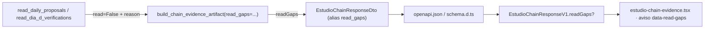

# Evidencia `v2.88.180-beta` — C-1: la ficha distingue «no se pudo leer» de «no hay propuesta», y la certificación viaja con el sello

## 1. Qué publica este sello

Sello de **publicación** sobre `2.11.179-beta` que incorpora el bloque **C-1** (lecturas tipadas de la cadena
durable y `readGaps`) junto con su evidencia, su corrección de test y su certificación de integración:

- **`Δ motor = 0`** · **`Δ decisión = 0`** · contrato HTTP **aditivo** (`readGaps`, opcional) · **SIN migración**
  (`head` sigue `062_sync_settings_check_backfill`).
- **Bump** `2.11.179-beta` → `2.11.180-beta` (+ los **13** `meta.bump`, **14 literales**;
  `test_dia_d_bump_guard` **2 passed**; el literal congelado `2.11.0-beta` de `v2_87` no se toca).
- **Pin PAPER re-anclado DESPUÉS del bump**: `apps` `7c49d5805f4a15a11540f1b23e419e9b87e71774` / `packages`
  `ce8fbc6a9a8de21e3df4ebb9c9e134528894060d` → **`freeze OK`** (commit `acaab362`).

El hueco: el lector durable devolvía «sin propuestas» cuando la lectura **fallaba**, así que un error transitorio
de PostgreSQL —o un esquema sin la migración `058`— quedaba indistinguible de una ausencia legítima. La ficha
afirmaba `not_proposed` sobre un hecho que **no se había medido**. Ahora cada etapa declara su estado de lectura
y la atribución de un ciclo cuyas propuestas no se pudieron leer es `unmeasured`, **nunca** `not_proposed`.

## 2. Qué certifica y qué NO (límites nombrados)

| Límite | Situación | Consecuencia |
| --- | --- | --- |
| `L-180-1` | la matriz PG combinada de [`../certificacion-pg-c1-ds1-o2-2026-11-03/README.md`](../certificacion-pg-c1-ds1-o2-2026-11-03/README.md) (28 pruebas, 4 ficheros) se midió sobre un árbol que **también** contenía DS-1 y O-2 | este sello acredita **solo** las filas de C-1 (1, 1b, 6, 6b, 6c, 6d) con **un** gate; las demás filas son evidencia de su árbol, no de este tag |
| `L-180-2` | la corrección del test multiproceso corrige el **test**, no el producto | no se lee como nueva certificación del mecanismo productivo de reservas |
| `L-180-3` | `readGaps` cubre las etapas **con lector tipado** | toda etapa nueva de la cadena debe traer su contrato de lectura y sus pruebas; el campo no se hereda por existir |
| `L-180-4` | el dwell de FASE 2 sigue **fijo en 30 s** | es la ventana en la que un reemplazo defectuoso apilaría una segunda reserva/orden; no se parametriza sin prueba de seguridad |

**No están en este árbol:** `DS-1` (`scan_job_lease.py`, `test_scan_job_lease_pg.py`, `test_scan_job_lease_heartbeat.py`),
`O-2` (`record_outcomes_in_savepoint` y `test_estudio_daily_proposal_savepoint_pg.py`), `H-1` y `GP-V190`. Sus
ficheros siguen sin commitear en el árbol de trabajo de desarrollo y **no** forman parte de este tag.

## 3. Reparto por commit

Base: `0f3ac4a7` (`docs(evidence): aislamiento de bolsa_v1 re-verificado tras el sello`, tronco de `.179`).

| Commit | Qué es | Alcance |
| --- | --- | --- |
| `178351ff` | `fix(auto,web)`: C-1 publica `readGaps` y la ficha distingue «no leído» de «sin propuesta» | 14 ficheros, `+868/−27` |
| `bfdbd5f2` | `docs(evidence)`: contrato `readGaps` de la cadena (addendum §10 de `v2.88.131`) | 1 fichero, `+86/−1` |
| `504b1184` | `test(auto)`: el exactly-once multiproceso espera la materialización real | 1 fichero, `+85/−20` |
| `df7d7a02` | `docs(evidence)`: diagnóstico de la deuda multiproceso | 2 ficheros, `+363` |
| `5b434755` | `docs(evidence)`: cierre del flaky de `lab discovery` | 1 fichero, `+67` |
| `78e20615` | `docs(dictamen)`: cierre del plan C-1 y sus dos deudas | 1 fichero, `+163` |
| `1c221cd5` | `test(auto)`: el pipeline declarativo prueba determinismo entre corridas | 1 fichero, `+59` |
| `c9eaeeaf` | `ci(release,python)`: certifica `readGaps` (C-1) en el CI del tag | 2 ficheros, `+44` |
| `e670729f` | `docs(evidence)`: acota la certificación PG combinada al sello `.180` | 1 fichero, `+9` |
| `9b5b8432` | `chore(release)`: bump `2.11.180-beta` | 15 ficheros, `+78/−15` |
| `acaab362` | `chore(window)`: re-ancla el pin PAPER | 1 fichero, `+11/−3` |

Dos piezas que la evidencia de C-1 citaba y que **no** viajaban en los commits del dictamen se incorporan aquí de
forma explícita: el **test de determinismo** del flaky (`1c221cd5`) y el **cableado de CI** de C-1 (`c9eaeeaf`).
Sin ellas el sello habría publicado una evidencia que su propio árbol no contenía.

## 4. El contrato `readGaps`

Propagación (aditiva, `schemaVersion` **no** sube):



| Valor en `readGaps[etapa]` | Significado | Efecto |
| --- | --- | --- |
| `null` | etapa **medida**, sin hueco de lectura | no se pinta aviso |
| clave **ausente** | servidor **anterior** a C-1 | no se inventa un fallo y **no** se lee como «todo medido» |
| motivo no vacío (`proposals_unreadable`, `dia_d_unreadable`) | hueco de **lectura** | la ficha declara la etapa y el motivo |
| motivo o etapa **desconocidos** | contrato ampliado por el servidor | se conservan y se muestran **crudos** |
| cadena vacía o solo espacios | no es un motivo | se trata como medida |

Reglas duras, todas con prueba:

- **`unmeasured` ≠ `not_proposed`.** Un ciclo sin enlaces legibles se atribuye `unmeasured` con
  `reason = proposals_unreadable`.
- **El veredicto del journal no se degrada.** Un `exact` ya sellado se mantiene; el hueco viaja por su canal.
- **La lectura va sellada en `SAVEPOINT`**, con uno **por etapa**: en PostgreSQL un statement fallido aborta la
  transacción de la sesión, y esa sesión es la del tick. Un fallo DÍA-D no vacía el enlace de propuestas ni al
  revés.
- **Control negativo.** Si la lectura **sí** ocurrió y no hay propuestas, la respuesta sigue siendo
  `not_proposed`: el hueco no se usa como excusa para no afirmar lo medido.

## 5. El test multiproceso: corrección del test, no del producto

`.179` exigía `released_qty > 0` **con** cola viva. Esa condición acierta en el fill parcial, pero con un fill
**completo** la reserva queda `RELEASED_BY_FILL` con `remaining_qty = 0`: el bucle **no rompía nunca** y agotaba
los 80 s de presupuesto — los **114,31 s** del job `lifecycle-pg` en el tag `.179`.

Este sello espera el hecho que el test realmente asserta:

```python
if released > 0 and released + remaining == requested:
    return True
```

- `released > 0` ⇒ hay al menos una trancha materializada (lo que se asserta).
- `released + remaining == requested` ⇒ la contabilidad está cerrada, que el libro mantiene en **cada**
  liberación (también con `released = 0`), así que no se espera un estado que el producto no prometa.

El camino real escribe en **dos transacciones**: primero se confirma la posición
(`sim_auto_positions`) y después se libera la reserva (`portfolio_reservations`). Entre ambas existe un estado
durable y legítimo (`released = 0`, `remaining = pedido`) que el proxy anterior tomaba por «carrera resuelta».
No se tocan reservas ni fills: la ventana es deliberada y la reconcilia el arranque.

## 6. Verificación medida (local, 2026-11-03)

Windows 10.0.26200 · `.venv` Python 3.12.13 · `psycopg` 3.3.4 · PostgreSQL 16.14 en `127.0.0.1:5432` · base
`bolsa_v1`. Cada fila es una ejecución distinta; no se suman.

| Comprobación | Comando | Salida |
| --- | --- | --- |
| C-1 contra PostgreSQL real | `AUTO_CHAIN_READ_GAPS_PG_REQUIRED=1 pytest apps/api-python/tests/test_auto_chain_read_gaps_pg.py -q -rs` | **6 passed in 2,36 s** (0 skipped) |
| Exactly-once multiproceso | `AUTO_MULTIPROCESS_PG_REQUIRED=1 pytest apps/api-python/tests/test_auto_v46_multiprocess_pg.py -q` | **2 passed in 36,09 s** (`.179`: 114,31 s) |
| Determinismo del pipeline declarativo | `pytest packages/py/application/tests/test_lab_discovery_dispatch.py -q` | **9 passed in 179,06 s** |
| Bump + censo de tests + wiring `a7-gate` | `pytest test_dia_d_bump_guard.py test_ci_test_selection_census.py test_release_tag_ci_a7_gate_wiring.py -q` | **12 passed** |
| Ruff (como CI) | `ruff check packages/py apps/api-python --config pyproject.toml` | **All checks passed** |
| Tests `shared` | `pnpm --filter @bolsa/shared test` | **891 passed** (1 todo) |
| TypeScript `shared` / `web` | `pnpm --filter @bolsa/shared typecheck` · `pnpm --filter @bolsa/web typecheck` | **limpios** |
| Contrato | `pnpm contract:check` | **OK** |
| Pin de ventana | `pnpm window:freeze` · `pnpm window:test` | **freeze OK** · **50 / 50** |
| YAML de los workflows | `yaml.safe_load` sobre los dos ficheros | **válido** |

## 7. Cableado de CI (solo C-1)

| Fichero | Cambio |
| --- | --- |
| `.github/workflows/python-ci.yml` | `--ignore` del fichero en el job `quality`; `AUTO_CHAIN_READ_GAPS_PG_REQUIRED: '1'` en `lifecycle-pg`; el fichero entra en la lista del paso *Pytest A12 PG* |
| `.github/workflows/release-tag-ci.yml` | `--ignore` en el job offline; gate en el `env` de `lifecycle-pg`; paso dedicado **`Pytest C-1 readGaps (PG, fail if skipped)`** con `-rs` y paso siguiente que falla si aparece cualquier `SKIPPED` |

Sin el `--ignore`, el fichero aparecería como `skipped` en el job offline y el job diría «verde» sin certificar
nada. Sin el paso dedicado, el gate no tendría dónde ejecutarse. El censo `test_ci_test_selection_census.py`
sigue verde: el fichero se **ejecuta**, no queda invisible.

## 8. Ficheros del sello

| Capa | Ficheros |
| --- | --- |
| Dominio / lector (`178351ff`) | `packages/py/application/src/bolsa_application/auto_chain_durable_reader.py`, `packages/shared/src/estudio-daily-ops.ts`, `packages/shared/src/estudio-daily-summary.ts` |
| API y contrato | `apps/api-python/src/bolsa_api/api/v1/routes/auto_estudio_chain.py`, `apps/api-python/scripts/v2_100_operational_certification_evidence.py`, `apps/web/api/openapi.json`, `apps/web/src/api/schema.d.ts` |
| UI | `apps/web/src/features/auto-monitor/estudio-chain-evidence.tsx` |
| Pruebas | `apps/api-python/tests/test_auto_chain_read_gaps_pg.py` (**nuevo**, 6 tests), `test_operational_certification_evidence.py`, `packages/py/application/tests/test_auto_chain_durable_reader.py`, `packages/shared/src/estudio-daily-ops.test.ts`, `estudio-daily-summary.test.ts`, `apps/web/src/features/auto-monitor/estudio-daily-ops-panel.test.tsx`, `apps/api-python/tests/test_auto_v46_multiprocess_pg.py`, `packages/py/application/tests/test_lab_discovery_dispatch.py` |
| CI | `.github/workflows/python-ci.yml`, `.github/workflows/release-tag-ci.yml` |
| Bump y pin | `package.json`, `CHANGELOG.md`, `v2_87` (banda financiera) + `v2_89`…`v2_100`, `scripts/lib/window-forward.mjs` |

## 9. Qué NO certifica este documento

- **Las suites completas sobre este árbol**: las re-mide el `Release tag CI` del tag, no este README. Las cifras
  de §6 son del árbol de trabajo en el momento de sellar y no se heredan a ningún otro tag.
- **Rentabilidad ni operativa**: AUTO sigue **OFF** y PAPER sigue **INCONCLUSIVE**; un sello de publicación no
  añade evidencia de resultados.
- **DS-1, O-2, H-1 y GP-V190**: fuera de este tag (§2).
- **El mecanismo productivo de reservas**: la corrección es del test (§5, `L-180-2`).

## 10. POST-TAG — el CI del tag quedó **ROJO**, y la causa es del propio sello

> **Veredicto:** `Release tag CI` **41683440085** → **`failure`**. **No se crea GitHub Release.** El tag
> `v2.88.180-beta` (objeto `037c3656`, commit `92d66fc4`) queda **publicado y rojo**, como quedaron `.177` y
> `.178`; se documenta aquí en vez de reescribir el tag (un tag es inmutable: moverlo rompería la
> reproducibilidad del expediente).

| Job | Resultado |
| --- | --- |
| `decision-spine`, `security`, `frontend`, `shared`, `playwright` (×4), `a7-gate`, `dr-verify`, `replay-repro` | **success** |
| **`lifecycle-pg`** — incluidos **`Pytest C-1 readGaps (PG, fail if skipped)`** y **`Fail on skipped C-1 readGaps`** | **success** |
| **`python (ruff/imports/mypy/pytest offline)`** | **failure** (3 `FAILED`) |
| **`certify (aggregate + artifact)`** | **failure** (agrega el anterior) |

**Lo que sí quedó certificado en el tag:** el paso dedicado de C-1 corrió y **pasó** en `lifecycle-pg` (junto con
su guarda anti-`SKIPPED`, que no disparó). La certificación de C-1 sobre PostgreSQL real es, por tanto, verde en
el tag; lo que falló es otra cosa.

**La causa.** En el commit `c9eaeeaf` se insertaron **comentarios `#` dentro del bloque plegado `run: >`** de la
lista de `--ignore` de dos workflows. En un escalar plegado cada línea es **texto del comando**, así que el `#`
convirtió en comentario de shell **todo lo que venía detrás**: la lista de exclusiones se truncó en silencio y el
job offline se puso a recoger ficheros que exigen PostgreSQL. Es exactamente el riesgo que el propio
`release-tag-ci.yml` documenta desde V2.40.2 (líneas 857-864 del fichero) y que `python-ci.yml` arrastra igual.

| Workflow | `--ignore` declarados | honorados | **descartados por el `#`** | Efecto medido |
| --- | --- | --- | --- | --- |
| `release-tag-ci.yml` (job `python`) | 92 | 48 | **44** | 3 `FAILED` (`test_f3b_alembic_data_epoch`, `test_mandate_sync_orphan_instrument` ×2) |
| `python-ci.yml` (job `quality`) | 97 | 52 | **45** | 6 `FAILED` (los 3 anteriores + 3 de `chaos/live_a7`) |

Los tres fallos son `sqlalchemy.exc.OperationalError: connection refused` a `127.0.0.1:5432`: ficheros que
**necesitan** PostgreSQL ejecutándose en un job que **no tiene servicio de PostgreSQL**. No son un fallo de C-1 ni
de producto: es el cableado el que dejó de aislar.

**Runs afectados (mismo defecto, mismo commit `c9eaeeaf`):**

| Run | Workflow | Rama/tag | Resultado |
| --- | --- | --- | --- |
| [41683440085](https://github.com/jvelasca/Bolsa_V1/actions/runs/41683440085) | `Release tag CI` | `v2.88.180-beta` | **failure** |
| [41683439960](https://github.com/jvelasca/Bolsa_V1/actions/runs/41683439960) | `Python CI` | `v2.88.180-beta` | **failure** |
| [41683396573](https://github.com/jvelasca/Bolsa_V1/actions/runs/41683396573) | `Python CI` | `seal/v2.88.180-beta` | **failure** |

**Corrección (sello `.181`, sin reabrir C-1):** mover esos comentarios **fuera** del bloque `run: >` (como ya hace
la nota V2.40.2 del propio fichero) restaura la lista completa de exclusiones; y añadir una prueba que **impida la
recaída** —el hazard ya se documentó una vez y volvió a entrar—, de modo que un `#` dentro de un `run: >` falle en
CI local en vez de degradar el job en silencio. El contenido funcional de C-1 **no** se toca: este sello ya lo
certificó en `lifecycle-pg`.

