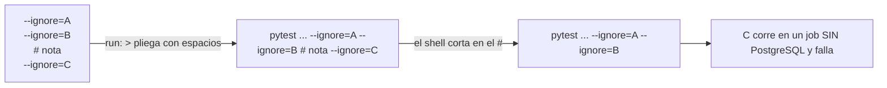

# Evidencia `v2.88.181-beta` — sello corrector del cableado de C-1

## 1. Qué es este sello

Sello **corrector** sobre `2.11.180-beta`. No publica funcionalidad nueva: corrige **el cableado de CI** que dejó
rojo el tag anterior y añade la prueba que impide la recaída.

- **`Δ motor = 0`** · **`Δ decisión = 0`** · **`Δ contrato HTTP = 0`** · **SIN migración** (`head` sigue
  `062_sync_settings_check_backfill`).
- **Bump** `2.11.180-beta` → `2.11.181-beta` (+ **13** `meta.bump`, **14 literales**; el literal congelado
  `2.11.0-beta` de `v2_87` se queda como está) y `test_dia_d_bump_guard` **2 passed**.
- **Pin PAPER re-anclado después del bump**: `apps` `95dbcdb0…` / `packages` `ce8fbc6a…` → **`freeze OK`**;
  `window:test` **50 / 50**.

## 2. Por qué existe: el rojo de `.180`

`Release tag CI` [41683440085](https://github.com/jvelasca/Bolsa_V1/actions/runs/41683440085) sobre
`v2.88.180-beta` → **`failure`**. Lo relevante es **dónde** falló:

| Job | Resultado |
| --- | --- |
| `lifecycle-pg` — con `Pytest C-1 readGaps (PG, fail if skipped)` y `Fail on skipped C-1 readGaps` | **success** |
| `python (ruff/imports/mypy/pytest offline)` | **failure**: 3 `FAILED` por `connection refused` a PostgreSQL |
| `certify (aggregate + artifact)` | **failure** (agrega el anterior) |

La certificación de C-1 sobre PostgreSQL real **sí** quedó verde en el tag. Lo que falló fue el aislamiento del job
offline.

## 3. El mecanismo (por qué es silencioso)

En YAML, un escalar **plegado** (`run: >`) une cada línea con espacios para formar **un solo comando**. Un `#`
dentro del bloque **no** es un comentario YAML: es el inicio de un comentario de **shell** y comenta todo lo que
viene detrás en esa misma línea de comando. En una lista de `--ignore`, eso borra las exclusiones posteriores
**sin ningún error de sintaxis**.

| Workflow | `--ignore` declarados | honorados | descartados | Fallos |
| --- | --- | --- | --- | --- |
| `release-tag-ci.yml` (job `python`) | 92 | 48 | **44** | 3 |
| `python-ci.yml` (job `quality`) | 97 | 52 | **45** | 6 (incluye 3 de `chaos/live_a7`) |

Runs afectados por el mismo commit (`c9eaeeaf` de `.180`): `41683440085` (`Release tag CI`),
`41683439960` (`Python CI`, tag) y `41683396573` (`Python CI`, rama).

El hazard **ya estaba documentado en el propio repositorio** desde V2.40.2: `release-tag-ci.yml` lleva un bloque de
comentarios que empieza con «V2.40.2: estos comentarios van FUERA del bloque plegado…». El cableado de C-1 lo
reintrodujo por la puerta de atrás, lo que demuestra que la documentación sola no basta como control.

## 4. La corrección

1. Los **seis** comentarios salen del bloque plegado y pasan a las líneas del **step** (por encima de `run: >`),
   donde son comentarios YAML legítimos. Las listas de `--ignore` quedan intactas: **92** y **97**.
2. Nuevo [`apps/api-python/tests/test_workflow_folded_run_comments.py`](../../../apps/api-python/tests/test_workflow_folded_run_comments.py):
   - recorre los workflows con la **indentación real** —no con el YAML ya parseado, que perdería la distinción
     entre plegado (`>`) y literal (`|`) y no podría ver el problema—;
   - **falla** ante cualquier `#` dentro de un `run: >`, citando fichero y línea;
   - exige que las listas de `--ignore` de los dos workflows no tengan comentarios intercalados;
   - ancla `test_auto_chain_read_gaps_pg.py` en el `--ignore` offline de ambos (si desaparece, el job offline
     volverá a romperse, porque ese fichero no lleva `skip` con el gate activo);
   - incluye **control negativo** del descubrimiento: si el escáner dejara de ver los workflows, la prueba
     fallaría en vez de pasar en vacío.

## 5. La guarda es falsable (no pasa por construcción)

El mismo algoritmo, aplicado a los dos árboles:

| Árbol | `release-tag-ci.yml` | `python-ci.yml` | Veredicto |
| --- | --- | --- | --- |
| `v2.88.180-beta` (rojo) | 92 declaradas / **48** honoradas, `#` presente | 97 / **52**, `#` presente | **FALLA** |
| `v2.88.181-beta` (este) | 92 / **92**, sin `#` | 97 / **97**, sin `#` | **OK** |

La comprobación se hizo con las reglas reales de YAML (plegado y después tokenizado con `shlex`, que es lo que ve
el shell), no con una búsqueda de texto.

## 6. Verificación medida (local, 2026-11-03)

| Comprobación | Comando | Salida |
| --- | --- | --- |
| Guarda nueva | `pytest apps/api-python/tests/test_workflow_folded_run_comments.py -q` | **4 passed** |
| Wiring `a7-gate` + censo de selección | `pytest test_release_tag_ci_a7_gate_wiring.py test_ci_test_selection_census.py -q` | **10 passed** |
| Bump | `pytest apps/api-python/tests/test_dia_d_bump_guard.py -q` | **2 passed** |
| Ruff | `ruff check apps/api-python/tests/test_workflow_folded_run_comments.py --config pyproject.toml` | **All checks passed** |
| Contrato | `pnpm contract:check` | **OK** |
| Pin de ventana | `pnpm window:freeze` · `pnpm window:test` | **freeze OK** · **50 / 50** |
| YAML de los workflows | `yaml.safe_load` sobre los dos ficheros | **válido** |
| Plegado real del comando | plegado + `shlex.split` | **92 / 92** y **97 / 97**, sin `#` |

**Nota sobre PostgreSQL en esta máquina.** Al sellar `.181` el servicio PostgreSQL local estaba **parado** (puerto
5432 cerrado), así que **no** se re-ejecutaron aquí los 6 tests de C-1. No se pierde cobertura: esa certificación
ya quedó **verde en `lifecycle-pg`** del tag `.180` y este árbol **no toca producto** (solo dos workflows, una
prueba nueva, el bump y el pin). El `Release tag CI` de `.181` la vuelve a ejecutar con PostgreSQL real en el
mismo paso `Pytest C-1 readGaps (PG, fail if skipped)` con guarda anti-skip.

## 7. Qué NO cambia este sello

- **C-1 no se reabre**: `readGaps`, la atribución `unmeasured` y la ficha son las de `.180`, y su certificación PG
  ya quedó **verde** en `lifecycle-pg`. Los límites `L-180-1`…`L-180-4` siguen vigentes.
- **`.180` sigue publicado y rojo**: un tag no se reescribe. Este sello es su corrección, como `.179` lo fue de
  `.178`.
- **DS-1, O-2, H-1 y GP-V190 siguen fuera** de este árbol.
- **Aviso para el WIP de desarrollo**: el árbol de trabajo de `fix/059-060-proveedores` tiene el **mismo hazard**
  (tres comentarios dentro del bloque plegado) en su cableado pendiente. La guarda nueva lo detectará **en cuanto
  se commitee**; no forma parte de este sello porque no está en este árbol.

## 8. Reparto por commit

Base: `99171b8d` (POST-TAG de `.180`).

| Commit | Qué es | Alcance |
| --- | --- | --- |
| `2b84e0c3` | `fix(ci)`: saca los comentarios del bloque plegado y vigila la recaída | 3 ficheros, `+167/−6` |
| `0283e93c` | `chore(release)`: bump `2.11.181-beta` | 15 ficheros, `+61/−15` |
| `71d04e6c` | `chore(window)`: re-ancla el pin PAPER | 1 fichero, `+10/−2` |

## 9. POST-TAG

Se completa en un descendiente del tag (el acto no se certifica a sí mismo):

| Dato | Valor |
| --- | --- |
| Objeto del tag | pendiente de medir |
| Commit apuntado | pendiente de medir |
| `Release tag CI` | pendiente de medir |
| Job `python (… pytest offline)` | pendiente de medir |
| Job `lifecycle-pg` (`Pytest C-1 readGaps`) | pendiente de medir |
| GitHub Release | pendiente de medir |
