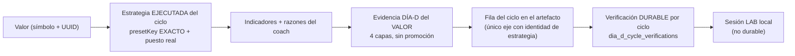

# Explicación P3→P4 de la estrategia seleccionada y qué es un «día operable»

> **AsOf:** 2026-10-16 · **package** `2.11.137-beta` · **Alembic head** `055_dia_d_identity_nullable` (**sin migración**) ·
> **`Δ motor = 0` · `Δ decisión = 0` · `Δ contrato HTTP = 0`** · **sin tag nuevo**.
> **Naturaleza:** read-model puro de UI (`apps/web`) + identidad de la etapa `EXPLANATION` en `@bolsa/shared` + documentación.
> **Este incremento NO demuestra rentabilidad** y **no** cierra la ventana PAPER (ADR-046), que sigue `INCONCLUSIVE`.

---

## 1. Qué es un «día operable» (y qué NO es)

Un día operable **no** es «la app funciona» ni «la API responde». Es una condición **medida** del
**gate de régimen** de ADR-046:

| Paso | Dónde | Qué hace |
| --- | --- | --- |
| 1 | `v2_76_forward_market_material.py --preflight-only` | Clasifica **cada** valor del watch (`classify_market_regime`) y **agrega al veredicto más conservador presente** |
| 2 | `aggregate_trial_regime` ([`auto_v2_entry.py`](../../packages/py/application/src/bolsa_application/auto_v2_entry.py)) | Prioridad conservadora: `high_vol` → `trend_down` → `range` → `trend_up` → `low_vol`. Sin ningún régimen clasificable ⇒ `NO_REGIME` (**fail-closed**) |
| 3 | `map_trial_regime` + `regime_allows_entry_for` ([`market_regime_gate.py`](../../packages/py/analytics/src/bolsa_analytics/cognitive/market_regime_gate.py)) | `trend_down` ⇒ `BEAR_TREND`; un LONG **no** se abre en `BEAR_TREND` |
| 4 | [`window-forward-runner.mjs`](../../scripts/window-forward-runner.mjs) | Traduce el resultado a vocabulario operativo |

La traducción es **unívoca** y está en el propio CLI (`v2_76`, §`main`):

```text
exit 0  con payload  ⇒  entradas LONG PERMITIDAS  ⇒  día OPERABLE
exit 2  con payload  ⇒  eje operativo VETA LONG   ⇒  se DECLARA `NO_MEDIDO_REGIMEN`
exit 2  SIN payload  ⇒  FALLO DURO (el intérprete no arrancó), NO es un veto
```

**Una sola** etiqueta `trend_down` en el watch hace que el agregado sea `trend_down` ⇒ `BEAR_TREND`
⇒ **todas** las LONG vetadas. Es la regla **más conservadora**: no se promedia ni se vota; un solo
valor en tendencia bajista confirmada bloquea el eje. `v2_76` documenta además que
`--preflight-only` **no escribe** (no siembra cuenta ni material).

### La trampa: operable ≠ medido

Un día **operable** sin `fill` **no** crea día. La ventana PAPER se construye del **material
durable** (`fills ∪ cycles ∪ journal`), no del permiso de régimen: ver
[`ventana-paper-no-medido-v2.88.11-2026-09-30.md`](./ventana-paper-no-medido-v2.88.11-2026-09-30.md) §9.
Es decir: el gate puede **permitir** y el día seguir **sin medirse**; y un veto de régimen **no** es
un fallo del sistema, es un veto legítimo del **mercado**.

## 2. Medición de hoy (`2026-10-16`, read-only)

```text
node scripts/window-forward-runner.mjs preflight      # exit 0: declara NO_MEDIDO_REGIMEN y NO fuerza el gobernador
  └─ v2_76 --preflight-only --watch-from-estudio      # exit 2 (veto legítimo, con payload válido)

[window] preflight: eje BEAR_TREND · LONG VETADAS (exit 2)
[window] veto de regimen legitimo: se DECLARA NO_MEDIDO_REGIMEN; no se fuerza el gobernador

{
  "mode": "preflight",
  "phase": "V2.76 AUTO-MATERIAL-4 MARKET MATERIAL FORWARD",
  "venue": "paper",
  "level": "evidence",
  "minBars": 60,
  "minCyclesPerStrategy": 32,
  "watchSize": 35,                 // watchA 18 + watchB 17
  "watchSource": "estudio",
  "account": "(no sembrada: el preflight no escribe)",
  "marketRegime": {
    "aggregateTrialRegime": "trend_down",
    "operationalRegime": "BEAR_TREND",
    "entriesAllowedLong": false,
    "counts": { "trend_down": 23, "range": 7, "trend_up": 5 },
    "barsLoaded": 35,
    "bySymbol": { "…": "trend_down | range | trend_up" }   // 35 símbolos del watch
  }
}
```

**Veredicto: hoy `2026-10-16` NO es un día operable.** Lo que está operativo es la **aplicación**
(p. ej. `/paper-desk/daily-report?asOf=2026-10-16`), no el día. Con 23 de 35 valores en
`trend_down` el eje queda en `BEAR_TREND` y el motor **veta** las LONG `fail-closed`: lanzar el
forward hoy produciría `cycles = 0` (un día de calendario **vacío**), no progreso hacia el gate.

> La conclusión es la del **dato**, no la de la opinión: si el preflight devolviera `exit 0`, la
> conclusión se corregiría. Se vuelve a medir cada día; el resultado se **declara**, no se supone.

## 3. La cadena P3→P4 que ahora se explica junta



Dos superficies, **una** explicación coherente:

| Superficie | Qué añade |
| --- | --- |
| Tarjeta **P3** «Estrategia que sustenta la señal» (`auto-operation-strategy-card.tsx`) | Bloque nuevo **«Por qué se sostiene (evidencia medida)»**: estrategia ejecutada, alcance real de la evidencia, verificación durable, contadores + suelos, las 4 capas y la sesión LAB |
| Fila **`EXPLANATION`** del story panel (`auto-operation-story-panel.tsx`) | Identidad con la clave **EXACTA** del ciclo (`estrategia (clave)`) y la nota de resolución reescrita: la evidencia agregada es del **VALOR** |

Piezas **puras** y reutilizadas (no se duplica nada de lo ya certificado):

- [`auto-strategy-dia-d-explanation.ts`](../../apps/web/src/features/auto/auto-strategy-dia-d-explanation.ts) — compositor (nuevo).
- [`auto-strategy-dia-d-evidence.tsx`](../../apps/web/src/features/auto-monitor/auto-strategy-dia-d-evidence.tsx) — presentacional (nuevo).
- `buildDiaDEvidenceAggregate` (4 capas sin promoción), `resolveDiaDCycleVerificationState` (tri-estado), `useAutoDiaDFeedbackList` / `useDiaDCycleVerifications` (lectura), `absent-data` (vocabulario de hueco), `MeasurementValue` (valor + medición).

## 4. Las cuatro capas y lo que **no** son equivalentes

| Capa | Token | Qué mide | **No** implica |
| --- | --- | --- | --- |
| Ventana operativa | `READY` / `INCONCLUSIVE` | días, episodios y ciclos suficientes | que el contraste cuadre |
| Declarado frente a ejecutado | `MATCH` / `PARTIAL` / `DIVERGENT` | lo declarado en el replay frente a lo ejecutado | evidencia **fuera de muestra** |
| Evidencia fuera de muestra | `OOS_SUPPORTED` / `MIXED` / `REFUTED` | evidencia OOS del replay (por símbolo) | **ejecución real** |
| Evidencia de ejecución real | — (**reservada**) | ejecución real | **nunca se emite** ⇒ el veredicto global es siempre **NO CONFIRMADO** |

`CONFIRMED` **no** existe en el código: el agregado devuelve el tipo literal `"NO_CONFIRMED"`
([`dia-d-evidence-aggregate.ts`](../../apps/web/src/features/auto-monitor/dia-d-evidence-aggregate.ts)).
La capa PAPER es un **hueco por contrato** (no hay rama que la mida).

`UNKNOWN ≠ 0`: un contador ausente viaja `null` y se rotula con el vocabulario de
[`absent-data.ts`](../../apps/web/src/components/absent-data.ts) («Sin dato todavía» / «No
disponible»). El rollup OOS **exige los tres recuentos** (`oosSupported`/`mixed`/`refuted`) y
`notMeasured === 0` antes de afirmar el veredicto: sin ellos la capa se declara **hueco**
conservando su línea de medición parcial.

## 5. Suelos de muestra (declarados, no relajados)

Los suelos viajan en el artefacto (`values[].limits`) y la UI los **copia**: no se reinterpretan ni
se relajan aquí. La fuente única de los valores es
[`dia_d_auto_feedback.py`](../../packages/py/application/src/bolsa_application/dia_d_auto_feedback.py)
(`MIN_VALUE_CYCLES = 5` · `MIN_VALUE_HIT_RATE = 0.5` · `EVIDENCE_SUPPORTED_MIN_CYCLES = 20` ·
`EVIDENCE_STRONG_MIN_CYCLES = 32`, emitidos como `limits` en el DTO):

| Suelo | Valor |
| --- | --- |
| `minCycles` (ciclos mínimos por valor) | **5** |
| `minHitRate` | **0.5** |
| `supportedMinCycles` (para «soportado») | **20** |
| `strongMinCycles` (para «fuerte») | **32** |

`minCyclesPerStrategy = 32` es además el suelo del **gate de la ventana** (ADR-046) que aparece en
el payload del preflight: un instrumento por debajo del suelo **no** puede sostener el veredicto, y
el hueco se declara en vez de afirmarse.

## 6. Atribución honesta: del **VALOR** frente de la **ESTRATEGIA**

El artefacto DÍA-D agrega su veredicto **por `symbol`**. En `values[]` **no hay identidad de
estrategia**; la identidad sólo existe en `cycles[]` (`strategyPresetKey`, `strategyVersion`) y en
la tabla durable `dia_d_cycle_verifications`. Por eso:

- Evidencia **por ciclo** (fila exacta de `cycles[]` enlazada a `cycleId`) ⇒ se etiqueta
  **«Del ciclo (exacta)»**.
- Evidencia **agregada** ⇒ se etiqueta **«Del valor (no de la estrategia)»**, con la nota: *«La
  evidencia se agrega por valor (símbolo): NO es atribuible a una estrategia concreta. Lo único
  exacto es la fila del ciclo enlazado.»*

La estrategia se da por **declarada por el ciclo** sólo con **clave exacta** (`presetKey`) **y**
emparejamiento exacto con el TOP del valor (`match === "same"`); en cualquier otro caso la
atribución se declara `false`. La etapa `EXPLANATION` de `@bolsa/shared` gana el hecho
`estrategia (clave)` para poder afirmarlo (o declarar el hueco, nunca fingir la identidad).

**Sesión LAB:** vive en `localStorage` (`bolsa-dia-d-trading-session-v1`) y se declara **local, no
durable**. La evidencia durable es la verificación enlazada al ciclo. La sesión sólo se da por
**vinculada a esta operación** con identidad **completa y exacta** en los **tres** espacios de
claves — instrumento (UUID), cuenta (UUID) y estrategia (`presetKey`); un hueco en cualquiera de
ellos, o una diferencia, deja la sesión **no vinculada** (`active = false`). Nunca se sustituye una
identidad por otra (no se usa el `definitionId` como clave) ni se atribuye una sesión de otro
instrumento, de otra cuenta o de otra estrategia.

## 7. Invariantes falsables (y dónde viven)

| Invariante | Test |
| --- | --- |
| Identidad exacta (clave + emparejamiento) o hueco; nunca se cae al #1 | [`auto-strategy-dia-d-explanation.test.ts`](../../apps/web/src/features/auto/auto-strategy-dia-d-explanation.test.ts) |
| La evidencia se declara del **VALOR** y el alcance exacto es el **ciclo** | ídem |
| Sin promoción: las 4 capas, PAPER como hueco, `NO_CONFIRMED` | ídem + [`dia-d-evidence-aggregate.test.ts`](../../apps/web/src/features/auto-monitor/dia-d-evidence-aggregate.test.ts) |
| `UNKNOWN ≠ 0` (contadores ausentes ⇒ `null`; `0` medido viaja `0`) | ídem |
| Fallo de lectura ⇒ «No disponible»; `loading` ⇒ hueco **transitorio** | ídem + [`auto-operation-strategy-card.test.tsx`](../../apps/web/src/features/auto-monitor/auto-operation-strategy-card.test.tsx) |
| Tri-estado de verificación (`linked` / `not-verified` / `unknown`) | ídem + [`dia-d-cycle-verification-status.ts`](../../apps/web/src/features/auto-monitor/dia-d-cycle-verification-status.ts) |
| Fallo de lectura de verificaciones ⇒ «No disponible» (`unknown`), nunca «Sin verificación» | ídem |
| Sesión LAB sólo vinculada con instrumento + cuenta + clave EXACTA (fail-closed ante cualquier hueco) | ídem |
| La clave EXACTA del ciclo llega a la fila `EXPLANATION` y la nota declara el alcance | [`auto-operation-story.test.ts`](../../packages/shared/src/cognitive/auto-operation-story.test.ts) + [`auto-operation-story-panel.test.tsx`](../../apps/web/src/features/auto-monitor/auto-operation-story-panel.test.tsx) |

## 8. Pruebas automatizadas (comandos y jobs)

```bash
# shared (identidad de la etapa EXPLANATION)
pnpm --filter @bolsa/shared build && pnpm --filter @bolsa/shared typecheck && pnpm --filter @bolsa/shared test

# web (compositor, bloque y panel)
pnpm --filter @bolsa/web typecheck && pnpm --filter @bolsa/web lint && pnpm --filter @bolsa/web test

# contrato HTTP: se espera VERDE y sin diff (Δ contrato = 0)
pnpm --filter @bolsa/web contract:check

# E2E mock del puente S5 (el mock fija sma_crossover, data-match="same" y el CTA habilitado)
E2E_RUN=1 pnpm --filter @bolsa/web exec playwright test gp-e2e-s5
```

| Job de CI | Qué certifica |
| --- | --- |
| `playwright-mock` ([`release-tag-ci.yml`](../../.github/workflows/release-tag-ci.yml)) | `pnpm e2e -- "gp-e2e\|gp-e2e-s5\|…"` ⇒ el puente S5 **mock**: [`gp-e2e-s5-auto-dia-d-bridge-mock.spec.ts`](../../apps/web/e2e/gp-e2e-s5-auto-dia-d-bridge-mock.spec.ts) (P3 + CTA + hueco declarado sin caer al #1) |
| `playwright-integrated-auto-s5` ([`release-tag-ci.yml`](../../.github/workflows/release-tag-ci.yml)) | `playwright test gp-v288-s5` ⇒ `GP-V288-S5-01..04` sobre **stack real**: [`gp-v288-s5-auto-dia-d-bridge-integrated.spec.ts`](../../apps/web/e2e/gp-v288-s5-auto-dia-d-bridge-integrated.spec.ts) |
| `auto-v2-durable-pg` ([`python-ci.yml`](../../.github/workflows/python-ci.yml)) | `test_dia_d_cycle_verification_pg.py` ⇒ la verificación **durable** por ciclo (upsert atómico, ownership) |
| `lifecycle-pg` (tag) | `test_auto_dia_d_trace_pg.py` ⇒ el ciclo CERRADO por el **proceso scheduler** |

No se añaden ficheros `test_*.py` nuevos: el censo de [`scripts/ci/test_selection.py`](../../scripts/ci/test_selection.py)
(0 sin declarar) no cambia.

## 9. Límites declarados (sin fabricar)

- **No** se toca el motor, los umbrales, `TOP_N`, la allocation, los pesos A/B ni ADR-046.
- La **ventana PAPER** sigue `INCONCLUSIVE` (`0/4 · 0/2 · 0/32`): falta **OPERACIÓN**, no software.
  Este incremento **no demuestra rentabilidad**.
- La evidencia DÍA-D **por valor** no es atribuible a una estrategia concreta con los DTO actuales:
  se declara **parcial** en la UI y se registra como trabajo futuro (exigiría campos de estrategia
  en `values[]` ⇒ cambio de contrato HTTP).
- La **sesión LAB** se muestra como **local, no durable**; la evidencia durable es
  `dia_d_cycle_verifications`.
- La conclusión del §2 es **de la medición de hoy**: se re-mide cada día y se declara el resultado.

@see [`runbook-cierre-p1-p4-2026-10-15.md`](./runbook-cierre-p1-p4-2026-10-15.md) ·
[`ventana-paper-no-medido-v2.88.11-2026-09-30.md`](./ventana-paper-no-medido-v2.88.11-2026-09-30.md) ·
[`docs/PROJECT_PREMISES.md`](../PROJECT_PREMISES.md) §5.2
