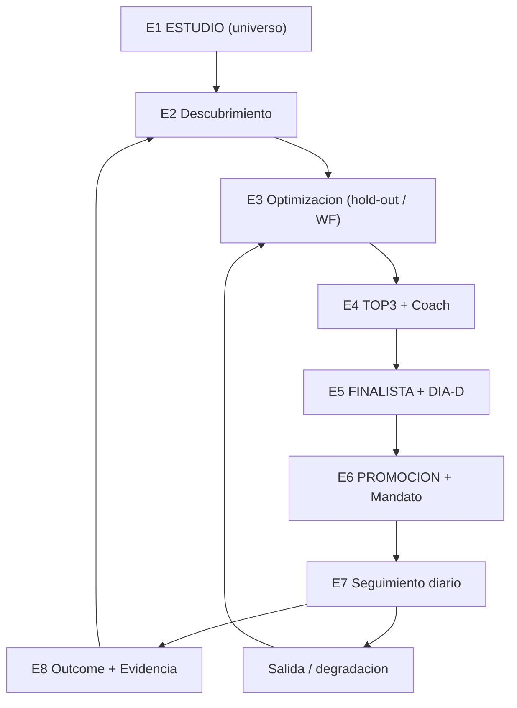
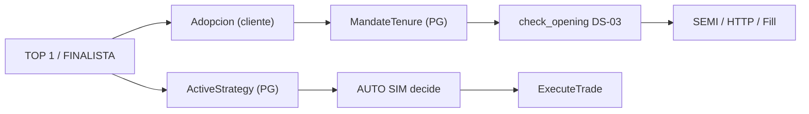
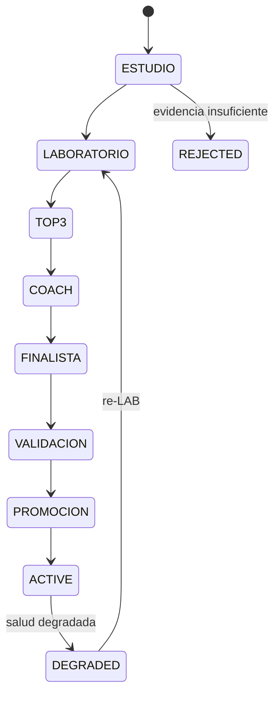
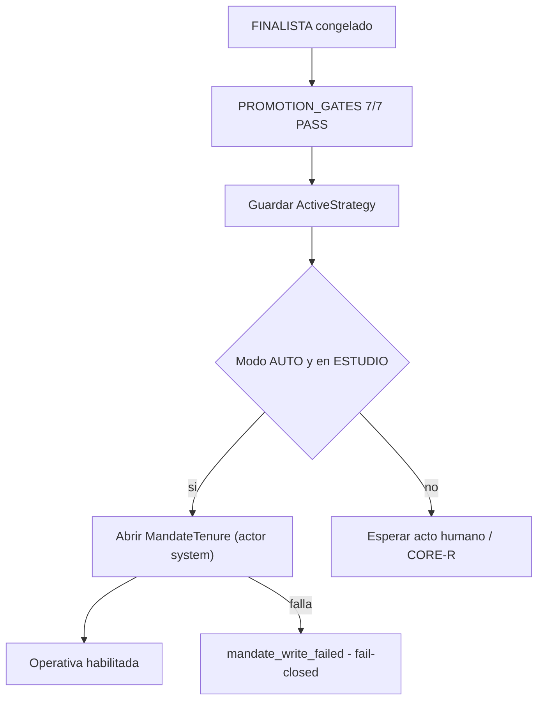

# Operativa secuencial extremo a extremo — diagnóstico y spec canónica (2026-11-13)

> **Padre:** [engineering-index-2026-08-03.md](./engineering-index-2026-08-03.md) §1 (Product / Ops).
> **AsOf:** 2026-11-13 · `HEAD` documental de referencia `bcdc4584` · rama `feat/f4-067-opinion-account-scope`.
> **Alcance:** explica y fija la secuencia completa **indicadores → optimización → mejor → DÍA-D → FINALISTA → mandato → seguimiento en ESTUDIO → entrada/salida → aprendizaje**, y el uso correcto de la IA en cada paso.
> **Naturaleza:** documento de diagnóstico y especificación. **No** modifica código, tests, flags, migraciones ni datos. Lo que aquí se marca TO-BE **no está implementado** salvo que se diga expresamente.

---

## 1. Resumen en 60 segundos

### 1.1 Las siete etapas

| Etapa | Qué produce | Autoridad |
| --- | --- | --- |
| **E1 · ESTUDIO** | universo canónico + presupuesto de búsqueda | lista `estudio` + allocator |
| **E2 · Descubrimiento** | familias/gramática candidatas y trials | motor determinista |
| **E3 · Optimización** | grid hold-out/WF por candidata | LAB determinista |
| **E4 · Selección** | TOP3 + dictamen del Coach | ranking local + auditoría dual |
| **E5 · FINALISTA + DÍA-D** | versión inmutable + replay D→hoy | promotion gates |
| **E6 · Promoción y mandato** | `ActiveStrategy` + `MandateTenure` | gate de 7 condiciones |
| **E7 · Seguimiento** | opinión EOD → `propose` → plan → fill → salida → outcome | worker diario + SIM |

### 1.2 Las cuatro rupturas que explican lo que se ve en pantalla

1. **«No existe todavía un plan operativo»** no significa «no se ha analizado». Significa que el último `propose` del valor no dejó un `TradePlan` en `ARMED`/`TRIGGERED` con stop estructural válido. Un plan `WATCH` —que sí es un plan— se pinta igual que la ausencia de plan.
2. **«Sin estrategia activa» (Mandato)** ocurre porque el cockpit lee `mandate_tenures`, y AUTO nunca escribe ahí. El orquestador promociona `ActiveStrategy` en PostgreSQL, que es **otra** autoridad.
3. **El cockpit lee el último `propose`, no el FINALISTA.** Por eso puede haber Finalista y TOP #1 y, aun así, plan vacío: el FINALISTA describe *qué estrategia*, el `propose` describe *qué hacer hoy*.
4. **El aprendizaje no cierra el bucle solo.** Hay outcomes, métricas y vigilancia, pero el snapshot de evidencia que alimenta el carril adaptativo se produce por script batch, y ese carril está OFF por defecto.

### 1.3 Diagrama de la cadena



---

## 2. Glosario y desambiguación

La mayor fuente de confusión es que **«AUTO» designa tres cosas distintas** en este producto. Conviene fijarlas antes de seguir.

| Término | Qué es | Dónde vive |
| --- | --- | --- |
| **AUTO (cuenta)** | postura de la cuenta: paper auto-armado; no es el orquestador | UI de Cuentas / `resolvePaperAutoPosture`; bloque AUTO de DECISIÓN |
| **AUTO (orquestador)** | worker que corre el embudo ESTUDIO→ACTIVE por instrumento | [`auto_orchestrator_worker.py`](../../apps/api-python/src/bolsa_api/background/auto_orchestrator_worker.py) |
| **AUTO (SIM)** | worker que ejecuta entradas/salidas contra barras reales | [`auto_simulation_worker.py`](../../apps/api-python/src/bolsa_api/background/auto_simulation_worker.py) |
| **LAB** | universo de investigación y simulación; no escribe el ledger operativo | [`dual-universes-lab-trading-design-2026-08-02.md`](./dual-universes-lab-trading-design-2026-08-02.md) §4–§8 |
| **ESTUDIO** | lista canónica de valores en seguimiento; alimenta al orquestador | `resolve_universe` (lista `estudio`) |
| **TOP / Finalista #1** | estrategia recomendada vigente para un instrumento | `instrument-strategy-top` |
| **Mandato operativo** | tenure de estrategia por instrumento × cuenta (ADR-020) | tabla `mandate_tenures` |
| **Plan operativo** | `TradePlan` del día: entrada, stop estructural, targets, cantidad | `decision_sessions` (kind `propose`) |
| **Adopción** | proyección de producto del mandato (`candidata`/`adoptada`/`propuesta`/`obsoleta`) | `strategy-adoption` (cliente) |

**Regla de lectura.** Mandato responde a *«qué estrategia sigo aquí»*. Plan responde a *«qué hago hoy»*. Un valor puede tener mandato y no tener plan (no hay señal hoy), y puede tener plan y no tener mandato (hay señal, pero nadie adoptó la estrategia).

Referencias de glosario: [`dual-universes-lab-trading-design-2026-08-02.md`](./dual-universes-lab-trading-design-2026-08-02.md) §7 y [`assistant-play-funnel-design-2026-07-29.md`](./assistant-play-funnel-design-2026-07-29.md) §2.

---

## 3. Diagnóstico AS-IS con evidencia

### 3.1 Por qué el cockpit dice «No existe todavía un plan operativo»

La cadena de decisión del texto es esta:

1. El backend construye la vista de estudio desde la sesión `propose` más reciente de cada instrumento:
   [`decision_journal_studies.py`](../../packages/py/application/src/bolsa_application/decision_journal_studies.py) L790–802 (`_latest_propose_per_instrument`).
2. De esa sesión extrae el `TradePlan` y calcula su geometría. **Solo** acepta `ARMED` o `TRIGGERED`, y además exige stop estructural válido:
   `decision_journal_studies.py` L96–118 (`journal_study_geometry`).
3. Si el estado es `WATCH`, `BLOCKED`, `EXPIRED`, ausente, o el stop no valida, la geometría queda vacía y `hasOperationalPlan` es `false`.
4. El frontend traduce eso a `hasPlan: false` y usa el literal `NO_OPERATIONAL_PLAN_COPY`:
   [`operational-plan-view.ts`](../../packages/shared/src/cognitive/operational-plan-view.ts) L217–277;
   el literal vive en `decision_journal_studies.py` L17.
5. El resolver compartido decide «posición o estudio» y devuelve el plan:
   [`instrument-operational-facts.ts`](../../apps/web/src/features/trading/instrument-operational-facts.ts) L32–47.
6. El cockpit consume ese resolver desde
   [`use-instrument-operational-context.ts`](../../apps/web/src/features/trading/use-instrument-operational-context.ts) L95–145.

Consecuencia de producto: **el copy miente por omisión**. Dice «no existe plan» cuando en realidad puede existir un plan en `WATCH` (vigilando una entrada que aún no se ha disparado). Es el hueco **G1**.

Caso real ya certificado, con el stack en vivo: BBVA mostró hero «Sin oportunidad», fase `propuesta`, CTA «Revisar y confirmar (3)» y, a la vez, «No existe todavía un plan operativo». Ver [`certificacion-s5-rediseno-2026-11-12.md`](./certificacion-s5-rediseno-2026-11-12.md) §5.

Estados posibles del `TradePlan` (v0):
[`trade_plan.py`](../../packages/py/analytics/src/bolsa_analytics/cognitive/trade_plan.py) L15.
El umbral de «armado» es `ARMED_ACTIONABILITY = 0.7` y `TRIGGERED` exige además entrada lista y gates OK (`trade_plan.py` L154–155 y L923–1086).

### 3.2 Por qué no hay mandato seleccionado «en función de FINALISTA»

El mandato se abre únicamente en dos caminos, ambos explícitos:

| Camino | Condición | Evidencia |
| --- | --- | --- |
| Adopción manual/SEMI | `state: "adoptada"` | [`strategy-adoption.ts`](../../apps/web/src/features/platform/strategy-adoption.ts) L129–148 |
| Propuesta aceptada | `state: "propuesta"` **y** `reason: "propose_accepted"` | `strategy-adoption.ts` L149–171 |

Y se materializa como tenure abierto en
[`operating-mandate.ts`](../../apps/web/src/features/platform/operating-mandate.ts) L180–243 (`applyMandateChange`), con un solo tenure abierto por instrumento × cuenta (L164–178).

Tres hechos que explican la pantalla:

1. **«Verificar D→hoy» no adopta.** Escribe `state: "candidata"`:
   [`use-dia-d-verify-launch.ts`](../../apps/web/src/features/trading/use-dia-d-verify-launch.ts) L90–100.
   Y `candidata` **no** abre tenure; hay test explícito:
   [`operating-mandate.test.ts`](../../apps/web/src/features/platform/operating-mandate.test.ts) L129.
2. **El orquestador AUTO no escribe `mandate_tenures`.** Promociona `ActiveStrategy` en su store
   ([`auto_orchestrator.py`](../../packages/py/application/src/bolsa_application/auto_orchestrator.py) L82–97 y L203 en adelante), pero no existe llamada al repositorio de mandatos en ese flujo.
3. **El gate operativo lee el tenure, no la estrategia activa.**
   [`account_mandate_gate.py`](../../packages/py/application/src/bolsa_application/account_mandate_gate.py) L22–58;
   [`opening_permission.py`](../../packages/py/application/src/bolsa_application/opening_permission.py) L214–226;
   [`risk_engine.py`](../../packages/py/application/src/bolsa_application/risk_engine.py) L198–211;
   el router AUTO lo cablea en [`execution_router.py`](../../packages/py/application/src/bolsa_application/execution_router.py) L575–590, L1039–1050 y L1429–1440;
   la composición está en [`dependencies.py`](../../apps/api-python/src/bolsa_api/api/dependencies.py) L1723.

Además, la UI de DECISIÓN pinta el resumen del mandato desde el store local de tenures, así que sin tenure abierto dice literalmente «Sin estrategia activa»:
[`trading-operativa-panel.tsx`](../../apps/web/src/features/trading/trading-operativa-panel.tsx) L686–700.

Resultado: con un FINALISTA publicado y un `ActiveStrategy` promocionado, el cockpit puede seguir mostrando «Sin estrategia activa». Son dos autoridades que hoy **no se reconcilian** (huecos **G2** y **G3**).

### 3.3 Por qué el aprendizaje y la evidencia no se ven aplicados en AUTO

Hay piezas reales, pero no forman un bucle cerrado y automático:

| Pieza | Estado real | Evidencia |
| --- | --- | --- |
| Outcomes de sesión de decisión | existen; el resumen de hit-rate **no** ajusta WeightRules | [`ai_governance.py`](../../apps/api-python/src/bolsa_api/api/v1/routes/ai_governance.py) L242 |
| Vigilancia de la activa | existe `watch_active`; degradación → re-LAB, nunca swap | [`auto_orchestrator.py`](../../packages/py/application/src/bolsa_application/auto_orchestrator.py) L535 |
| Snapshot de evidencia | función pura determinista, invocada por job batch/CLI | [`discovery_evidence.py`](../../packages/py/application/src/bolsa_application/discovery_evidence.py) L8–19; [`build_discovery_evidence_snapshot.py`](../../apps/api-python/scripts/build_discovery_evidence_snapshot.py) |
| Carril adaptativo | OFF por defecto; sin snapshot el peso es 0.0 explícito | [`auto_orchestrator_worker.py`](../../apps/api-python/src/bolsa_api/background/auto_orchestrator_worker.py) L92–105 |
| Worker SIM | OFF por defecto | [`auto_simulation_worker.py`](../../apps/api-python/src/bolsa_api/background/auto_simulation_worker.py) L15 |
| Orquestador | OFF por defecto, SIM-only | `auto_orchestrator_worker.py` L6–17 |
| Job diario ESTUDIO | ON por defecto (opt-out documentado) | [`estudio_eod_opinion_worker.py`](../../apps/api-python/src/bolsa_api/background/estudio_eod_opinion_worker.py) L13 |

Es decir: el **cálculo** de aprendizaje es correcto y determinista, pero la **aplicación** del aprendizaje está detrás de dos interruptores apagados y de un paso batch que nadie dispara automáticamente. Eso es **G4** y **G5**.

### 3.4 Por qué la cadena no se percibe como secuencial en la UI

- La UI no lee una verdad de servidor de «en qué etapa está este valor»; compone tres capas locales (vigilia, frescura, redescubrimiento) con sellos y cadencias:
  [`estudio-process-status.ts`](../../apps/web/src/features/trading/estudio-process-status.ts) L44–60 y L200–255.
- El bloque «AUTO» de DECISIÓN es el paper auto-arm de la cuenta, no el orquestador:
  `trading-operativa-panel.tsx` L768–772 y [`operativa-auto-panel.tsx`](../../apps/web/src/features/trading/operativa-auto-panel.tsx) L37–75.
- No hay recibo visible del handoff (`runId` de `propose`, `mandateTenureId`, versión de estrategia) en el cockpit: **G7**.

### 3.5 Mapa de autoridades (AS-IS)



Lectura: `ActiveStrategy` gobierna **qué señal** produce AUTO SIM; `MandateTenure` gobierna **si se permite abrir**. Ninguna de las dos informa a la otra. El TO-BE de §6 las reconcilia.

---

## 4. Cadena secuencial canónica (TO-BE)

Cada etapa tiene: entrada, proceso, artefacto de salida, gate de salida, responsable y modo de fallo. La regla constitutiva es que **ninguna etapa puede saltarse el gate de la anterior** y que **ninguna IA puede escribir estado de decisión**.

### E1 · ESTUDIO y presupuesto

| Campo | Contrato |
| --- | --- |
| Entrada | lista `estudio` de la cuenta + presupuesto de descubrimiento |
| Proceso | resolver de universo; allocator reparte cupo entre catálogo, gramática simple, gramática compuesta y adaptativo |
| Salida | conjunto de instrumentos × familias a explorar en el ciclo |
| Gate | universo `ok` y presupuesto > 0; sin evidencia, el peso adaptativo es `0.0` |
| Responsable | orquestador (determinista) |
| Fallo | `sin_candidatas_discovery` / `instrumento_ausente_en_universo`; el ciclo no inventa candidatas |

Invariante: un valor fuera de ESTUDIO no se opera por el embudo, aunque tenga TOP histórico. Evidencia: `auto_orchestrator.py` L218–268 y `auto_orchestrator_worker.py` L6–10.

### E2 · Descubrimiento de indicadores

| Campo | Contrato |
| --- | --- |
| Entrada | familias del catálogo + gramática permitida (allowlist de variantes) |
| Proceso | emisión de candidatas reproducibles, cada una con `strategy_family`, `params`, `data_snapshot_id` |
| Salida | `StrategyCandidate[]` persistidas (`save_candidate`) |
| Gate | candidata con parámetros válidos y snapshot de datos declarado |
| Responsable | motor de descubrimiento |
| Fallo | candidata descartada, nunca promovida por defecto |

La IA **puede** redactar un borrador de indicador o estrategia a partir de lenguaje natural, pero el borrador entra como candidata y pasa por los mismos gates. Evidencia: [`llm_indicator_draft.py`](../../packages/py/analytics/src/bolsa_analytics/research/llm_indicator_draft.py) L79–90 (proxy con fallback heurístico).

### E3 · Optimización

| Campo | Contrato |
| --- | --- |
| Entrada | candidatas + barras hasta `lab_end` (hold-out reservado **antes** de optimizar) |
| Proceso | grid determinista con hold-out estricto y walk-forward |
| Salida | `StrategyEvaluation` con gates `backtest`, `robustness`, `walk_forward`, más métricas |
| Gate | al menos un gate evaluado y todos los evaluados en PASS |
| Responsable | LAB (`run_optimize`) |
| Fallo | sin evaluación no hay evidencia; la candidata no avanza |

El hold-out se fija una sola vez y el LAB no lo ve: `auto_orchestrator.py` L277–288. El perfil de cuenta acota el techo de drawdown aceptable, de modo que «mejor» significa «mejor para este inversor» ([`assistant-play-funnel-design-2026-07-29.md`](./assistant-play-funnel-design-2026-07-29.md) §3).

### E4 · Selección del mejor (TOP3 + Coach)

| Campo | Contrato |
| --- | --- |
| Entrada | evaluaciones con gates |
| Proceso | ranking local determinista → TOP3 → auditoría dual del Coach |
| Salida | TOP3 con #1 declarado y `coachFacts` |
| Gate | `select_top3` + veredicto del Coach (advisory) |
| Responsable | selección + Coach |
| Fallo | discrepancia fuerte o veto → el valor se queda y se declara el motivo |

Regla dura del dominio: el Coach **puede vetar o degradar, jamás aprobar por encima de un gate cuantitativo**. Evidencia: [`strategy_lifecycle.py`](../../packages/py/domain/src/bolsa_domain/entities/strategy_lifecycle.py) L8–19.

Estados exigidos para avanzar (tabla acumulativa): `strategy_lifecycle.py` L119–132.
Para `FINALISTA`: `backtest` + `robustness` + `walk_forward` + `oos`.

### E5 · FINALISTA + verificación DÍA-D

| Campo | Contrato |
| --- | --- |
| Entrada | ganador del TOP3 |
| Proceso | congelar versión inmutable → replay D→hoy sobre el hold-out |
| Salida | `StrategyVersion` inmutable + `Finalist` + resultado de shadow |
| Gate | `oos` en PASS dentro de VALIDACION (`backtest`, `robustness`, `walk_forward`, `oos`, `risk`) |
| Responsable | promoción |
| Fallo | versión no publicada; se conserva la anterior |

El replay D→hoy existe como verificación de producto ([`dual-universes-lab-trading-design-2026-08-02.md`](./dual-universes-lab-trading-design-2026-08-02.md) §6.1 y §9.1) y como evidencia ejecutada del orchestrator (`_run_shadow`, `auto_orchestrator.py` L674).

**Aclaración importante:** lanzar «Verificar D→hoy» **no** promociona ni adopta; registra intención con `state: "candidata"` (`use-dia-d-verify-launch.ts` L90–100). La promoción la decide el embudo.

**Segundo método DÍA-D (ADR-049, 2026-11-13): as-run retrospectivo.** El replay anterior rejuega *el motor*; el as-run rejuega *la operativa realmente ejecutada*. Parte del estado durable de `D` (posiciones, stops estructurales, targets, mandato) y lo evalúa hasta hoy contra cinco brazos —`hold_structural`, `cash`, `engine_params`, `candidate` y `market_bh`— con ejecución realista (comisión, deslizamiento, spread, cota de participación sobre el volumen y gaps ejecutados al `open` real). Vive en [`dia_d_as_run.py`](../../packages/py/application/src/bolsa_application/dia_d_as_run.py), corre como job `dia_d_as_run` (`v2_102`) y se lee en `/auto-monitor` → pestaña **As-run**. Es read-only, sin look-ahead, con coste único declarado y huecos explícitos (`measured: false`, `realizedR: null`): nunca rellena con `0`.

**Validez del método, no del resultado.** [`dia_d_certification.py`](../../packages/py/application/src/bolsa_application/dia_d_certification.py) verifica las ocho condiciones —integridad del artefacto por hash recalculado, congelación temporal, estado inicial real con universo declarado, reproducción secuencial, mercado real con manifest por vela, ejecución realista con base de coste declarada, benchmarks comparables (`as_run`/`cash`/`market_bh` con universo, capital y coste) y auditoría con `paramsHash` recomputado— y emite `certified`, `not_certified` o `insufficient_sample`. Un artefacto v1 sin sobre de auditoría se sigue leyendo y sale `not_certified` con motivo; no se reescribe. La certificación **no** mira el signo del R y **no** autoriza nada. Detalle: [`dia-d-as-run-2026-11-13.md`](./dia-d-as-run-2026-11-13.md) y [`cierre-auditoria-dia-d-as-run-2026-11-13.md`](./cierre-auditoria-dia-d-as-run-2026-11-13.md).

### E6 · Promoción y mandato

| Campo | Contrato |
| --- | --- |
| Entrada | FINALISTA + shadow ejecutado |
| Proceso | evaluar los 7 gates + registrar `ActiveStrategy` |
| Salida | `ActiveStrategy` vigente + (TO-BE) `MandateTenure` abierto |
| Gate | `PROMOTION_GATES` completos en PASS: `backtest`, `robustness`, `walk_forward`, `oos`, `risk`, `dsr`, `coach` |
| Responsable | promotion gate + (TO-BE) adopción automática |
| Fallo | `NOT_EVALUATED` **no** es PASS (fail-closed) |

Evidencia de los siete gates: `strategy_lifecycle.py` L99–107 y L119–132. La promoción AUTO ya no admite override manual: `auto_orchestrator.py` L210–217.

### E7 · Seguimiento continuo en ESTUDIO (entrada, salida, aprendizaje)

| Paso | Qué ocurre | Evidencia |
| --- | --- | --- |
| E7.1 | El worker diario encola `JOB_KIND_ESTUDIO_DAILY` una vez al día | `estudio_eod_opinion_worker.py` L65–102 |
| E7.2 | `RunEstudioDailyOps` lanza opiniones EOD por lote, con aislamiento por valor | [`estudio_daily_ops.py`](../../packages/py/application/src/bolsa_application/estudio_daily_ops.py) L700–738 |
| E7.3 | Dry-run de `propose` reutilizando esas opiniones | `estudio_daily_ops.py` L741–775 |
| E7.4 | Cada valor sin señal se declara `STATUS_NO_PLAN`, sin abortar el batch | `estudio_daily_ops.py` L917–925 |
| E7.5 | El `propose` construye `TradePlan` y persiste la sesión | [`propose_recommendation.py`](../../packages/py/application/src/bolsa_application/propose_recommendation.py) L507–545 y L707–752 |
| E7.6 | SEMI: confirmación humana → `check_opening` → `ExecuteTrade` | `opening_permission.py` L197–326 |
| E7.7 | AUTO SIM: consume propuestas, aplica `RiskGate` y escribe el libro durable | `auto_simulation_worker.py` L2132 |
| E7.8 | Salidas: stop estructural, targets y trailing vía `ExitPermission` | [`position_exit_evaluator.py`](../../packages/py/application/src/bolsa_application/position_exit_evaluator.py) L85–125; [`auto_exit_gate.py`](../../packages/py/application/src/bolsa_application/auto_exit_gate.py) L1–54 |
| E7.9 | Outcome de la sesión cierra el aprendizaje | `ai_governance.py` L296–330 |
| E7.10 | Vigilancia de la activa; degradación → re-LAB | `auto_orchestrator.py` L535 |

**Regla dura E7:** el seguimiento **no** re-optimiza parámetros del FINALISTA. Si la estrategia se degrada, vuelve al LAB (E3); nunca se hace un swap directo. `strategy_lifecycle.py` L8–19.

**Bucle de adaptación gobernado (ADR-049, 2026-11-13).** El seguimiento tampoco improvisa: cuando hay evidencia medida de degradación, la IA puede **proponer** mutaciones tipadas de un enum cerrado (`adaptation_proposals.py`), esas propuestas se materializan como candidatas y solo pasan si superan los cinco umbrales pre-registrados, la corrección por pruebas múltiples, la muestra mínima y el as-run (`adaptation_validation.py`). LAB y as-run emiten **veredictos independientes**, cada uno con su hash: `validate_lab_gates` no lee los artefactos as-run y `validate_as_run_gates` no lee las métricas LAB. El lado as-run exige además el gate `as_run_certification`: sin certificación del método, la candidata queda rechazada aunque supere a `as_run`. Un veredicto en verde **no activa nada**: `activationAllowed` sigue siendo `false` y el sistema solo devuelve `requires_human_approval` con el motivo `human_approval_required` (`POST /ai/adaptation/propose`, `POST /ai/adaptation/{id}/validate`, `GET /ai/adaptation`). Sin proxy LLM el sistema emite el mismo veredicto con heurística y lo declara (`source = "heuristic_fallback"`).

---

## 5. Estados y transiciones

### 5.1 Ciclo de vida de estrategia



Estados de dominio: `strategy_lifecycle.py` L28–39. Orden lineal: L47–57.

### 5.2 Estados del plan y su proyección al cockpit

| `TradePlanStatus` | Se muestra como | Accionable |
| --- | --- | --- |
| `TRIGGERED` | plan operativo con niveles | sí |
| `ARMED` | plan operativo armado | sí |
| `WATCH` | hoy: «sin plan» (incorrecto) · TO-BE: «vigilando entrada» | no |
| `BLOCKED` | hoy: «sin plan» · TO-BE: «bloqueado + motivo» | no |
| `EXPIRED` | hoy: «sin plan» · TO-BE: «caducado» | no |
| ausente | «sin plan» (correcto) | no |

Evidencia del mapeo actual: `decision_journal_studies.py` L96–118 y L204–250.

### 5.3 Estados de adopción

| Estado | Abre mandato | Significado |
| --- | --- | --- |
| `none` | no | sin TOP adoptado |
| `candidata` | **no** | hay intención / verificación lanzada |
| `propuesta` | sí, solo con `propose_accepted` | en cola supervisada o aceptada |
| `adoptada` | sí | compromiso vigente |
| `obsoleta` | cierra el tenure | decaimiento declarado |

Evidencia: `strategy-adoption.ts` L25–36 y L129–171; `operating-mandate.ts` L180–243.

---

## 6. Contrato TO-BE: adopción automática del FINALISTA en AUTO

> **Estado:** propuesta de producto. **No implementada.** El código actual no escribe `mandate_tenures` desde el orquestador.

### 6.1 Disparador

La adopción automática se evalúa **después** de E6, nunca antes, y solo si se cumplen las cinco condiciones:

1. Existe `FINALISTA` con versión inmutable publicada.
2. El shadow replay (DÍA-D) se ejecutó sobre el hold-out y quedó registrado.
3. `PROMOTION_GATES` completo en PASS.
4. El instrumento pertenece a ESTUDIO.
5. La cuenta está en modo AUTO.

Si falta cualquiera, no se adopta y se declara el motivo. La adopción **no** sustituye al promotion gate: lo consume.

### 6.2 Escritura

| Campo | Valor |
| --- | --- |
| `accountId`, `instrumentId` | del par operativo |
| `strategyDefinitionId` | del FINALISTA |
| `actor` | `system` |
| `reason` | `adopt` (o `switch` si reemplaza) |
| `sourceTopId`, `sourceTopVersion` | trazabilidad al TOP |
| `evidenceLevel` | `lab_validated` |
| `effectiveFrom` | instante de promoción |
| `effectiveTo` | `null` (vigente) |

Debe abrirse en PostgreSQL (`mandate_tenures`), no solo en el store local: el gate DS-03 lee la tabla ([`account_mandate_gate.py`](../../packages/py/application/src/bolsa_application/account_mandate_gate.py) L72–85).

### 6.3 Guardas

| Guarda | Regla |
| --- | --- |
| Idempotencia | misma versión de estrategia → no crea tenure nuevo |
| Un solo abierto | cerrar el anterior antes de abrir el nuevo (`applyMandateChange`, L180–243) |
| Anti-stale | versión obsoleta, caducada o sin evidencia fresca → no adopta |
| Anti-mismatch | la señal propuesta debe coincidir con el `strategyDefinitionId` del mandato |
| Revocación | el usuario puede cerrar el mandato; AUTO no lo reabre hasta el siguiente ciclo con evidencia nueva |
| Kill switch | con entradas bloqueadas no se adopta (se puede adoptar y no operar, pero es preferible no adoptar) |

### 6.4 Fail-closed

Si la escritura del mandato falla:

- no se habilitan aperturas (`account_mandate:no_open_tenure` / `account_mandate:lookup_failed`);
- se registra `mandate_write_failed` con el `strategyDefinitionId` y el ciclo;
- el ciclo no se declara exitoso aunque la `ActiveStrategy` se haya guardado.

Los motivos de veto ya existen y se reutilizan: `account_mandate_gate.py` L37–58.

### 6.5 Autoridad única

`mandate_tenures` sigue siendo la fuente que lee `check_opening`. `ActiveStrategy` se **reconcilia** con el mandato: si divergen, el sistema no opera y lo declara. Nunca hay dos verdades silenciosas.



### 6.6 Qué cambia en la UI

- El resumen del mandato deja de decir «Sin estrategia activa» cuando hay tenure abierto por AUTO: muestra la estrategia, el actor «Sistema (AUTO)» y la versión.
- El bloque de plan distingue plan accionable, plan en vigilancia y ausencia de plan (§5.2).
- El cockpit muestra el recibo del handoff: versión del FINALISTA, `mandateTenureId` y `runId` del `propose` (**G7**).

---

## 7. Mapa de IA por etapa

### 7.1 Principios de gobierno

Tomados del paquete de gobierno (`bolsa_ai`, RFC-007):

- Un **único** punto de entrada: `AIGovernanceProxy.complete_structured`.
- Salida **estructurada y validada** contra esquema; si no valida, se descarta y se cae a heurística.
- Auditoría append-only `ART-LLM-CALL` por invocación.
- Sin proveedor disponible → `None` y el llamante usa su heurística local.
- **Nunca** en el camino caliente de ejecución ni en OMS.

Evidencia: [`packages/py/ai/README.md`](../../packages/py/ai/README.md) L1–62.

### 7.2 Tabla por etapa

| Etapa | Uso de IA | Permitido | Prohibido |
| --- | --- | --- | --- |
| E1 UNIVERSO | ninguno | — | decidir qué valores entran |
| E2 DESCUBRIMIENTO | **authoring asistido** | redactar borradores de indicador/estrategia desde lenguaje natural | emitir candidatas directamente, saltarse el schema |
| E3 OPTIMIZACIÓN | **ninguno** | — | proponer parámetros como si fueran evidencia, sustituir el grid |
| E4 TOP3 + COACH | **narración + veto tipado** | ordenar la narrativa, señalar discrepancias, vetar con motivo | cambiar el ranking local, aprobar por encima de un gate |
| E5 FINALISTA / DÍA-D | **explicación** | explicar métricas ya calculadas del replay | recalcular métricas, alterar el hold-out |
| E6 PROMOCIÓN | **coach del gate** | informar sobre el gate `coach` | promocionar, escribir `ActiveStrategy` o mandato |
| E7 SEGUIMIENTO | **copiloto y explicación** | explicar la opinión EOD, el plan, el riesgo; resumir filings; Q&A documental | decidir entrada/salida, calcular sizing, firmar, tocar `TradePlan` |
| E8 APRENDIZAJE | **explicación** | explicar el outcome y la evidencia | ajustar WeightRules, pesos del allocator o umbrales |

### 7.3 Endpoints donde hoy vive la IA (todos advisory)

| Endpoint | Qué hace | Evidencia |
| --- | --- | --- |
| `POST /ai/backtest-coach/analyze` | coach de batería, modo narrar o adversario | `ai_governance.py` L484–534 |
| `POST /ai/fundamentals/explain` | copiloto FA sobre tarjeta ya calculada | L537–556 |
| `POST /ai/dia-d/session-evidence` | informe de la sesión DÍA-D | L558–568 |
| `POST /ai/core-r/review-evidence` | informe de la cola CORE-R | L570–580 |
| `POST /ai/fundamentals/filings/summarize` | resumen de filing | L582–602 |
| `POST /ai/fundamentals/filings/ask` | Q&A con retrieval local | L604–631 |
| `POST /ai/recommendations/propose` | **no es IA**: es el runtime determinista de decisión | L400–450 |

La última fila importa: `propose` suena a IA, pero es el motor determinista que produce `Assessment` → `DecisionPackage` → `TradePlan`. La IA no interviene en esa ruta.

### 7.4 Regla de oro

> **La IA informa, narra y veta con motivo. Nunca decide ni firma.**

Corolario operativo: si mañana se apaga el proveedor LLM, la cadena E1–E8 debe seguir produciendo exactamente los mismos planes, gates y mandatos. La IA solo puede cambiar **cómo se explica** lo que ya ocurrió.

---

## 8. Registro de huecos

| Id | Severidad | Hueco | Evidencia | Slice propuesto |
| --- | --- | --- | --- | --- |
| **G1** | P1 | «Sin plan» se muestra también con plan `WATCH`/`BLOCKED`/`EXPIRED`; se confunde ausencia con no accionable | `decision_journal_studies.py` L96–118; `operational-plan-view.ts` L217–277 | Copy y estado por `TradePlanStatus`; nuevo literal para «vigilando entrada» |
| **G2** | P1 | AUTO no escribe mandato; el FINALISTA no se convierte en autoridad operativa | §6 de este doc; `auto_orchestrator.py` L82–97 | Adopción automática con guardas y fail-closed (§6) |
| **G3** | P1 | `ActiveStrategy` y `MandateTenure` no se reconcilian; cockpit puede mostrar «sin mandato» con estrategia activa | `account_mandate_gate.py` L22–58; `trading-operativa-panel.tsx` L686–700 | Read-model de reconciliación + aviso de divergencia |
| **G4** | P2 | Bucle de aprendizaje no automático: snapshot por CLI y carril adaptativo OFF | `discovery_evidence.py` L8–19; `auto_orchestrator_worker.py` L92–105 | Job programado del snapshot antes del ciclo |
| **G5** | P2 | Worker SIM OFF por defecto: las propuestas de ESTUDIO no se ejecutan sin rollout explícito | `auto_simulation_worker.py` L15 | Declarar el estado real por cuenta en el cockpit, sin encenderlo |
| **G6** | P2 | Estado de la cadena en UI son sellos locales, no verdad de servidor | `estudio-process-status.ts` L44–60 | Endpoint read-only de estado de cadena por instrumento |
| **G7** | P3 | Sin recibo visible del handoff (`runId` de propose, `mandateTenureId`, versión) | `propose_recommendation.py` L707–752 | Fila de trazabilidad en el cockpit |
| **G8** | P3 | El veto de la IA no se muestra con motivo tipado en DECISIÓN | `ai_governance.py` L484–534 | Mostrar `validationErrors`/veto con motivo, sin bloquear |

Ninguno de estos huecos se corrige en este documento. Se registran para priorización.

---

## 9. Verificación reproducible

### 9.1 Comprobaciones read-only

```powershell
# El plan solo es accionable con ARMED/TRIGGERED y stop válido
rg -n 'ARMED.*TRIGGERED' packages/py/application/src/bolsa_application/decision_journal_studies.py

# El cockpit lee el último propose por instrumento
rg -n '_latest_propose_per_instrument' packages/py/application/src/bolsa_application/decision_journal_studies.py

# El mandato solo se abre con adoptada o con propose_accepted
rg -n 'propose_accepted|adoptada' apps/web/src/features/platform/strategy-adoption.ts

# Verificar D->hoy escribe candidata y no adopta
rg -n 'candidata' apps/web/src/features/trading/use-dia-d-verify-launch.ts

# Gate DS-03 lee el tenure, no la estrategia activa
rg -n 'no_open_tenure|strategy_mismatch' packages/py/application/src/bolsa_application/account_mandate_gate.py

# Siete gates de promoción
rg -n 'PROMOTION_GATES' packages/py/domain/src/bolsa_domain/entities/strategy_lifecycle.py

# Interruptores por defecto
rg -n 'AUTO_ORCHESTRATOR_ENABLED|AUTO_SIMULATION_WORKER_ENABLED' apps/api-python/src/bolsa_api/background
```

### 9.2 Checklist de UI en `/mercado/operativa`

1. Con plan `WATCH`: comprobar que hoy dice «No existe todavía un plan operativo» (**G1** confirmado).
2. Con FINALISTA y `ActiveStrategy` pero sin tenure: comprobar «Sin estrategia activa» en Mandato (**G2/G3** confirmado).
3. Con posición abierta: comprobar que el plan viene de la posición y no del estudio (`instrument-operational-facts.ts` L32–47).
4. Comprobar que el bloque AUTO no promete ejecución si el worker SIM está OFF (**G5**).

### 9.3 Límites

- Este documento no ejecuta la suite ni mide el stack en vivo; las comprobaciones de §9.1 son estáticas.
- Las cifras de UI citadas provienen de la certificación S5 y no se re-miden aquí.
- El TO-BE de §6 no tiene todavía prueba de aceptación; debe redactarse al abrir el slice.

---

## 10. Referencias

### ADR

- [ADR-019](../adr/019-dual-universes-lab-vs-trading.md) — dos universos LAB vs TRADING.
- [ADR-020](../adr/020-operating-mandate-tenure.md) — mandato operativo y tenures.
- [ADR-031](../adr/031-operational-model-tesis-plan-permiso.md) — tesis ≠ plan ≠ permiso.
- [ADR-032](../adr/032-operational-core-tradeplan-positionstate-execution.md) — Operational Core.
- [ADR-046](../adr/046-protocolo-longitudinal-paper.md) — protocolo longitudinal paper.

### Documentos de producto

- [`dual-universes-lab-trading-design-2026-08-02.md`](./dual-universes-lab-trading-design-2026-08-02.md) — dos universos, objetos, reglas duras y flujos end-to-end.
- [`assistant-play-funnel-design-2026-07-29.md`](./assistant-play-funnel-design-2026-07-29.md) — embudo 1-Play y contrato serial.
- [`decision-spine-cadena-2026-08-24.md`](./decision-spine-cadena-2026-08-24.md) — cadena Assessment → permiso, con DS-03 y DS-05.
- [`certificacion-s5-rediseno-2026-11-12.md`](./certificacion-s5-rediseno-2026-11-12.md) — certificación de la ventana DECISIÓN.
- [`rutina-ventana-paper-2026-11-09.md`](./rutina-ventana-paper-2026-11-09.md) — operación diaria de la ventana paper.

### Código

- [`decision_journal_studies.py`](../../packages/py/application/src/bolsa_application/decision_journal_studies.py) — vista de estudio y copy de plan vacío.
- [`operational-plan-view.ts`](../../packages/shared/src/cognitive/operational-plan-view.ts) — proyección del plan al cockpit.
- [`strategy_lifecycle.py`](../../packages/py/domain/src/bolsa_domain/entities/strategy_lifecycle.py) — máquina de estados y gates.
- [`auto_orchestrator.py`](../../packages/py/application/src/bolsa_application/auto_orchestrator.py) — ciclo completo del embudo.
- [`estudio_daily_ops.py`](../../packages/py/application/src/bolsa_application/estudio_daily_ops.py) — lote diario de ESTUDIO.
- [`account_mandate_gate.py`](../../packages/py/application/src/bolsa_application/account_mandate_gate.py) — gate DS-03.
- [`strategy-adoption.ts`](../../apps/web/src/features/platform/strategy-adoption.ts) y [`operating-mandate.ts`](../../apps/web/src/features/platform/operating-mandate.ts) — adopción y tenures.
- [`packages/py/ai/README.md`](../../packages/py/ai/README.md) — gobierno de la IA.
