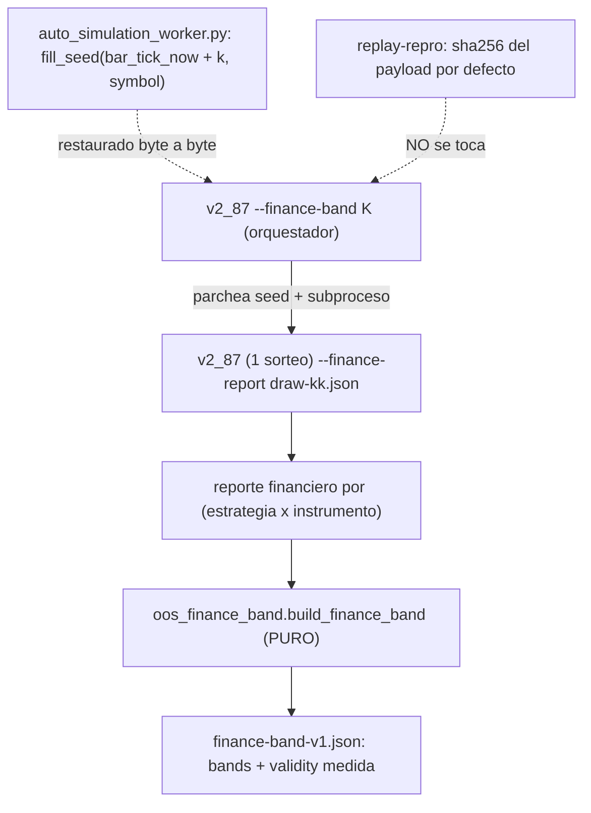

# Plan — `v2.88.114-beta` / **`§8-c` — BANDA `K` MEDIDA del reporte financiero OOS**

> **Estado:** **APROBADO** (2026-10-11) — alcance ratificado por el propietario: cerrar el residuo `R-4`/`§8-c` como sello propio.
> **Base funcional:** `v2.88.113-beta` (tag anotado `v2.88.113-beta`, objeto `7713925b` → commit `3dd15193`). HEAD del árbol al redactar: `3dd15193`.
> **Naturaleza prevista:** `Δ motor` **aditivo** (módulo puro nuevo + costura **opt-in** del CLI OOS) · **`Δ decisión = 0`** · **SIN migración** (head `053_dia_d_cycle_verifications`) · **contrato sin cambio**.
> **Origen:** residuo `R-4` de la [auditoría de `v2.88.113-beta`](./auditoria-v2.88.113-beta-2026-10-11.md) (§4 obs. 12/13, §6) y `§8-c` del [plan de `v2.88.111`](./plan-v2-88-111-oos-validacion-financiera-2026-10-11.md) §4/§5 (alcance `D-§8.A` declaró la banda `K` medida **pendiente**).

---

## 0. Objetivo y criterio de aceptación (falsable)

**Hueco (textual de `§8-c`):** el reporte financiero OOS ([`oos_finance.py`](../../packages/py/application/src/bolsa_application/oos_finance.py)) fija `pointCitable = False` **a propósito**, porque **no** cita la banda `K`; el dinero se reporta como **punto declarado**, no como **banda medida**. `§8-c` exige **medir** esa banda: correr el MISMO replay `K` veces (re-sorteo del venue) y plegar los `K` reportes.

Criterio de aceptación falsable:
1. Existe un artefacto determinista que, por grupo `(strategyVersion, symbol)` y por el agregado, publica `min/median/max/mean/stdev/n` de cada métrica de dinero (`netReturnPct`, `grossReturnPct`, `netReturnPctAtStress`, `maxDrawdownPct`, `hitRate`, `profitFactor`, `sharpe`, `trades`, `committedCapital`).
2. Un hueco es `None`/`NOT_MEASURED`, **nunca `0`**; un grupo ausente en un sorteo baja `drawsWithCell`.
3. `validity` se **evalúa**: `crossesZeroNetReturn` y `pointCitable = (no cruza) and |media| > 1.96·SE`, con `K >= MIN_DRAWS_FOR_BAND`; si no, `note = insufficient_draws`/`sin_muestra`.
4. **Sello intacto:** el payload por defecto de [`v2_87_replay_oos_durable_cycle.py`](../../apps/api-python/scripts/v2_87_replay_oos_durable_cycle.py) queda **byte a byte** igual ⇒ `replay-repro` sigue verde (`sha256_lf 1E3ADAC2…929A37E7`).
5. **Autochequeo:** el sorteo `k = 0` (sin parchear) reproduce el sello del tag.

---

## 1. Precedente y reutilización (no duplicar)

| Pieza | Rol | Reutilización aquí |
| --- | --- | --- |
| [`dia_d_multi_uncertainty.py`](../../packages/py/application/src/bolsa_application/dia_d_multi_uncertainty.py) | pliega `K` sorteos en banda con `validity` (`MIN_DRAWS_FOR_BAND`, `CI95_Z`) | se **importan** sus constantes (fuente única del criterio) |
| [`v2_88_16_3_oos_seed_robustness.py`](../../apps/api-python/scripts/v2_88_16_3_oos_seed_robustness.py) · [`v2_94_dia_d_multi_band.py`](../../apps/api-python/scripts/v2_94_dia_d_multi_band.py) | arnés de re-sorteo: parche de `_SEED_LINE` + restauración byte a byte | mismo arnés (`v2_44_mutation_audit._apply/_restore/_drop_bytecode`) |
| `--finance-report` de `v2_87` (`§8-b`) | costura opt-in inerte (fichero aparte) ya probada | el sorteo la reutiliza tal cual para producir su reporte |

---

## 2. Diseño

- **Módulo PURO** `oos_finance_band.py`: pliega `K` reportes (`OosFinanceReport.to_dict()`) por cubo; `None` sin muestra, `drawsWithCell` por presencia, `validity` medida. Determinista y ordenado.
- **Costura opt-in** `--finance-band K` en `v2_87`: el script pasa a ser **orquestador** (parchea el seed por sorteo, lanza subprocesos de sí mismo con `--finance-report`, restaura byte a byte) y pliega. `K = 0` ⇒ OFF (inerte).

---

## 3. Fases

### `§8-c-1` — Módulo puro de banda financiera

[`packages/py/application/src/bolsa_application/oos_finance_band.py`](../../packages/py/application/src/bolsa_application/oos_finance_band.py): `build_finance_band(draws=…)` con `SCHEMA_VERSION="oos-finance-band-v1"`, `bands` por métrica, `drawsWithCell`/`drawsTotal`, `validity` (`crossesZeroNetReturn`/`pointCitable` con `CI95_Z`/`MIN_DRAWS_FOR_BAND` importados), `coverage` y `limits` declarados.

### `§8-c-2` — Costura OPT-IN del CLI OOS

[`v2_87_replay_oos_durable_cycle.py`](../../apps/api-python/scripts/v2_87_replay_oos_durable_cycle.py): flags `--finance-band K`, `--finance-band-out PATH`, `--finance-band-seal SHA256`; `_build_parser()` extraído (DEFAULTs guardables en test).

### `§8-c-3` — Medición (no reproducible sin PG)

`--finance-band 12` contra PostgreSQL con la entrada congelada; `k = 0` reproduce el sello; se publica `finance-band-<ventana>.json` con `crossesZeroNetReturn`/`pointCitable` **medidos**.

---

## 4. Restricción DURA — el sello `replay-repro` NO se puede mover

`replay-repro` regenera `replay-oos-durable-v2.88.7.json` y **asserta su `SHA-256` byte a byte** ([`.github/workflows/release-tag-ci.yml`](../../.github/workflows/release-tag-ci.yml)). Por eso la banda viaja en un **fichero aparte**, activada por flag **apagado por defecto**, y se añade una guarda estructural que impide mover el payload por accidente.

---

## 5. Riesgos y mitigaciones

| Riesgo | Mitigación |
| --- | --- |
| Mover el sello congelado `replay-repro` | Banda en fichero aparte; `K = 0` por defecto; guarda estructural sobre `_build_parser()` |
| Dejar el árbol mutado tras un sorteo | Restauración byte a byte con `try…finally`; si NO restaura, **ABORTA** |
| Sobreafirmar con muestra anécdota | `MIN_DRAWS_FOR_BAND = 2` + `pointCitable` evaluado + límites declarados |
| Coste temporal (`K × replay`) | `K` es un presupuesto declarado; el sorteo 0 ancla al sello |

---

## 6. Límites declarados

- **Compone/observa, no decide:** `Δ decisión = 0`; no toca motor, umbrales, `TOP_N` ni reparto.
- **No sustituye PAPER** (`P3-2`/`P3-3` abiertas) ni emite `CONFIRMED`.
- **Costes modelados** (overlay); la fricción medida del SIM iría aparte, sin doble contabilización.
- **La banda medida no es reproducible sin PG** ⇒ se cita como medición, no como gate de CI.
