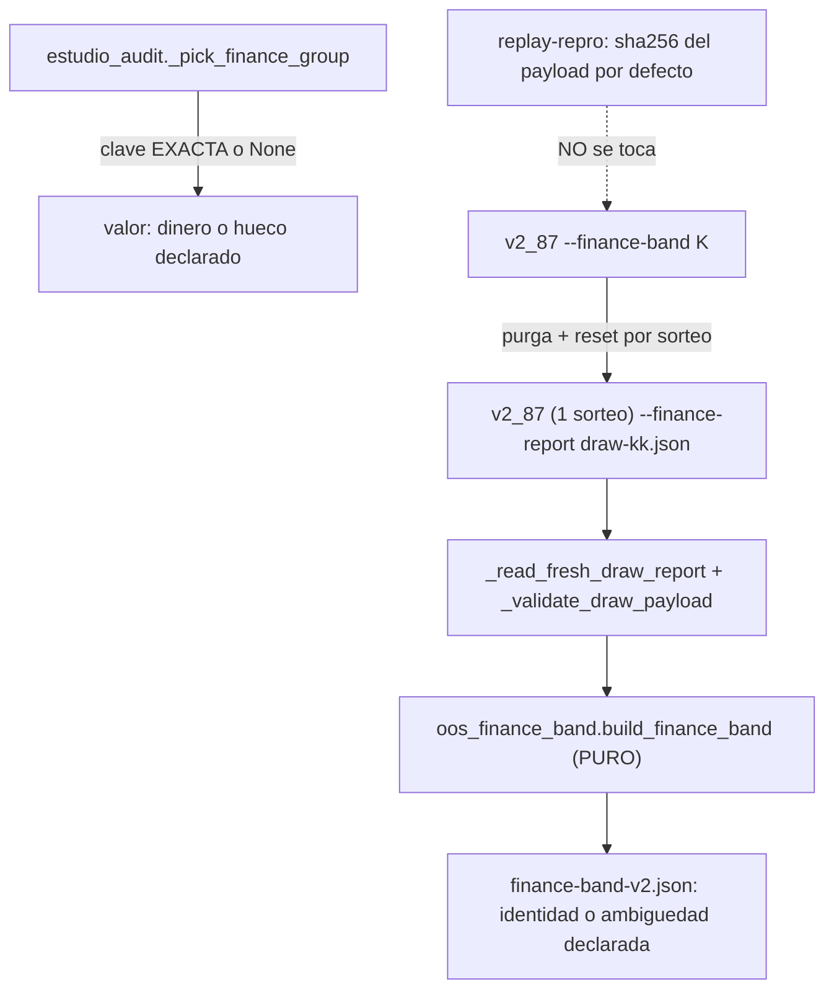

# Plan — `v2.88.115-beta` / **Endurecimiento de la banda OOS (`H2`/`H3`) + atribución financiera honesta (`P1`)**

> **Estado:** **EJECUTADO** (2026-10-12) — alcance ratificado por el propietario: cerrar los hallazgos pendientes de las auditorías sobre `v2.88.114-beta` como sello propio.
> **Base funcional:** `v2.88.114-beta` (tag anotado `v2.88.114-beta`, objeto `bcb19cd4…` → commit `743bb8df…`). HEAD del árbol al redactar: `98a3ec9a`.
> **Naturaleza prevista:** `Δ motor` **correctivo/aditivo** (dominio puro de auditoría + orquestador **opt-in**) · **`Δ decisión = 0`** · **SIN migración** (head `053_dia_d_cycle_verifications`) · **contrato sin cambio**.
> **Origen:** `H2`/`H3` de la AUDITORIA 1 (banda `K`) y `P1` de la AUDITORIA 2 (`estudio_audit` atribución cruzada).

---

## 0. Objetivo y criterio de aceptación (falsable)

**Huecos:**
- **`P1` (AUDITORIA 2):** `_pick_finance_group` devolvía el único grupo del símbolo **aunque** declarase otra `strategyPresetKey` ⇒ dinero de una estrategia atribuido a otra y marcado `measured: True`.
- **`H2` (AUDITORIA 1):** el plegado de la banda conservaba la **primera** clave no vacía del cubo; si dos sorteos declaraban claves distintas, publicaba una como identidad del motor.
- **`H3` (AUDITORIA 1):** `_run_finance_band` aceptaba un reporte por su mera **existencia**: un fichero dejado por una corrida previa podía leerse como el del sorteo actual.

Criterio de aceptación falsable:
1. Con identidad declarada y sin coincidencia, `_pick_finance_group` devuelve `None` y el hueco se declara con motivo (jamás atribución cruzada); el fallback «grupo único» solo aplica sin identidad declarada.
2. La banda declara `strategyPresetKey = None` + `strategyPresetKeyAmbiguous = True` + `strategyPresetKeys[]` cuando los `K` sorteos discrepan; determinista bajo permutación; una sola clave ⇒ identidad; ninguna ⇒ hueco.
3. `_run_finance_band` **borra y verifica la ausencia** de cada salida antes de lanzar; solo incorpora reportes **frescos** (`mtime` posterior al lanzamiento) y **bien formados**; valida **cuenta/versión/ventana** del payload.
4. El payload por defecto del CLI OOS queda **byte a byte** igual ⇒ `replay-repro` sigue verde (la costura es opt-in y apagada por defecto).

---

## 1. Diseño

- **`P1` (dominio puro):** `_pick_finance_group` restringe el fallback «grupo único» a los casos sin identidad declarada; `build_estudio_audit_report` emite un motivo específico cuando existen grupos del símbolo pero ninguno declara la clave del valor.
- **`H2` (dominio puro):** `_fold` acumula el **conjunto** de claves por cubo; `_identity_from_keys` resuelve identidad / hueco / ambigüedad; `_render_cell` publica `strategyPresetKey`/`strategyPresetKeyAmbiguous`/`strategyPresetKeys`. `SCHEMA_VERSION` → `oos-finance-band-v2`.
- **`H3` (orquestador opt-in):** `_purge_draw_artifacts`, `_reset_draw_outputs`, `_read_fresh_draw_report`, `_validate_draw_payload` cableados en `_run_finance_band`.

---

## 2. Alcance

- `packages/py/application/src/bolsa_application/estudio_audit.py` (+ tests).
- `packages/py/application/src/bolsa_application/oos_finance_band.py` (+ tests).
- `apps/api-python/scripts/v2_87_replay_oos_durable_cycle.py` (+ tests).
- Bump `2.11.114-beta` → `2.11.115-beta` y evidencia/`PROJECT_STATE`.

## 3. Fuera de alcance (declarado)

- **`H1` (AUDITORIA 1):** separación formal de `sensitivityBand` vs `statisticalConfidence` ⇒ **sello propio**.
- **Regenerar `finance-band-w32-k12.json`** con el esquema `v2`: requiere PostgreSQL con la entrada sembrada ⇒ no reproducible sin PG.

## 4. Verificación

Ver §4 de la [evidencia](./evidence/v2.88.115/README.md): `ruff` ✅ · `mypy` ✅ (`263` files) · `pytest packages/py/application/tests` ✅ `2691 passed` (+ `1` fallo **ambiental** declarado) · CLI/band/audit/guards ✅ `15 + 42 + 6 passed`.
