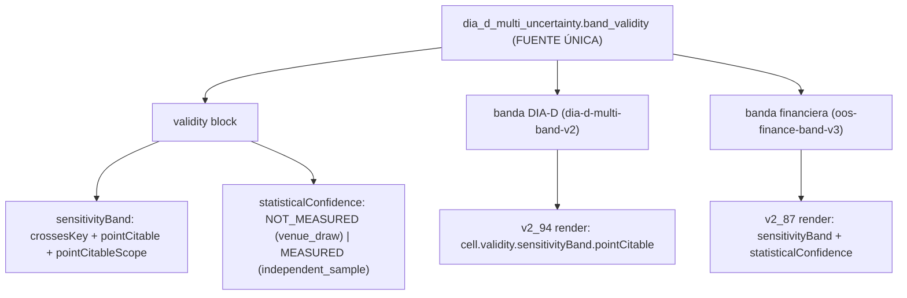

# Plan — `v2.88.116-beta` / **`H1`: separación `sensitivityBand` vs `statisticalConfidence`**

> **Estado:** **EJECUTADO** (2026-10-12) — alcance ratificado por el propietario: cerrar el último hallazgo abierto de la AUDITORIA 1 sobre la banda `K` como sello propio, aplicado a **ambas** bandas con **una sola** fuente de verdad, y **conservando** `pointCitable` encapsulado.
> **Base funcional:** `v2.88.115-beta` (tag anotado, objeto `289653e7` → commit `789677ca`).
> **Naturaleza prevista:** `Δ motor ≠ 0` **aditivo** (dominio puro de banda) · **`Δ decisión = 0`** · **SIN migración** (head `053_dia_d_cycle_verifications`) · **contrato HTTP sin cambio** (los artefactos de banda son ficheros, no endpoints).
> **Origen:** `H1` de la AUDITORIA 1 (`v2.88.114-beta`), textual: «la banda no debe confundirse con un intervalo de confianza estadístico… mantener separadas las etiquetas `sensitivityBand` y `statisticalConfidence`».

---

## 0. Objetivo y criterio de aceptación (falsable)

**Hueco:** en `dia_d_multi_uncertainty._validity` y en `oos_finance_band._validity` el bloque `validity`
publicaba, al mismo nivel y sin distinción, `crossesZero…` y `pointCitable = (no cruza) and |media| > 1.96·SE`.
El `1.96·SE` **parecía** una inferencia estadística, pero los `K` sorteos desplazan el ancla de la semilla
del simulador sobre el **MISMO** dato histórico ⇒ **no** son observaciones independientes. Un lector podía
tomar `pointCitable = True` como «rentabilidad demostrada».

Criterio de aceptación falsable:
1. `validity` publica **dos** etiquetas separadas: `sensitivityBand` (lo que los `K` re-sorteos del venue SÍ miden) y `statisticalConfidence`.
2. Con el diseño por defecto (`design = "venue_draw"`), `statisticalConfidence.status = "NOT_MEASURED"`, `established = False`, con **motivo** y **requisito** declarados; **jamás** se infiere de re-sorteos del mismo dato.
3. `pointCitable` se **conserva** pero encapsulado en `sensitivityBand` y acotado por `pointCitableScope = "sensitivity_band_only_not_statistical_confidence"`.
4. Solo un llamante que **declare** `design = "independent_sample"` computa `statisticalConfidence.status = "MEASURED"`.
5. La lógica vive en **UNA** función (`band_validity`) consumida por las **dos** bandas; el resultado es determinista bajo permutación de sorteos.
6. Los huecos siguen siendo hueco (`None`/`NOT_MEASURED`), nunca `0`.

---

## 1. Diseño

- **Fuente única:** `band_validity(crosses_key, stats, draws_with_cell, design)` en `dia_d_multi_uncertainty.py`.
- **Consumidores:** `oos_finance_band._validity` delega con `crosses_key="crossesZeroNetReturn"`; `dia_d_multi_uncertainty._validity` delega con `crosses_key="crossesZeroR"`.
- **Cambio de forma:** `SCHEMA_VERSION` de ambas bandas sube (`dia-d-multi-band-v1 → v2`, `oos-finance-band-v2 → v3`) y el payload gana `design` y `validity.crossesKey`.

---

## 2. Alcance

- `packages/py/application/src/bolsa_application/dia_d_multi_uncertainty.py` (**fuente única** + esquema `v2`) (+ tests).
- `packages/py/application/src/bolsa_application/oos_finance_band.py` (delega + esquema `v3`) (+ tests).
- `packages/py/application/src/bolsa_application/dia_d_multi_sampling.py` (lector tolerante del bloque `validity`).
- `apps/api-python/scripts/v2_87_replay_oos_durable_cycle.py` y `v2_94_dia_d_multi_band.py` (render).
- Bump `2.11.115-beta` → `2.11.116-beta` y evidencia/`PROJECT_STATE`.

## 3. Fuera de alcance (declarado)

- **No** se calcula una confianza estadística real: exige observaciones **independientes** y un procedimiento adecuado ⇒ queda `NOT_MEASURED` con su requisito declarado.
- **No** se regeneran los artefactos de evidencia sellados (`finance-band-w32-k12.json` en `v1`): exigen PostgreSQL ⇒ no reproducible sin PG.
- **No** se toca el motor, umbrales, reparto, `TOP_N`, régimen ni protección.

## 4. Verificación

Ver §4 de la [evidencia](./evidence/v2.88.116/README.md): `ruff` ✅ · `mypy` ✅ (`263` files) · `pytest packages/py/application/tests` ✅ · focales (bandas + CLI + guardas) ✅.
