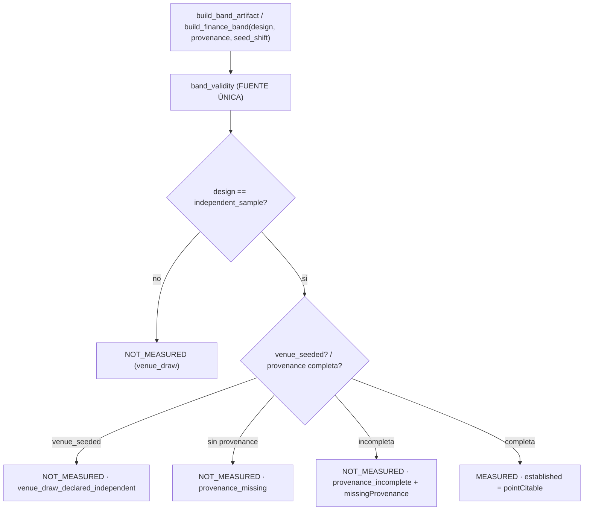

# Plan — `v2.88.117-beta` / **`H1.1`: la confianza estadística exige PROCEDENCIA verificable**

> **Estado:** **EJECUTADO** (2026-10-12) — alcance ratificado por el propietario: cerrar el subhallazgo abierto de la AUDITORIA 1 sobre la banda `K`, endureciendo la fuente única `band_validity` con **enforcement graceful** (nunca levanta; publica el hueco).
> **Base funcional:** `v2.88.116-beta` (tag anotado, objeto `cfed89bb` → commit `932cbdcf`).
> **Naturaleza prevista:** `Δ motor ≠ 0` **aditivo** (dominio puro de banda) · **`Δ decisión = 0`** · **SIN migración** (head `053_dia_d_cycle_verifications`) · **contrato HTTP sin cambio** (los artefactos de banda son ficheros, no endpoints).
> **Origen:** `H1` de la AUDITORIA 1 (`v2.88.114-beta`), textual: «la separación de etiquetas está corregida, pero la garantía estadística necesita una salvaguarda adicional… exigir que el resultado incluya evidencia verificable de su procedencia: ventanas de evaluación independientes, método de muestreo, tamaño de muestra, unidad de observación y tratamiento de dependencia temporal. Si esa evidencia no existe, debe mantenerse `NOT_MEASURED`, aunque el llamante solicite la etiqueta».

---

## 0. Objetivo y criterio de aceptación (falsable)

**Hueco:** en `dia_d_multi_uncertainty.band_validity` (fuente única desde `116`), pasar
`design = "independent_sample"` cambiaba `statisticalConfidence.status` a `MEASURED` y calculaba
`established` con el mismo criterio numérico de la banda de sensibilidad. El código **no** verificaba
que los datos procedieran de observaciones independientes. Los tests ejercitaban esa rama con
informes sintéticos: probaban la rama del código, **no** la independencia de los datos.

Criterio de aceptación falsable:
1. Con `design = "independent_sample"` **y** procedencia completa y bien formada ⇒ `status = "MEASURED"`.
2. Con `design = "independent_sample"` **sin** procedencia ⇒ `NOT_MEASURED`, `reason = provenance_missing`, `missingProvenance` = los 5 campos.
3. Con procedencia **incompleta** ⇒ `NOT_MEASURED`, `reason = provenance_incomplete`, `missingProvenance` = solo los campos ausentes.
4. Con datos **sembrados** (`seed_shift` NO vacío) declarados independientes ⇒ `NOT_MEASURED`, `reason = venue_draw_declared_independent`.
5. `_provenance_gaps` **no levanta** con input malformado: devuelve todos los campos como huecos, en orden determinista.
6. La rama `venue_draw` por defecto mantiene su salida; el resultado es determinista bajo permutación de sorteos.
7. Los huecos siguen siendo hueco (`None`/`NOT_MEASURED`), nunca `0`.

---

## 1. Diseño

- **Fuente única:** `band_validity(crosses_key, stats, draws_with_cell, design, provenance, venue_seeded)` en `dia_d_multi_uncertainty.py`.
- **Consumidores:** `oos_finance_band._validity` delega con `crosses_key = "crossesZeroNetReturn"`; `dia_d_multi_uncertainty._validity` delega con `crosses_key = "crossesZeroR"`.
- **Cambio de forma:** `SCHEMA_VERSION` de ambas bandas sube (`dia-d-multi-band-v2 → v3`, `oos-finance-band-v3 → v4`) y `validity.statisticalConfidence` gana `provenance` y `missingProvenance`.

---

## 2. Alcance

- `packages/py/application/src/bolsa_application/dia_d_multi_uncertainty.py` (**fuente única + esquema `v3`**) (+ tests).
- `packages/py/application/src/bolsa_application/oos_finance_band.py` (delega + esquema `v4`) (+ tests).
- `packages/py/application/src/bolsa_application/dia_d_multi_sampling.py` (nota de versión del lector).
- Bump `2.11.116-beta` → `2.11.117-beta` y evidencia/plan/`CHANGELOG`/`PROJECT_STATE`.

## 3. Fuera de alcance (declarado)

- **No** se implementa una confianza estadística real: la puerta **verifica** la procedencia declarada, **no** la valida científicamente.
- **No** se regeneran los artefactos de evidencia sellados (`finance-band-w32-k12.json`): exigen PostgreSQL.
- **No** se toca el motor, umbrales, reparto, `TOP_N`, régimen ni protección.
- **Ceremonial mínimo del render:** `v2_87`/`v2_94` imprimen `status`/`established` y siguen funcionando sin cambio.

---

## 4. Verificación

Ver §3 de la [evidencia](./evidence/v2.88.117/README.md): `ruff` ✅ · `mypy` ✅ (`263` files) · `pytest packages/py/application/tests` ✅ (**2705 passed**) · focales (bandas + render) ✅ **48 passed** · guardián de bump ✅ · comprobación empírica de bordes ✅ sin bypass.
