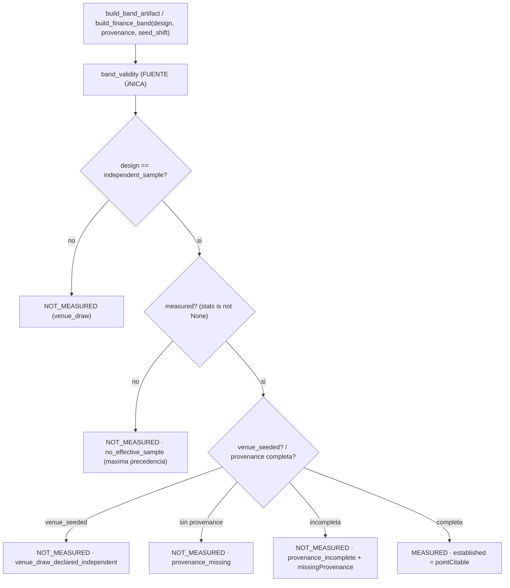

# Plan — `v2.88.118-beta` / **`H1.1`: sin muestra efectiva no hay `MEASURED`, ni con procedencia completa**

> **Estado:** **EJECUTADO** (2026-10-13) — alcance ratificado por el propietario: cerrar el caso límite (P1) que la AUDITORIA 1 detectó al auditar `v2.88.117-beta` y que la AUDITORIA 2 no cubrió. La fuente única `band_validity` gana una guarda de **máxima precedencia**: «sin muestra» (`no_effective_sample`) se evalúa **antes** que `venue_seeded`, `provenance_missing` y `provenance_incomplete`. Sigue siendo **enforcement graceful** (nunca levanta; publica el hueco).
> **Base funcional:** `v2.88.117-beta` (tag anotado, objeto `277d33ca` → commit `2195ad7f`).
> **Naturaleza prevista:** `Δ motor ≠ 0` **aditivo** (dominio puro de banda) · **`Δ decisión = 0`** · **SIN migración** (head `053_dia_d_cycle_verifications`) · **contrato HTTP sin cambio** (los artefactos de banda son ficheros, no endpoints).
> **Origen:** `H1.1` de la AUDITORIA 1 sobre `v2.88.117-beta`. El test `test_h1_gap_still_marks_statistical_confidence_not_measured` construía una banda **sin sorteos** (`draws=[]`) con procedencia completa y afirmaba `statisticalConfidence.status == "MEASURED"` (con `established == False`). Esa combinación es incoherente: un consumidor lee `MEASURED` como «hay una medición estadística» cuando **no existe muestra**.

> **Errata (remediación `v2.88.118–120`):** la guarda `no_effective_sample` de este sello se acotó a
> `stats is None`, dejando abierto el borde `stats["n"] = 1 < MIN_DRAWS_FOR_BAND`: **una sola lectura**
> con procedencia completa seguía emitiendo `MEASURED` / `established = False` (el mismo medio-estado
> que este sello quiso eliminar, alcanzado por el borde `insufficient_draws`). El sello de remediación
> amplía la guarda a `stats["n"] < MIN_DRAWS_FOR_BAND` (muestra **efectiva**), cubriendo ambos bordes
> con el MISMO motivo `no_effective_sample`. Sin cambio de forma de artefacto (`SCHEMA_VERSION` no sube).

---

## 0. Objetivo y criterio de aceptación (falsable)

**Hueco:** en `dia_d_multi_uncertainty.band_validity` (fuente única desde `116`, endurecida en `117`),
la rama `design = "independent_sample"` verificaba la procedencia declarada pero **no** la existencia de
muestra efectiva. Con `draws = []` (⇒ `stats is None`) y procedencia completa, el estado quedaba en
`MEASURED` con `established = False`: se publicaba «hay medición» sin muestra. La nueva guarda de
**máxima precedencia** (`if not measured:`) cierra ese borde.

Criterio de aceptación falsable:
1. Con `design = "independent_sample"` **sin** muestra efectiva (`stats is None`) ⇒ `status = "NOT_MEASURED"`, `reason = no_effective_sample`, `established == False`, `se is None`, `ci95HalfWidth is None`, `missing = list(gaps)`.
2. La guarda «sin muestra» tiene **máxima precedencia**: se evalúa **antes** que `venue_seeded`, `provenance_missing` y `provenance_incomplete` (es el motivo más específico cuando varios aplican).
3. Con `design = "independent_sample"` **y** muestra efectiva **y** procedencia completa y bien formada ⇒ `status = "MEASURED"`.
4. Con procedencia **incompleta** (y muestra presente) ⇒ `NOT_MEASURED`, `reason = provenance_incomplete`, `missingProvenance` = solo los campos ausentes.
5. Con datos **sembrados** (`seed_shift` NO vacío) declarados independientes (y muestra presente) ⇒ `NOT_MEASURED`, `reason = venue_draw_declared_independent`.
6. **La forma del artefacto NO cambia:** `SCHEMA_VERSION` NO sube; se mantienen `dia-d-multi-band-v3` y `oos-finance-band-v4` (diferencia clave con `117`, que sí subió esquema).
7. Las dos bandas (`dia_d_multi_uncertainty` y `oos_finance_band`) heredan la MISMA `band_validity` ⇒ **no pueden divergir**.
8. Los huecos siguen siendo hueco (`None`/`NOT_MEASURED`), nunca `0`; la rama `venue_draw` por defecto mantiene su salida.

---

## 1. Diseño

- **Fuente única:** `band_validity(crosses_key, stats, draws_with_cell, design, provenance, venue_seeded)` en `dia_d_multi_uncertainty.py`.
- **Precedencia exacta de la rama `independent_sample`:** 1) sin muestra ⇒ `no_effective_sample`; 2) `venue_seeded` ⇒ `venue_draw_declared_independent`; 3) sin procedencia ⇒ `provenance_missing`; 4) incompleta ⇒ `provenance_incomplete`; 5) completa y con muestra ⇒ `MEASURED`.
- **Consumidores:** `oos_finance_band._validity` delega con `crosses_key = "crossesZeroNetReturn"`; `dia_d_multi_uncertainty._validity` delega con `crosses_key = "crossesZeroR"`. La corrección se hereda por delegación en la MISMA `band_validity`.
- **Sin cambio de forma:** `SCHEMA_VERSION` NO sube; se mantienen `dia-d-multi-band-v3` y `oos-finance-band-v4`.

---

## 2. Alcance

- `packages/py/application/src/bolsa_application/dia_d_multi_uncertainty.py` (**fuente única**, guarda `no_effective_sample` + constante exportada) (+ tests).
- `packages/py/application/src/bolsa_application/oos_finance_band.py` (límite H1.1 homólogo; hereda la lógica) (+ tests).
- `packages/py/application/tests/test_dia_d_multi_uncertainty.py` · `packages/py/application/tests/test_oos_finance_band.py` (test nuevo `test_h1_1_no_effective_sample_blocks_measured_even_with_provenance`).
- `docs/engineering/evidence/v2.88.117/README.md` (§4 Límites): bullet «`MEASURED` también exige muestra efectiva».
- Bump `2.11.117-beta` → `2.11.118-beta`, con la evidencia, el plan, el `CHANGELOG` y el `PROJECT_STATE` del mismo sello.

## 3. Fuera de alcance (declarado)

- **No** se implementa una confianza estadística real: la puerta **verifica** la procedencia declarada, **no** la valida científicamente.
- **No** se regeneran los artefactos de evidencia sellados: exigen PostgreSQL sembrado.
- **No** se toca el motor, umbrales, reparto, `TOP_N`, régimen ni protección.
- **Sin cambio de forma de artefacto:** `SCHEMA_VERSION` no sube (a diferencia de `117`).

---

## 4. Verificación

Ver §3 de la [evidencia](./evidence/v2.88.118/README.md): `ruff` ✅ · `mypy` ✅ (`263` files) · `pytest packages/py/application/tests` ✅ (**2706 passed**, +1) · focales (bandas + render) ✅ **49 passed** · `test_dia_d_multi_sampling` ✅ **34 passed** · guardián de bump ✅ **1 passed** · `alembic heads` → `053_dia_d_cycle_verifications (head)` — **sin migración**.
