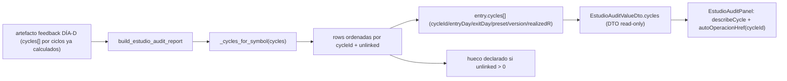

# Plan — `v2.88.120-beta` / **`A1-trace-por-valor`**: los ciclos del valor dentro del informe de ESTUDIO (con enlace a la operación)

> **Estado:** **EJECUTADO** (2026-10-13) — alcance ratificado por el propietario como la **rebanada mínima** de la prioridad funcional AUTO/DÍA-D: «entradas/salidas **trazables por valor**» + «trazabilidad exacta de la estrategia y sus señales», sin tocar motor ni scheduling.
> **Base funcional:** `v2.88.119-beta` (tag anotado, objeto `b9e62316` → commit `3b069ce4`).
> **Naturaleza prevista:** **`Δ motor = 0`** (dominio puro de informe + DTO read-only + UI) · **`Δ decisión = 0`** · **SIN migración** (head `053_dia_d_cycle_verifications`) · **contrato HTTP ampliado** (campo `cycles` aditivo en `EstudioAuditValueDto`; `readOnly`, sin endpoint nuevo).
> **Origen:** informe del reconocimiento funcional [Recon prioridad funcional AUTO/DÍA-D](../../../.cursor/projects/) — la lane diaria ESTUDIO expone el informe **por valor** (`GET /auto/estudio-audit`) pero NO permite navegar del informe a la **operación concreta**: `signal` solo contaba ciclos, sin dar `cycleId`/entrada/salida.

---

## 0. Objetivo y criterio de aceptación (falsable)

**Hueco:** el informe por valor de ESTUDIO (`estudio_audit.build_estudio_audit_report`) declaraba la
**señal** como un recuento (`cycles`/`measuredCycles`/`daysCovered`) pero no exponía **qué ciclos** la
componen. El `cycleId` es la clave canónica que el ciclo sella y que usa el resto del espacio AUTO
(`autoOperacionHref`) para abrir la operación; sin él, el informe no enlaza con la operación y el
«entrada/salida por valor» queda inaccesible. Se cierra añadiendo la **lista de ciclos enlazables** por
valor.

Criterio de aceptación falsable:
1. Cada entrada del informe expone `cycles[]` con, por ciclo: `cycleId`, `entryDay`, `exitDay`, `strategyPresetKey`, `strategyVersion`, `realizedR`.
2. La lista está **ordenada por `cycleId`** y es **determinista** bajo permutación de la entrada (mismo estado ⇒ mismo payload).
3. Un ciclo **sin `cycleId` legible** NO se descarta en silencio: se **cuenta** y se declara el hueco (`señal: N ciclo(s) sin cycleId (no enlazables a la operación)`); nunca se inventa una clave para forzar el enlace.
4. Un campo ausente (`exitDay`, `realizedR` ilegible…) es `None` (hueco declarado), **nunca** `""`/`0`.
5. Un valor **sin ciclos** expone `cycles == []` (lista vacía honesta; no se fabrica un enlace).
6. El contrato HTTP gana `cycles` **aditivo** (no rompe consumidores: `default_factory=list`); el endpoint sigue `readOnly` y `PRECOMPUTED_ARTIFACT`.
7. La UI (`EstudioAuditPanel`) pinta cada ciclo con su ventana/R y un **deep-link** a la operación canónica (`autoOperacionHref(cycleId)` → `/auto/operar/operacion/<cycleId>`); un valor sin ciclos enlazables declara «Señal sin ciclos enlazables (Sin dato todavía)» y NO pinta enlace.
8. **`Δ motor = 0`**: no se toca decisión/ejecución, umbrales, reparto, `TOP_N`, régimen ni protección; no se recalcula nada en vivo (se compone lo ya calculado).

---

## 1. Diseño

- **Puro y determinista:** `_cycles_for_symbol` vive en `estudio_audit.py` (sin DB/red/reloj); ordena por `cycleId`.
- **Honestidad (§3):** ciclo sin `cycleId` ⇒ se cuenta como hueco; campo ausente ⇒ `None`.
- **Contrato aditivo:** `EstudioAuditCycleDto` nuevo; `cycles` en `EstudioAuditValueDto` con `default_factory=list`.
- **UI reutiliza** `autoOperacionHref` (`features/auto/auto-nav.ts`), la misma clave de deep-link del resto de AUTO.

---

## 2. Alcance

- `packages/py/application/src/bolsa_application/estudio_audit.py` (`_cycles_for_symbol` + `cycles[]` en la entrada + docstring/notas) (+ tests).
- `apps/api-python/src/bolsa_api/api/v1/routes/auto_estudio_audit.py` (`EstudioAuditCycleDto` + `cycles` en `EstudioAuditValueDto`).
- `apps/web/src/api/schema.d.ts` · `apps/web/api/openapi.json` (contrato regenerado con `contract:gen`).
- `apps/web/src/features/auto-monitor/estudio-audit-view.ts` (`describeCycle`/`formatDay`) + `estudio-audit-panel.tsx` (lista de ciclos con deep-link) (+ tests).
- `packages/py/application/tests/test_estudio_audit.py` · `apps/api-python/tests/test_auto_estudio_audit_route.py` · `apps/web/src/features/auto-monitor/{estudio-audit-view,estudio-audit-panel}.test.*`.
- Bump `2.11.119-beta` → `2.11.120-beta`, con la evidencia, el plan, el `CHANGELOG` y el `PROJECT_STATE` del mismo sello.

## 3. Fuera de alcance (declarado)

- **No** se automatiza la lane diaria ESTUDIO (cron/universo servidor): eso toca scheduling/config y reabre el plan PARKED `plan-cierre-operativa-auto-2026-10-08.md`.
- **No** se rellena el «porqué» (`why`): sigue siendo el hueco declarado de `C2`, bloqueado por una decisión de fuente (artefacto CLI vs BD).
- **No** se añade un recompute en vivo del DÍA-D ni se emite `CONFIRMED` (reservado a la ventana PAPER).
- **No** se toca el motor, umbrales, reparto, `TOP_N`, régimen ni protección.

---

## 4. Verificación

Ver §5 de la [evidencia](./evidence/v2.88.120/README.md): `ruff` ✅ · `mypy` ✅ · `pytest packages/py/application/tests` ✅ · `pytest apps/api-python/tests` ✅ · `vitest` (aut-monitor) ✅ · `typecheck`/`lint`/`contract:check` ✅ · guardián de bump ✅ · `alembic heads` → `053_dia_d_cycle_verifications` — **sin migración**.
