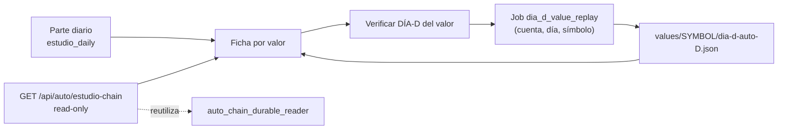

# Plan — `v2.88.152-beta`: evidencia por valor ESTUDIO y DÍA-D del valor bajo demanda

> **Estado:** **EJECUTADO** (2026-10-19) — alcance ratificado por el propietario como la
> superficie que convierte «operativa preparada para ser auditada» en una **superficie de
> producto falsable por cada valor de ESTUDIO**: qué estrategia se ejecutó (o por qué no se
> puede saber), qué indicadores la sustentan, qué señal/vela la originó, qué entrada/salida
> tenía, qué pasó realmente en la cadena PAPER y qué evidencia DÍA-D existe, con un botón para
> **lanzar la verificación DÍA-D de ese valor** desde la propia ficha.
> **Base funcional:** `v2.88.151-beta` (tag anotado, objeto `8bef1757`).
> **Naturaleza:** **`Δ motor = 0`** (read-model + cola durable + UI; no se toca decisión,
> umbrales, pesos A/B, `TOP_N`, régimen, sizing ni salidas) · **`Δ decisión = 0`** ·
> **contrato HTTP ampliado ADITIVO** (dos endpoints nuevos read-only y un `kind` de job;
> `contract:gen` regenerado, `contract:check` **OK**) · **SIN migración** (head
> `056_auto_ops_jobs`).
> **Restricciones ratificadas:** AUTO sigue **OFF** por defecto, no se enciende la cadencia
> diaria y **no se promociona `CONFIRMED`** ni se declara rentabilidad.

---

## 0. Objetivo y criterio de aceptación (falsable)

**Hueco:** el parte diario por valor (`/auto-monitor?mode=daily`) declaraba señal, decisión y
validación, pero no **demostraba la cadena**: no había forma de ver, para un valor concreto,
qué **estrategia ejecutada** selló el ciclo, con qué **indicadores**, con qué **señal/vela**,
con qué **entrada/salida** del `TradePlan`, qué pasó en las **nueve etapas durables** ni qué
evidencia **DÍA-D** existe. Y no había forma de **pedir** esa verificación desde la ficha sin
salir a otra pantalla.

Criterio de aceptación falsable:

1. `GET /api/auto/estudio-chain` devuelve el artefacto `auto-estudio-chain-v1` **acotado por
   cuenta** (`limit ≤ 200`), reutilizando `read_estudio_chain_evidence(...)` y
   `build_chain_evidence_artifact(...)`; **no** existe un segundo lector ni un segundo P&L.
2. Una etapa sin traza durable viaja `None` (**hueco declarado**), **nunca** `0`; un valor sin
   ciclos declara `cycles = []` y `measured = false`; un fallo de lectura es **error
   declarado**, nunca lista vacía.
3. Existe el `kind` `dia_d_value_replay`; su handler pasa `--watch <SYMBOL>` y escribe **sólo**
   `values/<SYMBOL>/dia-d-auto-<D>.json`; el artefacto del día **no se toca**.
4. La validación es **fail-closed**: `exit 0` + artefacto + `day` + `meta.account` +
   **`meta.watch == [symbol]`**. Un job sin símbolo falla cerrado.
5. `GET /api/auto/dia-d-replay/{day}/value/{symbol}` responde `available=false` si no hay
   artefacto, con la misma política de cuenta; otra cuenta **no** lo ve.
6. La ficha diaria muestra **«5 · Cadena y resultado (evidencia durable)»** con los seis
   bloques (estrategia e indicadores · por qué esa y no otra · señal y vela · entrada y salida
   · operación simulada · DÍA-D y suficiencia) y **una sola** query de `estudio-chain` por
   informe (indexada por `instrumentId`), no una por valor.
7. El botón **«Verificar DÍA-D de este valor»** encola el job correcto **una sola vez**,
   rehidrata al recargar por `(cuenta, día, kind)` **filtrando `payload.symbol`** y limpia al
   cambiar de cuenta/día/símbolo. Un fallo **no borra** el artefacto anterior.
8. **No** se pinta «Plan disparado», **no** se atribuye el histórico del valor a la señal de
   hoy sin coincidencia exacta de `planId`/`signalId`, **no** se emite `CONFIRMED`.
9. **`Δ motor = 0`** / **`Δ decisión = 0`**: el replay congelado sigue `REPRODUCIDO`.

---

## 1. Diseño

- **Una sola verdad de lectura.** `auto_estudio_chain.py` es un adaptador HTTP del lector
  durable ya existente; el artefacto, sus huecos y sus límites son los del lector.
- **Aislamiento por árbol.** `dia_d_artifacts` gana `values/` + `symbol_segment(symbol)` ⇒ la
  verificación del valor es **otro fichero** y no puede pisar el artefacto del día.
- **Sello de procedencia.** `v2_89_dia_d_auto_replay.py` publica `meta.watch` (lista
  explícita). El worker exige `meta.watch == [symbol]` antes de dar el job por bueno.
- **Coste de UI acotado.** Una query de `estudio-chain` por informe, indexada por
  `instrumentId` (`use-estudio-chain.ts`); el hook del valor
  (`use-dia-d-value-replay.ts`) rehidrata y encola por `(cuenta, día, símbolo)`.

---

## 2. Alcance

- `packages/py/domain/.../auto_ops_job.py` — `JOB_KIND_DIA_D_VALUE_REPLAY = "dia_d_value_replay"`.
- `packages/py/infrastructure/.../auto_ops_job_repository.py` — etiqueta legible del `kind`.
- `packages/py/application/.../auto_ops_jobs.py` — validación de `payload.symbol` (normalizado
  a mayúsculas) y rechazo de fechas futuras.
- `packages/py/application/.../dia_d_artifacts.py` — `DIA_D_VALUES_SUBDIR`,
  `symbol_segment`, `value_artifact_relpath`, `value_artifact_path_in`.
- `packages/py/application/.../auto_chain_durable_reader.py` — `entryDay`/`exitDay` en
  `_cycle_view`.
- `apps/api-python/src/bolsa_api/api/v1/routes/auto_estudio_chain.py` — **NUEVO** read-model.
- `apps/api-python/src/bolsa_api/api/v1/routes/auto_dia_d.py` — ruta read-only del valor.
- `apps/api-python/src/bolsa_api/background/auto_ops_dia_d.py` — `--watch`/`--out` y
  validación de `meta.watch`.
- `apps/api-python/src/bolsa_api/background/auto_ops_job_worker.py` — despacho del `kind`.
- `apps/api-python/scripts/v2_89_dia_d_auto_replay.py` — `meta.watch` (aditivo).
- `packages/shared/src/estudio-daily-ops.ts` — tipos del `kind`, del artefacto de cadena y del
  DÍA-D por valor.
- `apps/web/src/lib/api.ts` — `getAutoEstudioChain`, `createAutoDiaDValueReplayJob`,
  `getAutoDiaDReplayValue`.
- `apps/web/src/features/auto-monitor/use-estudio-chain.ts`,
  `use-dia-d-value-replay.ts`, `estudio-chain-evidence.tsx` (**NUEVOS**) +
  `estudio-daily-ops-panel.tsx` (integración).
- Contrato regenerado (`apps/web/api/openapi.json`, `apps/web/src/api/schema.d.ts`).
- Tests: `test_auto_estudio_chain_route.py` (**NUEVO**), `test_auto_dia_d_route.py`,
  `test_auto_ops_dia_d.py`, `test_auto_ops_job_worker.py`, `test_auto_ops_jobs.py`,
  `estudio-daily-ops-panel.test.tsx`, `use-dia-d-value-replay.test.tsx` (**NUEVO**) y
  `gp-v288-s5-auto-dia-d-bridge-integrated.spec.ts` (S5-08).

---

## 3. Fuera de alcance (declarado)

- **AUTO** sigue **OFF**; no se enciende la cadencia ni el orquestador.
- **`CONFIRMED` no se emite**; el veredicto agregado sigue siendo `NO CONFIRMADO` y la ventana
  PAPER sigue `INCONCLUSIVE`.
- El DÍA-D del valor es un **sandbox con watch de 1 símbolo**: no es una ejecución real ni una
  orden.
- La comparación estrategia-ejecutada vs mejor-puntuada queda en **hueco** cuando el motor no
  sella la identidad de la mejor puntuada; **no se rellena**.
- Un job por valor activo por `(cuenta, día)` (índice único parcial); el resto se **serializa**
  y la UI lo declara.

---

## 4. Pruebas (falsables, sin fabricar)

- **Read-model**: valor con ciclo completo ⇒ nueve etapas y `pnl.reconciled`; etapa ausente ⇒
  `None`; identidad ambigua ⇒ declarada; sin ciclos ⇒ `measured=false`; fallo de lectura ⇒
  error declarado.
- **Aislamiento**: dos cuentas con el mismo día/símbolo no se ven entre sí; una tercera recibe
  vacío/404 sin detalles.
- **Job por valor**: pasa `--watch`, escribe sólo `values/<SYMBOL>/...`, valida `meta.watch`,
  no modifica el artefacto del día, y un fallo conserva el artefacto anterior; sin símbolo
  falla cerrado.
- **Frontend**: la ficha muestra los seis bloques, no muestra «Plan disparado», no atribuye el
  histórico sin identidad, no emite `CONFIRMED` y el botón encola una sola vez; recargar
  rehidrata; cambiar de cuenta limpia.
- **No regresión**: `vitest src/features/auto-monitor`, suite web, `pytest` focalizado y
  completo, `lint:py`, `imports:py`, `types:py`, `typecheck`, `lint`, `contract:check`.

---

## 5. Sello

- Bump `2.11.151-beta` → `2.11.152-beta` (+ `meta.bump` de los **13** CLIs; guardián
  `test_dia_d_bump_guard` **2 passed**).
- Evidencia en [`evidence/v2.88.152/README.md`](./evidence/v2.88.152/README.md), `CHANGELOG`,
  `CURRENT_SYSTEM.md` y `PROJECT_STATE.md`.
- Re-anclar el pin (`pnpm window:pin` + `window:freeze OK`) por mover `apps`/`packages`.
- `Release tag CI` en verde; `replay-repro` debe seguir `REPRODUCIDO` (`Δ decisión = 0`).
