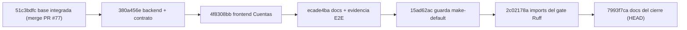

# Pre-sello `v2.88.174-beta` — expediente preparado, publicación no autorizada (2026-10-31)

> **Qué es:** el expediente de preparación del sello `.174` del bloque **Cuentas** (CTA-D1…CTA-D10) sobre `fix/059-060-proveedores`.
> **Qué no es:** una autorización. La versión `2.11.174-beta` **sí** existe ya en `package.json` (bump `3792ae19`), pero el tag `v2.88.174-beta` y la GitHub Release **no** se han creado.
> Rama: `fix/059-060-proveedores` · árbol del sello `ea1432fb` (bump + re-anclaje del pin) · SHA previo medido por CI `2c02178a` · versión `2.11.174-beta`.
> Actualización 2026-11-01: árbol movido de `7993f7ca` a `ea1432fb`; ver §5 (pin resuelto) y §6 (estado real de cada paso).
> Docs de referencia: [Seguimiento — Cuentas](./seguimiento-ui-cuentas-muestra-config-2026-10-31.md), [Verificación de grafo y cierre del gate Ruff](./verificacion-grafo-cuentas-2026-10-31.md), [Evidencia del sello .173](./evidence/v2.88.173/README.md).
> Evidencia: [`evidence/cuentas-muestra-config-2026-10-31/`](./evidence/cuentas-muestra-config-2026-10-31/).

---

## 1. Estado congelado (medido)

| Elemento | Valor | Cómo se midió |
|---|---|---|
| Rama | `fix/059-060-proveedores` (local y remota) | `git status -sb` |
| HEAD | `7993f7ca` | `git rev-parse HEAD` |
| SHA medido por CI | `2c02178a` | `gh run list --branch ... --json headSha` |
| Working tree | **3 `.md` de este expediente sin commitear** (2 modificados, 1 nuevo); `apps/`, `packages/` y `scripts/` limpios | `git status --short` |
| Commits sobre la base | 6 (`51c3bdfc..HEAD`) | `git rev-list --count` |
| Distancia al tag vigente | 18 commits (`v2.88.173-beta` → HEAD) | `git rev-list --count v2.88.173-beta..HEAD` |
| Versión en raíz | `2.11.173-beta` | [package.json](../../package.json) |
| Tag `v2.88.174-beta` | **No existe** | `git tag --list "*174*"` (vacío) |
| Release `.174` | **No creada** | `gh release list` |
| Release `.173` | **No emitida** (el tag `.173` sí existe) | [evidence/v2.88.173/README.md](./evidence/v2.88.173/README.md) §7 |

El **código** está limpio y sincronizado: `git status --short -- apps packages scripts` no devuelve nada. Lo único pendiente son los tres `.md` de este expediente, que se cierran en un commit docs-only antes de tocar la versión (§6, paso 0).

> Corrección posterior (2026-11-01): la primera redacción decía "árbol limpio". No era exacto en el momento de medir el pin: los tres documentos del expediente estaban sin commitear. Se conserva la medición del pin (§5), que solo depende de `HEAD:apps`/`HEAD:packages` y por tanto no la afectan ficheros `.md`.

---

## 2. Grafo y atribución de evidencia



| Commit | Qué acredita | Qué **no** acredita |
|---|---|---|
| `380a456e` | Backend de Cuentas (CTA-D5, CTA-D10) y contrato | Nada de frontend |
| `4f8308bb` | Frontend CTA-D1…CTA-D9 y el **E2E 90/90** (`provenance.head`) | El backend posterior |
| `ecade4ba` | Publicación de la evidencia E2E | Código |
| `15ad62ac` | Guarda de `make-default`; Frontend CI verde | Python CI (ese run **falló**) |
| `2c02178a` | **Ruff, Import-linter, Mypy y Pytest verdes** en Python CI | E2E en vivo (no repetido) |
| `7993f7ca` | Documentación del cierre | **Ningún run**: los filtros de `paths` no cubren `docs/**` |

Runs medidos (`gh run list --json headSha`):

| Run | Workflow | `headSha` | Resultado |
|---|---|---|---|
| [`41234889187`](https://github.com/jvelasca/Bolsa_V1/actions/runs/41234889187) | Python CI | `15ad62ac` | **failure** (Ruff, 8 I001) |
| [`41236648769`](https://github.com/jvelasca/Bolsa_V1/actions/runs/41236648769) | Python CI | `2c02178a` | success (5 jobs, incluidos los PG) |
| [`41236648795`](https://github.com/jvelasca/Bolsa_V1/actions/runs/41236648795) | Fase 2 scientific | `2c02178a` | success |
| [`41236648825`](https://github.com/jvelasca/Bolsa_V1/actions/runs/41236648825) | Optimize lab | `2c02178a` | success |
| — | cualquiera | `7993f7ca` | **sin run** |

**Regla de lectura:** el verde de rama acredita `2c02178a`. Afirmar "CI verde en `7993f7ca`" es falso por construcción; lo sostenible es "CI verde en `2c02178a`, y el HEAD añade solo dos `.md`". Es un argumento de continuidad, no una medición.

---

## 3. Inventario del diff (`51c3bdfc..HEAD`)

**77 ficheros, +4.449 / −121**, en cuatro áreas y sin salir de ellas:

| Área | Ficheros | Contenido |
|---|---|---|
| `apps/api-python` | 3 | `routes/accounts.py`, `routes/investor_profiles.py`, `tests/test_accounts_closed_guard_pg.py` |
| `apps/web` | 32 | 8 ficheros de `features/accounts` + sus tests, `lib/api.ts`, contrato generado y 18 envoltorios de `getPortfolio` |
| `packages/py` | 5 | `summary.py`, `errors.py`, `account_repository.py`, `investor_profile_repository.py`, `test_list_account_summaries.py` |
| `docs` | 37 | 4 `.md` de seguimiento/verificación y la evidencia cruda del recorrido E2E |

### 3.1 Los 18 envoltorios `getPortfolio`

`api.getPortfolio` pasó a recibir `accountId` opcional (CTA-D1). Los llamadores que deben seguir usando la cuenta ambiente se adaptaron de forma mecánica a `queryFn: () => api.getPortfolio()`:

`decision-journal-page.tsx`, `instruments-hub-detail-panel.tsx`, `use-instruments-hub-enrichment.ts`, `mesa-hoy-page.tsx`, `mesa-operational-bar.tsx`, `operations-page.tsx`, `asesor-opiniones-panel.tsx`, `position-policies-panel.tsx`, `list-hub-panel.tsx`, `list-membership-popover.tsx`, `list-operativa-phase-context.tsx`, `list-values-panel.tsx`, `use-chart-list-membership-sync.ts`, `operations-panel.tsx`, `operativa-phase-toast-poller.tsx`, `trading-operativa-panel.tsx`, `trading-status-bar.tsx`, `use-instrument-operational-context.ts`.

Es el único cambio fuera de `features/accounts` en el frontend, y no altera comportamiento: conserva el scope ambiente. Queda declarado porque un revisor que vea 18 ficheros "ajenos" en el diff debe encontrar la explicación, no suponerla.

### 3.2 Lo que el diff **no** toca (medido)

| Comprobación | Comando | Resultado |
|---|---|---|
| Versión y changelog sin mover | `git diff --stat 51c3bdfc..HEAD -- package.json CHANGELOG.md` | **vacío** |
| Sin migraciones | `git diff --name-only 51c3bdfc..HEAD -- "*alembic*"` | **vacío** |
| Sin motor ni decisión | revisión de las cuatro áreas del diff | sin ficheros de motor/AUTO |

Coherente con el expediente: es un cambio de Cuentas con 409 `account_closed` documentado, no un sello de motor.

---

## 4. Las tres condiciones del dictamen

### 4.1 Revisar el diff final (cumplida, medida)

```powershell
git status -sb
git diff --stat 51c3bdfc..HEAD
git diff --stat 51c3bdfc..HEAD -- package.json CHANGELOG.md
git diff --name-only 51c3bdfc..HEAD -- "*alembic*"
```

Resultado: árbol limpio, 77 ficheros en las cuatro áreas de §3, versión y changelog sin tocar, sin migraciones. **No hay cambios fuera del alcance previsto.**

### 4.2 E2E 90/90 (límite conservado, no re-medido)

El `e2e-result.json` declaraba `provenance.head = 4f8308bb`. **Resuelto el 2026-11-01**: el recorrido se repitió sobre el árbol del sello (`ea1432fb`, `2.11.174-beta`) con el árbol limpio, y ahora declara:

| Dato | Valor medido |
|---|---|
| `provenance.head` | `ea1432fb…` (árbol del sello) |
| `provenance.version` | `2.11.174-beta` |
| `provenance.dirty` | `false` |
| Comprobaciones | **90/90 OK** |
| Peticiones / escrituras | 309 / 42 |
| `pageerror` / `console.error` | 0 / 0 |
| Foto de BD | contenido idéntico (SHA-256 normalizado `8c8e2966…`); la única línea distinta es `dirty`, que el propio recorrido invierte al reescribir la evidencia |

La atribución a `4f8308bb` deja de ser la vigente: queda en el historial de Git. La equivalencia entre el código servido por la API y el árbol medido está comprobada (`git diff --name-only 2c02178a..HEAD -- apps/api-python/src packages/py` vacío, API de `run_dev.py` sin `--reload` desde el 2026-10-31 20:41), no supuesta.

### 4.3 `contract:check` en GitHub (pendiente)

Local está verde (`OK — openapi.json y schema.d.ts coinciden`) y el diff de contrato está congelado en `380a456e`/`15ad62ac`. Pero el step solo existe en [`.github/workflows/release-tag-ci.yml`](../../.github/workflows/release-tag-ci.yml) (job `frontend`, línea 134), que **no se dispara con push a rama ni con PR**:

| Opción | Crea tag | Qué mide | Coste |
|---|---|---|---|
| `workflow_dispatch` sobre la rama | No | La batería completa de `Release tag CI`, `contract:check` incluido, sobre ese SHA | Alto: arrastra PG, replay, dr-verify, a7-gate y `certify` |
| Empujar el tag del sello | Sí | Lo mismo, sobre el commit del tag | Es el sello real |

`workflow_dispatch` no está restringido a tags: los jobs no filtran por `github.ref_type`, así que un despacho sobre la rama produce evidencia verificable de `contract:check` sin crear versión, tag ni Release. El resumen se publicaría como `dispatch-<sha>`.

---

## 5. Hallazgo bloqueante para el sello: el pin de ventana está `TREE_MOVED`

Medido con la comprobación de solo lectura que ejecuta el job `shared` del CI del tag:

```powershell
pnpm window:freeze
# [window-pin] TREE_MOVED — el pin NO coincide con el arbol de HEAD
#   commit        bbc6e9a3   → 7993f7ca
#   appsHash      9d3d4356…  → 143a79e2…
#   packagesHash  3df714c5…  → 741ed1a8…
#   re-ancla con: node scripts/window-pin.mjs --write --note "<motivo>"
```

Es esperado: el pin se ancló al árbol del sello `.173` y Cuentas modifica `apps/web` y `packages/py`. **Consecuencia operativa:** si se empuja el tag `.174` sin re-anclar, `shared` falla y `certify` marca el sello en rojo ([`release-tag-ci.yml`](../../.github/workflows/release-tag-ci.yml), `Window freeze gate`). No es un defecto del cambio; es un paso obligatorio de la secuencia de sello.

**Resolución (2026-11-01):** el pin se re-ancló **después** del bump, en el commit `ea1432fb`, y la comprobación ya devuelve `freeze OK`:

```text
[window-pin] freeze OK (ea1432fb)
  appsHash     1a5bc7c4f20744852e7a5b85309abf46db6dad17
  packagesHash 741ed1a8a358f2b0555d9c32a7105fc46ef92546
```

`pnpm window:test` → **50/50** y `pnpm contract:check` → **OK** sobre ese mismo árbol. El orden importa: los 13 `meta.bump` viven en `apps/`, así que reanclar antes del bump habría dejado el pin `TREE_MOVED` de nuevo justo antes del tag.

---

## 6. Secuencia de sello (pasos 0–3 ejecutados el 2026-11-01; del 4 en adelante, pendiente)

Los pasos 0 a 3 se ejecutaron y están fechados abajo. Los pasos 4 a 8 **no** se han ejecutado: el tag y la Release requieren autorización explícita y no está dada.

| # | Paso | Comando / efecto | Estado |
|---|---|---|---|
| 0 | Cierre de estos documentos | Commit docs-only con los tres `.md` del expediente, para que el bump se mida sobre un árbol sin cambios pendientes | **hecho** — `afef4fd1` |
| 1 | Bump de versión | `package.json` → `2.11.174-beta` y los `meta.bump` de los 13 scripts (`v2_87`, `v2_89`…`v2_100`; `v2_100` emite dos artefactos, 14 literales) | **hecho** — `3792ae19` |
| 2 | Guardián del bump | `pytest apps/api-python/tests/test_dia_d_bump_guard.py` (2 tests) | **hecho** — 2 passed |
| 3 | Re-anclaje del pin | `pnpm window:pin -- --note "sello v2.88.174-beta"` **después** del bump, y después `pnpm window:freeze` → `freeze OK` | **hecho** — `ea1432fb`; `freeze OK` |
| 4 | Evidencia del sello | `docs/engineering/evidence/v2.88.174/README.md` con la tabla de runs, a la manera de `.173` | pendiente |
| 5 | Cierre documental | Commit docs-only que acompaña al sello (patrón `.173`: el tag apunta al cierre documental, no al commit del bump) | pendiente |
| 6 | Tag anotado | `git tag -a v2.88.174-beta -m "…"` sobre el cierre documental | **no ejecutado** (sin autorización) |
| 7 | Release tag CI | Se dispara con el push del tag; verificar 12 jobs + `certify`, y **leer el step `contract:check`** | pendiente del tag |
| 8 | GitHub Release | No se emitió en `.173`; decidir explícitamente si `.174` la emite o mantiene el criterio | **no ejecutado** (sin autorización) |

**Orden obligatorio: el paso 3 va DESPUÉS del paso 1, nunca antes.** El bump mueve `appsHash`, porque los 13 `meta.bump` viven en `apps/api-python/scripts/` y `apps/` sí participa del freeze. Reanclar el pin sobre `2.11.173-beta` (como sugería la secuencia del dictamen, con el bump al final) dejaría el árbol `TREE_MOVED` otra vez justo antes del tag, y el job `shared` (`Window freeze gate`) fallaría. Es el orden que ya siguió `.173`: `bbc6e9a3` (bump) → `9a78606a` (`chore(window)`) → `a5f6f1c6` (cierre documental, tag).

El paso 3 es el que cambia el resultado del CI del tag; los pasos 0 y 2 no lo condicionan. El paso 7 es donde se cierra la condición §4.3, y el E2E (§4.2) ya se repitió sobre `ea1432fb`.

---

## 7. Por qué no se abre PR

- Contra `integracion/cuentas-perfil-2026-10-30`: **vacío**, la rama apunta a `51c3bdfc`, ya ancestro de HEAD (PR #77 fusionado).
- Contra `main`: mezclaría **136 commits y 596 ficheros** de expedientes distintos al de Cuentas.

El vehículo es el sello con tag y Release sobre esta rama, no un PR. Sin cambios funcionales adicionales: la rama se mantiene como está.

---

## 8. Límites de este documento

- No certifica el sello ni autoriza operación; describe el árbol y el procedimiento.
- No re-mide E2E ni `contract:check`; declara su procedencia y su ausencia en la nube.
- No incluye cifras de suites completas sobre `7993f7ca`: no se han medido sobre ese SHA.
- El estado del pin (§5) es una medición de este árbol; si se toca `apps/` o `packages/` antes del sello, hay que repetirla.

---

## 9. Bitácora

| Paso | Hecho |
|---|---|
| 1 | Estado congelado: rama, HEAD, limpieza, 6 commits, 18 sobre el tag, versión y ausencia de tag/Release `.174`. |
| 2 | Atribución de evidencia por `headSha`: verde en `2c02178a`, HEAD `7993f7ca` sin run. |
| 3 | Inventario del diff por área y declaración de los 18 envoltorios de `getPortfolio`. |
| 4 | Verificación de que el diff no toca `package.json`, `CHANGELOG.md` ni migraciones. |
| 5 | `pnpm window:freeze`: `TREE_MOVED`, documentado como paso bloqueante de la secuencia. |
| 6 | Corrección de atribución en los dos documentos del expediente y publicación de esta nota. |
| 7 | 2026-11-01: corrección del estado del working tree (§1) y del orden bump → re-anclaje (§6), tras medir que los `meta.bump` viven en `apps/` y por tanto mueven `appsHash`. |
| 8 | 2026-11-01: ejecución de los pasos 0–3. `afef4fd1` (docs), `3792ae19` (bump, guardián 2 passed), `ea1432fb` (`window:freeze` → `freeze OK`; `window:test` 50/50; `contract:check` OK) y push. E2E 90/90 repetido sobre `ea1432fb` con `dirty: false`. Tag y Release **no** creados. |
