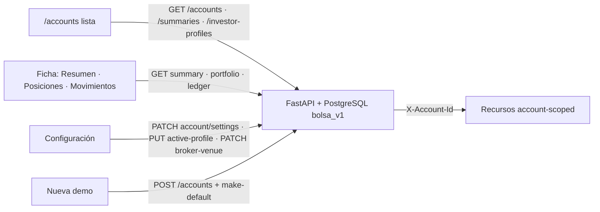

# Seguimiento — Cuentas: muestra y configuración (2026-10-31)

> Alcance: ventana **Cuentas** (`/accounts`) — lista, ficha (Resumen · Posiciones · Movimientos) y pestaña **Configuración** (datos, operativa, perfil inversor, comisiones/fiscal, entorno Paper/Live) más el asistente **Nueva demo**, de punta a punta (backend → frontend → UI en vivo).
> Stack revisado: web `http://localhost:5173`, API `http://localhost:8000`, rama `fix/059-060-proveedores`, HEAD `51c3bdfc`, `2.11.173-beta`, `schema_revision = 062_sync_settings_check_backfill`, PostgreSQL `bolsa_v1`.
> Docs de referencia: [CONFIGURATION_MODEL.md](../CONFIGURATION_MODEL.md), [API_REFERENCE.md](../API_REFERENCE.md), [Seguimiento previo de Cuentas y Perfil inversor](./seguimiento-ui-cuentas-perfil-inversor-2026-10-30.md).
> Evidencia: [`evidence/cuentas-muestra-config-2026-10-31/`](./evidence/cuentas-muestra-config-2026-10-31/).

**Integración**: el código y la evidencia de este documento quedan en `380a456e` (backend y contrato, CTA-D5/CTA-D10) y `4f8308bb` (frontend, CTA-D1…CTA-D9); el tercer commit solo añade documentación y evidencia.

**Publicación**: los commits ya están en `origin/fix/059-060-proveedores` (`15ad62ac` y, desde el cierre del gate, `2c02178a`). Sin PR —el grafo lo descarta—, sin tag y sin Release: `2.11.173-beta` sigue siendo la versión vigente y `.174` no existe. El estado exacto, la comprobación de grafo y la reparación del gate Ruff se registran en [Verificación de grafo y cierre del gate Ruff (2026-10-31)](./verificacion-grafo-cuentas-2026-10-31.md).

Este documento es un **registro de revisión**: no certifica el sello ni autoriza operación. Describe el árbol revisado; el `push` no altera el alcance revisado ni autoriza el sello `.174`.

---

## 1. Método

Misma serie que los seguimientos anteriores: **backend → frontend → en vivo**, con identificadores estables `CTA-*` reutilizados en tests, evidencia y este documento. Cada defecto confirmado se reprodujo con un test que fallaba antes de tocar código (rojo → fix → verde) y se re-midieron los gates afectados.

Ficheros de la auditoría estática: `accounts-page.tsx`, `account-detail-panel.tsx`, `account-settings-panel.tsx`, `account-settings-dialog.tsx`, `account-investor-profile-select.tsx`, `create-account-wizard-dialog.tsx`, `use-active-account.ts`, `stores/active-account-store.ts`, `lib/api.ts`, `apps/api-python/.../routes/accounts.py`, `routes/investor_profiles.py`, `packages/py/application/.../accounts/summary.py`, `account_repository.py`, `investor_profile_repository.py`.

---

## 2. Enlace superficie → endpoint

| Superficie | Endpoint | Identificador de la cuenta |
|------------|----------|----------------------------|
| Lista (filas, contadores, badge «Activa») | `GET /accounts` | — (lista del owner) |
| Tarjetas de patrimonio/posiciones por fila | `GET /accounts/summaries` | — |
| Selector de perfil por fila | `GET /investor-profiles` | — |
| Ficha · Resumen | `GET /accounts/{id}/summary` | **id de la ruta** (no el header) |
| Ficha · Posiciones | `GET /portfolio` | **`X-Account-Id` explícito = cuenta seleccionada** (CTA-D1) |
| Ficha · Movimientos | `GET /accounts/{id}/ledger` | **id de la ruta** |
| Configuración · datos | `PATCH /accounts/{id}` | **id de la ruta** |
| Configuración · operativa | `PATCH /accounts/{id}/settings` | **id de la ruta** |
| Configuración · perfil | `PUT /accounts/{id}/active-profile` | **id de la ruta** |
| Configuración · comisiones/fiscal | `PATCH /accounts/{id}/settings` | **id de la ruta** |
| Configuración · Paper/Live | `PATCH /accounts/{id}/broker-venue` | **id de la ruta** |
| «Usar ahora» | `POST /accounts/{id}/make-default` | **id de la ruta** |
| Nueva demo | `POST /accounts` + `POST /accounts/{id}/make-default` | — |

La distinción importa: los endpoints con `{id}` en la ruta validan acceso con `require_account_access` y **resuelven por ese id**; el header `X-Account-Id` es ambiente (cuenta activa) y solo gobierna los recursos account-scoped **sin** id en la ruta (como `/portfolio`). El cliente inyecta el header desde el store; la ficha lo sobrescribe con la cuenta seleccionada.

---

## 3. Hallazgos y estado

| ID | Sev. | Síntoma | Estado |
|----|------|---------|--------|
| **CTA-D1** | Alta | `AccountDetailPanel` pedía `GET /portfolio` sin id: al seleccionar una cuenta B sin activarla, la pestaña **Posiciones** pedía y pintaba la cartera de la cuenta **activa** A | **Corregido**: `getPortfolio(account.id)` con `X-Account-Id` explícito. Tests RTL + verificación en red (6/15 llamadas coinciden con la cuenta en pantalla; 0 con una tercera) |
| **CTA-D2** | Media | Si fallaba `GET /investor-profiles`, la lista pintaba «perfil no visible» y la ficha «fuera del catálogo (perfil legacy)» como si fueran datos | **Corregido**: estado de error real (`role="alert"`) y rótulo honesto de dato no disponible; deja de afirmar «legacy»/«no visible» sin catálogo |
| **CTA-D3** | Media | Las notas internas hacían `trim()` en cada pulsación: no se podían escribir frases con espacios | **Corregido**: el borrador conserva el texto tal cual; se recorta solo al guardar. Test RTL del texto tecleado + round-trip por API (`nota con espacios  y   dobles`) |
| **CTA-D4** | Media | «Usar ahora» lanzaba `mutateAsync` sin `catch`: un 4xx/5xx no dejaba mensaje | **Corregido**: error visible (`role="alert"`) con reintento; el store local se fija **después** de que el servidor confirme |
| **CTA-D5** | Media | `update_account` rechazaba cuentas cerradas, pero `PATCH /settings` y `PUT /active-profile` no | **Corregido**: `AccountClosedError` → **409 `account_closed`** también en settings, perfil, `ensure-defaults` y `make-default` (las cerradas son registro histórico y no pueden promocionarse a principal). Contrato documentado |
| **CTA-D6** | Baja | La ficha enviaba `name: ""`, el backend lo ignoraba y la UI decía «Datos actualizados» | **Corregido**: validación en cliente con mensaje (`aria-invalid`) y sin `PATCH` |
| **CTA-D7** | Baja | «Informe fiscal» desde una cuenta no activa abría `/fiscal` con la **cuenta activa**, sin avisar | **Documentado en UI**: el enlace se rotula «Informe fiscal (cuenta activa)» con explicación y cómo cambiarla. No se re-scopea `/fiscal` (fuera de alcance) |
| **CTA-D8** | Media | Lecturas fallidas o no disponibles se pintaban como datos vacíos («Sin posiciones abiertas», «Sin dato todavía», ceros) | **Corregido**: estados de error explícitos; una cuenta cerrada declara la ficha como no disponible, no como vacía; el resumen no se pide y no se fabrican cifras |
| **CTA-D9** | Media | Tras crear una cuenta con «Nueva demo», `useActiveAccount` la evaluaba contra una caché de `["accounts"]` aún sin la cuenta, caía al fallback y revertía a la semilla | **Corregido**: invalidar/esperar `["accounts"]` **antes** de fijar `activeAccountId`. Test RTL de activación del asistente |
| **CTA-D10** | Alta | Con una cuenta **cerrada** en la BD, `GET /accounts/summaries` devolvía **500**: `ListAccountSummaries` resolvía el scope de todas las cuentas y `_load_scope` solo admite activas | **Corregido**: la lista de resúmenes omite las cerradas (no hay cartera operable que resumir). Tests de aplicación y de ASGI+PostgreSQL; E2E vuelve a cerrar una cuenta sin error de consola |

Deudas previas que siguen abiertas y no se tocaron: `api.ensureDefaultInvestorProfiles` sin llamadores (AUD-02), paginación del ledger, contenido interno de `/fiscal`, catálogo completo de Configuración → Perfil inversor y motor/AUTO.

---

## 4. Decisión de producto: selección ≠ cuenta activa

Se mantiene la decisión del seguimiento anterior y se verificó en vivo:

| Acción | Efecto |
|--------|--------|
| Clic en una fila | Solo selecciona: `?selected=<id>`, detalle a la derecha. **No** activa, **no** toca `localStorage` |
| «Usar ahora» | `POST make-default` y después estado local; el badge «Activa» se mueve |
| Filtro Demo/Paper/Todas | No activa; la selección se constriñe al filtro y la activa fuera del filtro se anuncia |
| Abrir la ficha de B | 0 escrituras (ni perfil ni settings) |

---

## 5. Casos verificables (CTA)

| ID | Caso | Dónde |
|----|------|-------|
| **CTA-01** | Lista: filas, badge «Activa» solo en la activa, perfil por fila / «Sin perfil», contadores Demo/Paper/Todas | `accounts-page.test.tsx`, E2E |
| **CTA-02** | Seleccionar no dispara `make-default`, persiste `?selected=` y `localStorage` intacto; el portfolio usa la cuenta seleccionada | `accounts-page.test.tsx`, `account-detail-panel.test.tsx`, E2E |
| **CTA-03** | «Usar ahora»: 1 `POST make-default 200`, badge y `localStorage` se mueven | `accounts-page.test.tsx`, `account-detail-panel.test.tsx`, E2E |
| **CTA-04** | Filtros: Paper vacío, selección constreñida, aviso de activa fuera del filtro | `accounts-page.test.tsx`, E2E |
| **CTA-05** | Resumen: patrimonio, efectivo, P&L no realizado, P&L realizado y posiciones; error de resumen como alerta y «No disponible» | `account-detail-panel.test.tsx`, E2E |
| **CTA-06** | Configuración: guardar nombre/descripción con 1 `PATCH`; una sola superficie de perfil; resumen fiscal | `account-settings-panel.test.tsx`, `account-detail-panel.test.tsx`, E2E |
| **CTA-07** | Perfil: asignar (1 `PUT`), aviso de compartido, «Quitar perfil» con confirmación, 0 escrituras al abrir, 1 `PUT {"profileId": null}`, cabecera/fila «Sin perfil» | `account-investor-profile-select.test.tsx`, E2E |
| **CTA-08** | Comisiones/fiscal: botón y deep-link `focus=fiscal`; guardar preset/custom/jurisdicción; notas con espacios; cancelar no escribe | `account-settings-panel.test.tsx`, `account-wizard-fiscal.test.tsx`, E2E |
| **CTA-09** | Entorno Paper/Live: preferencia por cuenta persistida y conservada al guardar settings | `account-venue-preference.test.tsx`, `test_accounts_closed_guard_pg.py`, E2E |
| **CTA-10** | Nueva demo: 6 pasos, alta con perfil/comisiones/fiscal, activación real y aparición en la lista | `create-account-wizard-activation.test.tsx`, `account-wizard-fiscal.test.tsx`, E2E |
| **CTA-11** | Cuenta cerrada: no editable/asignable/activable desde la UI (sin «Usar ahora»); API 409 en datos, configuración, perfil y `make-default`; «Mostrar cerradas»; borrado de demo | `account-detail-panel.test.tsx`, `test_accounts_closed_guard_pg.py`, E2E |
| **CTA-12** | Red y consola: 0 `pageerror`, 0 `console.error`, 0 `ensure-defaults`, escrituras de la superficie contabilizadas y scope coherente | E2E |

---

## 6. Cambios por archivo

### Frontend

| Archivo | Cambio |
|---------|--------|
| `features/accounts/account-detail-panel.tsx` | Portfolio por id (`CTA-D1`); errores de resumen/portfolio visibles y cuenta cerrada como no disponible (`CTA-D8`); validación de nombre (`CTA-D6`); enlace fiscal rotulado (`CTA-D7`); error de activación (`CTA-D4`); resumen no se pide en cerradas |
| `features/accounts/accounts-page.tsx` | Error de catálogo como alerta y rótulo honesto (`CTA-D2`); contadores/filtros y badge de activa |
| `features/accounts/account-settings-panel.tsx` | Borrador de notas sin `trim()` por pulsación; recorte al guardar (`CTA-D3`) |
| `features/accounts/account-investor-profile-select.tsx` | Error de catálogo no se presenta como perfil legacy (`CTA-D2`) |
| `features/accounts/create-account-wizard-dialog.tsx` | Invalidar `["accounts"]` antes de fijar la activa (`CTA-D9`) |
| `features/accounts/use-active-account.ts` | Activación servidor-primero y store después (`CTA-D4`) |
| `lib/api.ts` | `getPortfolio(accountId)` con `X-Account-Id` explícito (`CTA-D1`) |

### Backend

| Archivo | Cambio |
|---------|--------|
| `packages/py/application/src/bolsa_application/accounts/summary.py` | `ListAccountSummaries` omite cuentas no activas antes de resolver scope (`CTA-D10`) |
| `packages/py/domain/src/bolsa_domain/errors.py` | `AccountClosedError` (subclase de `ValueError`) con `code = "account_closed"` |
| `packages/py/infrastructure/.../account_repository.py` | `update_settings` rechaza cuentas cerradas (`CTA-D5`) |
| `packages/py/infrastructure/.../investor_profile_repository.py` | `assign_to_account` rechaza cuentas cerradas (`CTA-D5`) |
| `apps/api-python/.../routes/accounts.py` | Mapeo de `AccountClosedError` → 409 `account_closed` en datos y settings |
| `apps/api-python/.../routes/investor_profiles.py` | 409 en asignación y `ensure-defaults` sin escribir perfiles a cerradas |

---

## 7. Tests

### Backend (PostgreSQL real)

| Suite | Casos | Resultado |
|-------|-------|-----------|
| Área completa (ver comando en §8) | esquemas de cuentas, resumen con realizado, asignación de perfiles, guard de borrado, broker-venue por cuenta, resúmenes de lista, integración de cuentas, perfiles de aplicación y guardas de cerrada | **72 passed, 0 skipped** |
| `packages/py/application/tests/test_list_account_summaries.py` | 3: realizado declarado `None`, un resumen por cuenta, **cerrada ignorada sin resolver scope (CTA-D10)** | ok |
| `apps/api-python/tests/test_accounts_closed_guard_pg.py` | 5: settings/nombre/perfil de cerrada → 409 y sin escritura parcial; `ensure-defaults` no toca cerradas; notas con espacios; guardar settings conserva `brokerVenue`; **`/accounts/summaries` 200 con cerrada (CTA-D10)** | ok |

Las suites PG se ejecutaron de verdad con `INVESTOR_PROFILES_PG_REQUIRED=1`, `PROFILE_DELETE_RACE_PG_REQUIRED=1` y `CTA_PG_REQUIRED=1`.

### Frontend (Vitest + RTL)

| Suite | Casos | Resultado |
|-------|-------|-----------|
| Área de cuentas (8 ficheros) | lista, ficha, selector de perfil, settings, venue, fiscal del asistente, catálogo y activación del asistente | **8 ficheros · 51 tests passed** |
| `account-detail-panel.test.tsx` | incluye CTA-D1, CTA-D2, CTA-D4, CTA-D6, CTA-D7 (2), CTA-D8 (3) | ok |
| `account-settings-panel.test.tsx` | incluye CTA-D3 (espacios al teclear y payload recortado) | ok |
| `create-account-wizard-activation.test.tsx` | CTA-D9: la cuenta nueva queda Activa y el refresco no la revierte | ok |
| Suite web completa | `pnpm test` | **356 ficheros · 2673 tests passed** |

---

## 8. Evidencia y gates

Salida cruda en [`evidence/cuentas-muestra-config-2026-10-31/`](./evidence/cuentas-muestra-config-2026-10-31/).

| Gate | Comando | Resultado | Fichero |
|------|---------|-----------|---------|
| Pytest del área | `uv run pytest apps/api-python/tests/test_schemas_accounts.py apps/api-python/tests/test_account_summary_dto_realized_pnl.py apps/api-python/tests/test_investor_profiles_assign.py apps/api-python/tests/integration/test_accounts.py packages/py/application/tests/test_investor_profiles.py packages/py/application/tests/test_list_account_summaries.py packages/py/application/tests/test_broker_venue_per_account.py packages/py/infrastructure/tests/test_investor_profile_delete_guard.py apps/api-python/tests/test_accounts_closed_guard_pg.py -v` | 72 passed, 0 skipped | `pytest-area.txt` |
| Vitest del área | `pnpm exec vitest run <8 suites de accounts>` | 8 files · 51 tests | `vitest-area.txt` |
| Vitest web completo | `pnpm test` | 356 files · 2673 tests | `vitest-web-full.txt` |
| Typecheck web | `pnpm --filter @bolsa/web typecheck` | limpio | `tsc.txt` |
| ESLint ficheros tocados | `pnpm exec eslint <30 ficheros .ts/.tsx del diff>` | 0 errores (6 avisos `exhaustive-deps` preexistentes en `mesa-hoy-page.tsx`, presentes ya en `HEAD`) | `eslint.txt` |
| Contrato | `pnpm contract:check` | `OK — openapi.json y schema.d.ts coinciden` | `contract-check.txt` |
| Ruff | `uv run ruff check <8 ficheros Python tocados: 6 fuentes + 2 tests>` | `All checks passed!` | `ruff.txt` |
| Mypy | `pnpm types:py` | 582 ficheros, sin errores | `types-py.txt` |

> Nota de orden de imports: `ruff check` resuelve el `pyproject.toml` más cercano a cada fichero y los de `packages/py/*` y `apps/api-python` **no** declaran `[tool.ruff.lint.isort]`. Por eso, en esos paquetes, `bolsa_application` se ordena después del bloque `bolsa_domain`/`bolsa_infrastructure`. El orden que muestran esos ficheros es el que exige el gate, no una edición manual.

### E2E en vivo (`e2e-cuentas.mjs`)

Playwright con Chrome del sistema contra el proxy Vite → API 8000 (`E2E_BASE_URL=http://127.0.0.1:5173`; se usa la IP literal porque Node resuelve `localhost` a `::1` y Vite escucha en IPv4), cuenta semilla para lectura y cuentas/perfiles desechables `CU-REV-*` / `PROF-REV-*` para escritura.

| Dato | Valor |
|------|-------|
| Procedencia | `e2e-result.json` → `provenance`: rama `fix/059-060-proveedores`, `head 4f8308bb…`, `2.11.173-beta`, `dirty: true` (solo quedaban sin commitear estos docs y la evidencia), `startedAt`/`finishedAt` |
| Comprobaciones | **90/90 OK** (`e2e-result.json`, `ok: true`) |
| Peticiones API observadas | 312 |
| Escrituras | 42 |
| `pageerror` / `console.error` | **0 / 0** |
| `ensure-defaults` desde la UI | 0 |
| Capturas | `e2e-01-lista.png` … `e2e-11-cerrada.png` (14 imágenes de recorrido, más `probe-resumen.png`) |
| Trazas | `console.txt`, `network.txt` (ambas con línea `# procedencia`), `e2e-run.log` |
| Foto de BD | `db-before.json` ≡ `db-after.json` (**idénticos byte a byte**, SHA-256 `FED9A486…`), `residue_like: []`; `tables` declara el alcance real (`investment_accounts`, `investor_profiles`) |
| Semilla restaurada | `is_default = true`, `active_profile_id = PROF-996fcd3d6ec6` |

La ejecución se repitió sobre el árbol congelado y con la API reiniciada sin `--reload`, y la que se publica es la que declara `head 4f8308bb`: corresponde a los dos commits de código, no a una ejecución anterior. El recuento de peticiones oscila en ±2 entre pasadas porque el *shell* deja lecturas de fondo en vuelo al cerrar la captura (quedan listadas como aviso, nunca como fallo ni como escritura). La foto de BD declara sus tablas: prueba ausencia de residuos en ellas durante este recorrido, no que toda operación posible sea correcta.

Hallazgo durante el cierre: la comprobación de scope de `X-Account-Id` se afinó para distinguir el **poller del shell** (que pide `/portfolio` con la cuenta activa por diseño) de la **ficha** (que debe pedirlo con la seleccionada). Quedan dos invariantes medidas: la ficha usa la seleccionada (6 llamadas) y ninguna llamada usa el scope de una tercera cuenta. Las peticiones de fondo que siguen en vuelo al cerrar la captura son `GET` del shell y quedan listadas como aviso, no como fallo.

---

## 9. Deuda declarada y límites

- **CTA-D7**: `/fiscal` sigue informando de la cuenta activa; se resolvió con rótulo honesto, no re-scopeando la página (fuera de alcance).
- **Paginación del ledger**: el historial pinta los primeros 30 movimientos sin «cargar más».
- **Contenido interno de `/fiscal` y `/history`**: sin cambios.
- **Catálogo Configuración → Perfil inversor**: sin cambios (solo su enlace y uso desde la ficha).
- **Motor / AUTO**: sin cambios.
- **`api.ensureDefaultInvestorProfiles`**: sigue sin llamadores (AUD-02).
- **Cambios de contrato**: solo documentación de `409 account_closed`; `contract:check` verde.
- **Sin PR, sin tag ni Release**: los commits están publicados en `origin/fix/059-060-proveedores`; el sello `.174` sigue pendiente de autorización expresa.

---

## 10. Bitácora

| Paso | Hecho |
|------|-------|
| 1 | Auditoría estática superficie → endpoint y confirmación de CTA-D1…CTA-D7 (+CTA-D8 de honestidad de lectura). |
| 2 | Corrección CTA-D1 con test rojo: portfolio por id; `api.getPortfolio(accountId)`. |
| 3 | CTA-D2: error de catálogo como alerta en lista, ficha y selector. |
| 4 | CTA-D3: borrador de notas sin recorte por pulsación; recorte al guardar. |
| 5 | CTA-D4: activación servidor-primero, store después, error visible con reintento. |
| 6 | CTA-D5: `AccountClosedError` → 409 `account_closed` en settings, perfil y `ensure-defaults`; contrato documentado. |
| 7 | CTA-D6: validación de nombre vacío en cliente. |
| 8 | CTA-D7: enlace fiscal rotulado como «cuenta activa». |
| 9 | CTA-D8: ficha de cerrada y errores de resumen/portfolio como estados explícitos, no como vacío/cero. |
| 10 | CTA-D9: orden invalidar `["accounts"]` → fijar activa en el asistente; test RTL. |
| 11 | CTA-D10: `ListAccountSummaries` omite cerradas; test de aplicación (rojo antes) y de ASGI+PG. |
| 12 | E2E `e2e-cuentas.mjs`: 90 comprobaciones, 13 capturas, consola/red y foto de BD antes/después idéntica; API reiniciada sin `--reload` para validar el fix de CTA-D10 en vivo. |
| 13 | Gates re-medidos (pytest 72, vitest área 51, vitest web 2673, `tsc`, ESLint, `contract:check`, Ruff, Mypy) y evidencia cruda guardada. |
| 14 | Continuación de esta serie: [Seguimiento — Cuentas: muestra y configuración (2026-10-31)](./seguimiento-ui-cuentas-muestra-config-2026-10-31.md), con CTA-D1…CTA-D10 y el E2E de 90 comprobaciones. |
| 15 | Cierre del gate (2026-10-31): el Ruff del paso 13 se midió sin `--config pyproject.toml` y no era el del CI; tras el push, el job `quality` cayó con 8 I001 del propio cambio. Corregido en `2c02178a` y registrado en [Verificación de grafo y cierre del gate Ruff](./verificacion-grafo-cuentas-2026-10-31.md). Python CI verde con `Ruff`, `Import-linter`, `Mypy` y `Pytest` ejecutados. |
