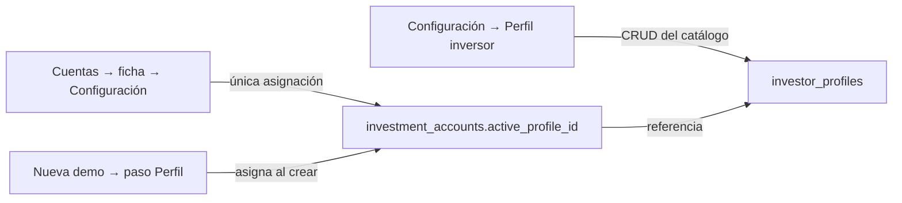

# Seguimiento — Cuentas y Perfil inversor (2026-10-30)

> Alcance: ventana **Cuentas** (`/accounts`) y catálogo **Configuración → Perfil inversor**, frontend y API.
> Base de trabajo: worktree `cuentas-perfil-2026-10-30`, rama `feat/cuentas-perfil-2026-10-30`, desde el sello `a5f6f1c6` (`v2.88.173-beta` en `package.json` → `2.11.173-beta`).
> Docs de referencia: [CONFIGURATION_MODEL.md](../CONFIGURATION_MODEL.md), [API_REFERENCE.md](../API_REFERENCE.md).
> Evidencia: [`evidence/cuentas-perfil-2026-10-30/`](./evidence/cuentas-perfil-2026-10-30/).

Este documento es un **registro de consolidación**, no una certificación del sello ni una autorización operativa. No incluye trabajo fiscal, migraciones, PR, tag ni Release.

---

## 1. Estado del árbol y aislamiento

| Elemento | Valor |
|----------|-------|
| Árbol fiscal intacto | `C:\Users\josea\Documents\Informatica\Typescript\Bolsa_V1` · rama `fix/059-060-proveedores` · 47 ficheros modificados sin commit |
| Árbol de este trabajo | `C:\Users\josea\.cursor\worktrees\cuentas-perfil-2026-10-30` |
| Rama | `feat/cuentas-perfil-2026-10-30` |
| Base | `a5f6f1c6` (sello `2.11.173-beta`) |
| Entorno | `pnpm install` sobre store local; `uv sync --frozen`; `.env` local copiado (gitignored) para PostgreSQL |

Ningún cambio de este seguimiento toca el árbol fiscal. El worktree arranca de un sello limpio, así que los ficheros fiscales del árbol principal **no** están presentes aquí: al integrar ambos trabajos habrá que rebasar el fiscal sobre esta rama (o al revés) y resolver los roces en `account-settings-panel.tsx`, `account-settings-dialog.tsx`, `account-detail-panel.tsx` y `create-account-wizard-dialog.tsx`.

---

## 2. Decisión de arquitectura: catálogo ≠ asignación

**La asignación no vive en Configuración → Perfil inversor.** `investor_profiles` es un catálogo **del usuario**; `investment_accounts.active_profile_id` es **estado de la cuenta**. Mezclarlos obliga a elegir una cuenta dentro del catálogo y crea dos fuentes de verdad.

| Superficie | Responsabilidad | Persistencia |
|------------|-----------------|--------------|
| Configuración → Perfil inversor | CRUD del catálogo + uso en solo lectura | `investor_profiles` |
| Cuentas → ficha → Configuración | **Única** asignación (elegir + aplicar) | `PUT /accounts/{id}/active-profile` |
| Nueva demo → paso Perfil | Asigna al crear la cuenta | alta de cuenta |
| Cuentas → lista | Selección (navegación) + badge de perfil | `?selected=` |



Nota de vocabulario: **no existe la ruta `/configuracion`**; es el modal de Configuración. `/settings#investor-profile` redirige a él.

---

## 3. Selección de cuenta ≠ cuenta activa

Hasta este cambio, pinchar una cuenta en la lista ejecutaba `activateAccount` sobre la cuenta activa **de toda la app** (trading, barra inferior, órdenes) sin acción explícita. Ahora:

| Acción | Efecto |
|--------|--------|
| Clic en la lista | Solo selecciona (detalle + `?selected=<id>`). No cambia la cuenta activa |
| «Usar ahora» en la ficha | Cambia la cuenta activa de toda la app (acción explícita) |
| Cambio de pestaña Demo/Paper | No cambia la cuenta activa; si la activa cae fuera del filtro, la UI lo dice |

La selección se constriñe al filtro vigente: lista y detalle no pueden mostrar cuentas distintas.

---

## 4. Inventario de superficies auditadas

| Superficie | Fichero |
|------------|---------|
| Modal Configuración (pestaña Perfil inversor) | `apps/web/src/features/config/platform-config-dialog.tsx` |
| Catálogo ART-PROFILE | `apps/web/src/features/accounts/investor-profile-panel.tsx` |
| Selector de catálogo | `apps/web/src/features/accounts/investor-profile-picker.tsx` |
| Hub Cuentas | `apps/web/src/features/accounts/accounts-page.tsx` |
| Ficha de cuenta | `apps/web/src/features/accounts/account-detail-panel.tsx` |
| Asignación por cuenta | `apps/web/src/features/accounts/account-investor-profile-select.tsx` |
| Comisiones y fiscal | `apps/web/src/features/accounts/account-settings-panel.tsx`, `account-settings-dialog.tsx` |
| Asistente Nueva demo | `apps/web/src/features/accounts/create-account-wizard-dialog.tsx` |
| API de perfiles | `apps/api-python/src/bolsa_api/api/v1/routes/investor_profiles.py` |
| Casos de uso | `packages/py/application/src/bolsa_application/investor_profiles.py` |
| Repositorio | `packages/py/infrastructure/src/bolsa_infrastructure/database/repositories/investor_profile_repository.py` |

---

## 5. Hallazgos (base `a5f6f1c6`) y estado

| ID | Sev. | Síntoma | Estado |
|----|------|---------|--------|
| **CU-D1** | Alta | `InvestorProfilePanel` decía «solo catálogo» pero renderizaba «Asignar a una cuenta» aunque recibiera `catalogOnly` | Corregido: fuera el bloque de asignación |
| **CU-D2** | Alta | Asignación duplicada en la misma ficha (pestaña Configuración + diálogo que remontaba el selector dentro de `AccountSettingsPanel`) | Corregido: una sola superficie |
| **CU-D3** | Alta | Seleccionar una cuenta disparaba la activación global; lista y detalle podían discrepar si la activa caía fuera del filtro | Corregido: selección desacoplada + selección constreñida al filtro |
| **CU-D4** | Media | El catálogo exigía cuenta activa: sin cuenta no se podía ni crear un perfil | Corregido: la pestaña ya no exige cuenta |
| **CU-D5** | Alta | Editar un perfil compartido cambia la Trading Policy de todas sus cuentas; borrarlo las desasignaba en silencio (Policy Gate caía a `moderate`) | Corregido: uso visible, aviso al editar, borrado bloqueado (409) |
| **CU-D6** | Alta | `PUT /accounts/{id}/active-profile` validaba el dueño de la cuenta pero no el del perfil; `ensure-defaults` creaba perfiles con `user_id=NULL` (invisibles para su dueño) | Corregido |
| **CU-D7** | Media | Escrituras ocultas al montar la UI: panel y selector llamaban a `ensure-defaults` como efecto de render | Corregido: sin auto-bootstrap |
| **CU-D8** | Media | La ventana Cuentas no tenía suite propia | Corregido: 5 suites nuevas (18 casos) |
| **CU-D9** | Media | El perfil activo no se veía ni en la lista ni en la cabecera; la ayuda documentaba dos caminos de asignación | Corregido |
| **CU-D10** | Baja/Media | Errores de carga de cuentas/summaries se mostraban como «no hay cuentas»; `totalRealizedPnl` viajaba en el resumen pero no se pintaba | Corregido (errores reales + P&L realizado). **No** se toca la paginación «cargar más» del ledger |
| **AUD-01** | Media | La UI no podía desasignar un perfil | **Corregido (2.ª pasada)**: «Quitar perfil» con confirmación inline, `PUT {"profileId": null}`, sin `ensure-defaults`, copy «Sin perfil» en cabecera y fila |
| **AUD-03** | Media | TOCTOU en el borrado y desasignación implícita en el repositorio | **Corregido (2.ª pasada)**: `delete_if_unused` atómico con `FOR UPDATE`, `assign_to_account` serializado y FK `ON DELETE RESTRICT` (migración 061) |
| **AUD-07** | Media (evidencia) | `*.txt` en UTF-16LE y `contract-check.txt` corrupto | **Corregido (2.ª pasada)**: `regen-evidence.ps1` escribe UTF-8 sin BOM; 0 bytes NUL; `contract-check.txt` real |

---

## 6. Casos verificables (CUE)

| ID | Caso | Dónde |
|----|------|-------|
| **CUE-01** | Configuración → Perfil inversor no muestra selector de cuenta ni botón de aplicar, y no crea perfiles al abrirse | `investor-profile-panel.test.tsx` |
| **CUE-02** | El catálogo muestra en qué cuentas está en uso cada perfil y bloquea el borrado si está en uso | `investor-profile-panel.test.tsx` |
| **CUE-03** | Editar un perfil compartido avisa de cuántas cuentas cambian de política | `investor-profile-panel.test.tsx` |
| **CUE-04** | Seleccionar una cuenta no llama a `activateAccount`; solo navega y persiste `?selected=` | `accounts-page.test.tsx` |
| **CUE-05** | «Usar ahora» sí activa la cuenta | `account-detail-panel.test.tsx` |
| **CUE-06** | La selección no puede salir del filtro vigente y la cuenta activa fuera del filtro se anuncia | `accounts-page.test.tsx` |
| **CUE-07** | Cada fila muestra el perfil activo o «Sin perfil» | `accounts-page.test.tsx` |
| **CUE-08** | La ficha muestra el perfil en cabecera y en Resumen el P&L realizado | `account-detail-panel.test.tsx` |
| **CUE-09** | `?focus=perfil` abre Configuración y enfoca el bloque de asignación | `account-detail-panel.test.tsx` |
| **CUE-10** | Solo hay una superficie de asignación (sin selector dentro de comisiones/fiscal) | `account-settings-panel.test.tsx` |
| **CUE-11** | Asignar un perfil hace `PUT` explícito y avisa si el perfil es compartido | `account-investor-profile-select.test.tsx` |
| **CUE-12** | Asignar un perfil propio → 200; ajeno → 404; cuenta ajena → 404 | `test_investor_profiles_assign.py` |
| **CUE-13** | `ensure-defaults` crea **un** perfil compartido por usuario y es idempotente | `test_investor_profiles_assign.py` |
| **CUE-14** | Borrar un perfil en uso → 409 `profile_in_use` con las cuentas afectadas | `test_investor_profiles_assign.py` |
| **CUE-15** | Acceso directo al repositorio: borrar un perfil asignado devuelve `(False, nombres)` y no desasigna; tras desasignar sí borra | `test_investor_profile_delete_guard.py` |
| **CUE-16** | `DELETE` en SQL crudo sobre un perfil asignado → `IntegrityError` (FK `RESTRICT`); la cuenta conserva el perfil | `test_investor_profile_delete_guard.py` |
| **CUE-17** | Asignar y borrar a la vez: o 409 con el perfil vivo, o 404 con `active_profile_id = NULL`; nunca un estado incoherente | `test_investor_profile_delete_guard.py` |
| **CUE-18** | La FK declarada en metadata y en la BD es `ondelete="RESTRICT"` | `test_schema_contract.py` |
| **CUE-19** | «Quitar perfil» pide confirmación, no escribe al pulsar, cancelar no escribe y confirmar hace un único `PUT {"profileId": null}` sin `ensure-defaults` | `account-investor-profile-select.test.tsx` |
| **CUE-20** | La cabecera y la fila muestran «Sin perfil» cuando `activeProfileId` es `null` | `account-detail-panel.test.tsx`, `accounts-page.test.tsx` |
| **CUE-21** | Una cuenta cerrada sigue bloqueando el borrado (409) y conserva su `active_profile_id` | `test_investor_profiles_assign.py` |

---

## 7. Cambios por archivo

### Frontend

| Archivo | Cambio |
|---------|--------|
| `features/accounts/investor-profile-panel.tsx` | Solo catálogo: fuera `assignAccountId`/`assignProfileId`/`assignMutation` y el auto-`ensure-defaults`. Uso por perfil («En uso en: …» / «Sin uso»), aviso al editar compartido y borrado deshabilitado si está en uso |
| `features/config/platform-config-dialog.tsx` | `InvestorProfileTabPanel` ya no exige cuenta activa; copy de una sola ruta de asignación; fuera `activeProfileId` del panel de comisiones |
| `features/accounts/accounts-page.tsx` | Fuera la activación implícita al seleccionar. `?selected=` al hacer clic, selección constreñida al filtro, aviso de cuenta activa fuera del filtro, badge de perfil por fila, errores reales de cuentas/resúmenes |
| `features/accounts/account-detail-panel.tsx` | Perfil visible en cabecera con acceso directo; `focus=perfil`; bloque de asignación con `ref`; `totalRealizedPnl` en Resumen; «Editar comisiones y fiscal» |
| `features/accounts/account-investor-profile-select.tsx` | Reescrito: estado sin perfil explícito, aviso de uso compartido, impacto declarado y **aplicar** explícito (sin auto-ensure) |
| `features/accounts/account-settings-panel.tsx` | Fuera `AccountInvestorProfileSelect` y `activeProfileId`: solo comisiones, fiscal y preferencia de venue |
| `features/accounts/account-settings-dialog.tsx` | Título/copy de comisiones y fiscal |
| `features/accounts/create-account-wizard-dialog.tsx` | Uso compartido en el picker y copy «se asignará a esta cuenta al crearla» |

### Backend

| Archivo | Cambio |
|---------|--------|
| `packages/py/application/.../investor_profiles.py` | `AssignInvestorProfileToAccount(..., owner_user_id)`; `DeleteInvestorProfileResult` + guard de uso; `EnsureDefaultInvestorProfile` reutiliza **un** perfil por usuario (`DEFAULT_PROFILE_NAME`) y propaga `user_id`; `EnsureDefaultsForAccounts(..., user_id)`; el alta valida el dueño del perfil reutilizado |
| `packages/py/infrastructure/.../investor_profile_repository.py` | `assign_to_account(..., owner_user_id)` valida cuenta y perfil (ajeno → «no encontrado»); nuevo `accounts_using(profile_id)` |
| `apps/api-python/.../routes/investor_profiles.py` | `assign` pasa el principal; `ensure-defaults` propaga el dueño; borrado → 409 `profile_in_use` con `accounts`; `responses` documentados |

---

## 8. Tests

### Backend

| Suite | Casos | Resultado |
|-------|-------|-----------|
| `packages/py/application/tests/test_investor_profiles.py` (fake store) | 9: propagación del dueño al asignar, desasignar, perfil por defecto compartido e idempotente, no reutilizar perfiles de otro tenant, conservar el perfil existente, propagación del dueño en `ensure-defaults`, borrado bloqueado en uso, borrado libre, rechazo de perfil ajeno en el asistente | `9 passed` |
| `apps/api-python/tests/test_investor_profiles_assign.py` (PostgreSQL real + ASGI) | 3: asignar propio `200` / ajeno `404` / desasignar `200` / cuenta intacta tras el rechazo · `ensure-defaults` con dueño, **un** perfil compartido, idempotente · borrado en uso `409 profile_in_use` con cuentas y sin desasignar | `3 passed` |

Total área backend: **12 passed**. Se ejecutan contra la BD de `DATABASE_URL` del worktree; si PostgreSQL no responde, las de integración se saltan salvo `INVESTOR_PROFILES_PG_REQUIRED=1` (en esta pasada corrieron de verdad).

### Frontend (Vitest + RTL)

| Suite | Casos | Resultado |
|-------|-------|-----------|
| `investor-profile-panel.test.tsx` | 3: catálogo puro (sin selector de cuenta, sin botón de asignar, sin auto-`ensure-defaults`), uso por perfil con borrado deshabilitado, aviso al editar compartido | ok |
| `accounts-page.test.tsx` | 5: seleccionar no activa y persiste `?selected=`, «Usar ahora» sí activa, badge de perfil por fila, aviso de activa fuera del filtro, error de carga real | ok |
| `account-detail-panel.test.tsx` | 5: perfil en cabecera, perfil legacy fuera del catálogo, `totalRealizedPnl` en Resumen, activación explícita, `?focus=perfil` con una sola superficie | ok |
| `account-investor-profile-select.test.tsx` | 4: sin auto-ensure y perfil activo visible, aviso de fallback `moderate`, `PUT` solo al pulsar «Aplicar a esta cuenta», aviso de perfil compartido | ok |
| `account-settings-panel.test.tsx` | 1: comisiones/fiscal ya no repiten la asignación | ok |

Total área frontend: **5 ficheros · 18 tests passed**. Suite web completa: **353 ficheros · 2632 tests passed**.


---

## 9. Evidencia y gates

Ejecutados en el worktree el 2026-10-30. Salida cruda en [`evidence/cuentas-perfil-2026-10-30/`](./evidence/cuentas-perfil-2026-10-30/README.md), regenerable con `regen-evidence.ps1` (UTF-8 sin BOM).

| Gate | Comando | Resultado | Fichero |
|------|---------|-----------|---------|
| Pytest del área | `uv run pytest …test_investor_profiles.py …test_investor_profile_delete_guard.py …test_schema_contract.py …test_061_profile_delete_restrict.py …test_investor_profiles_assign.py -v` | 33 passed | `pytest-area.txt` |
| Integración 061 (PG) | `uv run pytest …test_061_profile_delete_restrict_pg.py …test_investor_profile_delete_race_pg.py -v` (con `PROFILE_DELETE_MIGRATION_PG_REQUIRED=1`, `PROFILE_DELETE_RACE_PG_REQUIRED=1`) | 8 passed (base nueva, base heredada con datos, ventana transaccional, downgrade; 4 desenlaces de carrera) | `pytest-integridad-061.txt` |
| Vitest del área | `npx vitest run <5 suites de Cuentas> --reporter=verbose` | 5 files · 23 tests passed | `vitest-area.txt` |
| Vitest web completo | `pnpm --filter @bolsa/web test` | 353 files · 2637 tests passed | `vitest-web-full.txt` |
| Vitest web completo (2.ª ejecución independiente) | `pnpm --filter @bolsa/web test` | 353 files · 2637 tests passed | `vitest-web-full-run2.txt` |
| Typecheck web | `pnpm --filter @bolsa/web typecheck` | limpio | `tsc.txt` |
| ESLint áreas tocadas | `eslint src/features/{accounts,config,help}` | sin hallazgos | `eslint.txt` |
| Contrato | `pnpm contract:gen` + `pnpm contract:check` | `OK` | `contract-check.txt` |
| Ruff | `ruff check packages/py apps/api-python` | `All checks passed!` | `ruff.txt` |
| Mypy | `mypy … --follow-imports=silent` | 582 files, sin errores | `mypy.txt` |
| API real | `uv run python api-evidence.py` (ASGI + PostgreSQL) | `200` propio · `409 profile_in_use` · `404` ajeno · `PUT null` → `active_profile_id NULL` | `api-responses.txt` |

### Contrato

`contract:check` empezó en rojo: los `responses` documentados cambian el OpenAPI. Se regeneró con `contract:gen`; el diff es **solo documentación** (+6 líneas en `openapi.json`, +14 en `schema.d.ts`): un `404` en `PUT /accounts/{id}/active-profile` y un `409` en `DELETE /investor-profiles/{id}`. Sin cambio de esquema ni de tipos de request/response.

### Respuestas reales (`api-responses.txt`)

```
PUT /api/accounts/{id}/active-profile  {"profileId": "<propio>"}  → 200 {"data":{"accountId":"default-account-seed","activeProfileId":"PROF-…"}}
PUT /api/accounts/{id}/active-profile  {"profileId": "<ajeno>"}   → 404 {"detail":"Perfil no encontrado"}
DELETE /api/investor-profiles/{id}     (perfil en uso)            → 409 {"detail":{"code":"profile_in_use","accounts":["Cuenta demo EUR"]}}
PUT /api/accounts/{id}/active-profile  {"profileId": null}        → 200  («Quitar perfil»: sin perfil por defecto)
GET /api/accounts/{id}/active-profile                              → 404  (active_profile_id = NULL de verdad)
```

El script restauró el estado: perfil propio borrado, fila ajena eliminada y cuenta semilla con su `active_profile_id` original (verificado con consulta a la BD: 0 filas `CU-*`/`PROF-EVIDENCIA*` restantes).

### Recorrido en vivo (CUE-E2E ejecutado el 2026-10-30)

Ejecutado con navegador real contra el stack de **este** worktree (Vite 5317 → API 8317, ambos aislados del
árbol fiscal). Evidencia: [`evidence/cuentas-perfil-2026-10-30/e2e/`](./evidence/cuentas-perfil-2026-10-30/e2e/README.md)
(10 capturas, `console.txt`, `network.txt` y fotos de BD).

| Caso | Resultado |
|------|-----------|
| Badge de perfil por fila y «Sin perfil» | ok |
| Seleccionar una cuenta → `?selected=`, sin `make-default` y sin tocar `localStorage` | ok |
| «Usar ahora» → `make-default 200` + ACTIVA movida | ok |
| `?type=paper&selected=<demo>` → selección constreñida + aviso de activa fuera del filtro | ok |
| `?focus=perfil` → Configuración + una sola superficie de asignación | ok |
| Catálogo puro (sin cuenta, sin asignar, sin `ensure-defaults`) y uso por perfil | ok |
| Asignación solo con «Aplicar» (1 `PUT`), aviso de compartido y `409` en UI con caché obsoleta | ok, con el matiz AUD-04 |
| Cambio Demo/Paper y de selección → nunca activan; consola sin errores | ok |
| **AUD-01** «Quitar perfil» desde la UI: confirmación visible, 0 escrituras al pulsar, 1 `PUT {"profileId": null}`, 0 `ensure-defaults`, cabecera y fila «Sin perfil», BD con `active_profile_id = NULL` | ok (`e2e-09`, `e2e-10`, `db-active-profile-null.json`) |

Cierre verificado: cuentas y perfil desechables `CU-E2E-*` borrados, `is_default` y `active_profile_id`
restaurados, foto de BD idéntica a la inicial y árbol fiscal con el mismo hash. La auditoría del diff, con los
hallazgos y los roces de integración, está en
[`diff-audit.md`](./evidence/cuentas-perfil-2026-10-30/diff-audit.md).


---

## 10. Deuda declarada y límites

- **Trabajo fiscal (47 ficheros)**: fuera de alcance; sello propio. Este worktree no lo contiene.
- **Paginación del ledger**: el historial sigue pintando los primeros 30 movimientos sin «cargar más» (la exportación sí pagina).
- **Detalle de posiciones con P&L**: sin cambios.
- **Búsqueda y filtros avanzados de cuentas**: sin cambios.
- **Motor/ AUTO**: sin cambios.
- **Migración**: solo `061_profile_delete_restrict`, que endurece la FK `investment_accounts.active_profile_id` a `ON DELETE RESTRICT` (idempotente; `downgrade` vuelve a `SET NULL`). No crea ni borra tablas ni columnas.
- **Ventana de la 061 al desplegar**: recrear la FK toma `ACCESS EXCLUSIVE` sobre `investment_accounts` (bloquea lecturas/escrituras de la tabla mientras corre; es cuestión de milisegundos en una tabla de cuentas). El `DROP + CREATE` viaja en la transacción de Alembic: un lector concurrente nunca ve la FK ausente (verificado en `test_061_profile_delete_restrict_pg.py`).
- **El `downgrade` de la 061 reabre la semántica `SET NULL`**: es un rollback de esquema, no una operación rutinaria. Mientras la API nueva promete `409 profile_in_use`, bajar a `060` devuelve la desasignación silenciosa; solo debe ejecutarse si se revierte también el código.
- **Sin PR, tag ni Release**: requieren revisión de alcance y autorización explícita.
- ~~**Sin recorrido E2E real**~~: **cubierto** el 2026-10-30 (§9) con navegador real y capturas en `evidence/cuentas-perfil-2026-10-30/e2e/`, incluido el caso nuevo «Quitar perfil». Queda fuera del recorrido el flujo «Nueva demo» del asistente en vivo y el responsive/tema oscuro.
- **Hallazgos de la auditoría del diff**: AUD-01, AUD-03 y AUD-07 **corregidos y re-auditados** (§7 de `evidence/cuentas-perfil-2026-10-30/diff-audit.md`). Siguen abiertos, como deuda anotada:
  - AUD-02 (baja): `api.ensureDefaultInvestorProfiles` queda sin llamadores en el cliente.
  - AUD-04 (baja): el mensaje del `409` en UI no enumera las cuentas afectadas aunque el payload las trae.
  - AUD-05 (baja): `focus` sobrevive al cambio de pestaña/filtro (`?focus=perfil&type=all`).
  - AUD-06 (baja): el test de integración restaura con `_restore`, que cae a `ensure-defaults` si el `PUT` falla; con perfil legado la suite alteraría la semilla.
  - AUD-08 (info): el aviso de «cuenta activa fuera de la pestaña» resuelve sobre `accounts`, así que puede nombrar una cuenta **cerrada**.
  - AUD-09 (info): el scroll del bloque de perfil depende de `setTimeout(…, 80)`.
- **Integridad del borrado**: ningún camino (ruta, repositorio, SQL crudo, concurrencia) puede eliminar un perfil asignado; la única desasignación es un `PUT` explícito (botón «Quitar perfil» o API).
- **Roce de integración**: `apps/web/src/features/accounts/account-settings-panel.test.tsx` colisiona con el árbol fiscal (mismo path, contenido distinto): al integrar hay que **fusionar**, no sobrescribir. Hay además 4 ficheros de código solapados (ver §3 de `diff-audit.md`).
- **Sin `force` en el borrado**: desasignar (botón o API) y volver a borrar es el camino soportado; no hay borrado en cascada ni reasignación automática.
- El contrato OpenAPI cambió solo por documentación de `404`/`409`: `contract:gen` + `contract:check` quedan verdes (§9).

---

## 11. Bitácora

| Paso | Hecho |
|------|-------|
| 1 | Worktree `cuentas-perfil-2026-10-30` + rama `feat/cuentas-perfil-2026-10-30` desde `a5f6f1c6`; `pnpm install` y `uv sync` sobre el store local; `.env` copiado (gitignored). El árbol fiscal no se tocó. |
| 2 | Documento de seguimiento y carpeta de evidencia creados con los hallazgos CU-D1…CU-D10 medidos sobre el sello. |
| 3 | Catálogo: fuera asignación y auto-`ensure-defaults` de `InvestorProfilePanel`; `InvestorProfileTabPanel` deja de exigir cuenta activa y pasa `accounts` solo para uso read-only. |
| 4 | Cuentas: selección desacoplada de la cuenta activa, `?selected=`, selección constreñida al filtro, aviso de activa fuera del filtro, badge de perfil y errores reales. |
| 5 | Ficha: perfil en cabecera, `focus=perfil`, `totalRealizedPnl` en Resumen, «Editar comisiones y fiscal» y una sola superficie de asignación. |
| 6 | `AccountInvestorProfileSelect` reescrito como único punto de asignación, con estado sin perfil y aviso de uso compartido; retirado de `AccountSettingsPanel`/`AccountSettingsDialog`. |
| 7 | Backend: `owner_user_id` en asignación (perfil ajeno → `404`), `ensure-defaults` con dueño y **un** perfil compartido, borrado en uso → `409 profile_in_use`. |
| 8 | Tests: 9 casos de aplicación con fake store, 3 de integración contra PostgreSQL y 18 de Vitest/RTL en 5 suites. |
| 9 | Gates: pytest, vitest (área y suite completa), `tsc`, `eslint`, `ruff`, `mypy`. `contract:check` estaba rojo → `contract:gen` (solo documentación de `404`/`409`) → verde. |
| 10 | Evidencia cruda guardada en `evidence/cuentas-perfil-2026-10-30/`; respuestas HTTP reales capturadas y estado de la BD restaurado. Docs `CONFIGURATION_MODEL.md` y `API_REFERENCE.md` actualizados. |
| 11 | Auditoría del diff contra `a5f6f1c6` (16 modificados, 18 sin seguimiento) y de los nueve artefactos de evidencia; ocho gates re-ejecutados con los mismos recuentos; hallazgos AUD-01…AUD-09 en `evidence/…/diff-audit.md`, sin corregir código. |
| 12 | CUE-E2E visual con navegador real sobre el stack aislado del worktree (Vite 5317 → API 8317), 8 capturas + `console.txt` + `network.txt`; cuentas y perfiles desechables borrados, `is_default` y `active_profile_id` restaurados, `db-after.json` idéntico a `db-before.json` y árbol fiscal con el mismo hash. |
| 13 | Corrección AUD-03: `delete_if_unused` atómico con `SELECT … FOR UPDATE`, `assign_to_account` serializado con el mismo lock, sin desasignación implícita; puerto y caso de uso adaptados. |
| 14 | Corrección AUD-03 (BD): FK `ON DELETE RESTRICT` en `tables.py`, `schema.prisma` y SQL de Prisma; migración idempotente `061_profile_delete_restrict` aplicada (`confdeltype = 'r'`); `docs/DATA_MODEL.md` actualizado. |
| 15 | Pruebas AUD-03: `test_investor_profile_delete_guard.py` (repositorio, SQL crudo, concurrencia), contrato de FK en `test_schema_contract.py`, cuenta cerrada en `test_investor_profiles_assign.py` y guard-delegado en el fake store. Guardias de `head` de Alembic actualizadas a 061 (6 tests, solo la constante). |
| 16 | Corrección AUD-01: «Quitar perfil» con confirmación inline, `PUT {"profileId": null}`, sin `ensure-defaults`; copy «Sin perfil» en cabecera y fila; 5 tests RTL nuevos. |
| 17 | Corrección AUD-07: `regen-evidence.ps1` (UTF-8 sin BOM) regenera los diez `*.txt`, con `contract-check.txt` real y dos ejecuciones completas de Vitest; `api-evidence.py` reproducible con verificación de residuos. |
| 18 | Cierre: gates re-medidos (22 pytest, 23 vitest de área, 353·2637 vitest web ×2, `tsc`, `eslint`, `contract:check`, `ruff`, `mypy`), E2E nuevo «Quitar perfil» (`e2e-09`/`e2e-10`, `db-active-profile-null.json`, 0 residuos) y re-auditoría del diff contra `a5f6f1c6` (§7 de `diff-audit.md`). |
| 19 | Integración 061 (comprobación adicional del dictamen): `migrate_to`/`downgrade_to` en `migrations.py` (mismo runner que `ensure_migrated`); `test_061_profile_delete_restrict.py` (cadena, idempotencia, downgrade y coherencia metadatos/Prisma/061) y `test_061_profile_delete_restrict_pg.py` sobre BD scratch efímera: base nueva → `RESTRICT`; base heredada `SET NULL` **con perfil asignado** → `RESTRICT` sin perder datos; lector concurrente que nunca ve la FK ausente; `downgrade` → `SET NULL` sin huérfanos y re-`upgrade` → `RESTRICT`. |
| 20 | Carrera real determinista (`test_investor_profile_delete_race_pg.py`): el orden se impone desde fuera y se verifica con `pg_blocking_pids`; cubre «gana el borrado» (asignación 404 sin escribir), «gana la asignación» (409 `in_use`) y el backstop FK con escritores que ignoran el lock, en ambos órdenes. Cableado en `lifecycle-pg` con gate fail-if-skipped y nuevo gate `pytest-integridad-061.txt` en el lote de evidencia. |

Sin commit, sin push, sin PR, sin tag y sin Release: el diff queda para revisión de alcance.

