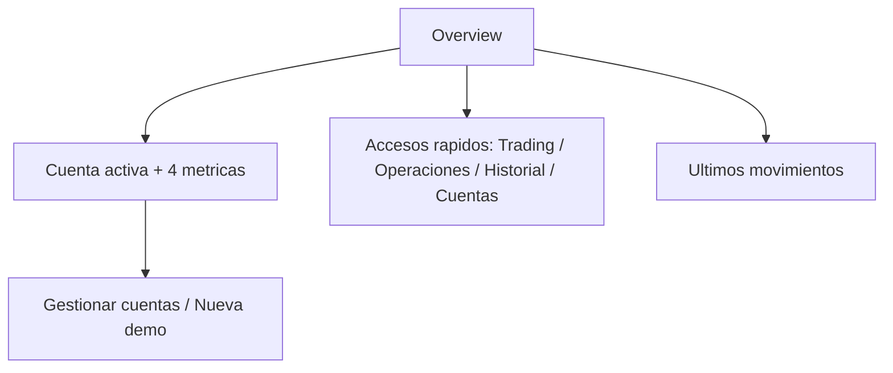

# Seguimiento — Ventana Overview (2026-11-01)

> Alcance: **solo frontend** (`/overview`). Sin cambios de backend, contrato HTTP, DTO, Alembic ni worker.
> Doc de contrato aplicado: [spec UI Contract 5.0](./spec-ui-contract-5-0-2026-10-08.md) §2 (`RT-01`, `RT-02`, `R-G1`, `R-G2`, `UI5-20`).
> Evidencia: [`evidence/overview-simplificada-2026-11-01/`](./evidence/overview-simplificada-2026-11-01/).
> Aceptación: [`dictamen-overview-simplificada-2026-11-01.md`](./dictamen-overview-simplificada-2026-11-01.md) — fija los límites `L-OVW-1` y `L-OVW-2`.

---

## 1. Diagnóstico (medido en navegador, no estimado)

Antes del cambio, a 1440×900 la ventana obligaba a hacer scroll: el contenido medía **1749 px** en un viewport útil de 853 px.

| Bloque | Alto | Problema |
|---|---:|---|
| Cabecera (`h1` + botón «Ir a Trading») | 56 px | CTA duplicada con el primer acceso |
| Cuenta activa | 229 px | Copy largo + 4 métricas (útil) |
| Investigación · sync | 367 px | Jerga interna en primer nivel: `Score_FUND`, `Piotroski`, `FIE`, `Paper D`, `whitelist`, `PAPER_D_EXECUTE=1`, `pnpm test:fa` |
| Accesos (8 tarjetas) | 495 px | Duplica la barra L1 (Hoy · Mercado · Cartera · Asesor · Laboratorio) y el `AdminRail` |
| Últimos movimientos + Por dónde seguir | 287 px | Los movimientos son útiles; el tutorial repite Accesos y Ayuda |
| Datos de mercado | 194 px | Estado técnico de sync, ya editable en Configuración → Sync |

A 380×556 (panel real del IDE) la suma de bloques era **≈ 4.025 px**.

**Reglas incumplidas:** `RT-01` (dato secundario en primer nivel), `RT-02` / `R-G1` (arquitectura interna visible), `UI5-01` / `R-G2` (la pantalla explicaba el sistema en vez de responder), `UI5-20` (dos rótulos/superficies para la misma navegación).

---

## 2. Decisión

Overview responde a **una** pregunta: *¿qué tengo y por dónde sigo?* Tres bloques, cada hecho una sola vez.

| Decisión | Motivo |
|---|---|
| Recorte **mínimo** (cuenta + accesos + movimientos) | Es lo que cambia lo que el usuario hace ahora; el resto tiene superficie propia |
| Se retiran **Investigación**, **Por dónde seguir** y **Datos de mercado** | Viven en Ayuda → Backtesting / Análisis del valor y en Configuración → Sync / proveedores |
| 8 tarjetas → **4 enlaces compactos** | La navegación ya está en la barra L1 y en el `AdminRail` (no se duplica) |
| Se mantiene el rótulo **«Overview»** | Cero impacto en `AdminRail`, e2e y barrido axe |
| «Ir a Trading» deja de ser botón de cabecera | Pasa a ser el primer acceso rápido (estilo primario): una sola CTA |

Cada bloque retirado sigue accesible: `Ayuda → Laboratorio / Asesor` para la documentación de investigación, `Configuración → Sync / proveedores` para el estado de captura.

---

## 3. Cambios por archivo

| Archivo | Cambio |
|---|---|
| [`apps/web/src/features/dashboard/dashboard-page.tsx`](../../apps/web/src/features/dashboard/dashboard-page.tsx) | Reescrito: cabecera con subtítulo de una línea, `ActiveAccountPanel` (h2 «Cuenta activa», nombre como texto, copy de una línea), `QuickLinks` (`nav[aria-label="Accesos rápidos"]`, 4 enlaces), `RecentLedgerCard` con `CardTitle level="h2"`. Eliminados `ResearchHighlights`, `NextStepsCard` y `NavCard` |
| [`apps/web/src/features/dashboard/dashboard-page.test.tsx`](../../apps/web/src/features/dashboard/dashboard-page.test.tsx) | **Nuevo** — 9 casos: jerarquía de encabezados, métricas, accesos y destinos, otras cuentas, movimientos y vacío, guardas anti-jerga |
| `apps/web/src/features/settings/data-sync-summary-card.tsx` | **Borrado** — sin consumidores tras salir de Overview; la edición real vive en `features/sync/sync-settings-panel.tsx` |

Sin cambios en backend, DTO, rutas ni en el `AdminRail`. Los datos usados siguen siendo `GET /api/accounts`, `/summary` y `/ledger?limit=8`.

### Jerarquía documental (gate `heading-order`)

`h1 Overview` → `h2 Cuenta activa` → `h2 Accesos rápidos` → `h2 Últimos movimientos`. Sin saltos y sin depender de un `h3` intermedio.

---

## 4. Resultado medido (después)

| Viewport | Contenido | Scroll | Notas |
|---|---:|---|---|
| 1440×900 | **596 px** (antes 1749 px) | **no** (`scrollH = clientH = 853`) | Bloques: 56 / 209 / 85 / 174 px |
| 390×740 | 1103 px | sí (esperado en móvil) | `scrollWidth = 390` → sin desbordamiento horizontal |

Capturas: `overview-despues-1440x900.png`, `overview-despues-movil-390x740.png`, `overview-despues-628x918.png` y `overview-antes-628x918.png` (panel real del IDE antes del cambio).

---

## 5. Verificación en vivo

Stack local: Vite `:5173` + API Python `:8000` (PostgreSQL local). Cuenta activa: `Demo · Cuenta demo EUR`.

| Caso | Cómo | Resultado |
|---|---|---|
| Jerarquía y contenido | `browser_snapshot` | `h1 Overview` + 3 `h2`; 4 métricas con valores reales (`99800.00`, `99800.00`, `0.00`, `0` + «Margen libre 99800.00») |
| Sin jerga ni duplicidades | Lectura del DOM | No aparecen «Investigación», «Por dónde seguir», «Datos de mercado», `Score_FUND`, `PAPER_D_EXECUTE`, `whitelist`, `FIE` |
| Acceso Trading | Clic real | `/trading` |
| Acceso Operaciones | Clic real | `/operations` |
| Acceso Historial | Clic real | `/history` |
| Acceso Cuentas | Clic real | `/accounts` |
| Destinos declarados | `nav[aria-label="Accesos rápidos"] a` | `["/trading","/operations","/history","/accounts"]` |
| Datos del ledger | UI | «Custodia anual −200.00» y «Ingreso de efectivo 100000.00» |
| Contraste API | `GET /api/accounts`, `/summary`, `/ledger?limit=8` | 200; `totalEquity=99800`, `cash=99800`, `totalUnrealizedPnl=0`, `positionsCount=0`, `freeMargin=99800`; 2 asientos |
| Sin error de API | Cabecera | No aparece «API no disponible» |

Detalle del contraste HTTP: `api-overview.txt`.

---

## 6. Gates

| Gate | Resultado | Fichero |
|---|---|---|
| `vitest run src/features/dashboard src/test/heading-order.test.tsx` | 2 archivos / **19 tests** ✅ | `vitest-area.txt` |
| `vitest run` (web completo) | 357 archivos / **2686 tests** ✅ | — |
| `tsc -b --noEmit` | ✅ | `tsc.txt` |
| `eslint src/` | **0 errores**, 23 warnings preexistentes | `eslint.txt` |
| `pnpm contract:check` | ✅ sin cambios de DTO | `contract-check.txt` |
| `playwright e2e/gp-e2e-ui5-0-axe-touched-routes-mock.spec.ts` | **35/35** ✅ (incluye `/overview` @desktop y @móvil con 0 critical/serious) | `axe-touched-routes.txt` |

> Nota de entorno: el barrido axe falló en el primer intento con `browserType.launch: Executable doesn't exist`. Se resolvió con `pnpm --filter @bolsa/web exec playwright install chromium`; no era un fallo de código (fallaban las 35 rutas, no solo Overview).

---

## 7. Límites

Los dos primeros están **nombrados y aceptados** en el dictamen, con su condición de apertura: no son deuda
pendiente, son parte del alcance aceptado.

- **`L-OVW-1` — el estado de sync deja de mostrarse en Overview:** se consulta en Configuración → «Automatización: velas y servidores» (`SyncSettingsPanel` + `MarketProvidersStatusCard`). No se pierde información, cambia de superficie. Se reabre si esa superficie pierde el estado o deja de ser alcanzable.
- **`L-OVW-2` — «otras cuentas activas» sin prueba en navegador real:** cobertura solo por el caso unitario `señala cuántas otras cuentas activas hay`. Se reabre con una comprobación en navegador con dos cuentas activas, cambio de cuenta y repintado de métricas y movimientos.
- La documentación de investigación (Backtesting / FIE) sigue en Ayuda; este cambio **no** la reescribe.
- No se renombra la ruta `/overview` ni el ítem del `AdminRail`.
- Verificación de datos con la cuenta demo canónica (`default-account-seed`, 2 asientos).
- No se midió rendimiento de la página (solo altura y ausencia de scroll); el número de queries baja de 4 a 3 (`health`, `summary`, `ledger`).
