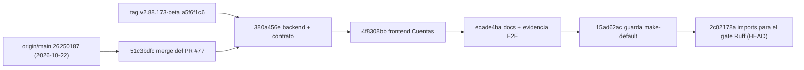

# Verificación de grafo y cierre del gate Ruff (2026-10-31)

> Alcance: decidir si procedía abrir un PR nuevo para el cierre funcional de **Cuentas** (CTA-D1…CTA-D10) y reparar el gate **Ruff** que el `push` de `15ad62ac` dejó en rojo en el CI.
> Rama: `fix/059-060-proveedores` · HEAD `2c02178a` · `2.11.173-beta` · **sin PR, sin tag `.174` y sin Release**.
> Docs de referencia: [Seguimiento — Cuentas: muestra y configuración](./seguimiento-ui-cuentas-muestra-config-2026-10-31.md), [Integración Cuentas / Perfil inversor](./integracion-cuentas-perfil-fiscal-2026-10-30.md).
> Evidencia: [`evidence/cuentas-muestra-config-2026-10-31/`](./evidence/cuentas-muestra-config-2026-10-31/), en particular [`ruff.txt`](./evidence/cuentas-muestra-config-2026-10-31/ruff.txt) (regenerado en este cierre).

Este documento es un **registro de verificación y reparación**. No certifica el sello ni autoriza operación: el tag `.174` sigue sin autorización expresa.

---

## 1. Qué se pidió y qué se encontró

El trabajo de Cuentas quedó publicado en `fix/059-060-proveedores` con HEAD `15ad62ac`, y la instrucción fue comprobar el grafo y las diferencias **antes** de abrir otro PR. La comprobación descartó el PR y, de paso, destapó un rojo real en el CI que la evidencia local no había detectado:

| Comprobación pedida | Resultado |
|---|---|
| Que `15ad62ac` contenga los cuatro commits esperados | Sí: `380a456e` → `4f8308bb` → `ecade4ba` → `15ad62ac`, sobre la base integrada `51c3bdfc` |
| Comparar la rama con `main` | `origin/main` es **ancestro estricto**; la rama va **136 commits** por delante (596 ficheros, +71.279 / −2.576) |
| Qué queda pendiente de integrar | Nada de Cuentas: el PR #77 ya fusionó la rama de integración; lo pendiente es el **sello `.174`**, bloqueado |
| Rama destino correcta | **Ninguna**: no hay PR que abrir sin duplicar el #77 o sin arrastrar 136 commits ajenos al expediente |
| Gate que el push debía dejar verde | **Ruff rojo** (job `quality`, run `41234889187`): 8 I001 en 7 ficheros, todos del propio cambio |

---

## 2. Grafo y relación entre ramas



| Ref | Tip | Relación con HEAD (`2c02178a`) |
|---|---|---|
| `origin/main` | `26250187` (2026-10-22) | Ancestro estricto. **No** contiene ni `v2.88.170-beta` ni posteriores |
| `origin/integracion/cuentas-perfil-2026-10-30` | `51c3bdfc` | Ancestro estricto. Es el **merge commit del PR #77** |
| `fix/059-060-proveedores` (local y remota) | `2c02178a` | HEAD, sincronizadas |
| `v2.88.173-beta` | `a5f6f1c6` | Tag vigente; HEAD va **17 commits** por delante |

**PR #77** (consultado, no asumido): base `fix/059-060-proveedores`, head `integracion/cuentas-perfil-2026-10-30`, estado `MERGED` el 2026-10-31T17:39:44Z, merge commit `51c3bdfc`. Como la rama de integración ya apunta a ese mismo commit y es ancestro de HEAD, **un PR contra ella sería vacío**.

**PR contra `main`**: posible técnicamente y equivocado como vehículo. En un solo diff mezclaría 059-060 (proveedores), 061 (`FK RESTRICT`), el bloque fiscal-comisiones, Cuentas, el pin `ruff==0.16.2` y el cierre del drift de esquema 060. La rama es la línea de sellos, no una rama de expediente: el mecanismo de publicación de este proyecto es el sello con tag y Release, que sigue bloqueado.

`main` local tiene además 3 commits (`815ed4d0`, `11a52fbe`, `6f4a6e4c`) no publicados en `origin/main` y ya contenidos en HEAD; no forman parte de este expediente.

---

## 3. Los commits del cierre

| # | Hash | Mensaje | Papel |
|---|---|---|---|
| 0 | `51c3bdfc` | `fix(bd): una base con sync_settings sin sembrar no es un error de integridad` | Base integrada (merge del PR #77) |
| 1 | `380a456e` | `fix(cuentas): cierra escrituras en cuentas cerradas y resumen de lista (CTA-D5, CTA-D10)` | Backend + contrato |
| 2 | `4f8308bb` | `fix(cuentas): ficha por cuenta, errores honestos y activacion del asistente (CTA-D1...CTA-D9)` | Frontend |
| 3 | `ecade4ba` | `docs(cuentas): seguimiento y evidencia E2E 2026-10-31` | Documentación + evidencia |
| 4 | `15ad62ac` | `fix(cuentas): make-default rechaza cuentas cerradas con 409 account_closed` | Guarda de la última laguna |
| 5 | `2c02178a` | `style(cuentas): ordena imports para el gate Ruff con --config (8 I001)` | Reparación del gate (este cierre) |

---

## 4. El incidente: el push dejó el Python CI en rojo

Run [`41234889187`](https://github.com/jvelasca/Bolsa_V1/actions/runs/41234889187) sobre `15ad62ac`, job `quality`, step **Ruff**: 8 errores, todos I001, todos corregibles:

| Fichero | Línea | Bloque |
|---|---|---|
| `apps/api-python/src/bolsa_api/api/v1/routes/accounts.py` | `3:1` y `615:5` | imports de módulo y `select` local |
| `apps/api-python/src/bolsa_api/api/v1/routes/investor_profiles.py` | `3:1` | imports de módulo |
| `apps/api-python/tests/test_accounts_closed_guard_pg.py` | `79:5` | imports dentro del fixture `api` |
| `packages/py/application/src/bolsa_application/accounts/summary.py` | `3:1` | `collect_report_inputs` fuera de su sección |
| `packages/py/application/tests/test_list_account_summaries.py` | `3:1` | imports de módulo |
| `packages/py/infrastructure/.../repositories/account_repository.py` | `3:1` | `sqlalchemy` tras los `bolsa_*` |
| `packages/py/infrastructure/.../repositories/investor_profile_repository.py` | `3:1` | `bolsa_domain` antes de `sqlalchemy` |

**No son deuda preexistente.** `git blame` sobre `15ad62ac` atribuye los imports que rompen el orden a `380a456e` (2026-10-31): `from bolsa_domain.errors import AccountClosedError` en `account_repository.py:18`, `accounts.py:11`, `investor_profiles.py:18`, y `from bolsa_application.accounts.tax import collect_report_inputs` en `summary.py:22`. Los seis ficheros restantes siguen la misma estela de los commits de Cuentas. Es decir: el cambio introdujo los 8 avisos y el gate es bloqueante, así que dejarlo rojo no era una decisión de alcance, era un CI caído.

### 4.1 Por qué el verde local era falso

El step del CI invoca:

```bash
uv run ruff check packages/py apps/api-python --config pyproject.toml
```

El `--config pyproject.toml` no es cosmético: es lo que aporta `known-first-party` (`bolsa_ai`, `bolsa_analytics`, `bolsa_api`, `bolsa_application`, `bolsa_domain`, `bolsa_infrastructure`, `bolsa_market`) y `select = ["E","F","I","UP","B"]`. El `ruff.txt` que se había guardado como evidencia recogía la salida de `ruff` **sin** ese flag (fichero UTF-16 con códigos ANSI y la única línea `All checks passed!`), de una invocación que no es la del gate.

Reproducido en local, misma versión (`ruff 0.16.2`, el pin que el CI verifica en el step *Ruff version guard*):

| Invocación | Resultado |
|---|---|
| `ruff check packages/py apps/api-python --config pyproject.toml` | **8 errores (I001)** |
| `ruff check <los 7 ficheros>` (sin `--config`) | `All checks passed!` |

### 4.2 Efecto colateral

Al caer el primer step del job `quality`, **`Import-linter`, `Mypy` y `Pytest` no llegaron a ejecutarse** sobre `15ad62ac`: el CI no midió nada de lo que vino después. Y `contract:check` solo existe en `release-tag-ci.yml`, así que tampoco había corrido nunca contra `15ad62ac`. El "gate limpio" del dictamen anterior no era reproducible tal cual.

---

## 5. La corrección

Un único commit que solo reordena imports, ejecutado con la invocación exacta del gate:

```powershell
.venv\Scripts\ruff.exe check <los 7 ficheros> --config pyproject.toml --fix
```

- `2c02178a`: 8 ficheros, **+35 / −37**. El diff es exclusivamente reordenación de bloques de import; ninguna línea de lógica cambia y no se añade ningún `noqa`.
- Comprobación de que reordenar no rompe nada: import en frío de `bolsa_application.accounts.summary`, `account_repository` e `investor_profile_repository` (el caso de riesgo era subir `collect_report_inputs` por encima de los imports de infraestructura) y `pytest` de los tests afectados offline: **36 passed**.
- `docs/engineering/evidence/cuentas-muestra-config-2026-10-31/ruff.txt` se **regenera** con `npm run lint:py` (idéntico al step del CI) y declara en su cabecera por qué se regeneró y que la versión anterior no era válida como evidencia.

---

## 6. Gates medidos

Locales, con los comandos del CI (no con invocaciones cómodas):

| Gate | Comando | Resultado |
|---|---|---|
| Ruff | `npm run lint:py` | `All checks passed!` (8 → 0) |
| Import-linter | `npm run imports:py` | `Contracts: 4 kept, 0 broken` |
| Mypy | `npm run types:py` | `Success: no issues found in 582 source files` |
| Contract check | `npm run contract:check` | `contract:check OK` |
| Pytest (afectados) | `pytest test_list_account_summaries.py test_schemas_accounts.py` | 36 passed |

CI sobre `2c02178a`:

| Run | Workflow | Resultado |
|---|---|---|
| [`41236648769`](https://github.com/jvelasca/Bolsa_V1/actions/runs/41236648769) | Python CI | `success`; jobs `quality`, `lifecycle-pg`, `paper-forward-pg`, `grammar-discovery-pg`, `auto-v2-durable-pg` en verde |
| [`41236648795`](https://github.com/jvelasca/Bolsa_V1/actions/runs/41236648795) | Fase 2 scientific | `success` |
| [`41236648825`](https://github.com/jvelasca/Bolsa_V1/actions/runs/41236648825) | Optimize lab | `success` |

Dentro de `quality` se ejecutaron y pasaron, por fin sobre este HEAD: `Ruff version guard`, `Ruff`, `Import-linter`, `Mypy` y `Pytest`.

`Frontend CI` **no se disparó**, y es correcto: su filtro de `paths` no incluye `apps/api-python/**` ni los paquetes Python tocados, y este push no cambia ningún fichero de `apps/web/**` ni `packages/shared/**`. El último Frontend CI verde sobre contenido frontend es el de `15ad62ac`.

---

## 7. Estado consolidado

| Elemento | Estado |
|---|---|
| Rama local y remota | Sincronizadas en `2c02178a` |
| Commits publicados | 5 sobre la base integrada `51c3bdfc` |
| Push | `15ad62ac..2c02178a` |
| Working tree | Limpio |
| PR nuevo | **No creado** (ni contra la rama de integración ni contra `main`) |
| Tag `v2.88.174-beta` | **No creado** |
| Release .174 | **No creada** |
| Versión vigente | `2.11.173-beta` (raíz) |

Sobre el E2E: la evidencia de **90/90 conserva su procedencia `4f8308bb`** y no se ha repetido sobre `2c02178a`. No se le atribuye. El commit nuevo no toca comportamiento (solo orden de imports), pero eso es un argumento, no una medición: si el sello lo exige, el recorrido se repite antes de autorizarlo.

El commit que publica este documento es **docs-only**. Ni `python-ci.yml` ni `frontend-ci.yml` lo disparan (sus filtros de `paths` no incluyen `docs/**`), así que el SHA medido por CI para el código sigue siendo `2c02178a`: publicar la nota no mueve la medición.

---

## 8. Correcciones a lo declarado en la revisión previa

| Declarado | Medido |
|---|---|
| "Ruff: 4 I001 preexistentes declarados" | **8 I001**, y **no** preexistentes: introducidos por `380a456e` en los ficheros de este mismo cambio |
| "La deuda Ruff queda correctamente separada del cambio funcional" | No procedía separarla: el gate era bloqueante y el CI quedó rojo. La deuda a separar era la de publicación (sello), no la de lint |
| "Gate limpio" (implícito en el dictamen) | Solo es cierto a partir de `2c02178a`, con `quality` completo ejecutado (Ruff, Import-linter, Mypy, Pytest) |
| "Sin push, sin PR" (docs de Cuentas) | El push existe desde este cierre; el PR sigue descartado por grafo, no por omisión |

El dictamen **funcional** de Cuentas no cambia: los 12 expedientes y la guarda de `make-default` sobre cuenta cerrada siguen avalados por sus pruebas y por la integridad del default verificada con PostgreSQL. Lo que cambia es el estado **operativo** del gate.

---

## 9. Deuda y límites (sin cambios de alcance)

- **Sello `.174`**: no autorizado. Sin `push` adicional, sin tag y sin Release.
- **E2E 90/90**: procedencia `4f8308bb`; no repetido sobre el HEAD actual.
- **`contract:check` en CI**: solo corre en `release-tag-ci.yml`. En local está verde sobre este árbol; no hay run en la nube para este SHA hasta que se dispare el workflow del sello.
- **CTA-D7**, paginación del ledger, `api.ensureDefaultInvestorProfiles` sin llamadores (AUD-02): igual que en el seguimiento de Cuentas.
- **Trazabilidad de los 18 envoltorios `getPortfolio`**, manifiesto de hashes y degradación de Redis/worker ARQ: deuda documental/operativa ya declarada, fuera de este expediente.

---

## 10. Bitácora

| Paso | Hecho |
|---|---|
| 1 | Comprobación de grafo: `origin/main` e `integracion/cuentas-perfil-2026-10-30` son ancestros de HEAD; PR #77 fusionado con merge commit `51c3bdfc`. |
| 2 | Descartado el PR contra la rama de integración (vacío) y contra `main` (136 commits, 596 ficheros ajenos al expediente). |
| 3 | Detectado el rojo del run `41234889187`: 8 I001 atribuidos por `blame` a `380a456e`, no deuda preexistente. |
| 4 | Reproducido el falso verde: `--config pyproject.toml` es lo que cambia el resultado. |
| 5 | `ruff --fix` con la invocación del gate; diff de solo imports (`+35 / −37`) y smoke de imports en frío. |
| 6 | `ruff.txt` regenerado con `npm run lint:py` y motivo declarado en el propio fichero. |
| 7 | Gates locales: Ruff, Import-linter (4 kept), Mypy (582 ficheros), `contract:check`, 36 tests. |
| 8 | Commit `2c02178a` y push; CI verde en Python CI (5 jobs), Fase 2 scientific y Optimize lab. |
| 9 | Este documento. |
