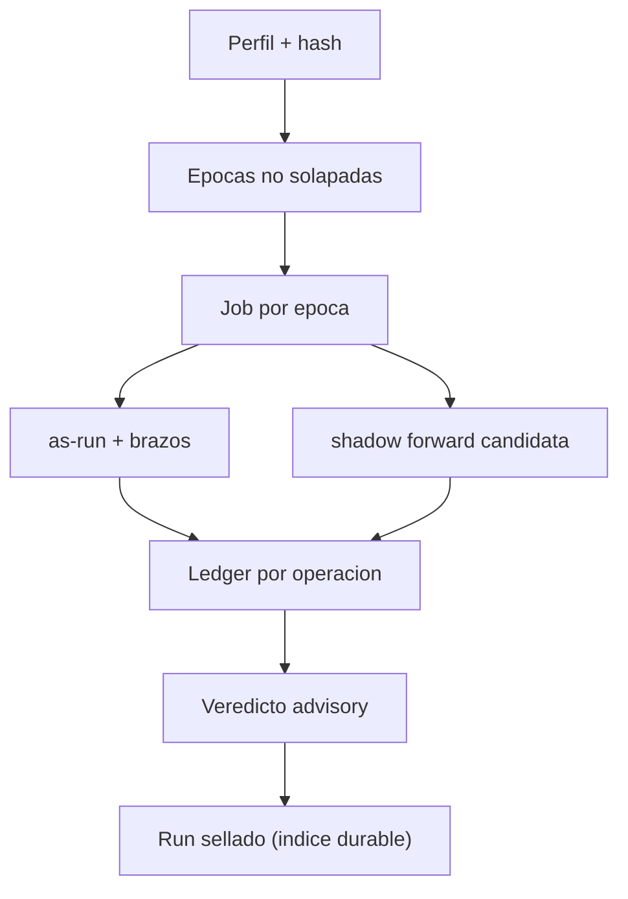

# Verificación periódica de estrategia — método, límites y niveles de evidencia

**Fecha:** 2026-11-14
**Estado:** implementado, **advisory**, flags apagados por defecto.
**ADR:** [ADR-050](../adr/050-verificacion-periodica-estrategia.md)
**Piezas previas:** [DÍA-D as-run](./dia-d-as-run-2026-11-13.md) ·
[cohorte as-run](./cohorte-dia-d-as-run-2026-11-13.md) ·
[reparación del instrumento as-run](./reparacion-as-run-2026-11-13.md).

---

## 1. Qué pregunta responde (y qué no)

El as-run responde «si en D hubiéramos seguido la operativa que llevábamos, ¿qué habría pasado?».
La verificación periódica responde una pregunta distinta:

> **¿Seguimos con la estrategia correcta, y lo sabemos con muestras independientes?**

No responde «¿vamos a ganar?». Es **descriptiva**: explica la muestra, no el futuro. Un veredicto
`continue` no autoriza a operar; `activationAllowed` es `false` en el perfil, en el veredicto y en
todas las rutas HTTP.

---

## 2. Arquitectura

| Módulo | Rol |
| --- | --- |
| `strategy_verification_profile.py` | perfil pre-registrado + hash; sin él no hay medida comparable |
| `strategy_verification_cadence.py` | épocas `(D_k, D_{k+1}]`, solape, ventana móvil, muestra independiente |
| `dia_d_as_run.py` | ledger por ciclo, `unrealizedR`/`openPositions`, `candidate_forward` |
| `strategy_verification_candidate.py` | candidata point-in-time + shadow forward |
| `strategy_verification.py` | gates, veredicto, `measurement_hash` |
| `068_strategy_verifications.py` | tabla índice `strategy_verification_runs` |
| `strategy_verification_repository.py` | sellado idempotente y conflicto de medición |
| `strategy_verification_scheduler.py` | encola épocas completas |
| `auto_strategy_verification.py` | superficies HTTP |
| pestaña **Vigilancia** | veredicto, gates, épocas, serie y ledger filtrable |

### 2.1 Flujo



---

## 3. Perfil de verificación

`StrategyVerificationProfileV1` declara y hashea **antes** de medir:

| Bloque | Contenido | Regla dura |
| --- | --- | --- |
| `cadence` | `everyDays`, `anchorDay`, `rollingEnabled`, `rollingLookbackDays` | `everyDays >= 1` |
| `samples` | `minCohortSamples=12`, `minClosedCycles`, `epochsInVerdict` | `minCohortSamples >= 12` |
| `universe` | instrumentos declarados en D | vacío ⇒ perfil inválido |
| `arms` | `as_run`, `hold_structural`, `engine_params`, `cash`, `market_bh`, `candidate` | `as_run`/`cash`/`market_bh` obligatorios |
| `candidatePolicy` | `requirePointInTime` | `false` ⇒ perfil inválido (look-ahead) |
| `execution` | comisión, deslizamiento, spread, participación, gaps | round-trip > 0 |
| `thresholds` | `minExcessMeanR`, `minShareEpochsNotWorse=0.6`, `maxDrawdownPct`, TTL | fijados antes de medir |
| `decisionPolicy` | `allowAutoActivation` | `true` ⇒ perfil inválido |

El hash es determinista: mismo perfil ⇒ mismo `profileHash`; cambiar un umbral lo cambia.

---

## 4. Cadencia e independencia

- `epochs(profile, today)` produce `D_k` y la ventana `(D_k, D_{k+1}]`. La última queda `open` y no
  es muestra.
- `overlaps(a, b)` y `assert_non_overlapping(epochs)` comprueban la independencia en lugar de
  suponerla.
- `independent_samples(epochs)` solo cuenta épocas cerradas y no solapadas.
- Regla dura: **cualquier solape ⇒ `insufficient_independent_sample`, nunca PASS**.
- `build_rolling_window` produce la ventana móvil marcada `overlapping=True`; **no** entra al
  veredicto.

### 4.1 La matemática temporal que hay que declarar en la UI

| `everyDays` | 12 muestras tardan | Riesgo práctico |
| --- | --- | --- |
| 30 | ~12 meses | muchas épocas tendrán 0 ciclos |
| 7 | ~3 meses | más épocas vacías, menos potencia |

Hasta cumplir las 12 épocas cerradas el veredicto es `insufficient_sample`. No se baja el mínimo
para «llegar antes»: sería el mismo error que contar replays solapados.

---

## 5. Ledger por operación

Campos por ciclo (`AsRunOperationRow`): `arm`, `instrumentId`, `direction`, `quantity`, entrada
(`entryDay`, `entryPrice`, `structuralStop`, `target1`, `target2`, `riskPerUnit`), salida
(`exitDay`, `exitPrice`, `exitReason`, `deferred`), `daysHeld`, `grossR`, `netR`, `pnlCurrency`,
`feesCurrency`, `maeR`, `mfeR`, `capture`, `cycleId`, `reasonCodes`, `decisions[]`.

### 5.1 Dos ejes que no se colapsan

| `outcome` | Significado | | `decisionQuality` | Significado |
| --- | --- | --- | --- | --- |
| `win` | el ciclo terminó en positivo | | `consistent` | la acción siguió el plan y las reglas |
| `loss` | terminó en negativo | | `inconsistent` | la acción contradijo el plan o las reglas |
| `breakeven` | cerró ≈ plano | | `unmeasured` | no hay evidencia para juzgar la decisión |
| `open` | sigue viva al cierre | | | |
| `unmeasured` | no se pudo medir | | | |

Un `loss` + `consistent` es una **buena** decisión con mal resultado. Un `win` + `inconsistent` es
un acierto por saltarse el plan y no debe premiarse.

### 5.2 Posiciones abiertas

Van en `unrealizedR` y `openPositions` (marcadas a mercado, con `measured`/`reason`). **Nunca** se
suman al R realizado ni se imputan como 0.

### 5.3 Contraste honesto

| Comparación | Cómo |
| --- | --- |
| Misma entrada, salidas alternativas | `hold_structural` y `engine_params` comparten `cycleId` con `as_run` |
| Otra estrategia | ledger **paralelo** del shadow forward de la candidata |
| Cartera | `cash` y `market_bh` a nivel de época (`market_bh` en retorno %, no en R) |

---

## 6. Candidata point-in-time y shadow forward

- `CandidateVerificationProvider.snapshot(account_id, day)` devuelve la candidata conocida en `day`
  y su definición.
- `candidateAsOf > D` ⇒ `candidate_not_point_in_time`; sin versión ⇒
  `candidate_version_unavailable`; sin definición ⇒ `candidate_definition_unavailable`; fuera del
  universo ⇒ `candidate_outside_universe`; sin barras ⇒ `candidate_no_forward_bars`; fallo del
  motor ⇒ `candidate_forward_failed`.
- `run_candidate_shadow_forward` opera solo con barras **posteriores a D**, con el modelo de coste
  del perfil. `candidateForward` publica `measured`, `reason`, `barsUsed`, `firstBar`, `lastBar`,
  `trades`, `roundTrips`, `returnPct`, `maxDrawdownPct`, `winRate` y `barsHash`.
- Un hueco declarado no suma como 0 ni como muestra.

---

## 7. Gates y veredicto

| Gate | Qué exige |
| --- | --- |
| `method_certified` | `certify_cohort` sobre la cohorte |
| `independent_sample` | épocas no solapadas + mínimos |
| `as_run_vs_best_arm` | R medio mayor, bootstrap determinista favorable y ≥ 60 % de épocas no peores |
| `candidate_vs_as_run` | candidata medida en **todas** las épocas |
| `observed_health` | salud observada en `continue`; sin dato ⇒ `not_evaluated` |
| `version_integrity` | misma versión de estrategia/mandato en la ventana |
| `freshness` | evidencia dentro del TTL |

| Veredicto | Cuándo |
| --- | --- |
| `continue` | todos los gates aplicables en PASS |
| `watch` | evidencia insuficiente pero sin señal de abandono |
| `relab` | un brazo contrafactual domina de forma sostenida |
| `promote_requires_human` | gates en verde; exige aprobación humana (ADR-049) |
| `insufficient_sample` | menos de 12 épocas cerradas o ciclos insuficientes |
| `inconclusive_version_change` | la ventana cruza un cambio de versión |

`NOT_EVALUATED` **nunca** es PASS. `activationAllowed` es siempre `false`.

---

## 8. Identidad de medición y sellado

- `measurement_hash` se calcula sobre el contenido medido: **excluye** `hash`, `meta` y timestamps.
  Dos rejuegos idénticos del mismo perfil producen el mismo `measurementHash`; el `hash` del
  artefacto (que incluye `meta.generatedAt`) **no** sirve como identidad.
- `strategy_verification_runs` guarda `(account_id, profile_id, kind, day, to_day)` como clave
  natural única, más `measurement_hash`, `verdict`, `strategy_version` y `payload`.
- Mismo clave + misma medición ⇒ idempotente. Misma clave + otra medición ⇒
  `SealedVerificationRunConflictError`: una revisión de barras exige **identidad nueva**, no
  reescribir la historia.
- El JSON del artefacto sigue siendo la fuente de verdad; la tabla es el índice consultable.

---

## 9. Operación

### 9.1 CLI

```bash
python apps/api-python/scripts/v2_102_dia_d_as_run.py \
  --day 2026-01-05 --to 2026-02-27 \
  --universe AAA,BBB --verify-bars \
  --candidate-snapshot candidate.json
```

`--candidate-snapshot` construye las patas de la candidata; sin él, el brazo declara
`candidate_not_provided` y el `candidateForward` correspondiente.

### 9.2 API

| Método | Ruta | Qué hace |
| --- | --- | --- |
| GET | `/api/auto/strategy-verification/profile` | perfil pre-registrado o hueco declarado |
| GET | `/api/auto/strategy-verification` | último veredicto sellado + runs |
| POST | `/api/auto/strategy-verification` | recalcula y sella (409 si hueco o conflicto) |
| GET | `/api/auto/strategy-verification/history` | serie por `kind` (`epoch`/`rolling`) |
| GET | `/api/auto/strategy-verification/ledger` | ledger filtrable por brazo/instrumento/desenlace/calidad |
| GET | `/api/auto/strategy-verification/measurement-hash` | huella reproducible de un artefacto |

### 9.3 Settings

| Variable | Default | Efecto |
| --- | --- | --- |
| `STRATEGY_VERIFICATION_ENABLED` | `0` | apaga el scheduler |
| `STRATEGY_VERIFICATION_EVERY_DAYS` | `30` | paso entre anclas |
| `STRATEGY_VERIFICATION_ROLLING_ENABLED` | `1` | ventana móvil (historial) |
| `STRATEGY_VERIFICATION_ROLLING_LOOKBACK_DAYS` | `1` | tamaño de la ventana móvil |
| `STRATEGY_VERIFICATION_INTERVAL_SECONDS` | `3600` | cadencia del worker |

---

## 10. Niveles de evidencia

| Nivel | Qué significa | Cómo se declara |
| --- | --- | --- |
| **E0 — hueco declarado** | el dato no existe | `candidate_not_point_in_time`, `no_declared_universe`, `artifact_not_found` |
| **E1 — no medido** | existe el artefacto pero el brazo no midió | `measured=false` + `reason`; nunca 0 |
| **E2 — medido, no certificado** | la medición existe pero el método falla una condición | `certification.verdict = not_certified` + `reasons` |
| **E3 — medido y certificado, muestra insuficiente** | el método es válido pero no hay 12 épocas | `insufficient_sample` |
| **E4 — veredicto completo** | 12+ épocas independientes, gates aplicables evaluados | `continue`/`watch`/`relab`/`promote_requires_human` |

Regla: **un nivel bajo nunca se presenta como uno alto**. Un `NOT_EVALUATED` no es un PASS y un
hueco no es un cero.

---

## 11. Verificación implementada

| Test | Qué ancla |
| --- | --- |
| `test_strategy_verification_profile.py` | hash estable, umbrales rompen el hash, defaults literales |
| `test_strategy_verification_cadence.py` | bisiestos, ancla en festivo, mismo día, solape |
| `test_dia_d_as_run_ledger.py` | ledger por ciclo, `unrealizedR` separado, calidad ≠ resultado |
| `test_strategy_verification_candidate.py` | point-in-time, huecos declarados, shadow forward |
| `test_strategy_verification_gates.py` | un gate por caso, ventana con cambio de versión |
| `test_strategy_verification_scheduler.py` | dedupe por época, doble gate |
| `test_dia_d_as_run_scheduler.py` | universo declarado + `--verify-bars` en el payload |
| `test_auto_strategy_verification_routes.py` | perfiles, 409 de sellado, ledger filtrable, huella reproducible |
| `strategy-verification-panel.test.tsx` | `not_evaluated` ≠ PASS, R vivo separado, 409 declarado |

Criterios de aceptación cubiertos:

- mismo perfil + mismas entradas ⇒ mismo `measurement_hash`; `meta.generatedAt` no lo altera;
- ninguna cohorte con solape pasa a `certified`;
- `NOT_EVALUATED` nunca cuenta como PASS y `activationAllowed=false` en todas las rutas;
- candidata no point-in-time ⇒ hueco declarado, nunca medida;
- posiciones abiertas en `unrealizedR`, nunca sumadas al realizado;
- los artefactos as-run antiguos se siguen leyendo y certificando como hoy.

**Remedición y atribución de fallos.** Los recuentos, la corrección del «9 failed» caducado y la
causa raíz de cada fallo restante están en
[`verificacion-adr-050-2026-11-14.md`](./verificacion-adr-050-2026-11-14.md), junto con la checklist
de sello (no ejecutada). Ese expediente también documenta el bloqueante de sello ajeno a este ADR —los
golden de ciclo de vida, rojos al conectar la revalidación de precio en #116— y su cierre re-anclando
el escenario a la banda de ±2 %.

---

## 12. Límites declarados

- **Descriptivo, no causal.** La atribución explica lo ocurrido en la muestra.
- **La muestra manda.** Con `n < 12` épocas el veredicto es `insufficient_sample`; no se rellena.
- **Coste de cómputo.** N épocas × candidatas × brazos; el perfil acota candidatas y ventanas.
- **Revisión de datos.** Una corrección de barras cambia la medición: identidad nueva, run anterior
  intacto.
- **Sin edge demostrado.** La verificación no demuestra rentabilidad; solo dice si seguimos midiendo
  lo que creemos medir.
- **`AUTO` sigue OFF.** Nada de este sistema enciende workers ni autoriza dinero real.
